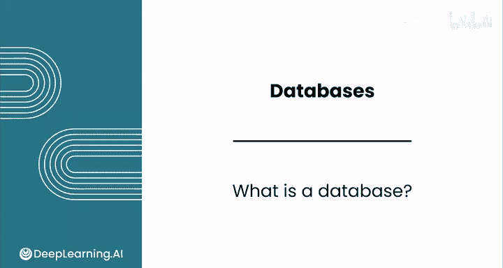
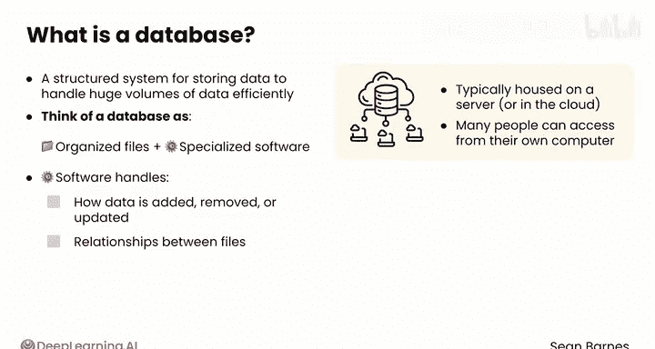
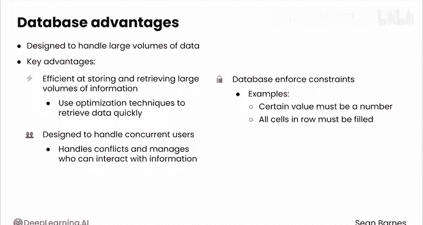
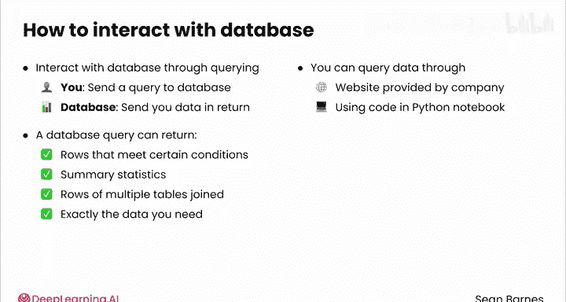
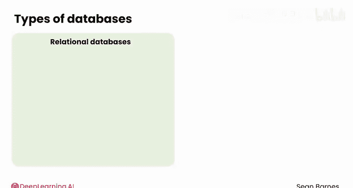
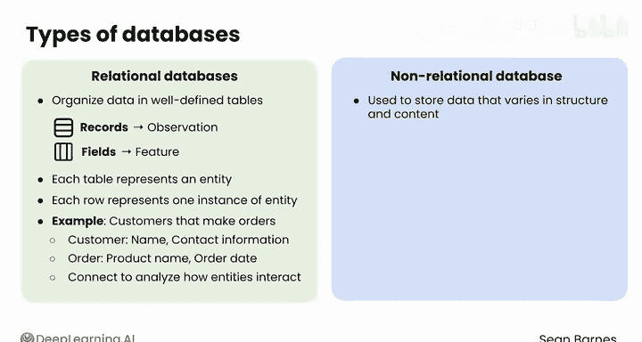

# 吴恩达《数据输入／输出与预处理（Python 和 SQL）Data I／O and Preprocessing with Python and SQL》中英字幕 - P42：41_数据库概念.zh_en - GPT中英字幕课程资源 - BV1sZEzzQEkF

Databases are universal in data analytics Let's take a look at what they are and how they work At its core。

 a database is a structured system for storing data that's designed to handle huge volumes of data efficiently。

 Think of a database as essentially a collection of organized files with a specialized piece of software attached That software handles how data is added。

 removed or updated from the files as well as manages the relationship between all the files。

 databases are typically housed on a server or in the cloud so that many people can access them from their own computer。

 but just like any other collection of files you can also store database on your own computer provided you have enough space。

 databases are specifically designed to handle large volumes of data so they have a few key advantages over spreadsheets and CSV files。

 First， databases are extremely efficient at storing and retrieving large volumes of information efficient here means fast。

 They use optimization techniques that allow you to retrieve data quickly。

 databases are also designed to handle multiple concurrent users。

 The software part of the database explicit。

Handles potential conflicts and dynamically manages who can interact with the stored information。

 Dataases also typically enforce constraints。 A constraint is a rule about how the data should be stored。

 For example， a constraint might enforce that a certain value must be a number or that all cells in a row must be filled with the value rather than missing。

 These constraints maintain data integrity。 Finally， databases model relationships。

 They can connect related information across different tables。

 which is difficult to do in a spreadsheet。 You briefly encounter this idea in a previous course when you saw how to use the spreadsheet function X lookup to grab data from another table that was related to the current one。

 It can be a pan。

You'll interact with a database through a process called querying。

 You'll send a query to the database and it will send you data in return。

 It's similar to the request response cycle you've gotten used to when scraping the web or using an API A database query can return rows that meet a certain condition it can return summary statistics or even rows of multiple tables joined together。

  Queries can actually get quite complex。 allowing you to request exactly the data you need。

 You'll write your first queries in the third lesson of this module。

 you can query a database through a website provided by your company or using code like in a Python notebook。

 you'll see both methods in this course。 databases can be broadly categorized into two main types relational and non-relational relational database is organized data into welldefined tables similar to spreadsheets with rows and columns representing records and fields record here is another term for observation and field is another term for feature。

 Each table represents an entity which is a fancy term for what you have observations of like customers orders products iguanas。

 each row represents one entity。

Sa that entity like one Igu。 for example， a business has customers that make orders。

 Custom and orders are two distinct entities。 data about each is collected and stored separately because customer details。

 for example， name， contact information etc， differ from order details。 For example。

 product name order date， but a database can connect these two concepts so that you can analyze how these entities interact。

 For example， tracking which customers made which orders relational databases are the most common type of database。

 but you'll sometimes see nonrelational databases。 nonrelational databases are typically use to store data that varies in structure and content because they don't use tables with fixed columns while they sacrifice some of the strict consistency of relational databases。

 they often provide better performance for high volumee data with a flexible structure。

 You're going to use databases a lot。 In the next video。

 you'll deepen your understanding of the software behind databases。 The database management system。

 I hope you'll join me there。😊。

