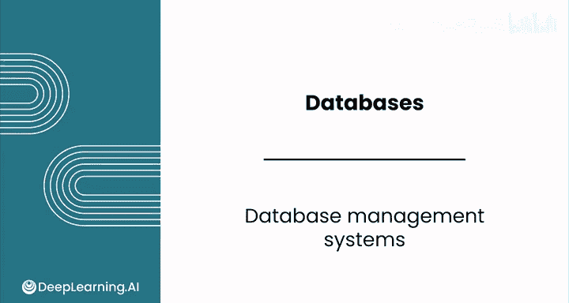
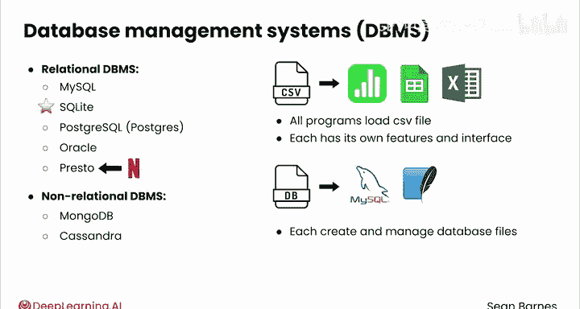
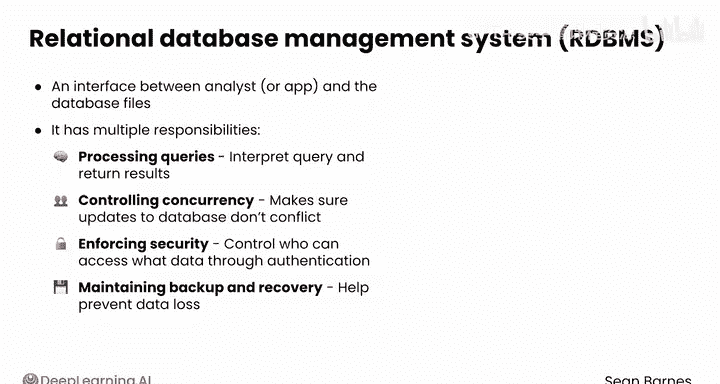
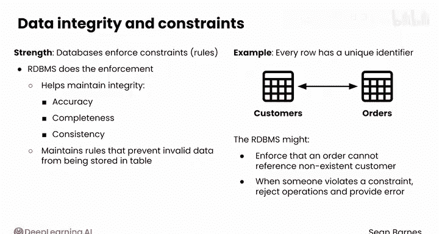

# 吴恩达《数据输入／输出与预处理（Python 和 SQL）Data I／O and Preprocessing with Python and SQL》中英字幕 - P43：42_数据库管理系统.zh_en - GPT中英字幕课程资源 - BV1sZEzzQEkF

In the previous video， you learn that databases are a collection of files and a piece of software that manages those files。

 The software component is called a database management system。

 Some common relational database management systems include MysQL， SQLL。

 Postgres SQL sometimes abbreviated Postgres， oracle and Presto you might also encounter nonrelational database management systems like Mongo Db and Cassandra。

 Fun fact， a Netflix we use Presto。 This course uses SQLite。

 It can sometimes be hard to understand how these applications are different as a parallel。

 Think about the relationship between a CSv file and a program like numbers， Google sheets or Excel。

 The CSv file is like the collection of files stored by the database。

 All of these programs can load a CSv file， even though each program has its own features and interface。

 MysQL SQLL and these other database management systems are similar to numbers。

 Google sheets and Excel。 they each create and manage the database files and you're likely to encounter different ones at different companies。

😊。

The relational database management system also called RDBm is an interface between you as the data analyst or any application you're using and the database files。

 It has multiple responsibilities。 First， it processes queries。

 So when you want data from the database， you'll write a query and send it to the RDBm which will interpret that query and return the results。

 The RDBm also controls concurrency or multiple users interacting with the database at once。

 It helps make sure that simultaneous updates to the database don't conflict with each other。

 It's also responsible for security。 Control who can access what data often through authentication。

 and finally， it maintains backup and recovery mechanisms to help prevent data loss。

 You learn previously that one strength the databases is that they enforce constraints or rules about the data being stored。

 the RDBMS is the engine that actually does the， which helps maintain data integrity。

 you can think of data integrity as similar to data quality， accuracy。

 completeness and consistency being key dimensions。 The RDBMS maintains rules that prevent。

Vid data from being stored in a table。 For example。

 it might enforce the constraint that every row in a table has to have a unique identifier like a customer ID。

 Constraint can be quite complex as well。 For example。

 your database might model a relationship between customers and orders and the RGBMS might enforce the constraint that an order cannot reference a non-existing customer When someone tries to put data into the database that violates a constraint。

 the RGBMS will reject that operation and provide an error message。

 This enforcement is significantly more rigorous compared with spreadsheet data validation。

 which is often optional Great work learning about databases and database management systems。

 you've now learned the core concepts behind storing data in a database。

 Once you've completed the practice assignment， follow me to the next lesson to learn about database organization。

😊。

