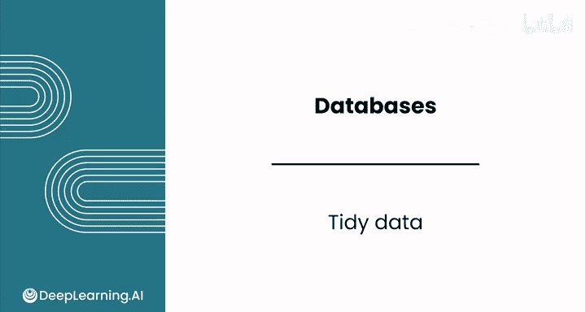
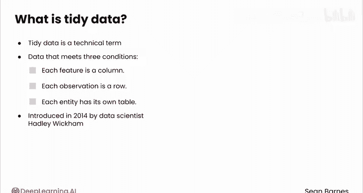
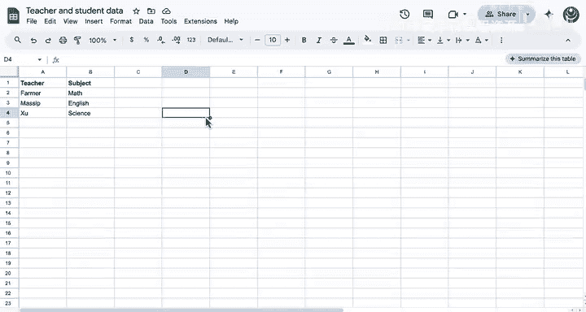
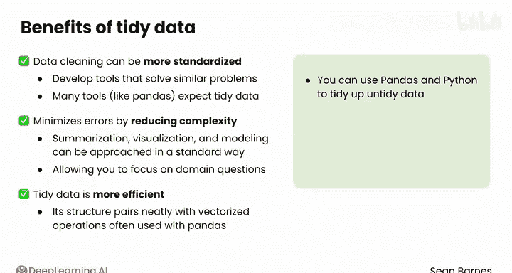

# 吴恩达《数据输入／输出与预处理（Python 和 SQL）Data I／O and Preprocessing with Python and SQL》中英字幕 - P44：43_整洁数据原则.zh_en - GPT中英字幕课程资源 - BV1sZEzzQEkF

Since you've been working with structure data for a while。

 you've likely developed an intuition for data that's well organized and data that isn't in this video。

 you'll formalize that intuition as the concept of tidy data。

 Take a look at this data about teachers and students on the left。

 you have different students and their scores in class as well as their attendance。

 then you have some teacher information here as well。

 And then some summary information at the bottom。 I want you to imagine what would happen if you were to use PD read CSv to read this data into a Python notebook and try to analyze it。

 It would be a struggle for a few related reasons。 Let's briefly break down the two key reasons why that analysis would be a pain。

 First， not all the information in each row corresponds to one observation。 For example。

 this row has information about both a student and a teacher So having the student and teacher data together isn't very helpful。

 Second， take a look at column C。 This column doesn't only contain one feature to start with you actually have two features stored in a single column。

 both a math and an English score。 but you also have some text as well。 the summary and student data。

😊，And some kind of average score at the bottom。 So not only is each row not an observation。

 but each column is not a single feature， and you have multiple entities。 both students and teachers。

 combined into the same table。 This is untidy data。 Although it sounds like a casual phrase。

 tidy data is actually a technical term。 tidy data refers to data that meets three conditions。 First。

 each feature is a column。 Second， each observation is a row。 and third。

 each entity such as students or teachers has its own table。

 The concept of tidy data was introduced in 2014 by a data scientist named Hadley Wickham while similar ideas had been floating around for some time。

 he was the first to succinctly define the idea of tidy data。

 2014 paper introduced in the idea starts with a famous line。

 It is often said that 80% of data analysis is spent on the process of cleaning and preparing the data。

 His aim was to define how to maintain data that is easy to analyze with these three rules。

 Here's another version of the teacher in student data。 This time separated into two tables。

 One for students and one for teachers。

T representing only one entity students， each row is one observation。 So one student。

 their math score， their English score and their attendance。 and each column is a feature Id name。

 math， English and attendance and the same for teachers each row is a teacher and each column is a feature。

 their name and their subject with the data structured this way is much easier to imagine using PD that reads CSv to import this data and then analyze it。

 you'd hardly have to do any preprocessing because now you can manipulate the columns in the rows the way you're used to rather than handling the haphazard structure of the untidy data like you saw a moment ago。

 tidy data has many benefits for pre-processing and analysis。 First。

 your data cleaning techniques can be more standardized because you can develop tools over time that solve similar problems without tidy data you'd likely have to adapt your data cleaning tools each time you get your hands on a new data set Many tools such as the pandas module also expect tidy data。

 Second， tidy data minimizes errors by reducing complexity when data is tidy summarization visualization。

And modeling can be approached in a standard way， which allows you to focus on domain questions rather than logistical data management issues。

 Finally， tidy data is more efficient。 It structure pairs neatly with the vectorized operations you have often used with pandas。

 While you can use pandas and Python to tidy up untidy data It's generally better to address these issues earlier in the workflow。

 Ily， data should be stored in a database in a tidy manner。

 If you're curious and would like to learn more about tidy data。

 I highly recommend the 2014 paper by Hadley Wickham。 tidy data is a fascinating concept。

 It's hard to believe such a simple concept was only formalized so recently。 as much as possible。

 you should enforce its principles in your work。 follow me to the next video to see how entities and attributes can be represented in a tidy database。

😊。

