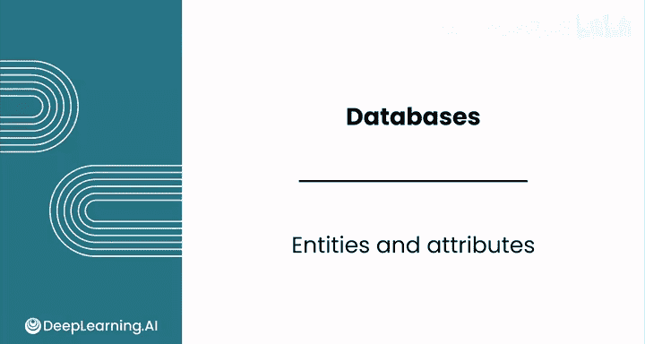
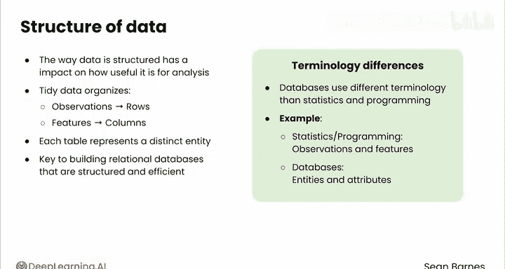
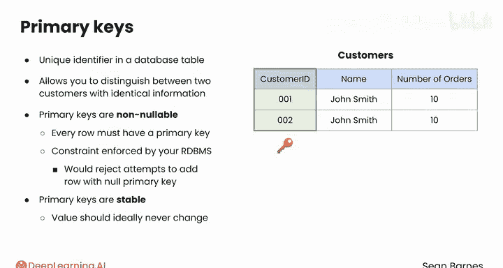
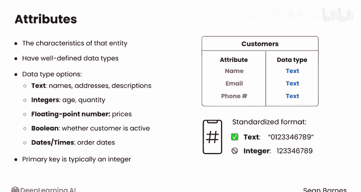

# 吴恩达《数据输入／输出与预处理（Python 和 SQL）Data I／O and Preprocessing with Python and SQL》中英字幕 - P45：44_实体与属性.zh_en - GPT中英字幕课程资源 - BV1sZEzzQEkF

In the last video， you learn how tidy data principles make it easier to analyze datas In this video。

 you'll take that a step further by learning how these principles apply to relational database entities and attributes The way data is structured including how it's categorized and linked together has a big impact on how useful it is for analysis  previously you learn how tidy data organizes observations and features into rows and columns creating a clear structure for analysis you also saw that each table should represent a distinct entity these ideas are key to building relational databases that are both structured and efficient you'll notice that databases use slightly different terminology from statistics and programming these three communities each evolved independently with distinct goals and purposes so they use slightly different language to describe similar concepts Rather than saying that databases are made up of observations and features you would say they have entities and attributes。

An entity represents a distinct thing in the world。 These could be tangible things like people。

 products or iguanaas or intangible ones like events or processes En are usually represented as tables in a relational database entities have two key constraints Each entity must be uniquely identifiable For example。

 let's say you have a customer table with multiple customers who all have the same name like John Smith without a unique identifier such as a customer ID it becomes impossible to distinguish between different John Smiths or track their individual transactions。

 Each table must have only one entity。 For example。

 your customer table should only have customers If you have a table that combines both customer details like name and email and order details like product name and quantity purchase you've created a mix of entities that can make the analysis more complex。

 Instead， customer data should be stored in one table and orders in another when customer data and order data need to be combined for example。

 to analyze how many different kinds of items were purchased by each customer you can use a special type of query to join the tables together temporarily but for stores。

Purpos to preserve tidiness，Custom and orders should be kept separate。

 The unique identifier in a database table is called a primary key。 For example。

Custom I and the customer table， while many customers can have the same name or number of orders。

 No two customers can have the same I。 The primary key allows you to distinguish between two customers with otherwise identical information。

 primary keys are nonnullable， which just means that every single row must have a primary key。

 This constraint would be enforced by your RDBm， and it would reject any attempts to add rows to your database with null primary keys。

 primary keys are also stable， which means their value should ideally never change。

 Custom I would likely never be updated unless they deleted their account and create an a new。

 En have attributes， the characteristics of that entity。

 you might think of attributes as features in a data。 For example。

 in a table of customers attributes might include name， email and phone number。

 just like in app pan's data frame。 the columns of a database。 each represent an attribute。

 attributes should ideally have well defined data types。

You've followed when working in Python， you should know what type of data each column contains。

 and it should all be one type。 Data type options are quite similar for databases compared with data frames。

 including text for names， addresses or descriptions integers for discrete numerical values such as age or quantity。

 floatingbo numbers for continuous numerical values like prices Booles for true false flags such as whether a customer is active and dates and times to capture temporal data like order dates。

 the primary key in a database is typically an integer you should carefully consider what type is best for stor a particular attribute。

 for example， a restoring phone numbers you might think that they should be stored as well numbers however it's actually common to store phone numbers as text phone numbers often have special characters like a plus for the country code。

 and if the phone number starts with a zero that number would disappear if the value is stored as an integer。

Once you've figured out the entities and attributes that belong in your database。

 you'll want to connect them up by forming relationships， followow me to the next video to see how。

