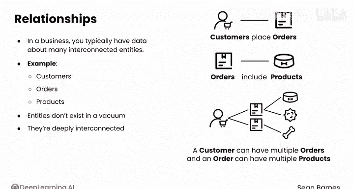
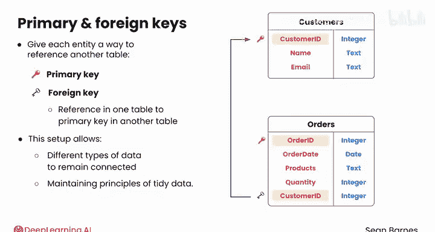
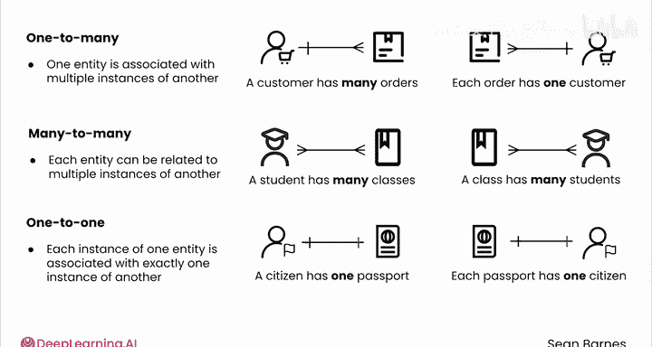
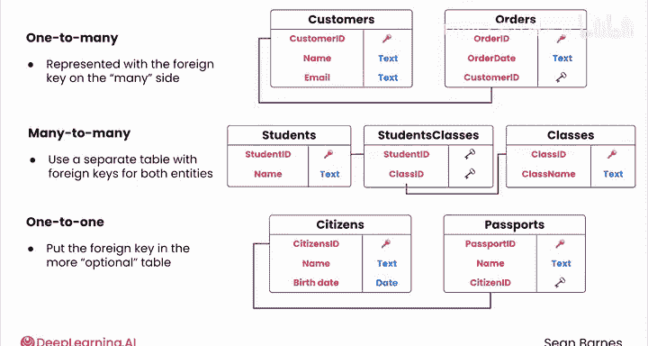

# 吴恩达《数据输入／输出与预处理（Python 和 SQL）Data I／O and Preprocessing with Python and SQL》中英字幕 - P46：45_关系型数据.zh_en - GPT中英字幕课程资源 - BV1sZEzzQEkF

One of the key strengths of databases is the ability to model relationships between entities。

 Let's take a look at how to do that In a business。

 you typically have data about many interconnected entities。 For example。

 you might track information about customers， orders and products。

 These entities don't just exist in a vacuum by themselves。 Rather， they're deeply interconnected。

 Customs place orders and each order contains specific products。 A customer can have multiple orders。

 and each order can have multiple products。 However， as you've seen。

 these different entities are stored in separate tables。

 How can a database effectively model these relationships。

The idea behind relationships is to give each entity a way to reference another table。

 Here's an example。 say you have a customer's table。

 Each customer is represented as a row with attributes like customer ID， name and email。

 The customer ID serves as the primary key You also have an orders table。

 Each order is represented as a row with attributes like order I order date， products and quantity。

 How could you link the order to the customer who place that order。

You can give the orders table a new attribute。Custom I。 Now。

 for each row representing an individual order， you have a reference to the customer's table that allows you to uniquely identify the customer who placed the order in the order table。

 order I is the primary key as you previously learned while customer I is called a foreign key。

 Its foreign because it's from a different table almost like a reference to a different land。

 Its purpose is to link the order back to the corresponding customer in the customer table。

 to summarize databases define relationships between entities using foreign keys。

 A foreign key is a reference in one table to a primary key and another table。

 This setup allows different types of data to remain connected while maintaining the principles of tidy data。

 This structure is beneficial for several reasons。 For example。

 let's say you try to store all this data in one large table。 For every order。

 you'd have to repeat customer details like name and email。

 along with product details like name and price。 This duplication not only waste storage。

 but also makes updates error。 For example， if a customer updates their。😊。

You only need to change at once in the customer's table and the updated information is instantly reflected wherever the customer is referenced。

 There are many kinds of relationships you can model using foreign keys。

 including one to many many to many and one to one one to many and many to many are quite common while one to one relationships are more rare。

 one to many relationships occur when one entity is associated with multiple instances of another。

 For example， a customer has many orders， but each order has just one customer。

 and many to many relationships。 Each entity can be related to multiple instances of another。

 For example， a student has many classes while a class has many students。

 many to many relationships are more complex to model one to one relationships occur when each instance of one entity is associated with exactly one instance of another。

 It's not as common as the other two types。 For example。

 each citizen has one passport and each passport has one citizen。

 These relationships are represented in databases using different arrangements of foreign keys。

 a one to many relationships is represented with the foreign key on the many side。

To represent that a customer has many orders， you could place a customer ID column as a foreign key in the orders table。

 The foreign key links each order to its customer， allowing the same customer ID to appear multiple times in the orders table to model many to many relationships。

 you use a separate table with foreign keys for both entities。 For example。

 if you wanted to model a many to many relationships between students and classes you could have the studentss table and classes table then have another table often called students classes Each row has a student ID and a class ID So each row represents a relationship between a student and a class the class the student has and the student in that class for one to one relationships it's common to put the foreign key in the more optional table for example。

 in the case of citizens and passports you should place the citizen I in the passports table since every passport has a citizen while not every citizen might have a passport This approach helps avoid null values for the foreign key your RDBMS will typically enforce referential integrity for foreign keys。

 which just means that they can't reference rows that don't exist。

Now that you're familiar with how relationships are represented in databases。

 you're ready to structure many tables in a database。

 follow me to the next video to learn about effective database design。

