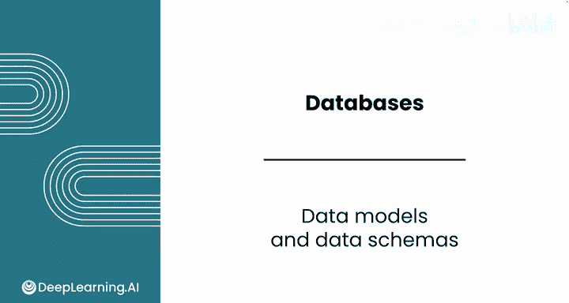
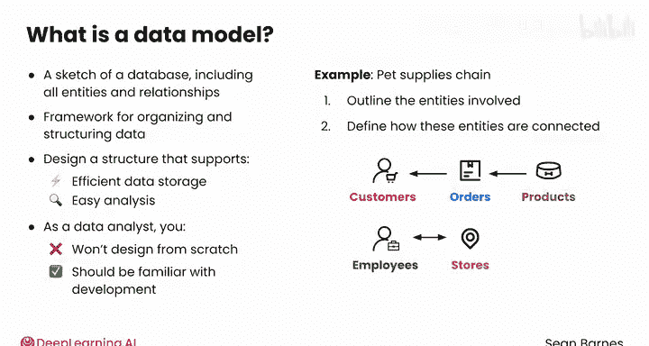
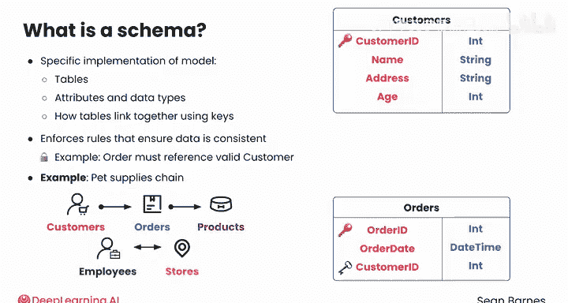
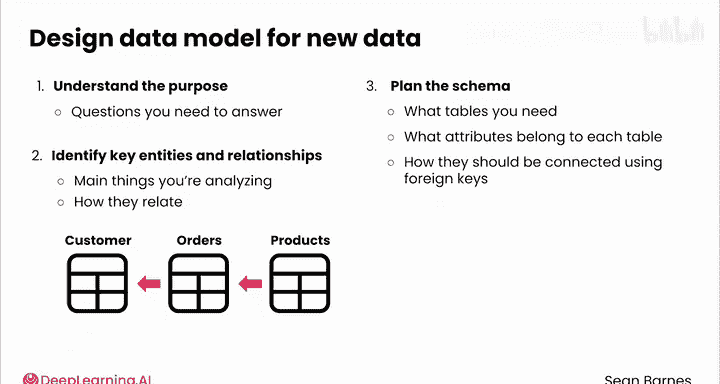

# 吴恩达《数据输入／输出与预处理（Python 和 SQL）Data I／O and Preprocessing with Python and SQL》中英字幕 - P47：46_数据模型与数据模式.zh_en - GPT中英字幕课程资源 - BV1sZEzzQEkF

Each database has its own unique structure， allowing you to access data about different entities and relationships。

 The database model and schema define this structure。 Let's take a look。

A data model is like a sketch of a database， including all the entities and relationships。

 It's a framework for organizing and structuring your data。

 but doesn't get specific about how that structure should be implemented in a database。

 The goal of a data model is to design a structure that supports both efficient data storage and easy analysis。

 As a data analyst， you won't typically design a data model from scratch。

 but you should be familiar with how it's developed so you can better communicate with your data engineers。

 As an example， let's say you're analyzing data from a pet supplies chain to construct a data model for the store。

 You'll first outline the entities involved。 The pet supplies chain might have customers， orders。

 employees， stores， products。 The list can go on。 large businesses typically have tens or even hundreds of entities。

 Next， you'll want to define how these entities are connected。 For example。

 a customer has many orders。 and order has many products。 a store has many employees。

 Maybe employees have many stores。 if they can work at any nearby store based on their availability。

 Once you've decided on the data model that helps you store key data for the business。😊。

You can think more about the specific implementation of that model。

 That's the data schema While a data model provides a sketch of your entities and relationships。

 the schema is the specific implementation of that model。

 including what tables you'll need what attributes each table has in their corresponding data types and how the different tables linked together using keys in practice。

 a schema enforces rules that ensure data is consistent。 For instance。

 you might require that every order must reference a valid customer。 For example。

 say you're working with the data from the pet supplies chain。

 your data model already specified that you should have five entities。 Custom orders， employees。

 stores and products and that you have the following relationships。 one to many customers to orders。

 one to many orders to products and many to many stores to employees。

 So your data schema would define each entity including its attributes。 For example。

 the customer table has an integer primary key customer I， a string name。

 a string address and integer age and so on。 The orders table might have an integer primary key order I a date time。

😊。

For the order date and an integer foreign key customer I that links to the customer table and so on。

 don't forget that for the many many relationship， you'd need a separate table with both foreign keys to link the other two tables together。

 Step back for a moment when designing the structure of your database first understand the purpose of storing all this data Think about the questions you need to answer with this data。

 remember that you're not just interested in a particular outcome like sales but also the context that enriches your story about sales。

 For example， if your goal is to analyze sales performance your data model should also include entities like customers orders and products make sure to identify key entities and relationships figure out the main things you're analyzing and how they relate example if your entities or customers orders and products your relationships would want to model the fact that customers place orders and that orders include products Finally plan the schema think about what tables you will need what attributes belong to each table and how they should be connected using foreign keys generative AI tools like a large language model can help brainstorm possible data。

Strucs or clarify questions about how to organize complex datas， For example。

 you can ask for suggestions for how to model complex relationships between entities in an upcoming video you'll see how to use a large language model in more detail Data models and schemas help ensure that your data is tidy before you go to the trouble of implementing the database itself you can also reference the schema as you're getting familiar with the database in the next video you'll learn about the different types of tables you'll encounter in a database。

