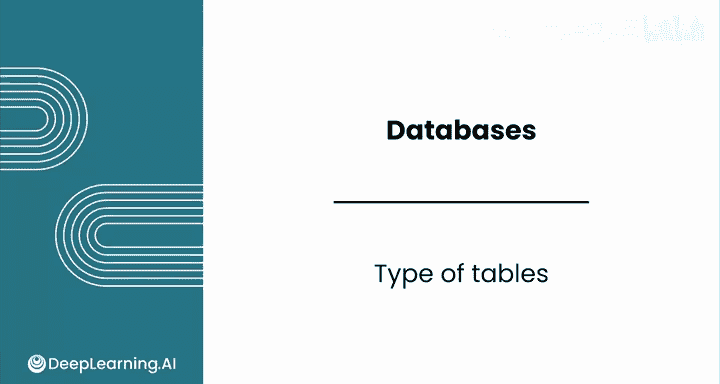
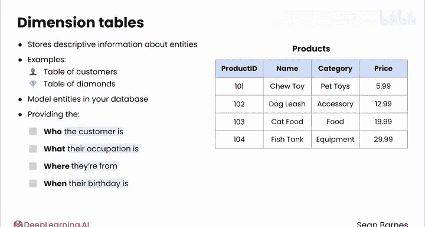
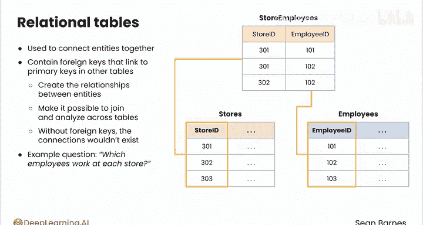
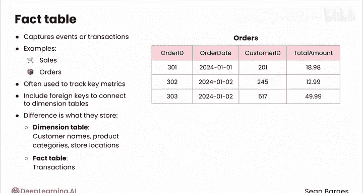
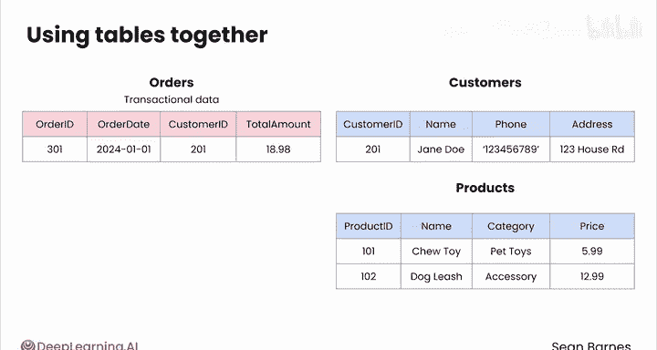

# 吴恩达《数据输入／输出与预处理（Python 和 SQL）Data I／O and Preprocessing with Python and SQL》中英字幕 - P48：47_表类型.zh_en - GPT中英字幕课程资源 - BV1sZEzzQEkF

As you've already seen with many to many relationships。

 not all tables serve the same purpose In this video。

 you'll learn the three main types of tables commonly used in databases。

 dimension relational and fact。 First of， a dimension table stores descriptive information about entities。

 Di table is a fancy term for the kindss of data tables you've been working with throughout this program like a table of customers or a table of diamonds。

 they model entities in your database。 It's called a dimension table because it adds context to a single entity type like dimensions add depth to a physical object。

 Think of it as providing the who， what， where and when that frame your analysis。 For example。

 who the customer is， what their occupation is where they're from or when their birthday is。

 For a pet supplies chain， One dimension table is the product table。

 which includes attributes like product I D， name， category， price and so on。

 These fields describe the products but do not store transactional data like when they were purchased or how many orders contain each one。

 This dimension table will help you answer a question like， what are the name。😊。

And prices of the products we sell Next， you have a relational table which is used to connect entities together。

 These tables always contain foreign keys that link to primary keys and other tables。

 The foreign keys are what create the relationships between entities making it possible to join and analyze data across tables without foreign keys the connections between entities wouldn't exist in the pet supply store you might have a table called stores employees It links employees to stores by storing store I a foreign key that links to the stores table。

 and employee I， a foreign key that links to the employee table。

 This relational table allows you to answer the question which employees work at each store。

Finally， you have a fact table which captures events or transactions such as sales or orders。

 Fact tables don't model individual entities like customers。

 but rather events that involve multiple entities like a sale。

 They are often used to track key metrics like sales or matches and sports。

 Fact tables include foreign keys that connect to dimension tables。

 The key difference between a dimension table and a fact table is what they store。

 A dimension table describes the details of an entity like customer names。

 product categories or store locations， a fact table is used for transaction。

 in the pet supplies store。 The order table is a fact table。 It includes data like order I。

 order date， customer I and total amount。 Each row represents an individual transaction。

 Fact tables answer questions like how much revenue do we generate from a specific order or how many units of a product were sold。

😊。

When combined in a database schema， these table types allow you to model your data in a way that supports complex analysis。

 For example， if you want to analyze total sales in the pet supply store。

 you would use the orders fact table to gather transactional data。

 use the customers and products dimension tables to add descriptive details about who made the purchase and what was sold。

Dimenssion， relational and fact tables help you organize your data to answer the right questions。

 speakingea of which it's time to test what you've learned so far in a practice assignment。

 Once you're done， follow me to the next lesson to learn how to query databases with SQL。

