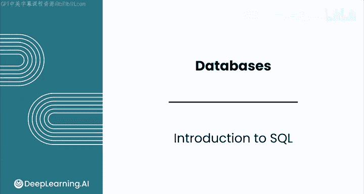
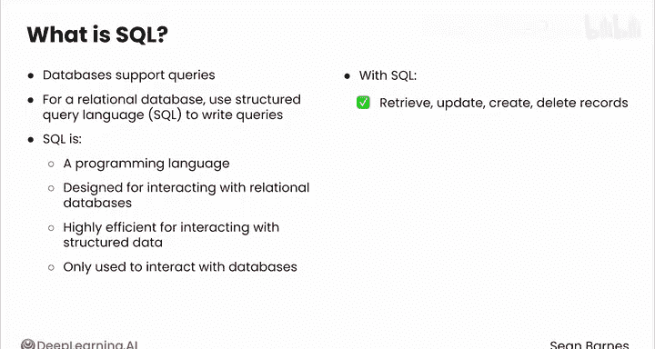
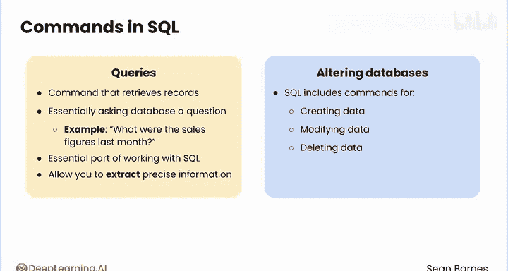
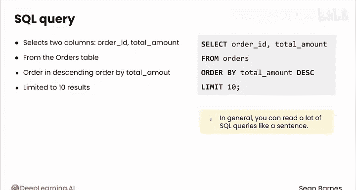
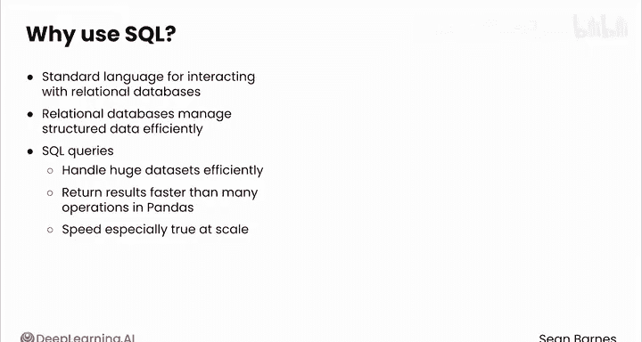
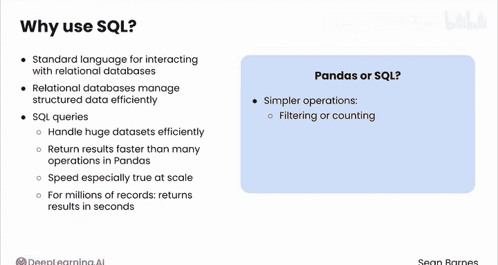
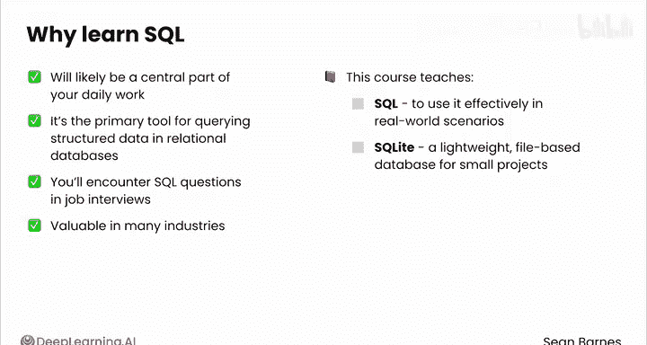

# 吴恩达《数据输入／输出与预处理（Python 和 SQL）Data I／O and Preprocessing with Python and SQL》中英字幕 - P49：48_SQL入门.zh_en - GPT中英字幕课程资源 - BV1sZEzzQEkF

So far， you've learned that a database provides a reliable way to store data Now。

 you'll take the next step by exploring how you can retrieve specific information from a database for analysis。

 You learned that an earlier lesson that databases support queries。

 similar to As  Queries will be your main interaction with databases as a database analyst for a relational database。

 you will typically use structured query language or SQL to write queries。

 SQL is a programming language designed specifically for interacting with datas stored in relational databases。

 You may hear people use both SQL or SQl， both are common。

 This specialized design makes it highly efficient for interacting with structured data。

 While a general purpose programming language like Python can perform a wide range of tasks such as statistical modeling or data visualization。

 SQL is only used to interact with databases with SQL， you can retrieve， update。

 create or delete records in a database， though you won't be running linear regression models with it。

 As you learned previously， a command that retrieves records is called a query。

 A query is essentially asking the database a question like what the。😊。

Fure last month and getting an answer backqueries are an essential part of working with SQL and allow you to extract the precise information you need for analysis aside from querying where you do not change any data within a database SQL also includes commands for creating。

 modifying or deleting data as a data analyst though your primary focus will be on retrieving data through queries altering the database by updating。

 creating or deleting records iss typically handled by database administrators or data engineers。

 especially in larger organizations Here's an example of a SQL query。

 Take a moment to look at it feel free to pause the video and see if you can guess what it does。

This query selects two columns of data。 order I and total amount from the orders table and orders the resulting rows in diss a order by the total amount。

 So you get the largest total amount at the top。 and this query is limited to just 10 results。

 in general， you can read a lot of SQL queries like a sentence。

 Select order I total amount from orders and order by total amount in diss a order and limit that to 10 results。

 You'll get more into the specifics of how to write SQL queries in the next video。

 SQL is the standard language for interacting with relational databases。

 Ma it a highly desirable skill for data analysts。 Relational databases have achieved broad adoption because of their ability to manage structured data efficiently。

 SQL queries handle huge data sets efficiently and return results much faster than many operations in pandas。

 This speed is especially true at scale。 In fact， even when working with millions of records。

 SQL queries can return results in seconds。 That said。

 depending on the operations you're trying to perform。 Either pandas or SQL may be the right choice。

 Sr operations like filtering or counting can often be more。😊。

Efficient with SQL， while more complex or custom calculations are more appropriate for your Python notebook。

As a data analyst， SQL will likely be a central part of your daily work。

 since it's the primary tool for querying structured data and relational databases。

 you'll encounter SQL questions and job interviews and also find it valuable in many industries that's why this course teaches SQL to make sure you're well prepared to use it effectively in real- world scenarios you'll use SQL light which is a lightweight filebased database that's perfect for small projects。

By mastering SQL， you're positioning yourselves to handle bigger data sets and more sophisticated tools。

 join me in the next video to see what SQL looks like in practice。

