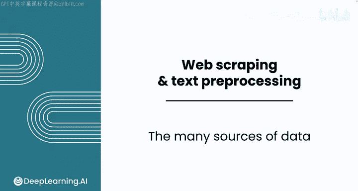
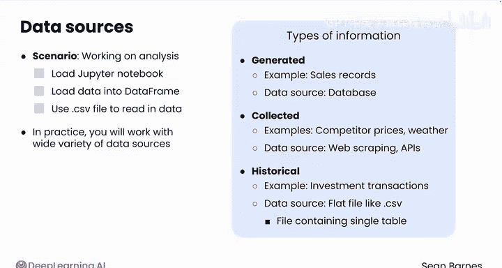
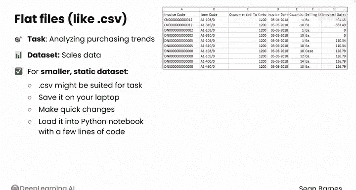
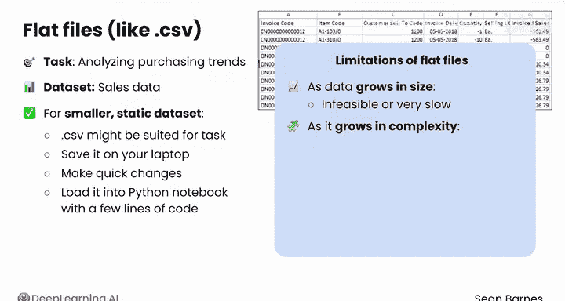
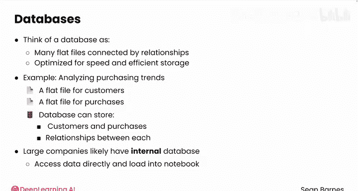
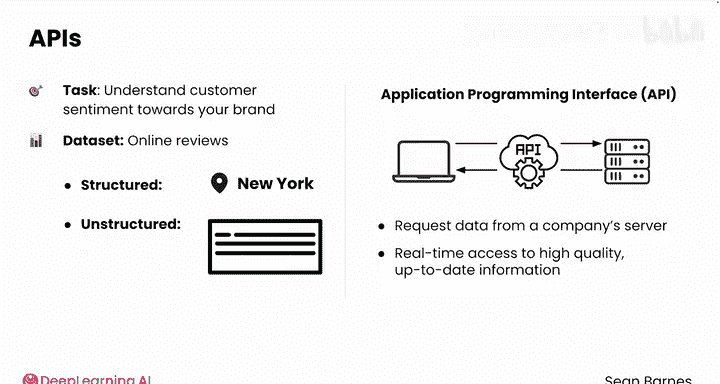
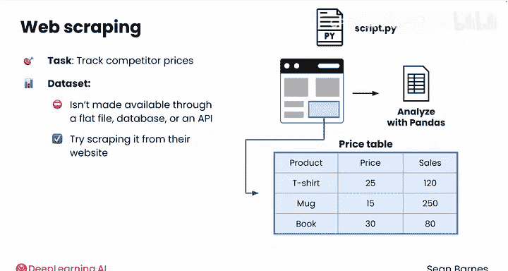

# 吴恩达《数据输入／输出与预处理（Python 和 SQL）Data I／O and Preprocessing with Python and SQL》中英字幕 - P4：3_多样化的数据来源.zh_en - GPT中英字幕课程资源 - BV1sZEzzQEkF

Businesses generate and collect lots of information every day。

 And depending on the problems that you as an analyst have to solve。

 you'll encounter data from different sources。 Let's say you're about to work on some analysis and you load up your Jupyter notebook。

 Your first step is typically to load your data into a data frame up until now you've used a Cv file to read in the data that works for many applications but in practice you will work with the wide variety of data sources not just cv files。

 Think about the different types of information you might have available for analysis。 First。

 information you generate like your sales records。 A Cv doesn't seem like the right place to store this information because as soon as someone makes a sale now your cv is out of date。

 you'll see in the coming modules that this type of data is typically loaded from a database。

 then you have information you collect in real time like monitoring competitor prices or keeping track of the weather this information can be acquired through scraping the web which you'll learn about in this module or through application programming interfaces or apis which you'll encounter in the next one and finally。

 you have historical information like your。😊。

Investment transactions from last year you'll likely load this information from a flat file like a CSV since it will not be updated anymore flatat filele just means a file containing a single table of rows and columns Let's examine a few common scenarios where you might work with data from each of these common sources。

 a flat file， databases， APIs and web scraping。

If you're analyzing purchasing trends from your customers， you'll likely rely on sales data。

 This data is structured， meaning it can be stored in rows and columns when you're just dealing with a smaller static data set。

 a CSV file might be perfectly suited to the task you can save it on your laptop。

 make quick changes and load it into your Python notebook with just a few lines of code。

But as data grows in size， storing it in a single spreadsheet may become infeasible or very slow to work with as it grows in complexity。

 you may need to store the data in multiple tables with relationships。

 you may also need to store and process unstructured data and as more people need to use and edit the file。

 you'll need to manage access databases address most of these shortcomings of flat fileses。

 you can think of a database as many flat files connected by relationships optimize for speed and efficient storage For example。

 say you're still analyzing purchasing trends from your customers you might have a flat file of customers and a flat file of purchases。

 A database can store these customers and purchases as well as the relationship between each customer and the purchases they' made a larger more established company is likely to have some type of internal database system you can access the data directly from the database and load it into your Python notebook allowing for analysis。

Now let's say you want to expand your purchasing trends analysis to better understand customer sentiment towards your brand This information customer sentiment might best be found in online reviews of your company These reviews are a mix of structured and unstructured data like the city where the reviewer was located and the raw text of their review respectively it's common for online review sites to provide a way for you and anyone else willing to pay to directly access this review data using an application programming interface or API an API allows you to request data directly through a company's server。

 which they provide for this purpose an API is useful to you because it provides realtime access to high qualityality up-to-date information collected by another platform。

Now let's say you want to track your competitor prices as part of your purchasing trends analysis。

 This data isn't made directly available by your competitors through a flat file database or an API。

 They won't make it easy for you if these other methods are unavailable to you you can try scraping it from their website This process of web scraping involves writing code to visit that website identify the parts you need like a pricing table and save that data into a structure format you can then analyze that data in the same way you would any other by loading it into a pan's data frame。

Data collected from all these sources， flat files， databases， APIs。

 and the web can all be loaded into your Python notebook for processing and analysis。

 depending on its source， the data will need different levels of preprocessing the steps you take before analysis follow me to the next video to see how。

