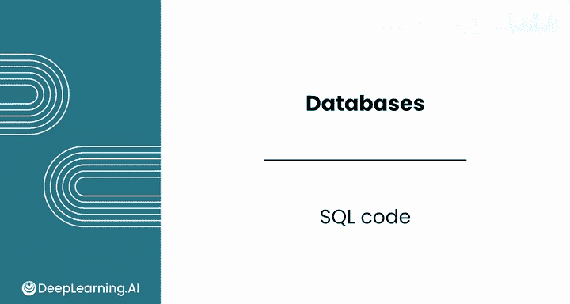
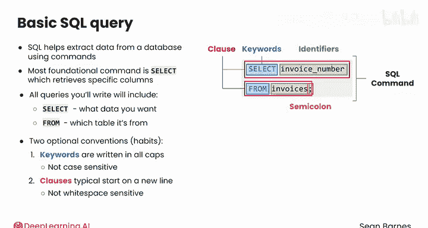
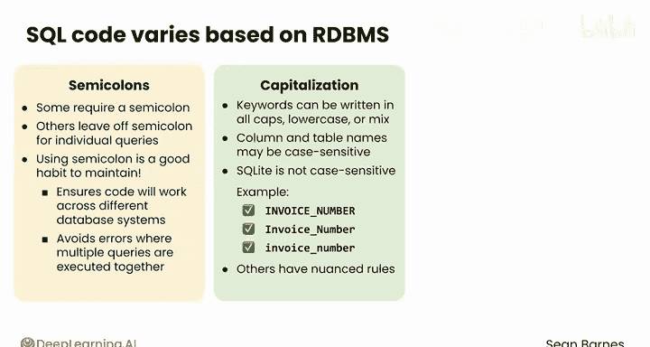

# 吴恩达《数据输入／输出与预处理（Python 和 SQL）Data I／O and Preprocessing with Python and SQL》中英字幕 - P50：49_SQL语句.zh_en - GPT中英字幕课程资源 - BV1sZEzzQEkF

So far， you've seen what SQL is for and how you might use queries in your work as a data analyst。

 Let's take a closer look at the anatomy of a SQL query。 As a reminder。

 SQL helps you extract data from a database by using commands that the database can understand the most foundational command of all queries is select。

 which allows you to retrieve specific columns from a database。 Here's an example。

 select invoice number from invoices。 Vi all queries you'll write。

 will include both select and from you're specifying what data you'd like and which table you'd like it from。

 Both select and from are called keywords。 Each keyword starts a clause or a part of the entire command。

 clauses often include identifiers。 The other part of the clause aside from the keyword Ientifiers are specific to the data you're working with and include information like the column or table names。

 And together， all these clauses make up this entire SQL command。 Finally。

 SQLqueries and in the semicolon。 There are two optional conventions or habits demonstrated in the SQL code as well。

 First， SQL keywords are typically written in all。😊。

To help distinguish them from the rest of your command。 It's just a stylistic choice， though。

 SQL keywords are not case sensitiveitive。 Some SQL interfaces will apply special formatting like bold or color to make the keyword stand out。

 You've already seen examples of this in your Jupyter notebook with Python code。 Second。

 clauses typically start on a new line。 This convention helps with readability。

 especially as your queries get longer and more complex。 However， SQL is not whitespace sensitive。

 So your line breaks， spaces and tabs don't affect your query。

 writing a query all on one line will still work， but it will be difficult to read。

 you can expand your SQL queries by adding more clauses， or by adding more specifics to each clause。

 you'll see more examples in the next video。😊，Different database management systems have slightly different conventions when writing SQL code。

 Some RDBMSss like MysQL require you to end each SQL query with a semicolon， others like SQL light。

 which you will use in this course are more flexible。

 allowing you to leave off the semicolon for individual queries。

 Still using a semicolon to close queries is a good habit to maintain。

 It ensures your code will work across different database systems and avoids errors in cases where multiple queries are executed together。

 you learned a moment ago that SQL is case insensitive for keywords like select and from those can be written in all caps all lowercase or a mix of the two。

 though all caps format is typically more readable。 However。

 column and table names may be case sensitiveitive depending on the RDBm。

 SQL light is not case sensitiveitive by default。 So if you're selecting invoice number you can write it like this and all caps or like this in title case。

 or all in lowercase and still get the same response。

 regardless of how the column name is stored in the database。 However。

 other RDBmss like Postgres have more new。😊。

Rules for case sensitivity。 you'll want to make sure you're following the conventions of the specific RDBMS you're using in SQL light。

 If you're working with a column name that contains a space like employee based name。

 you should enclose it in double quotes。 Other RDBMSss may have different rules。

 It's best to make sure your database has consistent capitalization and uses underscores rather than space is when possible。

 However， when you're working with the older system。

 you'll sometimes see column names that aren't formatted ideally。 Just like in Python。

 you can also write comments in SQL。 single line comments are written with two dashes。

 The dashes tell the computer to ignore any other text on that line and skip to the next line。

 writing comments in your SQL code helps you or others understand what the query is doing。

 Com are most important when your query is complex。 It's time to get hands on with SQL。

 follow me to the next video to start writing your own queries。

