# 吴恩达《数据输入／输出与预处理（Python 和 SQL）Data I／O and Preprocessing with Python and SQL》中英字幕 - P51：50_选择查询.zh_en - GPT中英字幕课程资源 - BV1sZEzzQEkF

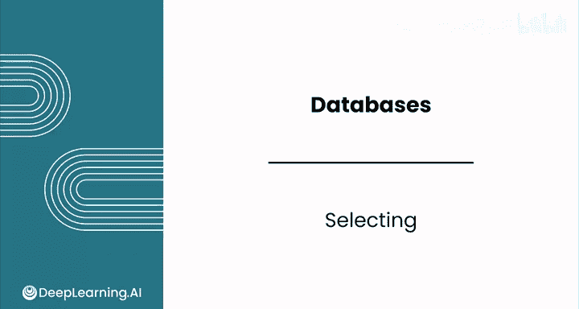

Now that you've seen the overall structure of a SQL query， you're ready to get handson practice。

 designing and writing SQL queries。 your role for this lesson will be that of a data analyst at a music streaming service。

 Your company recently acquired an oldcho digital music store that used to sell individual tracks online。

 The goal is to now integrate this new company's extensive music catalog into a bundled subscription service that gives people unlimited access to whatever tracks they want。

 you've been asked to perform exploratory data analysis on the acquired company' database。

 which uses SQLite。 your goal is to better understand the scope of the catalog。

 The database is extensive， containing dimension tables of music related entities， including artists。

 tracks and playlist， as well as business related entities， including customers。

 employees and invoices。 Before you start writing your queries。

 you should take a look at the database schema to see what data is available。 Otherwise。

 you won't know what identifiers are available for different tables and attributes。

 Here is the entity relationship diagram for the database you're going to work with。

 starting in the top left。 you have。😊。

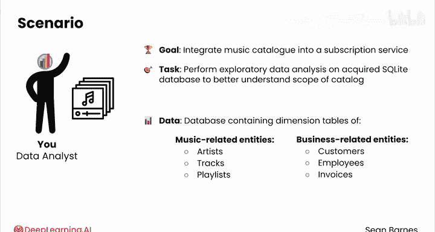

Table containing artist IDd and the name of the artist。

 you also have a relationship with the album table Since an artist has many albums。

 the foreign key is in the table on the many side of this relationship。 So every album has an I。

 a title and the I of the artist， which links it to the artist table。

 you also have many other tables like tracks， which has a lot more fields。

 including album I which corresponds to which album that track is on Note that an album has many tracks So the foreign key is in the tracks table。

 you also have media type I which is another foreign key genre I。

 which is another foreign key composer milliseconds and so on。

 So you have all these different tables available to you and you can use the entity relationship diagram to understand what attributes are available to you and how the tables are linked now that you know the layout of the database。

 you can check out the actual data the first few SQL queries in this course will be executed in this website interface which is very similar in format to many analytics applications that allow you to query a database directly。

 Since your goal is to better understand the music catalog。

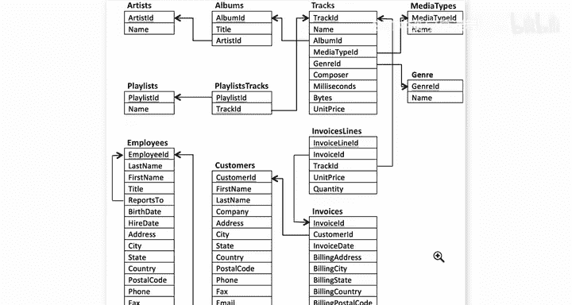

Your first step might be to select a few album titles。Start with select title from albums， limit 10。

 You're asking for the first 10 titles and the album table。 and you get the results back。

 These look like older albums rather than current hits。 You can also query tracks in the same way。

 You saw a moment ago that tracks has many more attributes to look at。

 you can get multiple columns at the same time by separating each column name with a comma。

 For example， select name， milliseconds， unit price from tracks and limit 10。

 Now you get multiple columns for each track。 Looks like they were all 99 cents。

 but varied in length from 203000 milliseconds up to 375000 That's over 6 minutes。

 Notice that unit price is written without spaces。 But with each word capitalized。

 What do you think would happen if you were to put a space here accidentally。

 that query wouldn't execute properly， The result is empty。 However。

 if you have unit price in all caps， that works totally fine。 Since SQL light is not key sensitive。😊。

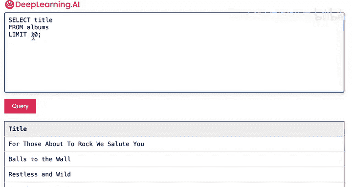

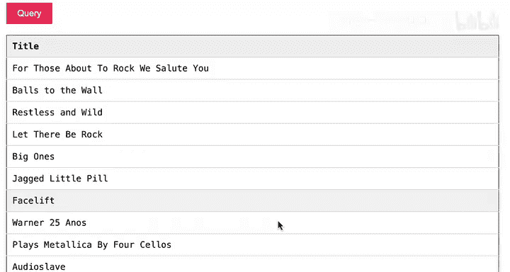

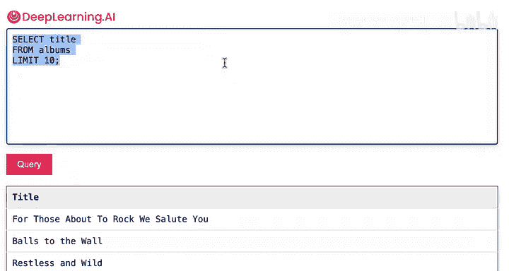

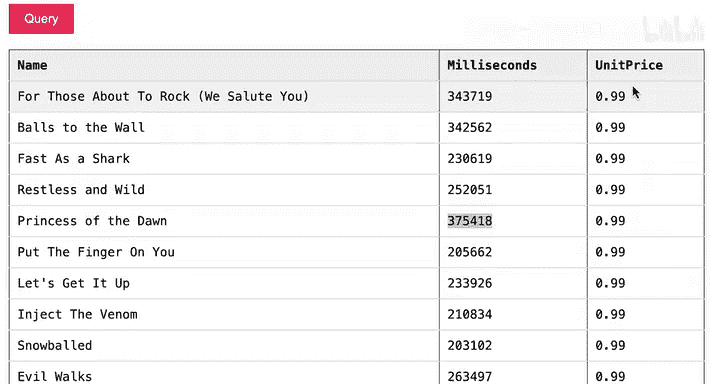

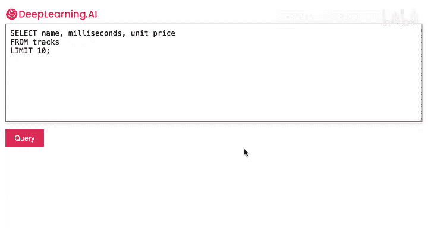

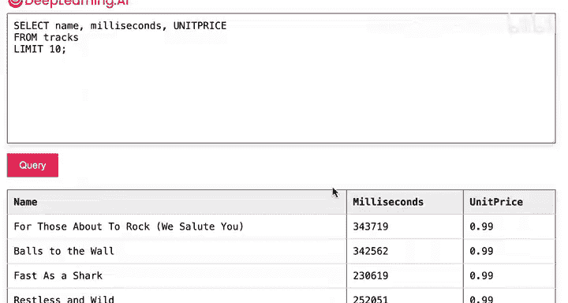

I encourage you in the upcoming practice items to play around with spacing， capitalization。

 commas and semicollonons to better understand what works and what doesn't。

 If you don't have the entity relationship diagram on hand。

 or if you just want all the information in the table， you can use the select all shorthand。

 which is written as select star or asterisk。

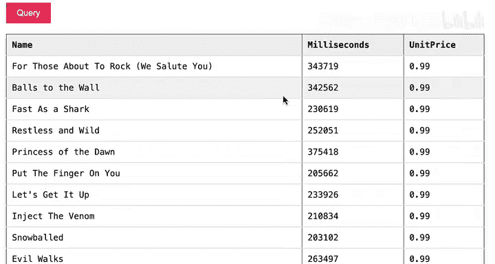

That query looks like select star from tracks limit 10。

 Notice that you have the same tracks as before for those about to rock and so on。

 But you just have more information。 Select all is convenient。

 You saw earlier in the entity relationship diagram that there are many foreign keys in the tracks table。

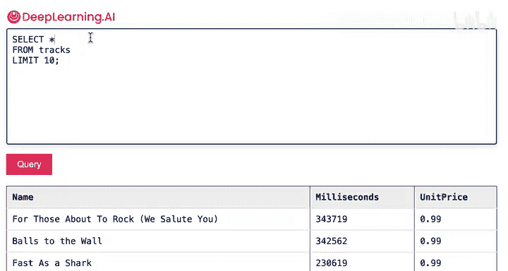

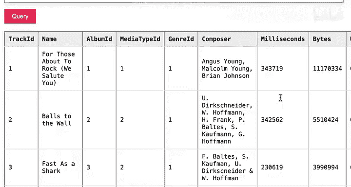

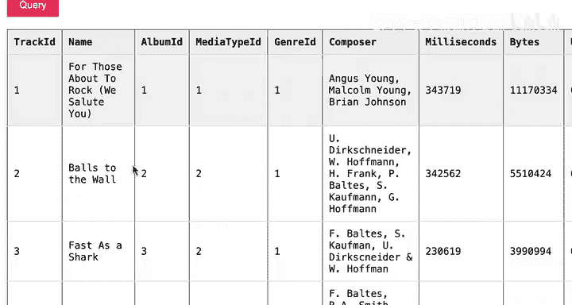

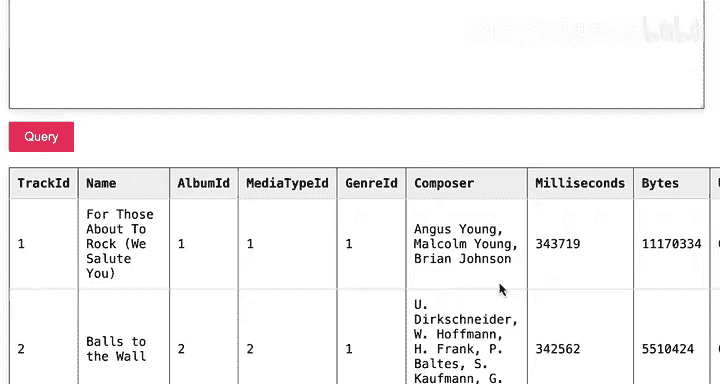

You can follow these to check out their values in other tables。 So， for example。

 restless and wild is media type 2。 What does that mean， Select star from media types。

 and you get that it is a protected Aac audio file。

 Select star is useful for exploratory data analysis。

 but you should be mindful that it can become slow or computationally expensive for very large tables。

 It's generally best to select only the columns you need for your analysis。 As a quick recap。

 you saw that you can use select column names from table name to retrieve specific columns from a specific table with multiple columns separated by commas in SQL light。

 these identifiers aren't case sensitive， but they are sensitive to extra whitespace。

 You also use limit to control how many results were returned by the query。

 This is a good way to test your query before applying it to the full scope of the data you're trying to retrieve。

 Finally， you saw the select all operator in action written as select star。

 which selects all columns from a table。 Just like in Python。

 it's important to remember that just because your code runs doesn't mean it did the right thing。

 In fact， while errors will stop your code。😊。

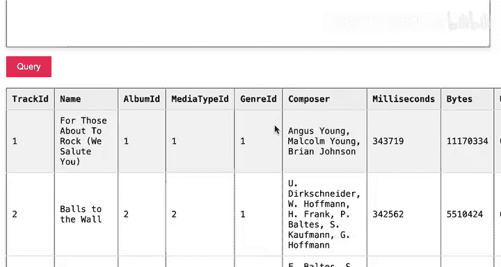

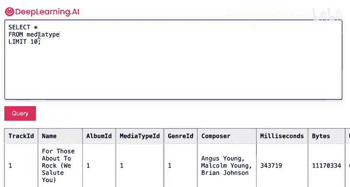

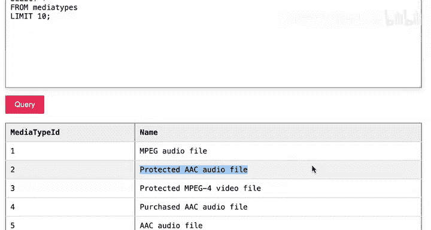

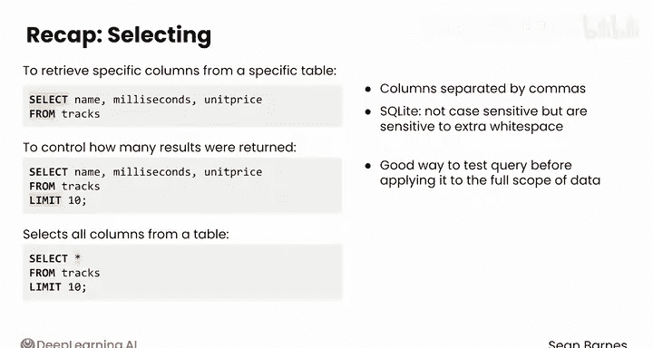

From running， logical mistakes can quietly give you the wrong answers you should have an expectation of what your query results should look like in advance。

 for example， how many rows should be returned， how many columns and what data types you'll see some strategies for debugging queries in the coming videos。

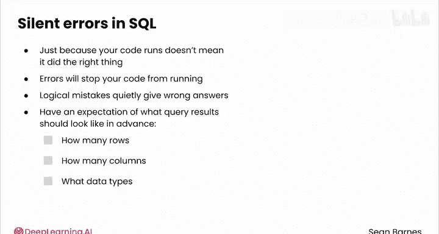

Great work with those SQL queries。 It's so satisfying to work with a fast database。

 and you'll get more and more tools in the coming videos， as well as the next module。 Next up。

 you'll see how to organize the results of a SQL query。😊。

