# 吴恩达《数据输入／输出与预处理（Python 和 SQL）Data I／O and Preprocessing with Python and SQL》中英字幕 - P52：51_结果排序.zh_en - GPT中英字幕课程资源 - BV1sZEzzQEkF

SQL has a lot of capabilities for organizing the information contained a query。 In this video。

 you'll learn how to sort the results of your queries。 As a quick reminder。

 you're working with the music streaming service to better understand a catalog of music they recently acquired after purchasing a competitor。

 You're performing exploratory data analysis to better understand the types of music in the catalog。

 You'd like to better understand the length and storage space required for different tracks so that your company can allocate appropriate database resources for storing the music。

 Take a look at this new query。 Select name， milliseconds bytes from tracks。

 What do you expected to return。 Well， it returns of many rows。 All of the rows in the tracks table。

 In fact， and three columns， The ones you requested。

 Btes is a measure of how much storage space a file takes up on your computer。

 notice that these tracks vary wildly and how large they are。 This first one， for example。

 is over 11 million bys。 Almost double the size of the next track。

 which is roughly the same duration， but a different media type。

 You can use the order by keyword to sort these tracks space on their size。 Give it a try。

 Select name millise。😊。

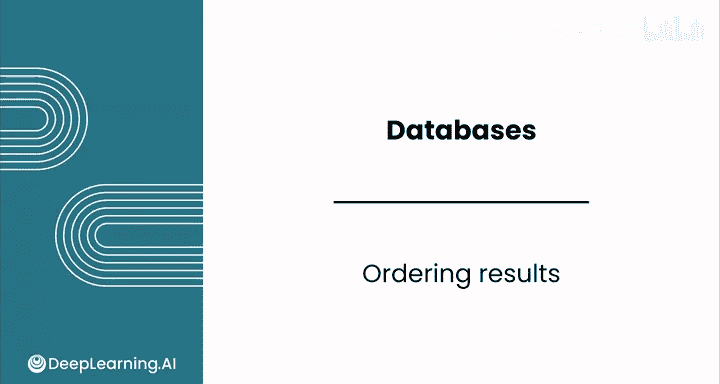

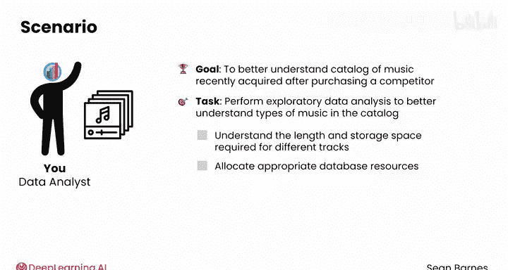

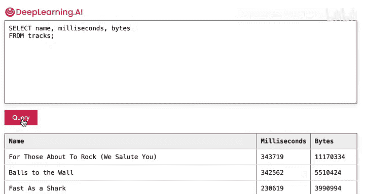

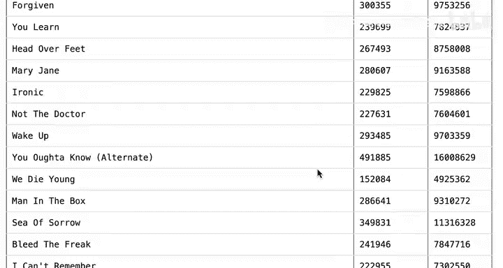

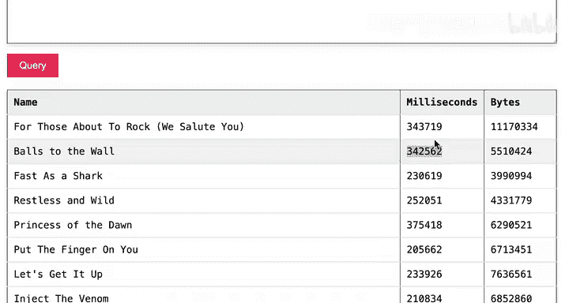

Bs from tracks by Bs What do you notice about the order of these tracks？

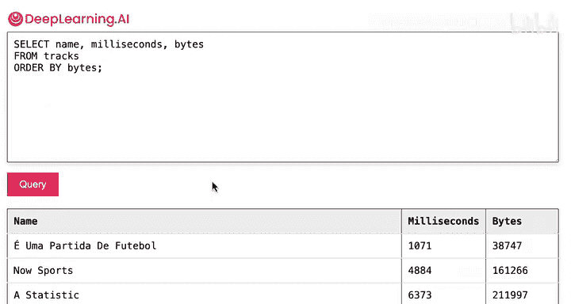

It's ascending by default， SQL sorts an ascending order。 So smallest to largest for numbers。

 earliest to latest for dates and alphabetically for text。

 These first rows are the smallest files in the dataset set。

 and they look like commercials or possibly even erroneous files。1000 milliseconds is only a second。

 So this first track is very short。 You couldn investigate this track and see if it's actually a corrupted file。

 If you're looking for the largest tracks at the top。 You can use the descending keyword。

 Just added to the end of your query before the sendingco。

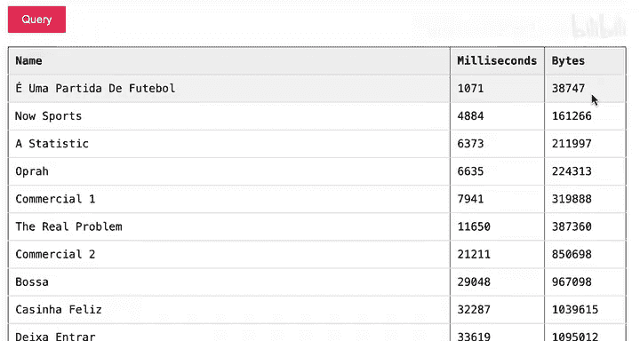

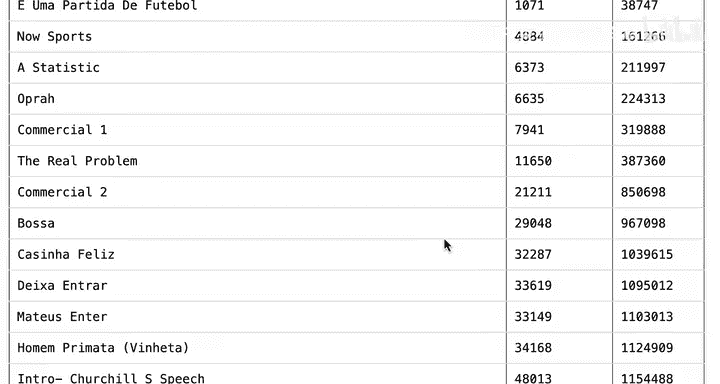

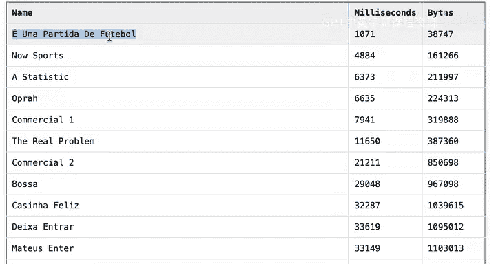

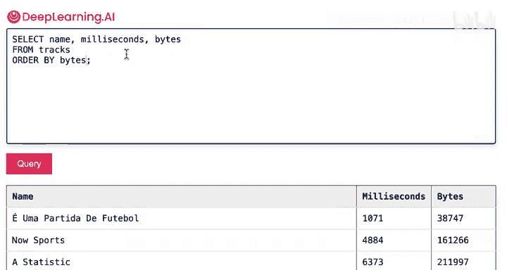

These files are huge。 The first one。 the largest track is over a gigabyte。

 That's about the size of 100 page book or a 20 hour audiobook。

 These look like they might be scifi TV episodes of some sort。

 Perhaps you can learn more if you add genre I， So just add it to the list of columns that you have in your select clause。

 These all appear to be genres 1920 and 21。 query the genres table to identify these genres。

 Select all from genres。1920 and 21 are TV shows scifi and fantasy and drama。

 So longer form content typically comes from these particular genres。

 This is a great discovery about the contents of the catalog。

 going back to the original query for a moment。 You may be interested in better organizing the size of tracks by genre。

 you can order your results by multiple columns toed doa。 For example。

 the query here adds genre I D to the order by clause and specifies that you want to order it in ascending order。

 This query will first sort the results by genre in ascending order then by bytes in descendending order。

 The two column identifiers are separated by a comma。 This type of query works very similarly。😊。

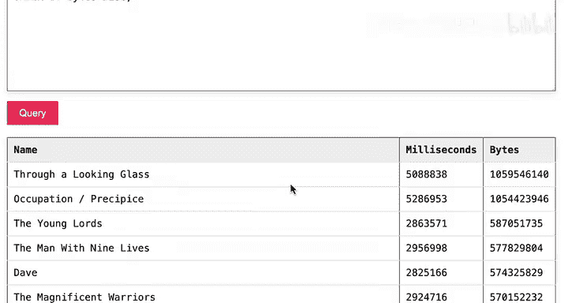

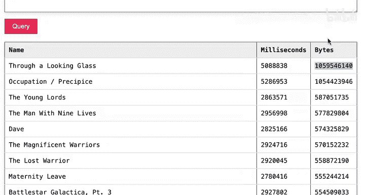

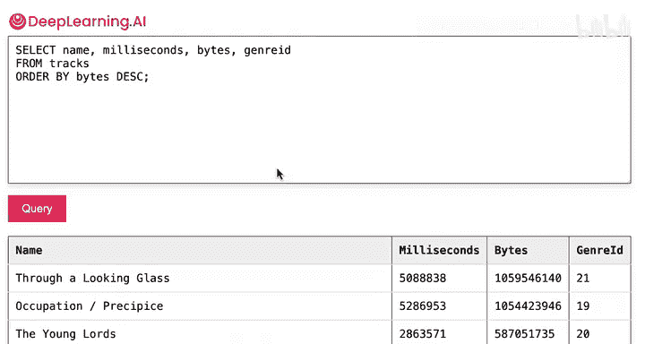

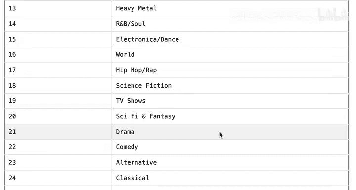

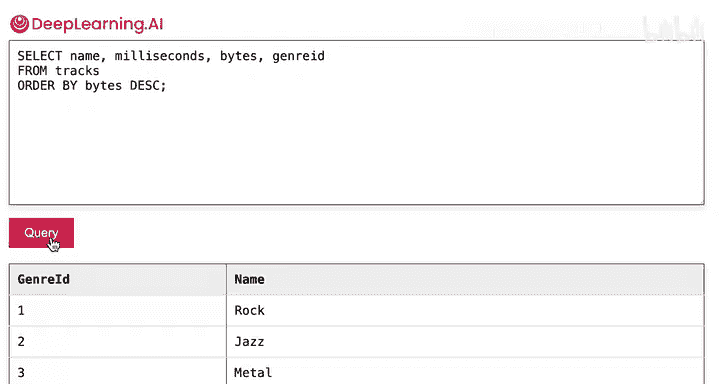

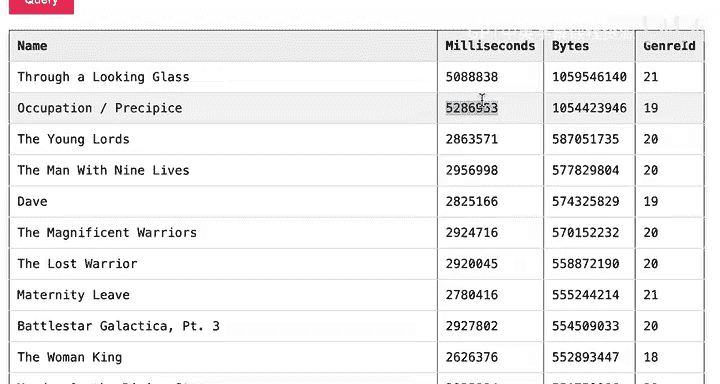

To sorting as， the order of the sort matters。 So， for example， genre 1 is rock。

 and the first track here is dazed and confused。

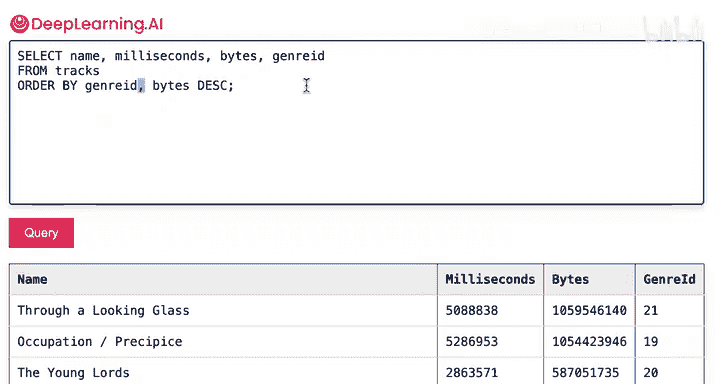

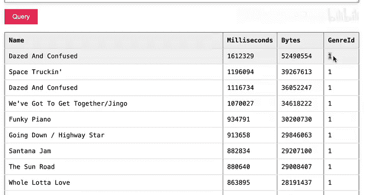

If you swap the sorting order。You get a different result starting with genre 21 and through a looking glass。

 which you saw previously， It's not very meaningful to sort by bytes first。

 because it's unlikely any two tracks have exactly the same size。

 So it doesn't help you groupve the results meaningfully。 let's go back to the previous sort。

 One interesting  query of sorting is that you don't need to include the column you sorting by and your select clause at the top。

 For example， if you remove genre I D from this query， you still get the same order of results。

 just without that column。 This technique is useful for hiding unnecessary data。

 or when you're really trying to optimize for speed。

 If you're selecting from tables with long or confusing column names。

 you also have the option of renaming them using the as keyword。

 The as keyword only renames the columns on your end。 It's like a nickname just for you。 For example。

 if you're walking a stakeholder through your process。

 you might want to rename some of these columns for clarity。

 Sometimes the engineering teams who create the tables use different language or conventions from higher stakeholders may describe the data。

 For example， you could use the query， select name as track title。

 milliseconds as length and millisecond。😊。

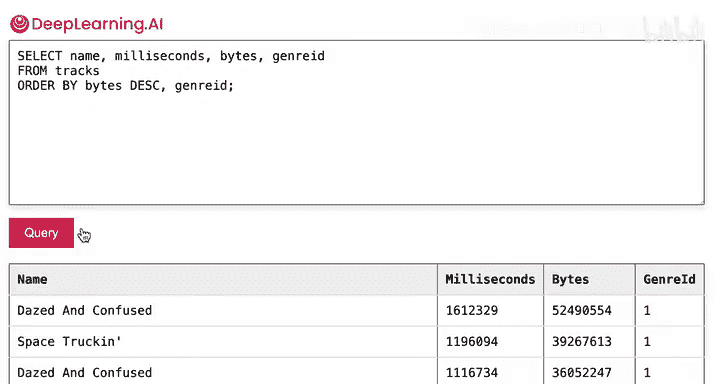

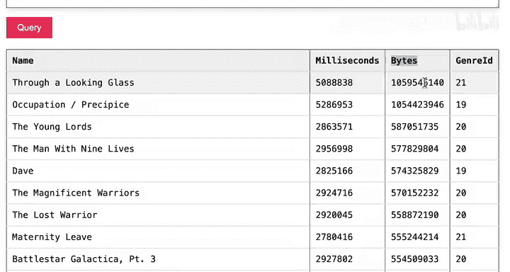

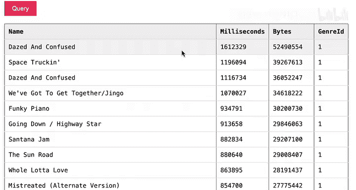

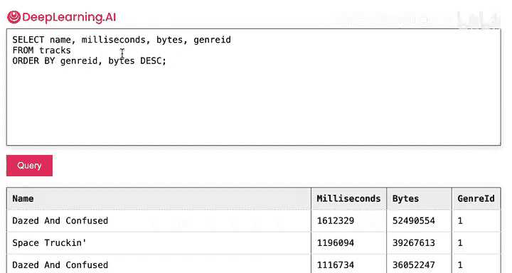

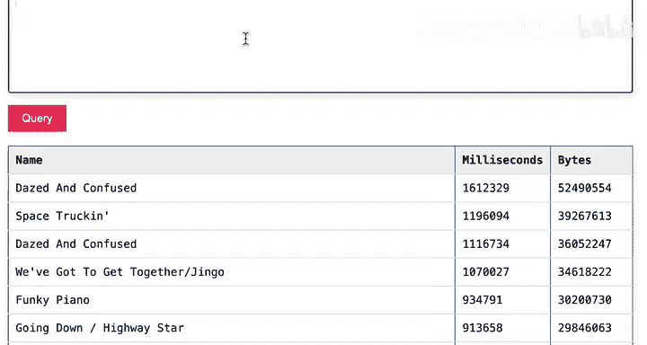

Btes as size and bytes from tracks， order by genre ID and bytes into descend sending order。

 you get the same output as before， but the column names may be more interpretable for your stakeholder without changing the underlying schema。

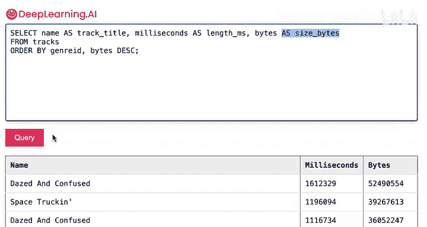

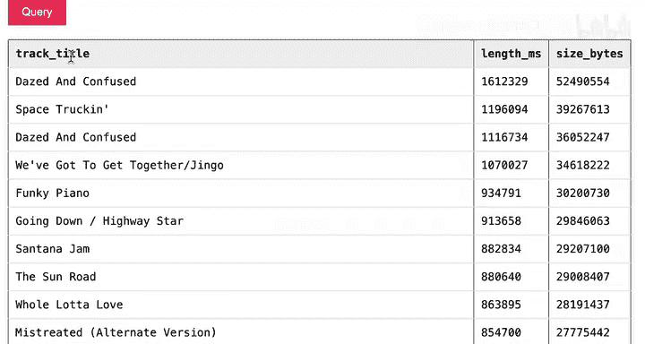

To quickly recap， you saw that you can use an order by clause to sort your results。

 The order by should come after the from clause by default。 sorting is asing。

 but you can add the descending keyword after your column identifier to sort and reverse。

 You also learn that you can order by multiple column separated by comms。 sorting order matters。

 The first column will be sorted first， then the second and so on。

 You also learn that you can use the as keyword to give a column a temporary nickname。

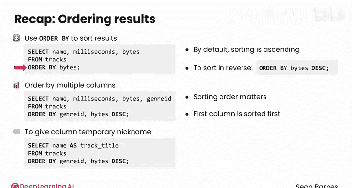

You've already seen how to write several powerful types of queries in SQL。

 follow me to the next video to explore working with databases using LLMs， I'll see there。

