# 吴恩达《数据输入／输出与预处理（Python 和 SQL）Data I／O and Preprocessing with Python and SQL》中英字幕 - P53：52_数据库应用中的LLM.zh_en - GPT中英字幕课程资源 - BV1sZEzzQEkF

Since the advent of LLMs working with the database has become more collaborative than ever in this video。

 you'll see a few different techniques for working with the SQL database using an LLM。

 you'll continue working with the music database。 Perform exploratory data analysis to better understand the catalog。

 This demo uses chat G01 offered by openaiI， which is a reasoning model。

 You'll see more on this in a moment。 It's currently available for free and paid accounts。

 note that you have other options available for reasoning like cloud 3。

7 Sonet extended thinking mode。 and you may have a more upto date model available to you as well。

 First， say you're just onboarding to this project and you get this database schema。

 Intering a database schema is a complex task involving a lot of visual reasoning。

 So you can try using a reasoning model like chatt G01 reasoning model spend more time thinking step by step through your request before they respond to you。

 You can copy this image and paste the screenshot of the entity relationship diagram into chat G01 and ask a little about it。

 For example， create an outline for exploratory data analysis for this database schema。😊。

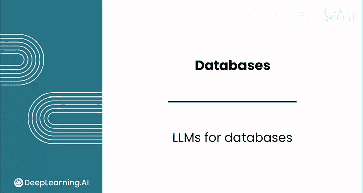

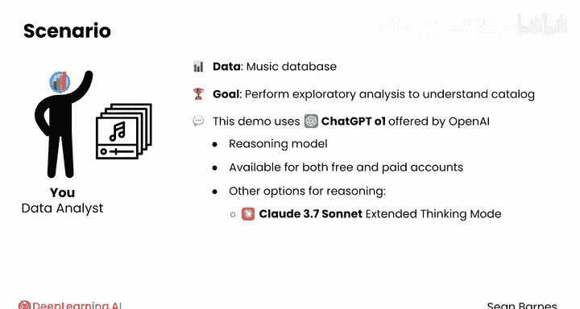

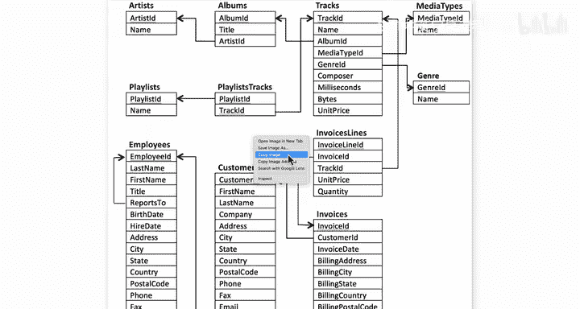

My company has just purchased the company owing this data。

 We are looking to integrate it into our own databases。

 My goal is to better understand the tables related to music。

 as well as what it might take to store this data alongside our own music catalog。

 So the big steps I suggest here are first to get familiar in the high level assessment of the overall schema and entity relationships。

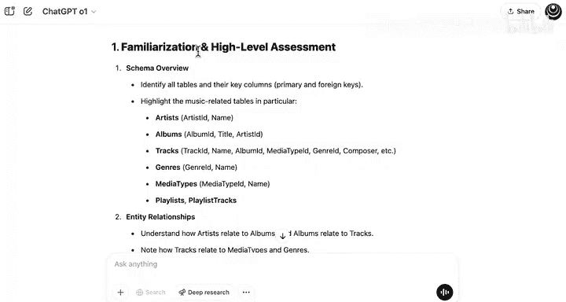

Then it summarizes a data dictionary which describes the column definitions and all of the primary and foreign key constraints。

 Then it goes on to talk a little bit about data quality and profiling。

 understanding some basic descriptive statistics about the data and how some of the features are distributed。

 and lastly， it speaks to the integration considerations。

 describing some approaches for thinking about schema alignment。

 data mapping and transformation and migration needs。

 It also talks about handling historical or transactional data in this suggestion。

 it suggests that you might want to consider whether you want to retain some of this data or not and also to think about how you might merge some of this data into your existing data。

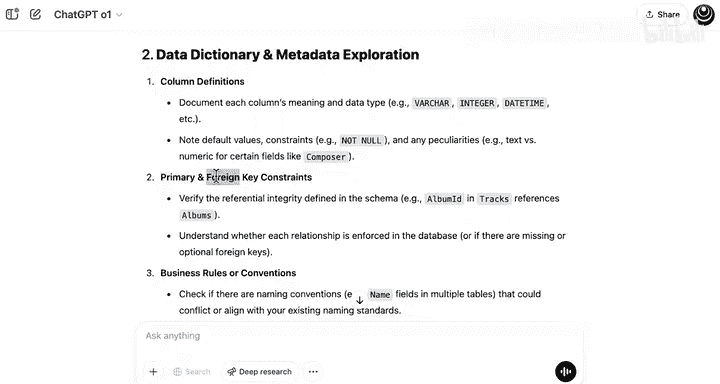

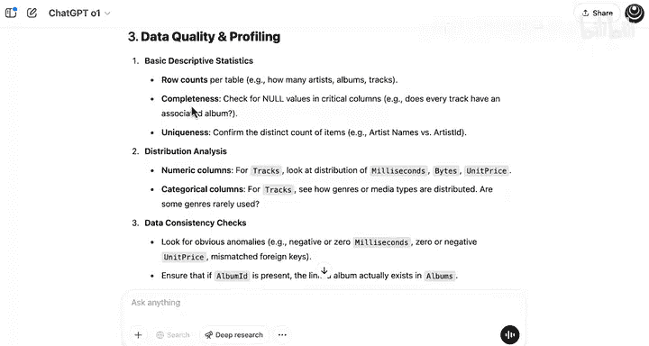

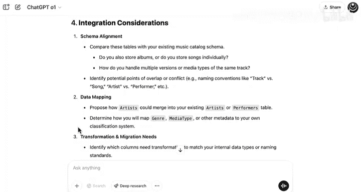

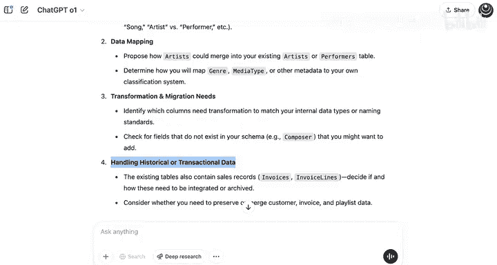

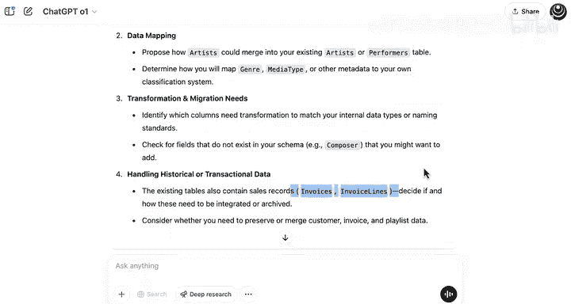

One potentially obsolete column you might notice is the employee fax number。

 which may be a legacy column that's no longer relevant。 because you used a reasoning model。

 you might notice that the model took more time with the request， and consequently。

 it used more computing power to give you its answer。 During this time。

 the model was thinking through your request step by step。

 almost like it was talking itself through the problem。

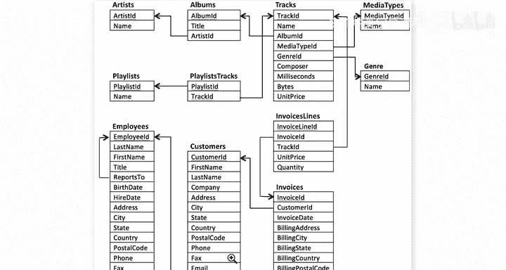

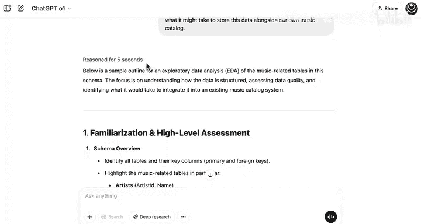

As a quick follow up， you could ask it to identify potentially obsolete attributes or tables and attributes that would be irrelevant for your analysis。

 make sure to identify any legacy technology or outdated information。

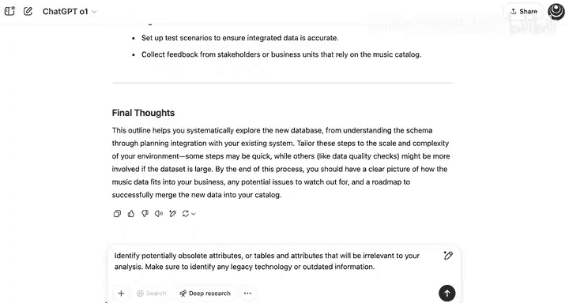

This query was a little more complex for the model to think through。

 It took 14 seconds to complete its reasoning process。So the irrelevant tables might be employees。

 customers， invoices， and potentially playlists， although arguably playlists might be useful。

 If your company maintains some type of playlist architecture。

 you might be able to integrate these older playlists with your own。

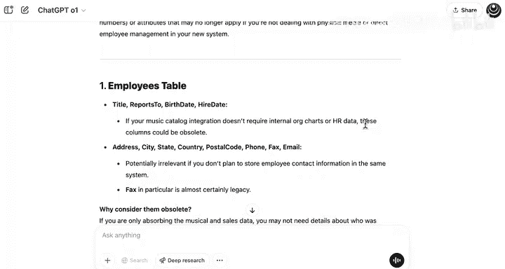

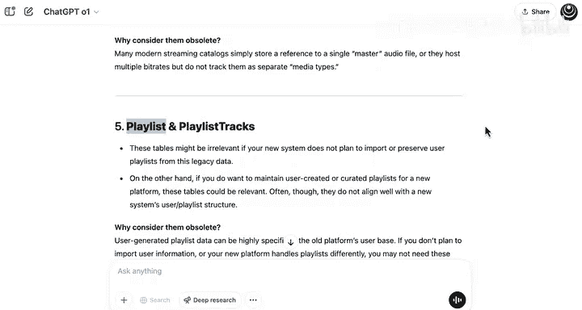

You may also notice that under legacy technology indicators。

 it does identify that f is a prime example of a legacy field。

 So this might be a good example of something that you want to remove from the data as a documentation step。

 you can ask this model to take this image and create a structured data format to store the contents of this image。

 So create a JSON file representing the contents of this database schema。 Now， previously。

 this was a very challenging task for large multimodal models。

 While it's still a very challenging task and you'll need to verify this output。

 reasoning models like chattpt01 tend to be much better at this type of task compared with previous models。

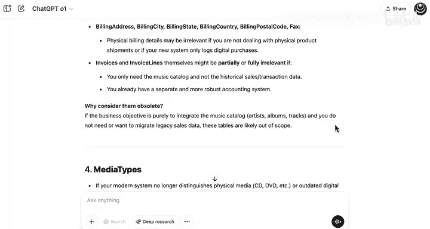

It may seem counterintuitive that this task is difficult since it's just reading text and interpreting arrows。

 However， you can think of these AI systems as having blurriier vision。

They can see the broad strokes of the image well， but may struggle with the details。

Here is one possible Json representation of the schema。 You have a database schema。 Then inside。

 you have a list of tables。The first table is called Artist， the primary key is artist ID。

 and it also has the name of the artist。R S IDD is an integer。 Then you have the name column。

 which is a text data type， So it actually did a very sophisticated job interpreting this information。

After verifying the accuracy of this information， you can share this JSON file with your data team to help them migrate this data into your own company's database。

LLNs can help you better understand the structure of a database before you begin writing SQL queries Next up。

 you'll cap off this module by learning how to write SQL queries in Python。

 I'll see you in the final video of this module。

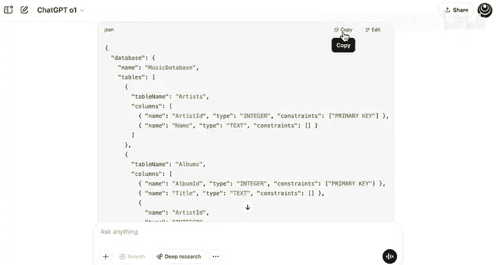