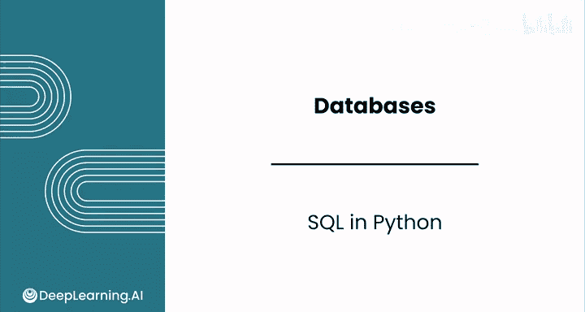
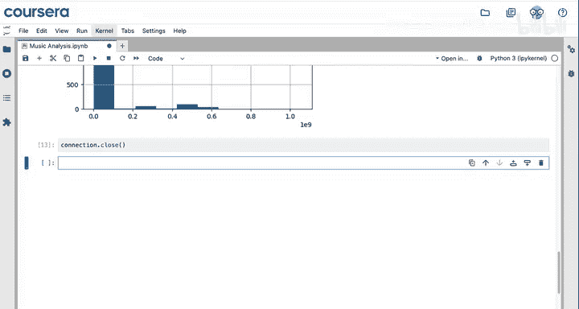
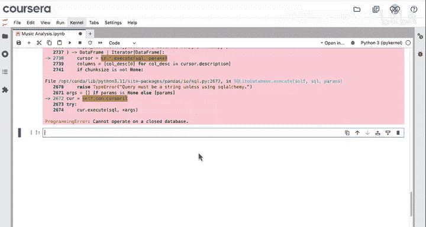
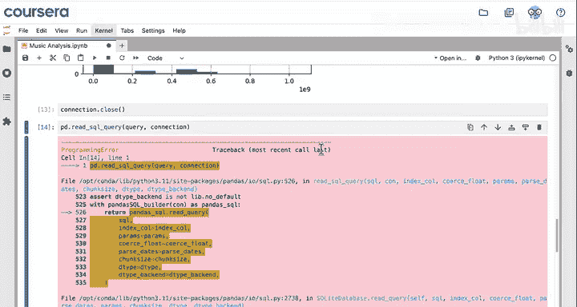
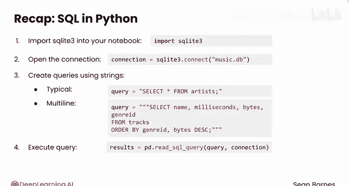

# 吴恩达《数据输入／输出与预处理（Python 和 SQL）Data I／O and Preprocessing with Python and SQL》中英字幕 - P54：53_Python中的SQL.zh_en - GPT中英字幕课程资源 - BV1sZEzzQEkF

So far in this lesson， you've been writing SQL in a website like interface。

 which is a common way to interact with the database。 However， for more powerful analysis。

 you'll want to execute SQL queries directly in a Python notebook。

 Let's see how If you're starting a fresh notebook。

 The first thing you want to do is import the necessary libraries。 First， you'll need pandas。

 You're also going to use SQL light in this course。

 So the module you need is called SQLite 3 and Python。

 It allows you to interact with a SQL by database。 The first thing you need to do is establish a connection with the database。

 It's like starting a phone call with the database。

 You're getting it on the line so you can ask us some questions。

 You'll do that with this line of code。 connection equals SQLite 3 do connect。

 And then the name of the file you want to connect to。

 SQL light is a filebased database rather than a cloud database。

 Here's the database right here and music do Db。 It's about one mebyte and it contains all the information about albums。

 tracks and so on。😊，So first establish your connection by running that cell now that your connection is established。

 you've got the database on the phone and you can use this connection to ask your queries。

 queries and Python are stored in strings。Your query looks like a regular SQL query。

Remember that SQL queries are not whitespace sensitive。 so you can say select star from artists。

 That can be your entire query。 Save that into a variable called query to execute this query to actually ask this question。

 you're going to use the PD that reads SQL query function with two arguments。 First， your query。

 And second， the connection that you just created。You're telling pandas。

 here's the question that I want to ask。 and here's the database where I want to ask it。

 This function gives you back a data frame。 Each row is an artist with columns， artist， I D and name。

Remember， those are the only two attributes in the artist table。

 Having to write a query on one line like this is pretty inconvenient。

 You'll want to follow the best practices you learned in this module by including each clause on its own line to create a longer and more well formatted query。

 you can use a multi line string in Python。 First， to find a new variable query to create a multi line string Use triple quotes。

 So1，2，3 and hit enter。Now， if you write， blah， blah， blah。

 these blas are all part of the same string， whereas if you make a string here in a new cell with just one set of quotes。

 notice that blah， blah and blah are in black text。 They're not considered part of the string。

 And running the cell actually gives you an error unterinated string。 Instead。

 use the multilined string。 So， for example， select star hit enter from artist's semicolon save that query。

 And then you can once again called Pd do reads sQL query with the query and connection。

 Now you can look at Df do head。 and you have this nice data frame with all of your artists。

 You can use the same pattern to execute any of the queries you've already seen in this course。

 For example， you saw this query in a previous video selecting name， milliseconds。

 bytes and genre I from tracks。 And then ordering by the genre and then by bytes or the size of the file。

 you can run that query。 Not that it executed very quickly。

 and Df dot head now gives you the same columns and in the same order that you are looking for。

 Now that you have this data in your Python notebook。 you can do more interesting stuff with it。 so。

😊，For example， using Df dot described， you'll learn that there are 25 genres and 3500 tracks in this table。

 You can also check out Df dot info to learn that there are no missing values in this dataset set。

 and that name is an object， which is essentially a string。 The other three attributes are images。

 You can also do some cool stuff like Df bys do hist。

Btes appears to be either strongly positively skewed， or perhaps it has a different distribution。

 but with a few outliers。 This looks a little like the histogram you saw for employee training hours。

 So you have all those python tools available to you once you query a database in your Python notebook final step。

 once you're done with your database， it's good practice to close the connection。

 while you're working and writing queries and getting data back from the database。

 that connection to the database is still open like an ongoing phone call。

 and it's still taking resources from your computer。

 So you can call connection do close to essentially hang up the phone and stop communicating with the database。

 Be mindful that after you call connection do close。

 you can no longer run any queries until you open the connection again。

 So notice that if you try to call P read SQL query。

 you'll get a programming error cannot operate on a closed database。

 The upcoming graded lab as well as the practice in graded labs in the next module。

 all test your sQL skills inside a Python notebook。

 So you'll get a lot of practice with writing queries and you'll get to manipulate all the data you retrieve using the cool Python techniques you've already learned。

😊。

To quickly recap when working with the SQLL database in Python。

 you'll first import SQLL3 into your notebook， then you'll need to open the connection using the correct file name Once the connection is open。

 you can create queries using strings either with a typical string or by using multilined strings with triple quotes using multilined strings allows you to maintain proper SQL code conventions executeute your query using PD do read SQL query with two arguments The query and the connection This function returns a data frame which you can preprocess and analyze using any of the techniques you learn in this program。

You've now unlocked database connections for use in your Python notebook。

 you're now ready to do some seriously highpowered preprocessing and analysis coming up。

 you'll complete a practice lab to get more comfortable with SQL queries。

 then you'll complete the graded assignment and graded lab for this module Once you're done。

 join me in the next and final module of this course where you'll learn even more advanced SQL queries that you'll use regularly on the job。

😊。