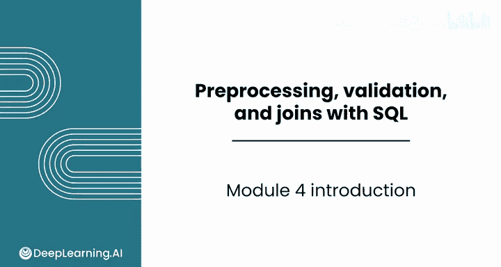
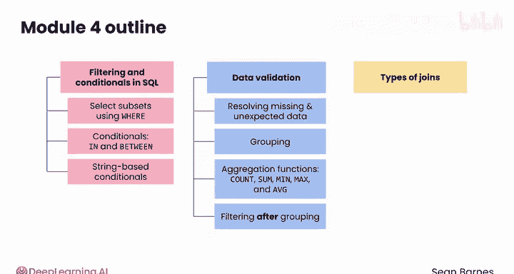

# 吴恩达《数据输入／输出与预处理（Python 和 SQL）Data I／O and Preprocessing with Python and SQL》中英字幕 - P55：54_模块4 简介.zh_en - GPT中英字幕课程资源 - BV1sZEzzQEkF

Welcome to module 4 Data preprocessing and validation with SQL Throughout this module。

 you will deepen your understanding of essential SQL techniques to clean and validate data effectively In your first lesson。

 you'll explore filtering and conditionals in SQL filtering allows you to select only the subset of data you're interested in using the keyword where。

 you will use conditions such as in and between， as well as stringbased conditions to filter data and create new features。

 In the second lesson， you'll focus on data validation。

 Data validation includes identifying and resolving issues with missing or unexpected data。

 you'll use grouping along with aggregation functions like count， sum min。

 max and average to validate that your data meets your expectations。

 you'll also learn to filter after grouping your data。 Finally。

 you'll explore different types of joins which are a cornerstone of working with relational databases。

 You'll combine data from multiple tables using left， inner and outer joins。😊。

By the end of this module， you'll feel comfortable filtering， grouping。

 aggregating and joining data effectively with SQL。

 These skills are indispensable for tackling real world data challenges。

 Let's get started in the next video。😊。