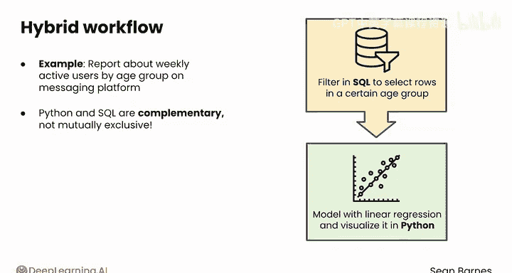

# 吴恩达《数据输入／输出与预处理（Python 和 SQL）Data I／O and Preprocessing with Python and SQL》中英字幕 - P56：55_SQL与Python对比.zh_en - GPT中英字幕课程资源 - BV1sZEzzQEkF

In the coming lessons， you'll explore many SQL techniques that have a parallel operation in pandas。

 In other words， you'll end this module knowing two ways to accomplish the same task。

 It's an ageold question。 When should you use SQL and when should you use Python。 General speaking。

 you'll want to use SQL when it's most efficient。 and Python when you need a more custom analysis。

 in practice， you'll often be working with massive data sets of millions or billions of rows。

 pulling all those rows across the network just to filter or aggregate them on your own computer can waste time。

 using SQL to select only necessary rows for analysis is often more efficient， specifically grouping。

 combining tables with joins and sorting are often highly optimized by the relational database management system。

 making them very fast and memory efficient。 SQL can also be a better starting point and collaborative contexts。

 when multiple analyses depend on the same logic， you can maintain a standardized set of SQL queries that keep interpretability consistent。

 SQL queries can also be scheduled meaning that the same query runs regularly。

 you might use the schedule。😊。

SQL query to fetch data about all shipping orders in the past seven days for a weekly report。

 this type of scheduled query can be easier to maintain compared with the Python notebook。

Python shines when you need a more advanced analysis and efficiency and repeatability are less of a priority。

 For example， if you're in exploration mode， you might prioritize quick visualizations。

 throwing together many analyses quickly。Expllororatory data analysis can feel more clunky in SQL Python is also necessary for advanced and custom analyses。

 SQL queries can't build a box plot or train a linear regression model。

 and don't forget SQL is only relevant when your data is stored in a database。

 If you have flat files or you're working with data from an API you'll lean on your Python skills。

 you'll often work with a hybrid workflow。 For example。

 if you're putting together a report about weekly active users by age group on a messaging platform。

 you might filter the data in SQL to only select rows in a certain age group。

 then model that behavior with linear regression and visualize it in Python。

Ultimately Python and SQL are complementary rather than mutually exclusive tools。

You've now seen how to choose between SQL and Python for similar operations。

 follow mes at the next lesson to get started with data preprocessing and SQL。

