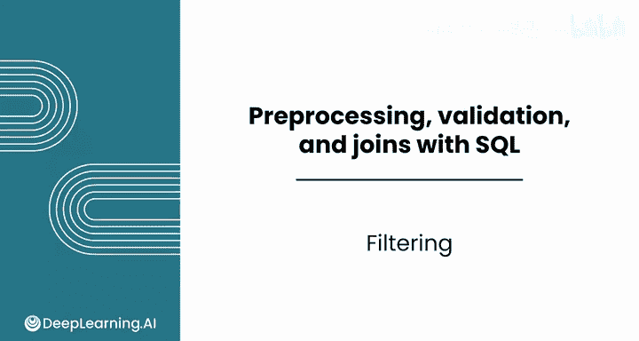
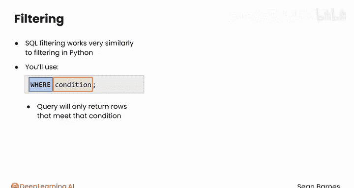
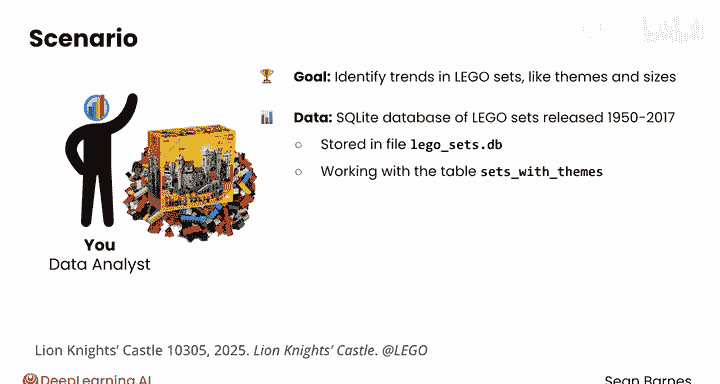
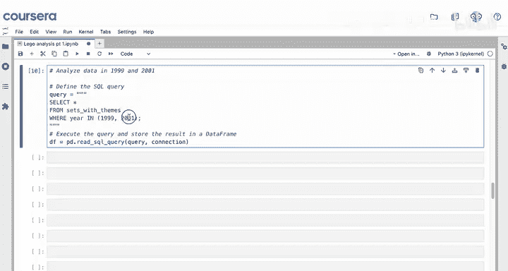
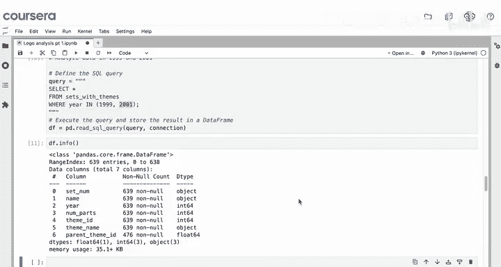
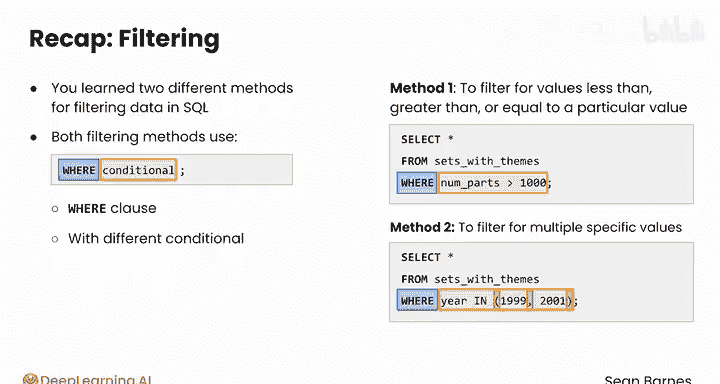

# 吴恩达《数据输入／输出与预处理（Python 和 SQL）Data I／O and Preprocessing with Python and SQL》中英字幕 - P57：56_过滤数据.zh_en - GPT中英字幕课程资源 - BV1sZEzzQEkF

SQL is a powerful tool for data preprocessing， allowing you to pull only clean and relevant data into your Python notebook for analysis。

 Your first SQL tool for preprocessing is filtering。

 SQL filtering works very similarly to filtering in Python。

 You'll use the wear keyword to filter data sets followed by a condition。

 The query will then only return rows that meet that condition。

Recently， you've been contracted for a data analytics project by a business that resells Lego sets If you're not familiar。

 Legos are small colorful plastic building blocks that snap together。

 Lego sets include all the parts needed to build an object or seen like a wizard tower。

 Your overall objective is to identify trends in these Lego sets like themes and sizes。

 You have a SQL light database of all Lego sets released between 1950 and 2017 stored in the file Lego sets Db。

 You'll primarily be working with the table sets with themes。

 Your first task is to identify popular Lego set themes over the years。

 You're particularly interested in the largest sets which tend to be more expensive。

 Let's take it over to a fresh Python notebook。

During this demo and all the subsequent demos you'll see in this course。

 you'll be working directly in a Python notebook。 remember that you can follow along with the demos using the provided practice lab item。

 which comes next in this course。 First up， import pandas as Pd and import sQLite 3 you'll need both of these modules to execute your queries then open a new database connection using SQLL do connect Legoets Db Now you can use that connection to write queries。

 remember this connection only works because this file Legoet Db is in the same folder as this notebook。

 you won't need to do any file management in this course but you should be familiar with this constraint。

 remember that all your queries will come in the form。 a multilined string containing your SQL code。

 then PD do reads sQL query to create a data frame based on the response Since you're just getting to know your data set。

 start with an unfiltered query to get a better sense of the data select star from sets with themes use df info to learn more about the data。

So there are over 11，600 rows and7 columns。 remember that column numbering starts with zero。

 So you have three categorical columns and four numeric columns。

 Check out the unique values for theme。 you have options like Ca building star Wars。

 So there's many different kinds of sets use Df dot described to summarize the numeric columns。

 The mean year is 2002 with years ranging from 1950 to 2017。

 So there are some antiques in this catalog。 The mean number of parts is 162 with the largest set having almost 6000 pieces。

 check out the minimum value for the number of parts column。 It's negative one。

 It doesn't seem possible for a Lego set to have negative one parts。

 So that's worth looking into which you'll do in a future video Since you want to explore the largest sets you might start by filtering for sets with more than 1000 parts。

😊，You'll do that， with the query select star from sets with themes where none parts is greater than 1000。

 This query will only return in rows where the number of parts is above 1000。

 DF dot info reveals that this data frame now contains only 278 sets。Using Df dot describe。

 you can see that these sets are on average newer 2009 compared with 2002。

 remember you'll need statistical testing to determine if this observed difference is significant。

 you can also filter for specific values。 Let's say you've been asked to analyze data about sets in the years 1999 and 2001 your query would look like select star from sets with themes were year in 1999 and 2001 in is a new keyword which works exactly like the Python in operator if checks it values in the specific column are one of the items in a list。

 your list of values must be in parentheses。 So for example， 1999 and 2001。

 Take a look at Df do info 639 sets to meet this criteria。

 You can continue to analyze their characteristics from here。

To recap， you learn two different methods for filtering data in SQL。

 both filtering methods use a where clause with a different condition。

 you can use a Boolean expression to filter for values less than。

 greater than or equal to a particular value， you can use the N keyword to filter for multiple specific values。

 note that the individual values must be inside parentheses and separated by commas。

In the next video， you'll expand your filtering skills to write complex queries with multiple conditions。

 These queries will allow you to answer more nuanced business questions。 I hope you'll join me there。

😊。