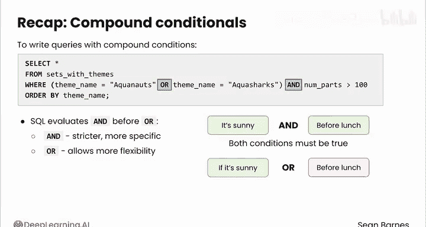

# 吴恩达《数据输入／输出与预处理（Python 和 SQL）Data I／O and Preprocessing with Python and SQL》中英字幕 - P58：57_复合条件过滤.zh_en - GPT中英字幕课程资源 - BV1sZEzzQEkF

To answer more complex questions， you can filter data with compound conditions。

 Let's take a look at how to use them in SQLSimilar to Python。

 SQL can filter rows based on complex conditions using logical operators。

 including and which returns rows where all conditions are true and or which returns rows where at least one condition is true。

 These operators allow you to filter rows by multiple columns。

 Connu your work with the Lego set database。 you've been asked to filter for sets according to both theme and year。

 specifically focusing on aquatic themes。 As a quick reminder。

 you've imported the necessary modules at the top of this notebook and open a database connection with Lego sets Db。

 Start with the query to select all sets from the year 1995 and 1996 with the theme aquanas。

 Aquanats is a set theme about undersea minorrs， and it was only produced in those two years。

 So select star from sets with themes where year in 1995 or 1996 and theme name equals aquanas。

 The first condition checks at the years 1995 or 1996。 The second condition。😊。

The theme is Aquas Both conditions must be true for a row to be returned。

Only these seven sets that meet both conditions are returned。 The Crytal Explorer sub sounds awesome。

 I think my kids would love that one。 Notice that this query needs quotation marks around Aquanas。

 If you left them off， you'd get this scary red air。 no such calm。😊。

So keeping the string aquanats in quotes prevents that error。

Since you know these sets were only released in 1995 and 1996。

 you could drop the first part of this query and instead filter for sets that belong to the themess Aquanas or Aquasharks。

 The query you'd write is select star from sets with themes where theme name equals aquanas or theme name equals aquasharks。

 Notice that you have to include the column name for each condition to separate the two groups of themes you could throw in order by theme name。

Now you've got the seven Aquana sets plus the six aquashark sets。

 Spyshark what you can also combine and with or to create complex filters。 For example。

 let's say that you want to focus only on larger sets from Aquanats and Aquasharks So to find sets with more than 100 pieces。

 you might think to write the query select star from sets with themes where theme name equals aquanats or theme name equals aquasharks and nupart greater than 100 order by theme name。

Check out the results。This isn't right， the data frame includes sets with fewer than 100 parts。

 so SQL seems to only be checking the number of parts condition for Aquasharks， not aquanats。

Remember， you can always ask your LLM for advice on how to approach fixing this issue。

 Try the prompt。 This query returns Aquana sets with fewer than 100 parts。

 rewrite the query to filter for sets with either theme as long as they have greater than 100 parts。

 The LLM points out that the query needs parentheses to make sure or applies to the theme names。

 Copy that query and try it out。 select star from sets with themes or theme name equals aquanats or theme name equals aquasharks and nupart greater than 100。

Order by thememe。Cool this query is a great example of a logical error rather than a code error。

 your code ran and you got a data frame back， but it didn't contain the right information。

 it's a good reminder to always check the output of your queries and make sure it matches your expectations。

To recap， you learn how to write queries with the compound conditions an and or。

 you also saw that SQL evaluates an before or that's because an creates stricter。

 more specific conditions while or allows more flexibility。

 Imagine you're deciding when to do yard work If you say all work if it's sunny and before lunch。

 both conditions must be true so the decision is precise。 On the other hand。

 if you say all work if it's sunny or before lunch。

 either condition is enough so the result is broader to avoid silent logical errors in your queries。

 you'll need to use parentheses to group conditionals。 For example。

 you saw how to group checks for theme name before checking the number of parts in the Lego set。

Compound conditions give you much more flexibility for retrieving the right data in the next video。

 you'll apply filtering to text data by writing queries to match patterns See there。

