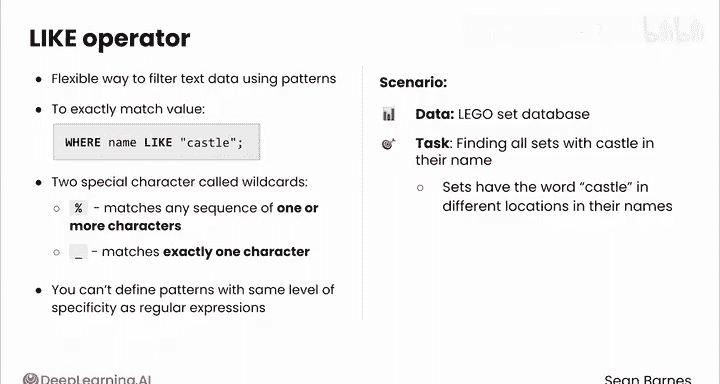
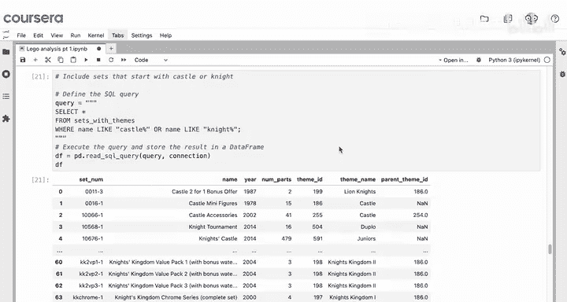
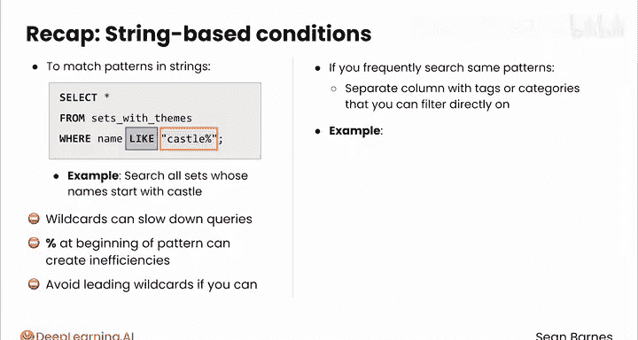

# 吴恩达《数据输入／输出与预处理（Python 和 SQL）Data I／O and Preprocessing with Python and SQL》中英字幕 - P59：58_基于字符串的条件过滤.zh_en - GPT中英字幕课程资源 - BV1sZEzzQEkF

For flexible text filtering in SQL， you can use pattern based matching with the like keyword。

 The like keyword is a bit like a regular expression with more limited options。

 The like operator in SQL provides a flexible way to filter text data using patterns。

 Like can be used with the string and quotes to exactly match that value。 However。

 Like has more powerful functionality using two special characters called wildcard。

 The percent symbol matches any sequence of one or more characters。

 and the underscore matches exactly one character。 You can see how like is a mini regular expression。

 You have a lot of flexibility， but you can't define patterns with the same level of specificity as you can with regular expressions。

 taking the Lego sets data as an example。 You may be interested in finding all sets with Ca in their name。

 But you know that sets have the word Ca appear in different locations in their names。

 Let's take a look at how to do that in code。 As a quick reminder。

 you've imported the necessary modules at the top of this notebook and open a database connection with Lego sets do Db。

 You can start with the query select star。😊。

From sets with themes were name like castle。 This returns all the sets that are named Cas。

 So there are two sets。 It looks like the Lego Classic castle was rereleased in 1981 with two fewer parts。

 However， you may be interested in any sets that start with the word castle。

 not just sets that are named just castle to check for these sets， you can use the query。

 select star from sets with themes where name like castle percent。

 The percent sign matches any sequence of characters。

 So as long as the sets starts with the name castle。 This query will include that set。

You can see there are many more of those， including Casle minifi and the Castle Dragons accessory set。

 You can use Df name do unique to check for all different sets that were selected。

 It looks like they were some rereleas in the data frame since there are 20 set names here rather than 27。

 you can use like with compound conditions as well。 For example。

 if you wanted to expand your search to include sets that start with Cale or night。

 you could use the query select star from sets with themes or name like Cale percent or name like night percent。

 in SQL light， the case of the match string like Cale doesn't need to match the text you're searching。

 So all uppercase or all lowercase will get you the same results as well。 However。

 other relational database management systems behave differently。

 So you'll need to know the rules of the system your company uses。

 Just remember to include quotation marks around your match string。 To recap。

 you learn that the like keyword allows you to match patterns and strings。

 You use the where name like Cale percent clauses to search for all sets whose name begins with CAsL。

😊。

As a final warning， wildcard like the percent sign can slow down queries when used with large data sets in particular。

 a leading percent sign percent at the beginning of a pattern can create inefficiencies。

 avoid leading wildcard if you can， and if you frequently search for the same patterns。

 consider pre-processing your dataset by creating a separate column with tags or categories that you can then filter directly on。

 for example， if you're frequently searching for sets with manyfi which are Lego people。

 you might add a new column in your data set with that information。

Pattern based filtering with SQL is a versatile tool for working with text data In the next video。

 you'll learn how to create categories for your data using SQL conditionals。

 I hope you'll join me there。😊。