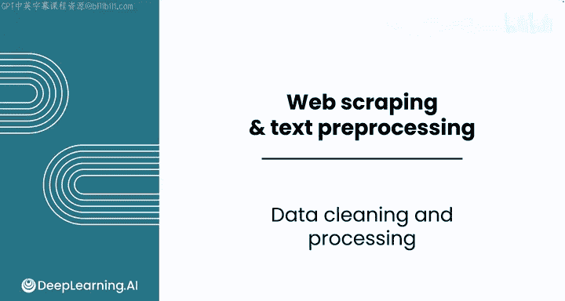
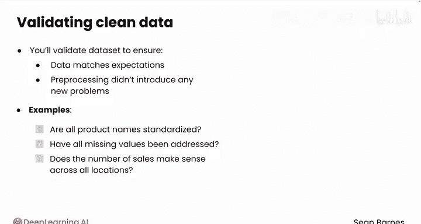

# 吴恩达《数据输入／输出与预处理（Python 和 SQL）Data I／O and Preprocessing with Python and SQL》中英字幕 - P5：4_数据清洗与处理.zh_en - GPT中英字幕课程资源 - BV1sZEzzQEkF

When you collect data， it's rarely ready to analyze right away。

In this video， you'll learn the big picture process for turning messy data into a form that's ready for analysis。

 If you took the earlier data analytics foundations course。

 you explored the Ask a manager salary dataset。 As a reminder。

 this data set includes thousands of responses from people who each share details about their job row industry and salary while this data is an incredible resource。

 I challenge you to find another data like it。 It does have a lot of inconsistencies。

 Here's another look at the Ask a manager's salary survey results from 2019 Each row is a single survey response and each column is a feature or a question from the survey。

 Imagine you wanted to calculate something like the average salary of all these responses。

 It seems like a straightforward question Well， if you take a look at column E。

 which is your annual salary， there are a lot of different formats。

 The first row doesn't have any commas while the second and third row do row 15 includes a trailing dollar sign and a space rather than a comma。

 you can tell by how it's on the left side of the cell that Google sheetets is actually treating it as text rather than a number。

 it would take some work to make sure these are。😊，formatted consistently so that you're truly analyzing all the results correctly say you want to analyze the locations of people who took the survey check out column G。

 where are you located This is a super vague question with freetex responses that led to many different types of answers the first three rows are cities in the US which appear well formatted but row 6 has a city in the UK The next row is also in the U but includes a more general area possibly because the respondent wanted to protect their identity analyzing these seemingly simple questions like where the respondents from is surprisingly challenging you'll need to perform some preprocessing on this data to prepare for analysis preprocessing always starts with raw data。

 which is unprocessed information at its original form then you'll take steps to make sure that data is more suitable for analysis some common preprocessing steps include removing duplicates handling missing values handling outliers fixing inconsistent formatting selecting a subset of features scaling values to a common range and encoding categorical variables you can see that preprocessing is a broad term sometimes。

You're transforming the data sometimes you're just selecting what's most relevant to the business question at hand The preprocessing steps you take will always depend on your specific business problem As an example。

 say you're analyzing online posts about your company if your business goal is to identify testimonials for your website you might filter posts to include only those in a specific language such as English remove any personally identify information then select only messages with positive sentiment however if you want to rank the hashtags associated with your company to help promote your products online you might want to remove all images and videos。

 extract all the hashtags， then create a list of the top five unique hashtags and their frequency。

You may have heard the term data cleaning used to mean data preprocessing It's true that many professionals use these terms interchangeably。

 although they have slightly different meanings， data preprocessing refers to all the steps you take to prepare raw data for analysis。

 this includes everything from filtering transforming and organizing data to aligning it with their specific analysis goals it also includes data cleaning data cleaning is a subset of preprocessing that focuses specifically on fixing problems in your data like correcting errors。

 fixing inconsistencies and removing duplicates For instance。

 fixing typos and product names would be data cleaning since you're explicitly correcting the raw data so while the terms overlap and practice。

 data cleaning refers to one specific step and the larger preprocessing process After pre-processing。

 you'll validate the data set to ensure the data matches your expectations and that preprocessing didn't introduce any new problems For instance。

 are all product name standardized have all missing values been addressed does the number of sales make sense across all locations once you're confident in the data validity。

You can proceed to the analysis step and start finding some cool insights now that you've seen why data preprocessing is a crucial step before analysis。

 follow me to the next video where you'll see when preprocessing can occur。

 I hope you'll join me there。

