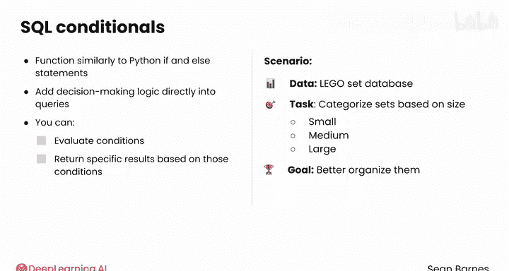
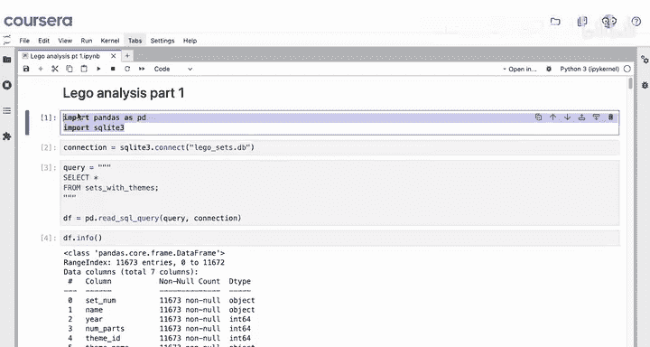
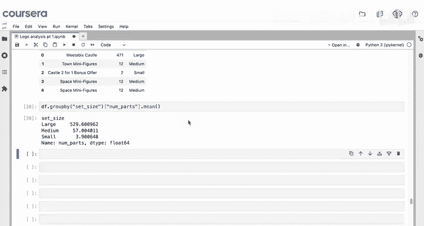
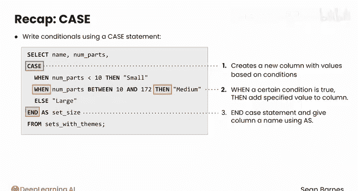

# 吴恩达《数据输入／输出与预处理（Python 和 SQL）Data I／O and Preprocessing with Python and SQL》中英字幕 - P60：59_CASE条件语句.zh_en - GPT中英字幕课程资源 - BV1sZEzzQEkF

SQL conditionals allow you to efficiently create categories in your data。

 They're particularly useful when you want to create new attributes on the fly。

 SQL conditionals function similarly to Python if and L statements。

 which you already encountered in the previous course。

 Conditionals let you add decision making logic directly in your queries。

 You can evaluate conditions and return specific results based on those conditions。 For example。

 say you want to categorize the Legoets based on size， small。

 medium and large so that you can better organize them。 you can use a SQL query to do so。

 As a quick reminder， you've imported the necessary modules at the top of this notebook and open a database connection with Legosat Db。

😊。

Start with a short query to select the name and number of parts from the sets with themes table。

 select name nu parts from sets with themes， using DF do described reveals that there's a wide range in part numbers from that anomalous negative one you previously identified to almost 6000。

 but the mean is around 162。Looking at a quick histogram， the distribution is quite skewed。

 you can use SQL to categorize these sets by adding a new column。 Yes。

 SQL can create new columns for you。If you wanted to define small， medium and large sets。

 you could use quartile boundaries， so maybe small sets are the bottom 25%。

 medium sets are between the 25th and 75th percentile。

 and large sets are anywhere above that 75th percentile。To create this query。

 you'll use the case statement。Start with your original query with the select and from statements the same now you'll need to add a comma since you are creating a new column。

 then you'll add case， this starts a new conditional。

 you're essentially going to write some different cases or conditions to tellSQL which value to put in the new column。

Then， when numb parts less than 10， then small。That's your 25th percentile。

 So if the number of parts is below that。 you can add the values small to the new column。

 then when nu parts between 10 and 172， then medium。

 this line creates the middle category by specifying that any values between 10 and 172 should get the value medium in the new column then else large So if there are any remaining sizes。

 those should get the value large in the new column Finally， and as set size， you're ending the case。

 and you're using the as keyword to give this column a name， set size。 checking out Df dot head。

 you now have a new column set size that appears to correctly categorize these first five sets based on their size。

 Now you can go on to do something like calculate the mean number of parts for each category separately。

 which can form the start of a segmentation analysis to recap。

 you learn how to write SQL conditionals using a case statement the case statement creates a new column with values based on conditions you write。

 you write conditions using when， then， when a certain condition is true。

Then add the specified value to the column， finally end your case statement and give the column a name using as。

Conditionals are great for efficiently segmenting your data or reducing the number of values you need to wrangle in your analysis or visualization。

SQL conditionals are a powerful tool for creating categories in your data。

 they also allow you to effectively handle null values。

 follow me to the next video to see that in action。

