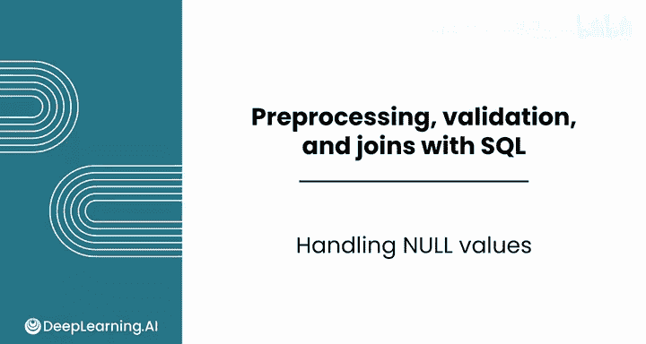
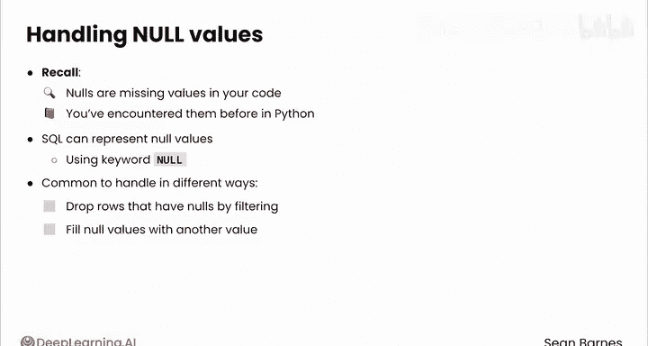
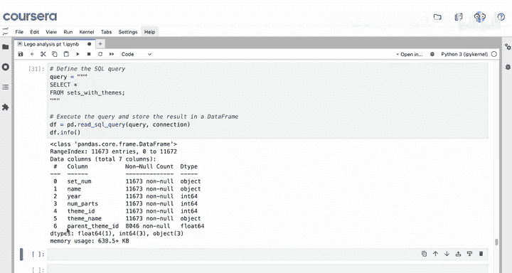
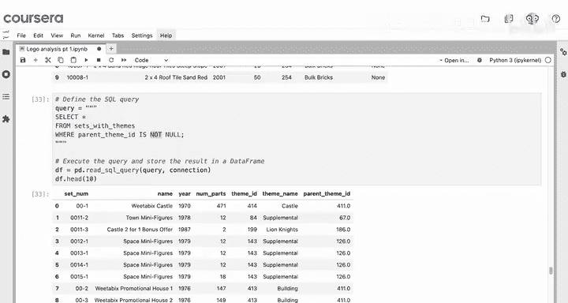
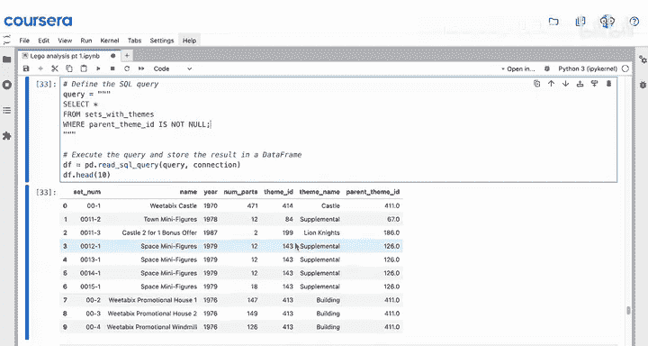
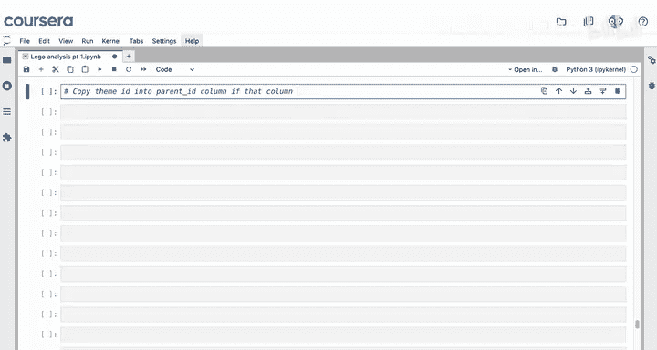
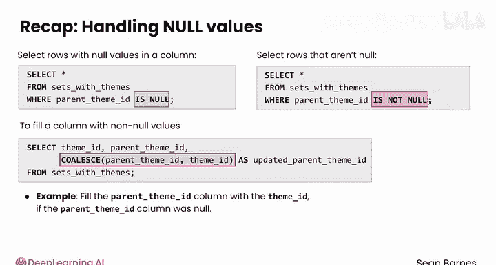

# 吴恩达《数据输入／输出与预处理（Python 和 SQL）Data I／O and Preprocessing with Python and SQL》中英字幕 - P61：60_空值处理.zh_en - GPT中英字幕课程资源 - BV1sZEzzQEkF

As you know， you'll often be faced with missing values in your data known as nulls and SQL In this video。

 you'll learn how to properly handle null values with SQL。

 recall that nulls are missing values in your code。 You've encountered them before in Python。

 SQL can also represent null values using the keyword null。

 It's common to handle null values in different ways。

 you can drop rows that have nulls by filtering them out or you can fill null values in with another value。

 let's take a look at these options in SQL。 As a quick reminder。

 you've imported the necessary modules at the top of this notebook and open a database connection with Legoets do Db。

 You may have noticed that when running this query to select every column from the sets with themes table。

 There was a column with many null values。 parentent theme I D。😊。

Let's take a look at some rows where the parent theme ID is actually null to get a better sense of what these rows look like。

Use a query， select star from sets with themes where parent theMID is null。

 checking out the first 10 values， you have some many figures and in and some bricks。

Each of these rows has none for the parent the I。It turns out that these themes are already parent themes。

 so they do not themselves have a parent theme。 So one option you have with these rows is to just exclude them in your query You can do that with select star from sets with themes where parent theme ID is not null。

 The not keyword will select all rows where the parent theme I is actually some value rather than null。

This gives you a much reduced data set from 11，600 rows to about 8，000 rows。

 that may not be the most ideal outcome， especially since these are perfectly valid sets。

 another option might just be to copy over the theme ID into the parent theme ID column if that column is null。

Let's check with the LLM to see how to do that， a good prompt might be write a SQL query that replaces parent theM ID with the value in theme ID if the value in parent theMI is none。

Do not update the table。Here is how that query should be written。Cool。

 so the LLM tells you that you can use the coalvalesce function in SQL。

 which returns the first non null value from a list of arguments。

So if you provide it with multiple column names， you can use the first non null value in a new column。

 copy the code and give it a try， so the new column name should be called updatedated parentent theMID。

Now， if you look at the first 10 values， the set at index7 originally had none for parent theme。

 but now the parentent theme ID has been replaced with the theme ID。Great。

 now you can continue analysis on the parent themes without having to drop over 3。

000 rows from your data。To recap， you learn that you can handle null values using filtering。

 you can select only rows with null values in a particular column using the condition is null or only rows that artt null with is not null。

You also saw how to use the coalesce function to fill a column with non null values。

You use this function to fill the parent theme ID column with the theme ID if the parent theme ID column is null Great work leveling up your SQL skills。

 you now have all the tools you need to effectively filter queries and handle missing values Com up。

 you'll complete the practice assignment and practice lab for this lesson and when you're done follow me to the next lesson where you'll learn more advanced SQL queries for data validation。

