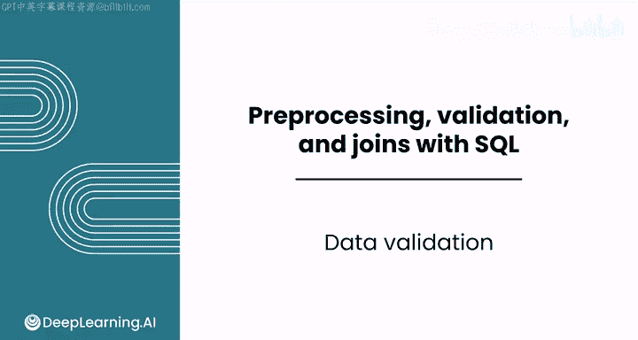
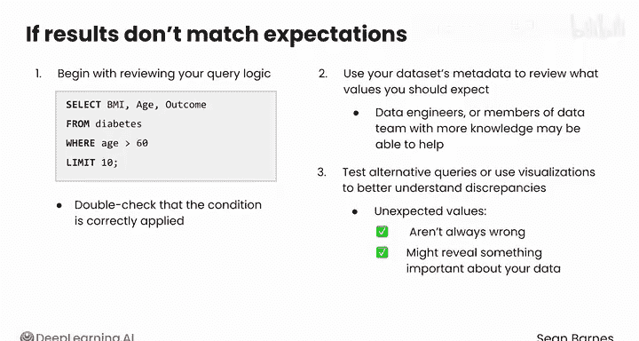

# 吴恩达《数据输入／输出与预处理（Python 和 SQL）Data I／O and Preprocessing with Python and SQL》中英字幕 - P62：61_数据验证.zh_en - GPT中英字幕课程资源 - BV1sZEzzQEkF

Welcome to this lesson on data validation and SQL Before you start data preprocessing and analysis。

 you'll want to confirm that the data you're working with matches your expectations。

 let's take a look， Sometimes your data might not be what you expected。

 which can lead to errors or missteps in your analysis。For example。

 imagine you ran a query to retrieve sales data for the month of January。

You expected to see records for hundreds of transactions。

 but instead got a data frame with just a few values。If you proceeded without validating your data。

 you might have wasted significant time creating reports or running calculations on incomplete data。

 Some common issues as you look for and data validation include unexpected data formats。

 For instance， dates might be stored as text instead of a proper date type making it impossible to sort or filter them chronologically you can also have duplicate or missing entries。

 a customer ID might appear twice， which inflates the total number of customers or be completely absent。

 which leads to incomplete analysis， or you might encounter unexpected values。

 values like sales amounts might not match your expectations for how high or low they might be。

 for example， you may question if a negative sales amount represents a loss or if it is an anomaly that needs to be corrected。

 As an analyst， it's your responsibility to verify the data at each step to ensure it aligns with your expectations and the goals of your analysis。

 you have a few tools for doing so。 In particular thinking through expectations and validating with subset。

 Consider a data containing diagnostic measurements for predicting whether a patient has diabetes。

With data collected exclusively from females of Pima Indian heritage age 21 years or older before running any query on this dataset。

 you should think through the kind of results you expect。 for example。

 you should know that the outcome feature can only be two values one for diabetes and zero for no diabetes If this column has any other numbers。

 it would indicate that something is wrong with the data Similarlyly。

 because the study was only conducted on women age 21 or older。

 you know that any values below 21 should be investigated to understand whether they are mistakes or whether your initial understanding of the dataset was incorrect。

 the same goes for other values in the dataset， even though you're not expected to become a medical expert。

 it's valuable for you to know what normal values are for measurements like glucose， blood pressure。

 insulin and BmiI that way， if you see any values that would be impossible for a human being to have。

 you would have an immediate warning sign that there's a problem with the data when you're working with a massive data set with millions of rows。

 it's often unnecessary or even impractical to load and analyze the entire data set right away by testing。

Quries on a small sample of the data set first。 you can validate the structure of the data。

 identify missing values or inconsistencies early and test your logic to ensure it works before running a full analysis。

 For instance， if you want to explore older patients who have a blood glucose below 100 you could start with an unfiltered query select star from diabetes limit 10 the output will be limited to the first 10 records starting with a query like this also allows you to verify the data Are the values numeric as expected。

 Once you confirm that the data looks correct。 you can add more conditions。 For example。

 you can now add a wear clause to focus on patients over the age of 60 and with the blood glucose less than 100 This step narrows down the data and ensures the filtering works as expected。

 So the query becomes select star from diabetes or age is greater than 60 and glucose is less than 100 limit 10 Again。

 you should check the results to see if the where clause correctly filters the rows Our age and glucose values in a legitimate range does a glucose。

approply correlate with other health measures like the outcome feature manually reviewing your data allows you to get more familiar with it。

 You're not wasting time。 You're building good data habits。

 If your results don't match what you expect， pause to investigate begin by reviewing your query logic For instance。

 if you're filtering it for patients with an age above 60。

 double check that the condition is correctly applied。 Next。

 Use your datas metadata to review what values you should expect data engineers or other members of the data team with more knowledge about how the data was collected may be able to help you better understand it。

 Another option is to test alternative queries or even use visualizations to better understand potential discrepancies。

 Remember unexpected values aren't always wrong。 they might reveal something important about your data。

 stay curious。

You have several options available to you to check whether your data meets your expectations。

 follow me to the next video to get started with data validation in SQL， starting with the keywords。

 count and distinctt。

