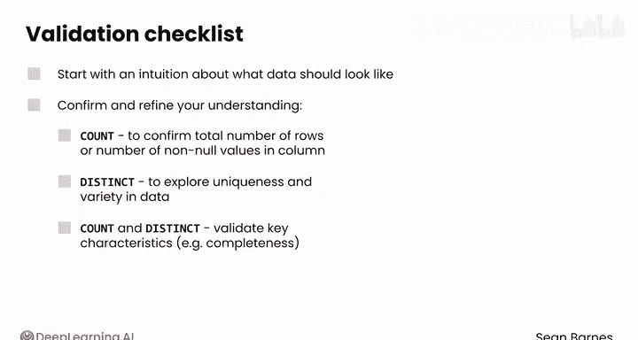

# 吴恩达《数据输入／输出与预处理（Python 和 SQL）Data I／O and Preprocessing with Python and SQL》中英字幕 - P63：62_验证：计数与去重.zh_en - GPT中英字幕课程资源 - BV1sZEzzQEkF

A common data validation technique is to count the number of values or to examine the unique values in your data。

 Let's take a look at how to validate counts and unique values in SQL。 Let's start with count。

 This keyword answers a basic but important question。

 How many records do I have comparing this number to your expectations can reveal whether data is missing。

 or if duplicate rows might exist。 And then you have distinct。

 This keyword identifies unique values in a column。

 which helps you understand the variety in your data and is especially useful for detecting duplicate entries。

To see how count and distinct operate in practice， let's run some queries using the LeEGO data set you've worked with in the previous lesson。

Remember， you can follow along with the demos in this lesson using the providedvi Prae La item。

First import your libraries， then open the database connection。

 Start with a quick refresher of what this table of data looks like using select star from sets with themes you see the same table as you saw previously with data on each LGgo set。

With this structure in mind， you can now generate some SQL queries to verify the data first。

 to count the total number of rows， use select count star from sets with themes。The result is 11，673。

 which is correct。If the number was higher， it might indicate duplicate records or some other issue。

 count only counts non null rows， and count star is used to count every row。

 even those with null values in a given column。 You already noticed in the previous lesson that there were several thousand parent theme ideas missing。

To count how many non null entries there are in that column。

 you can replace count star with count parenting theme ID。

 so this column contains 8046 non null values The difference between this value and the value returned by count star indicates that there are some null values in this column to check for unique values you can use the distinct keyword you can get a list of all the unique theme names using this query Select distinct theme name from sets with themes order by theme name。

Now you see a variety of themes sorted alphabetically。

 combining the count and distinct keywords is a powerful data validation technique。 For example。

 say you want to check whether each theme has a unique ID。

 You can check the number of distinct values in both columns， theme name and theme ID。

 starboard theme name。Add count to the query and put distinct theme name and parentheses。

 Select count distinct theme name from sets with themes。

The output now shows that there are 386 unique themes Now check theme ID。Interesting。

 there are 575 different results。So it looks like some themes may have the same name。

 but different ideas， it's worth investigating this discrepancy further。

Let's quickly recap when validating your data， always start with an intuition about what the data should look like。

 then use these methods to confirm and refine your understanding。

 use count to confirm the total number of rows or the number of non- null values in a column。

 use distinct to explore the uniqueness and variety in your data Use count and distinct together to validate key characteristics like completeness these techniques are your first line of defense against data errors。

Count and distinct allow you to validate basic characteristics about your data。

 but if you want to validate specific subsets of your data， you'll need tools for grouping your data。

 Fo me to the next video to see how。

