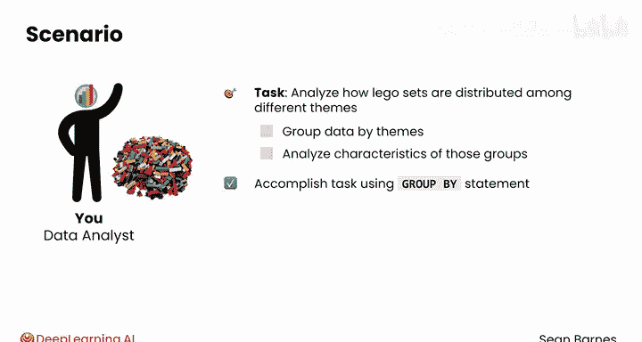
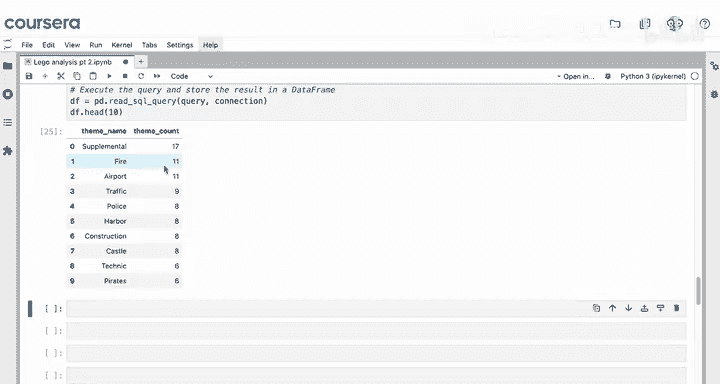
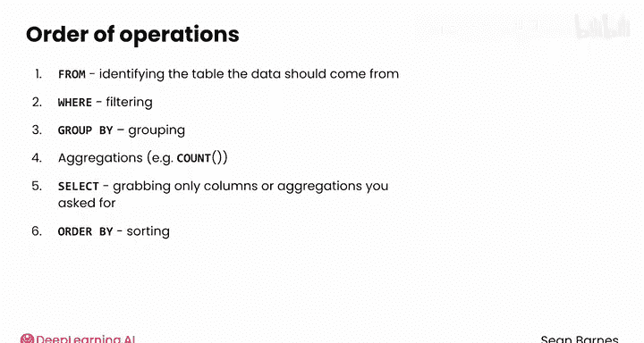

# 吴恩达《数据输入／输出与预处理（Python 和 SQL）Data I／O and Preprocessing with Python and SQL》中英字幕 - P64：63_验证：分组聚合.zh_en - GPT中英字幕课程资源 - BV1sZEzzQEkF

SQL provides you with tools to group your data based on one or more attributes creating subsets of your data。

 Let's take a look at how to perform a grouping operation and SQL say you've been tasked with analyzing how the LeEgo sets are distributed among different themes。

 you can group data by themes， then analyze characteristics of those groups you can accomplish this task using a group by statement。

As a quick reminder， you've imported the necessary modules at the top of this notebook and open a database connection with Legoets。

 Db。 You can use the group by statement to organize the sets by themes。

 The group by clause becomes powerful when used together with aggregating functions like count and sum。

For example， if your goal is to see how many sets are associated with each theme。

 you can use the group by statement together with the count function。

Select theme name count star as set count from Se with themes， group by theme name。

 order by set count descending。In this query， group by theme name organizes the data into groups based on unique theme names。

 and count star tallies the number of sets in each group。

Even though countstar appears above the grouping， it actually happens after grouping。

 you'll see more details on this quirk in just a moment by ordering the results in the sending order。

 you can quickly pinpoint which themes are most popular。

 writing this query provides a clear picture of the distribution of sets across various themes。

Basic themes like supplemental， Technic， city， and friends seem to have the greatest number of sets。

If you're more interested in the least popular themes。

 you could sort by set count and asending order。Select theme name。

 count star as set count from sets with themes， group by theme name， order by Se count。

Upon examining the results， you might find some lesser known themes that may be more valuable due to their rarity。

You can also use the count distinct paradigm to check the number of unique values within each group。

For example， you notice earlier that there are some theme names with multiple unique IDs。

 you can use a query to check how many IDs are associated with each theme name。Select theme name。

 count Dis theme ID as theme count from sets with themes group by theme name。

Then sort in descending order and check out the first 10 values to see the theme names with the most unique ideas。

Interesting， so some of the more generically named themes like Splemental。

 Fire and Air have 11 or more unique theme IDs associated with each name。

To recap， you can group rows using the group by statement and providing the name of a column to group by。

 similar to how you would group rows in Pans， if your query includes a grouping。

 aggregation functions like count will apply to each group individually。Interestingly。

 it's not required to select the column you group by。

 though it helps you understand your results better。

You learned a moment ago that aggregations like count happen after grouping SQL has a set order of operations First from identifying the table the data should come from。

 then where so filtering happens next Next group by for grouping， then aggregations like count。

 the select statement comes next， So grabbing only the columns or aggregations you ask for。Finally。

 order by sorting comes last， you don't need to memorize this order of operations。

 but you should know that SQL has a set order of operations and that aggregations come after grouping。

Once you've grouped your data， you can apply many different aggregation functions to the subsets you created。

 you applied count and count distinct using Groupbyte in this video in the next video you'll explore several new aggregation functions I'll see you there。

