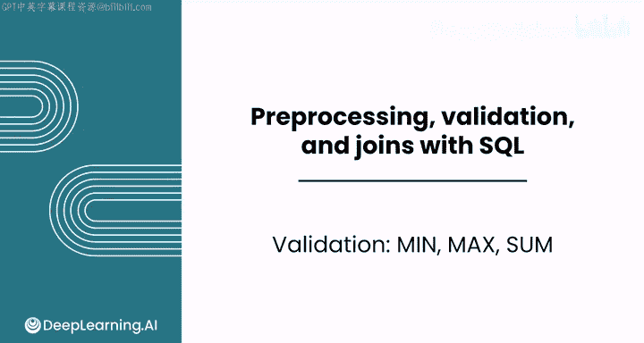
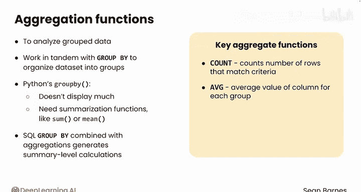
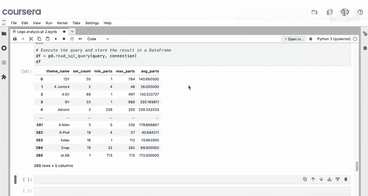
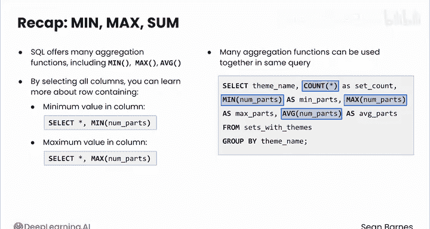

# 吴恩达《数据输入／输出与预处理（Python 和 SQL）Data I／O and Preprocessing with Python and SQL》中英字幕 - P65：64_验证：最小值-最大值-求和.zh_en - GPT中英字幕课程资源 - BV1sZEzzQEkF

Aside from counting， you can aggregate your data in many different ways in SQL。

 some common options for numeric data include Min， Mac and some to analyze group data。

 SQL provides powerful aggregation functions。 These functions work in tandem with the group by clause to organize your data set into meaningful groups before performing calculations。

 Think about how Python's group by function alone doesn't display much。

 You need summarization functions like sum or mean to extract insights。

SQL follows the same principle， combining group by with aggregate functions to generate summary level calculations efficiently。

 the key aggregation functions are count which you already use in the previous video average。

 which calculates the average value of a column for each group。

Some， which totals the values in a column for each group。And Min and Max。

 which find the smallest and largest values within each group。As a quick reminder。

 you imported the necessary modules at the top of this notebook and open a database connection with Legoets。

bbb。 Let's say that you want to explore the largest Lego sets in each theme。 You can use the query。

 select theme name， Max of nu parts from sets with themes， group by theme name。

So the 12 volt theme had a set with over 700 parts while the agogori sets appear to be quite small。

 This query tells you the size of the largest set， but doesn't tell you which set it is to include all the details about the largest set in each theme。

 you can add star to the select statement which will display all the columns for the row with the largest set。

 Note that this is a special feature of SQL light and does not generalize to all database systems。

 adding the star isn't redundant because when you use max of nu parts。

 youre selecting the row with the maximum value of that column。However。

 to retrieve all the details of that row， you'll want to see all the columns so selecting an aggregation function like Max operates separately from selecting the corresponding column values It looks like the largest 12 v set is the Intercity passenger train that makes sense it seems like it would have a lot of parts and it was released in 1980 Now let's do the same for the set with the minimum number of parts you can just change max to men in your query and add sorting to see the themes with the smallest sets order by none parts。

Interesting， three sets have negative one parts What can it mean It's not entirely clear without reading more about the data set Several of these themes with zero and negative one parts aren't even Lego sets at all。

 theyre wooden storage boxes or idea books。It's not clear if negative 1 and0 are defined differently or if these negative values represent some type of invalid value。

 Sometimes negative values are used as a flag for specific reasons when you want to keep the column numeric SQL also allows you to include many aggregation functions in one query。

 for example， rather than looking at the count max and min of parts in each theme separately。

 you can combine them into a single query。 Select theme name。

 count star as set count men nu parts as men parts， Max nu parts as max parts。

 A nu parts as average parts from sets with themes， group by theme name。😊。

Very useful now you have a table similar to DF。Describe which can run efficiently on large data sets without having to load all the data onto your local computer。

To recap， you learn in this video that SQL offers many different aggregation functions。

 including min， Max， and average。You saw that by selecting all the columns you can learn more about the row containing the minimum or maximum value in a column remember。

 this typically only works for SQL light and you'll have to explore the features of other database systems to make sure。

 and you learn that many aggregation functions can be used together in the same query。

Just like pandas， SQL provides many different aggregation functions I encourage you to explore all your options in the next and final video for this lesson。

 you'll learn how to filter your group data using aggregations I'll see you in the next video。

