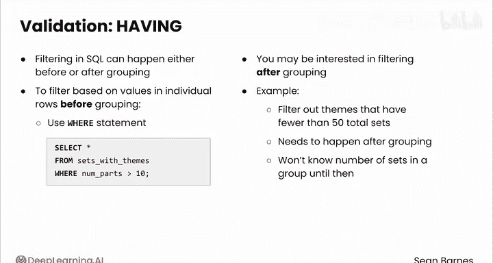
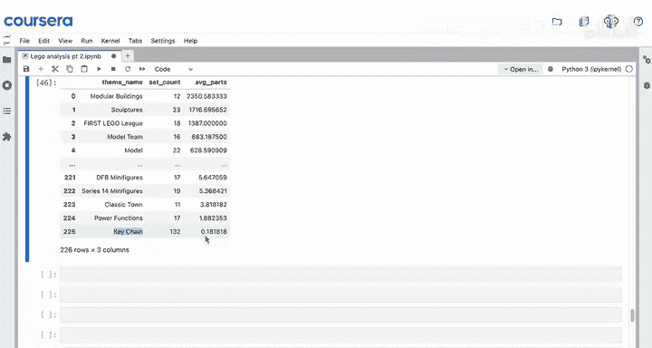
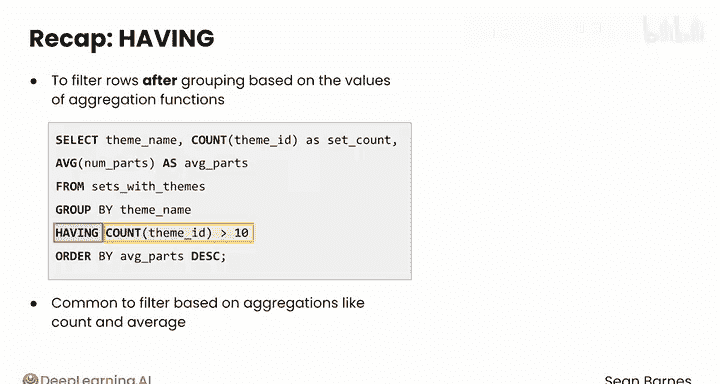

# 吴恩达《数据输入／输出与预处理（Python 和 SQL）Data I／O and Preprocessing with Python and SQL》中英字幕 - P66：65_验证：HAVING子句.zh_en - GPT中英字幕课程资源 - BV1sZEzzQEkF

After grouping your data， you can filter the results based on an aggregation function。

 It's a useful technique for identifying outliers and duplicates in your data。 Let's take a look。

 Fing in SQL can happen either before or after grouping。😊。

To filter based on values in individual rows before grouping， you can use the where statement。

 so for example， you can check if each individual set has a number of parts greater than 10。 However。

 you may also be interested in filtering after grouping for example。

 you can filter out themes that have fewer than 50 total sets This operation needs to happen after grouping because you won't know the number of sets in a group until that let's take a look at how to filter after grouping and code as a quick reminder。

 you've imported the necessary modules at the top of this notebook and open a database connection with Legos。

 Db In an earlier video， you use the query， select theme name count star as set count from sets with themes group by theme name to count the number of sets in each theme you can expand on this query to include only themes that have at least 50 sets by adding the statement having count star greater than 50 here。

 having count star greater than 50 acts as a filter only retaining themes where the set count exceeds 50 This statement can help focus your analysis only on the most popular themes。

😊。

Remember that while where deals with rowlevel filtration having comes into play after aggregation This distinction is crucial when you're managing larger data sets and need precise control over the results you work with。

 your post grouping filter doesn't need to use the same aggregation that you're selecting for example。

 you can filter for themes that have at least 10 sets then show the average number of parts in each theme that query would look like select theme name count of theme ID as set count average nu parts as average parts from sets with themes group by theme name Having count of theme I greater than 10 order by average parts descend。

 that's a lot。 This query allows you to calculate the averages for only themes with the minimum sample size of 10。

 you should include the set count to validate that the having statement executed correctly and ordering by average parts allows you to view the themes with the largest sets on average So modular buildings which are very large and intricate sets have many parts on average while keychas don't In fact。

 there appears to be a lot of keychas。Zero parts since the average is below1。

As a quick recap， you saw that the having statement allows you to filter rows after grouping based on the values of aggregation functions。

 it's common to filter based on aggregations like count and average。

Great work You've learned so many powerful tools for validating your data with SQL from aggregation to grouping。

 coming up， you'll complete the practice assignment and practice lab for this lesson and once you're done。

 follow me to the next and final lesson in this course， SQL joinins。

