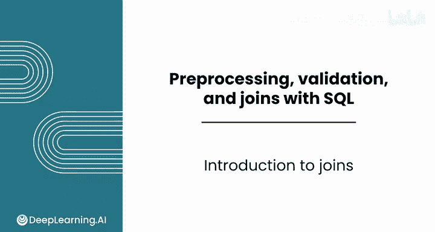
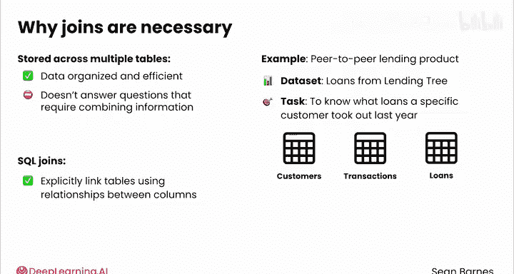
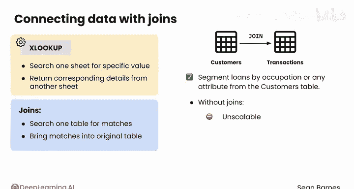
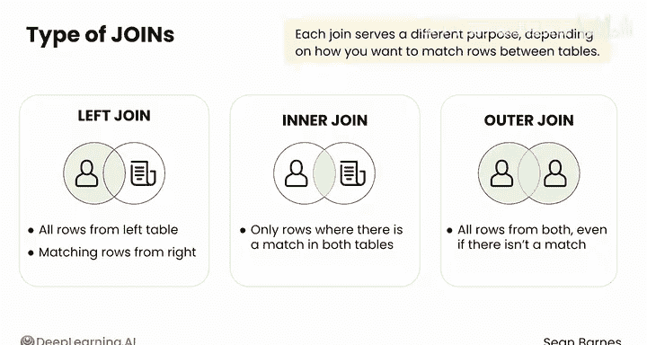

# 吴恩达《数据输入／输出与预处理（Python 和 SQL）Data I／O and Preprocessing with Python and SQL》中英字幕 - P67：66_表连接介绍.zh_en - GPT中英字幕课程资源 - BV1sZEzzQEkF

So far on this module， you've learned to write SQL queries that retrieve data from one table at a time。

 SQL becomes much more powerful when you connect tables together through joins when data is stored across multiple tables。

 each table typically focuses on a single entity For instance， you might have a table for customers。

 another for transactions and another for products This setup is great for keeping data organized and efficient。

 but it doesn't let you answer questions that require combining information。 For example。

 imagine your data analyst working at a startup looking to disrupt peer-to-peer lending with a new product。

 you're working with the data set of loans from lending tree。

 a peer-to-peer lending platform which you may remember from an earlier course supposeuppose you want to know what loans to specific customer took out last year The customer' details might be stored in one table They are transactions and another and loan information and yet another with SQL joins you can explicitly link these tables using relationships between their columns to pull all the relevant data together when joining you will use a unique identifier to join the tables together typically an ID column like customer ID if both the customer and loan table。

😊。

Have a customer ID。 you can add customer information to the loans table to give it richer context。

 This ability to connect tables is one of the most powerful features of relational databases without joins。

 you'd have to match and merge data in a timecon process that would be prone to errors SQL joins are similar to the X lookup function and Excel or Google sheets if you're not super familiar with x lookup't worry it's just a quick analogy for those that are comfortable with it。

 recall that X lookup lets you search one sheet for a specific value and return corresponding details from another sheet Jos operate on the same principle but on a much larger and more flexible scale。

 they allow you to search one table for matches and bring those matching records into your original table。

 For instance， imagine your analyzing loan data you have one table with customer details and another with loan transactions。

 a join lets you connect these tables so that you can see which loans each customer took out this ability is vital if you're trying to segment loans by customer occupation or any other attribute from the customer table without joins combining this data would be unsable making it nearly impossible。

To answer complex business questions。 there are several types of joins in SQL Each join serves a different purpose。

 depending on how you want to match rows between tables Let's continue with our loan example where you have two tables one containing customers with their demographic details and another containing loans which records the details of each loan transaction。

 Here's how different types of joins work。 a left join returns all rows from the left table。

 which in this case is the customers table， and the matching rows from the right table。

 which is the loan table if a customer hasn't taken out a loan。

 their details will still appear in the result with the loan information showing as null an inner join returns only the rows where there is a match in both tables。

 for example， if you only want to see the customers who have taken out loans and inner join will give you just that excluding customers with no loans and loans that are missing a match in the customers table an outer join returns all rows from both tables。

 even if there isn't a match it typically used for two tables representing the same entity for example。

 if you have two tables of customers from different companies you could join these two tables with an outer。

To get one giant table of customers Now that you know why joins are essential and can distinguish between the different types。

 you're ready to see them in action。 Foow me to the next video。

