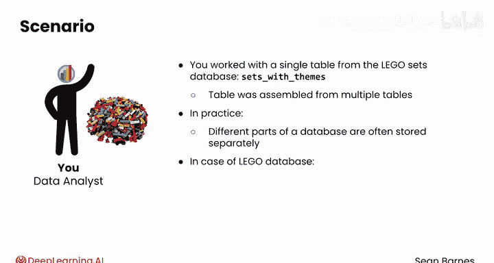
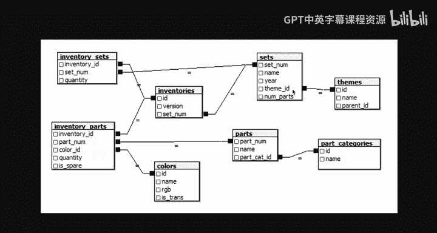
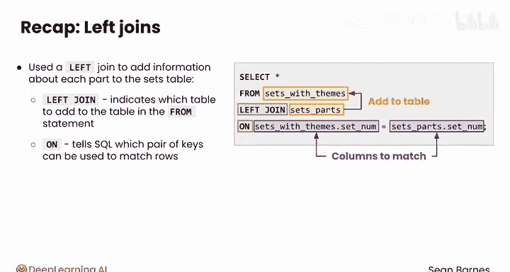

# 吴恩达《数据输入／输出与预处理（Python 和 SQL）Data I／O and Preprocessing with Python and SQL》中英字幕 - P68：67_左连接.zh_en - GPT中英字幕课程资源 - BV1sZEzzQEkF

In the previous video， you learn that SQL joins combine data from different tables。

 A left join helps add more context to your current table Throughout the previous lessons in this module。

 you work with a single table from the Lego sets database。 Se with theme。

 This table was actually assembled from multiple tables In practice。

 different parts of the database are often stored separately In the case of the Lego database sets and themes each have their own table。

 Check out the schema for the actual Lego data。 notice that sets and themes are stored in separate tables。

 Se nu is the primary key for the sets table。 So what does that make theme I and the sets table。

Theme I is a foreign key that allows you to access the theme in the theme table。

 So left join will allow you to add the theme name and parent ID to the sets table。

 Let's take a look at how you can perform a similar join in your Python notebook。

 say you're interested in looking at the parts contained in each set。

 You can left join the parts table onto the sets table to add information about the set each part is contained in like the set name and year of release。

 Let's try it and code。 Remember， you can follow along with the demos in this lesson using the provided practice lab item。

 which comes after this video。 Start by importing the necessary libraries and creating the database connection。

 Start with the left join which returns all the entries from the left table and the matching entries from the right table。

 If no match exists， the result shows null values for the columns from the right table。

  build up the query step by step。 So first you'll have select star from sets with themes。

 that gives you the information about each set and its theme at the bottom of the data frame。

 It shows that there are a total of 11673 rows。 Meanwhile， the query select star from sets parts。😊。

Gives the setum part ID color ID quantity and is spare。 This table represents each part。

 so it contains only information about the parts individually at the bottom of the data frame。

 it shows that there are nearly 600000 rows So to join them right select star from sets with themes left join sets parts on sets with themes do setum equals sets parts setum you already know the first two statements in the query。

 The left join line tells you what kind of join you want to perform Then you specify which table you want to add information from The last row tells which columns from both tables should be matched。

 Both tables have a setum， which is a unique identifier for each set so you can use that number to match up rows This query will match rows from the sets with themes table with rows from the parts table where the setum is the same in both tables The dot notation in the on clauseuse helps you be specific about which table a given column comes from without dot notation you'd have something like setum equals setum and SQL won't be able to figure out which table you're referring to that。

ul lead to an ambiguous column error for readability。

 it's also useful to keep the left table on the left of the equal sign and the right table on the right Now this gives you back a huge table。

 you join all sets in all parse， which means that you now have one row for each part in each set This is an interesting table that you can explore further For example。

 you can add where sets with themes do setm equals 84801 to the end of your query to filter for the retrospace shuttle set for 1996 which was a big hit。

Now you can look for individual parts within this set row by row。

 This join also allows you to do cool stuff like examining the number of unique parts included in sets in each year。

Previously， you wouldn't have been able to complete this calculation since the year of release and parts were stored separately Try。

 select year count distinct part noum as parts per year from sets with themes left join sets parts on sets with themes do setum equals sets parts do setum group by year。

 make sure to select year so that you can see which year has each number of parts。 Okay， cool。

 So 1950 had only six unique parts same for 1953， and then the numbers seem to gradually increase until they go up to values in the  three00 in the 2010s。

 You can also graph these using a line plot。😊，The increasing trend is quite clear。To recap。

 you use the left join to add information about each part to the sets table。

 The left join statement indicates which table to add to the table in the from statement。

 The on statement then tells SQL which pair of keys can be used to match rows。

 On sets with themes do setum equals sets parts do setum specified which column to match in each table。

 You saw how this type of join can create a richer data set and enable previously impossible analysis。

 Okay， great， Now you've learned how to add more context to your current table with the left join In the next video。

 you'll practice using inner joins to combine common observations from multiple tables。 See there。😊。

