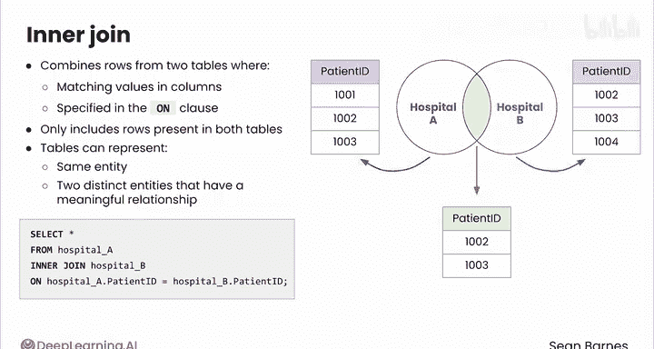
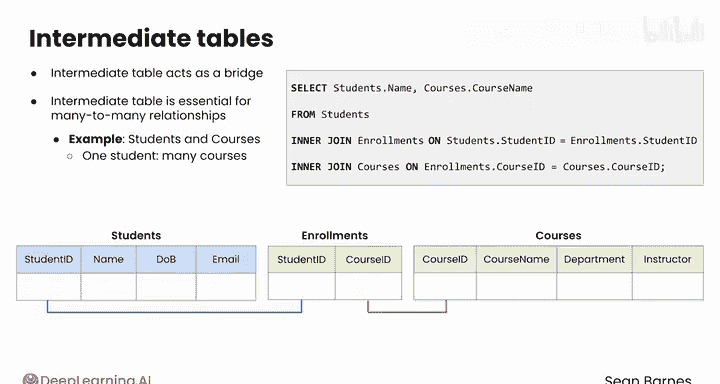

# 吴恩达《数据输入／输出与预处理（Python 和 SQL）Data I／O and Preprocessing with Python and SQL》中英字幕 - P69：68_内连接.zh_en - GPT中英字幕课程资源 - BV1sZEzzQEkF

You'll often find yourself working with multiple tables that contain information about the same entity。

 you can join them together to find common rows giving you richer context about that entity an innerjoin combines rows from two tables where there are matching values in the column specified in the on clause This joint only includes the rows present in both tables The tables can represent the same entity or they can represent two distinct entities that have a meaningful relationship for example。

 let's say you have patient records from two hospitals and want to analyze only the patients admitted to both hospitals you might write this query select star from hospital A innerjoin hospital B on hospital A patient ID equals hospital B patient I The output will only show the patients that went to both hospital A and hospital B In this case。

 you'll need to assume that both hospitals share the same patient ID system so the same patient has the same ID at each hospital you can visualize innerjoins using a Ven diagram on the left is the first table Sa it represents hospital A on the right as the data from hospital。

B， the inner join represents the overlapping area where the circles intersect patients that are unique to hospital A or unique to hospital B are not included。

 so innerjoins are best for focusing on shared data between two tables。

Sometimes data from two tables can't be directly joined because they don't share a common field in these cases。

 you can use an intermediate table to act as a bridge For example。

 consider a scenario with students courses and an intermediate enrollmentments table The Student table contains information about students like student ID name data birth and email address the courses table contains details about courses like course I name of course department and instructor the enrollment table link students to the courses they are taking with column student ID and course ID to find all students and the courses they are enrolled in you could write select students。

 name courses。 course name from students interjoin enrollments on students student ID equals enrollmentments student ID Injoined courses on enrollmentments。

 course ID equals courses。 course ID This query starts by joining the student table with the enrollmentments table with the student ID as the common field This new table is then joined with the courses table with the course ID as the common field In other words。

 the query。The Enments table to connect students to their courses using intermediate tables in this way is essential for many to many relationships such as the one with students and courses since one student can take many courses and one course can have many students。

Inner joinins are one of the most complex and powerful operations in SQL。

 There's one more type of join you should be familiar with。 The outer join。

 follow me to the next video to learn more。😊。