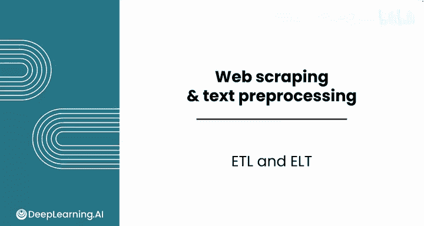
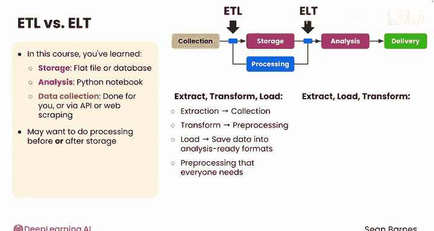
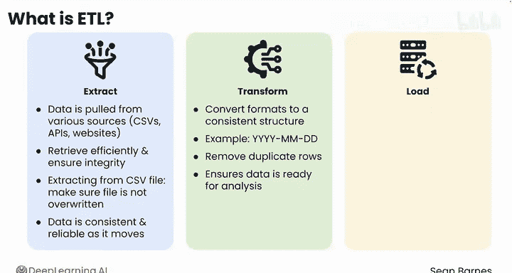
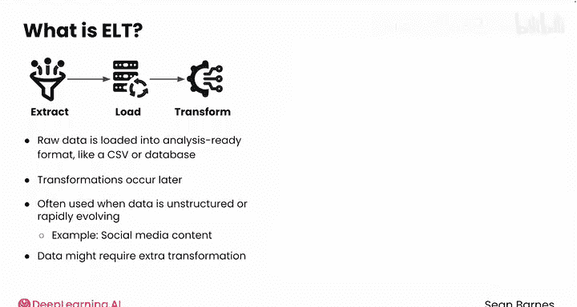
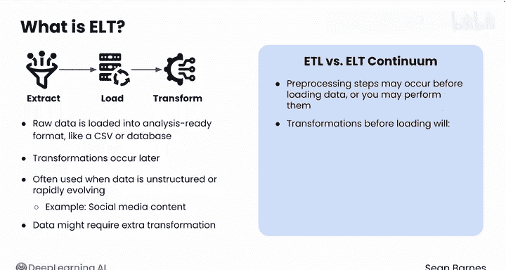
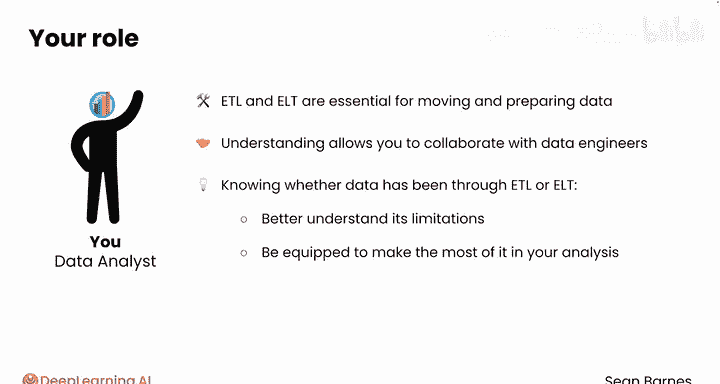

# 吴恩达《数据输入／输出与预处理（Python 和 SQL）Data I／O and Preprocessing with Python and SQL》中英字幕 - P6：5_ETL与ELT.zh_en - GPT中英字幕课程资源 - BV1sZEzzQEkF

Data often undergoes many preprocessing steps before it's ready for analysis。

Depending on the kind of preprocessing needed， those steps may take place at different points in the data's lifecycle If you took the earlier course data analytics foundations。

 you may recall this diagram of the data ecosystem from collection to processing storage analysis and delivery you've learned so far in this course that storage in this context often means a flat file like a CSv or a database and analysis is often done in a Python notebook Data collection may be done for you or you can do it yourself depending on your use case through APIs or webs scrappy noticeice that this diagram includes preprocessing at multiple stages depending on your business problem you may want to do processing either before or after storage processing data before storage is called ETL extracttract Trans load that's this block on the left Extract essentially means collection Trans means preprocessing and load is when you save that data into an analysis ready format such as a database or CSV you can think of ETL Transs as preprocessing that everyone needs。

 For example， if your company has some sales data coming in。

From different stores your data team might standardize data formats， clean up customer names。

 remove obvious duplicates and so on if you process data after storage that's called ELT extract load transform this block on the right the data is collected then you load it into your python notebook for preprocessing in addition to analysis This process is somewhat less common your data team will lead the data as is or reserve some preprocessing for later this is typically done if people downstream have different data needs for example。

 if the team regularly collects online reviews they might just leave them as is in case different analysts like yourself want to perform different types of analysis on those reviews let's take a closer look at each step in ETL the first step in the ETL process is extraction where data is pulled from various sources such as cv files。

 Apis or websites the goal of extraction is to retrieve this data efficiently while ensuring the integrity of the source for example when extracting data from a cv file to analyze it in a python notebook you want to make sure the file is not being overwritten or edit。

During the process that way， the data remains consistent and reliable as it moves through the pipeline After extraction。

 the data is transformed。 For example， you or other members of the data team might convert all data formats to a consistent structure like year month day or remove duplicate rows。

 This transformation ensures the data is ready for analysis Finally。

 the transformation data can be loaded into an analysis ready format like a flat file or database then you can use a tool like a Python notebook to read in the data for analysis。

 This step brings the data into a format you're already familiar with so that you can start your analysis without having to perform a lot of preprocessing in EL the raw data is loaded into an analysis ready format like a cv or database first and transformations can occur later businesses often use this approach in cases where data is unstructured or rapidly evolving such as social media content but using an ELT process also means that the data might require extra transformation steps in Python or other tools before it's ready to use In practice there's a continuum between ELT and。

ELSome preprocessing steps may occur before loading data into the database or CSV while you may personally perform others As you saw a moment ago。

 transformations that occur before loading will ensure data integrity and enable consistent analysis and shouldn't block later analysis For example。

 your data engineers might standardize data formats from different regions but they be unlikely to remove the milliseconds from the timestamp。

 even though that data might seem unnecessary for many applications that data is typically preserved just in case it's useful ETL andLT are essential processes for moving and preparing data for analysis while you may not be responsible for setting up these processes directly。

 understanding how they work will allow you to collaborate effectively with data engineers more than that。

 knowing whether your data has been through EL or ELT means you can better understand its limitations and be equipped to make the most of it in your analysis Great work in this first lesson coming up you'll complete the practice assignment to test your knowledge once you're done join me in the next lesson where you'll get handson with web scraping and data cleaning。

