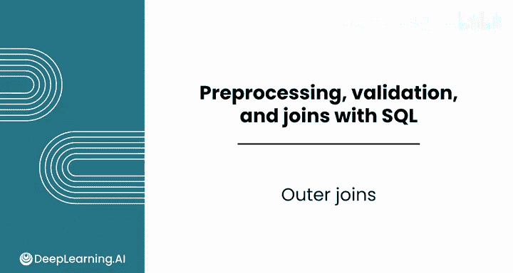
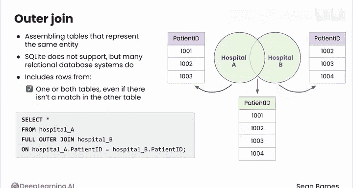
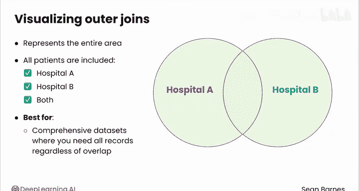

# 吴恩达《数据输入／输出与预处理（Python 和 SQL）Data I／O and Preprocessing with Python and SQL》中英字幕 - P70：69_外连接.zh_en - GPT中英字幕课程资源 - BV1sZEzzQEkF

When working with multiple tables that represent the same entity。

 you may be interested in assembling a combined dataset。 even if some records don't match。

 you can still join the tables together， assembling multiple tables that represent the same entity is often done with an outer join Note that SQL light does not support outer joins but many other relational database management systems do you should be familiar with how outer joins work and outer join includes rows from one or both tables。

 even if there isn't a match in the other table。 for example。

 you might write the query select star from hospital A full outer join hospital B on hospital A patient I equals hospital B patient I the output will show a complete list of patients from both hospitals。

 including where overlaps occur In other words， the patient who went to both hospitals and where data is missing where a patient went to one hospital but not to the other Again。

 you'll need to assume that the patient I system is shared between hospitals。

 you can visualize outer joins using a similar Venn diagram As for an inner join on the left is the first table for hospital A on the right。

The data from hospital B， the outer join represents the entire area。

 including overlaps and non overlapping sections。 All patients are included。

 whether they went to hospital A， hospital B or both。

 So outer joins are best for comprehensive data sets where you need all records regardless of overlap。

 While outer joins do have some limitations， you should be aware of they're incredibly useful for amassing a large combined data set representing a particular entity。

 Each joint has its place。 depending on your data and business question。 As a data analyst。

 it's your job to match the business goals with the most appropriate joint type。

 and that takes you to the end of this lesson and almost to the end of this course。

Coming up， you'll complete the practice assignment and practicectic La for this lesson。

 then you'll tackle the graded items， including the graded assignment， lab。

 and capstone for this course。In the capstone， you'll explore restaurant characteristics to better understand how to predict restaurant inspection performance。

Once you're done with the capstone， I'll see you in one final video to talk about your next steps as a data analyst。

