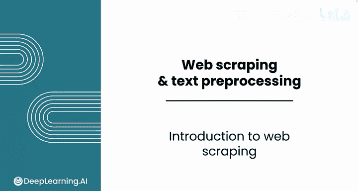
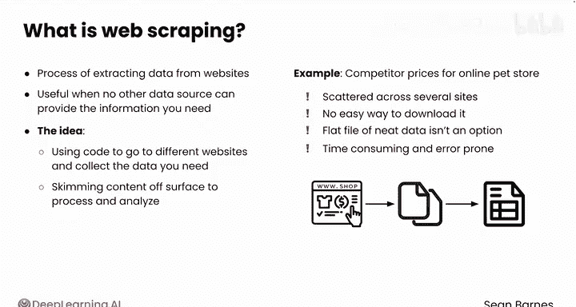
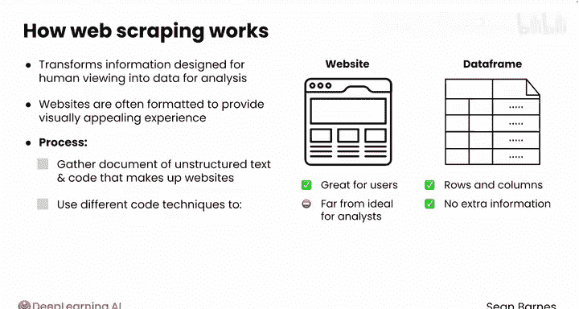
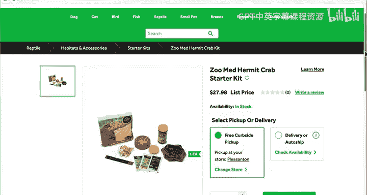
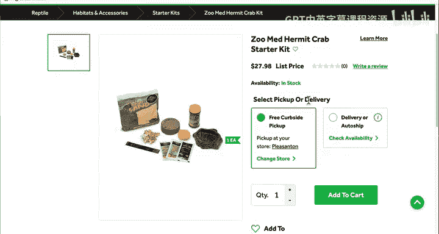
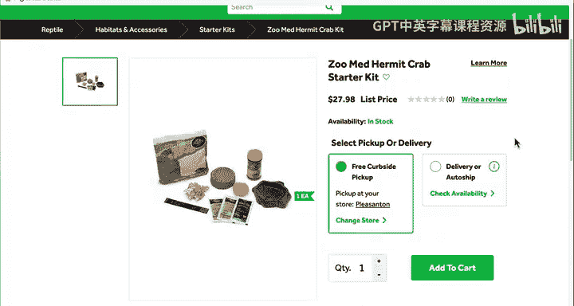
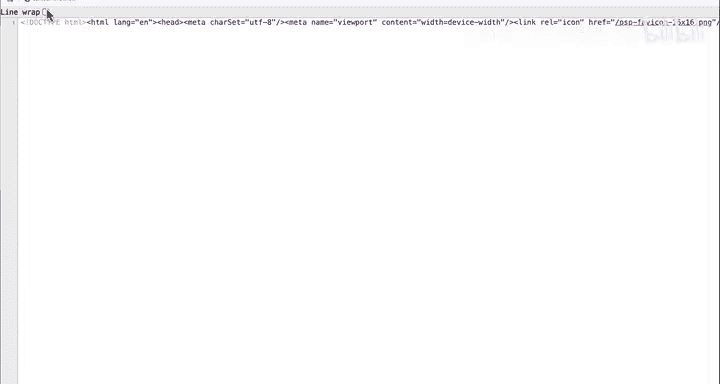
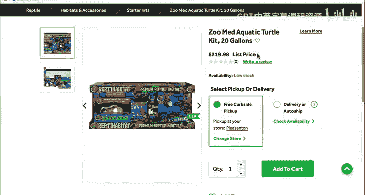
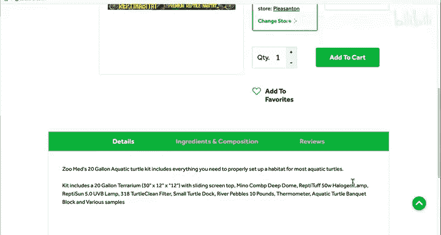
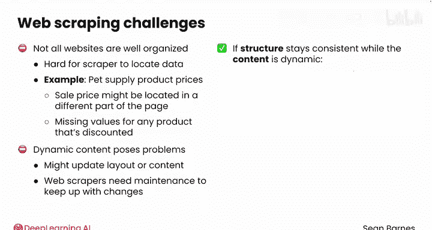

# 吴恩达《数据输入／输出与预处理（Python 和 SQL）Data I／O and Preprocessing with Python and SQL》中英字幕 - P7：6_网络爬虫介绍.zh_en - GPT中英字幕课程资源 - BV1sZEzzQEkF

In the last lesson， you learn that web scraping is one data collection method available to you in this video。

 you'll learn more about how web scraping works and why it's a valuable tool for any data analyst。

 Web scraping is the process of extracting data from websites。

 you learn in the previous lesson that it's often useful when no other data source can provide the information you need For example。

 say you're working as a data analyst researching competitor prices for an online pet store。

 The data you need is likely scattered across several ecommerce-commerce sites with no easy way to download it。

 The method of collecting data you've already encounter in this program。

 downloading a flat file of need data isn't an option。

 You could manually go to different competitor websites and copy their prices for each product and enter that information in a spreadsheet but it would be a time consuminging an error prone process。

 Why not get a computer to do it for you。 That's the idea behind web scraping using code to go to different websites and collect the data you need If you think of a website as a flat surface。

 You're essentially skimming the content off that service to process and analyze hence the term scrap。

😊。

Web scraping essentially transforms information designed for human viewing into data suitable for analysis。

 websitebss are often formatted to provide people with a visually appealing experience with menus。

 images and more while this is great for users it's far from ideal for analyst In fact。

 is pretty much the opposite of a data frame where you want everything a neat rows and columns with no extra information in web scraping you gather through a big document of unstructured text and code that makes up the website。

 then you use different coding techniques to extract only the data you need typically in a structured format like rows and columns Here's a quick example say you're looking the scrape prices for Hermit Crab starter kits online to help better price your products Here's an example product page from pet supplies plus showing a hermit crab starter kit you're interested in the name of the product the price and maybe a description which here is called details。

 there's a lot of irrelevant information here。 In fact。

 more than meets the eye If you right click this page then say view page source。

 you may have to turn on myrap you can actually see that there is a ton of information here。😊。

Web scraping involves writing a computer program to parse through all this unstructured text and code to find the price Here it is about a third of the way down。

 don't worry about all this code you'll see that with Python this task is much more manageable。

 The cool thing is once you've written a program to scrape this page， you can likely reuse it。

Here's another product page for an aquatic turtle kit。 noticeice that the title。

 price and description are all in the same location。

 A common web scraping paradigm is to have a list of all the sites you want to gather information from and use the same code to scrape each one Web scraping presents many challenges for data analyst First not all websites are well organized making it hard for your scraper to locate the data you need for example。

 say your scraping pet supply product prices if the product is on sale。

 the price might be located in a different part of the page than it usually is。

 that might lead to missing values in your data for any product that's discounted。

 dynamic content also poses problems for scraping。 even if a website has a clear structure。

 it might update its layout or content which can cause your scraper to break Web scrapers often need maintenance to make sure they're keeping up with these kind of changes but if a website structure stays consistent while the content is dynamic your web scraper will truly shine For example。

 you saw earlier that product pages are typically formatted in a consistent way you can write one scraper to find the price of every product on a pet。

website web scraping transforms unstructured information into valuable data sets。

 saving you a ton of time， follow me to the next video to write Python code to scrape tables of data。

