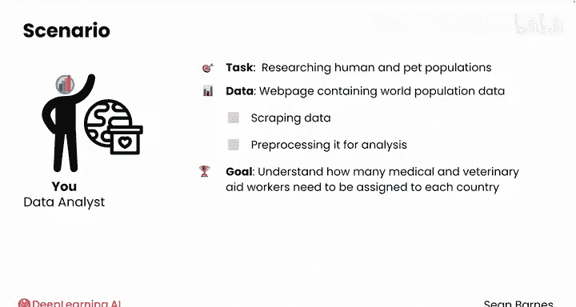
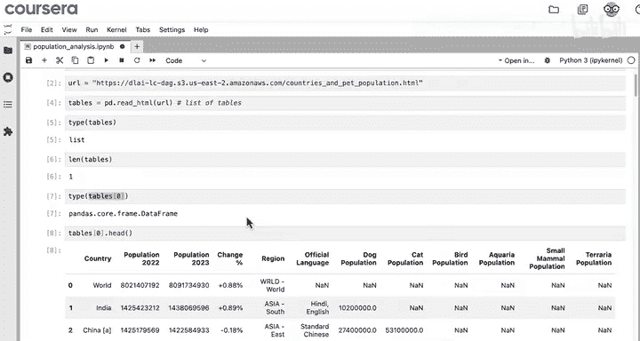
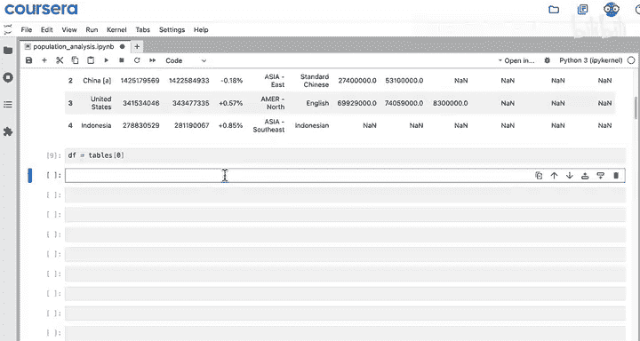
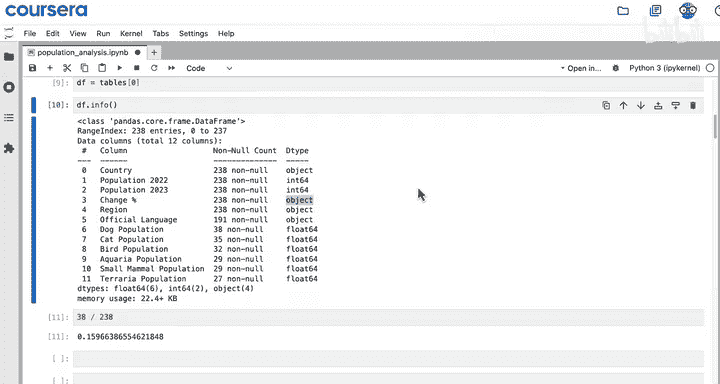
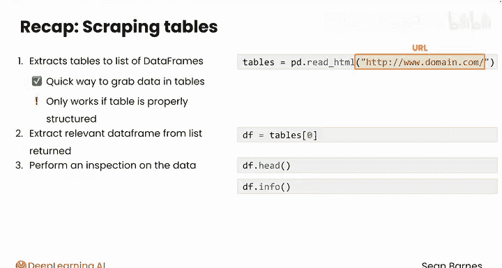

# 吴恩达《数据输入／输出与预处理（Python 和 SQL）Data I／O and Preprocessing with Python and SQL》中英字幕 - P8：7_使用Pandas抓取表格数据.zh_en - GPT中英字幕课程资源 - BV1sZEzzQEkF

In the last video you learn that web scraping enables you to transform unstructure web content so it's suitable for analysis。

 Now you're ready to get handson practice web scraping and canvass In this lesson。

 you'll explore the task of researching human and pet populations worldwide for an international aid organization your team has located a web page containing world population data and you've been tasked with scraping its data and preprocessing it for analysis your ultimate goal is to better understand how many medical and veterinary aid workers might need to be assigned to each country。

 Take a look at this website which has been adapted from the Wikipedia page of rural populations before scraping the data from any web page you'll need to get familiar with its content。

 First notice that each row is a country from the top row。

 which is the world each column is some feature of that country like its population in 2022 or 2023 dog population region official language and so on This information is presented in a table that's pretty much the same format as a data frame if it were already in the data frame you can calculate the number of dogs per capita and then。

from highest to lowest and do some other cool analyses。

 Notice that there's a good deal of missing data。 For example。

 you have the population of dogs in India， but not the cat or bird populations。

 you'll need to be mindful of that in your analysis。

 Let's head over to a fresh Python notebook to start scraping this page。

Remember that you can use the practice lab item to follow along with the demos。 First。

 import pandas as PD a line of code you should be familiar with from the previous course。

 then save the URL of this website as a string into a variable like URL Padas provides a function。

 read HTML that takes data stored in a table like you just saw and turns it into a data frame That process is complex。

 So it doesn't always work perfectly and it only works on tables stored in a certain way which you'll learn more about in an upcoming video about HTML called PD read HTML with URL as the only argument When you run this line of code。

 pandas will go off to this website look for any properly formatted tables and save them into a list of tables。

 you can save this result into a variable called tables Now check the type of tables。 It's a list。

How long is it checking that with the link function theres only one table stored in tables that makes sense because there's just one table on the website。

 the populations to display this table you'll want to get the first item of this list Do you remember how to access the first item in a list？

That would be the name of the list tableables at index0。

 check its type quickly and you get a data frame convenient， so because table0 is a data frame。

 you can use the command table0 got head to view the first five rows。

These first five rows exactly matched the table you just saw since you'll be working with this data throughout this lesson。

 you can save it in the variable DF to save some typing Finally， check out Df。

 infofo to see a summary of the data store here。

There are 238 rows and 12 columns。 The non- null count column shows that there are 38 rows with a dog population。

 so you only have dog data for about 15% or so of all these countries。

 and it looks like panda's automatically detect many numeric columns including these populations you may notice that change percent though it should be numeric is represented as an object remember that in panda's object typically means text。

 Pada's defaults to treating data as text when it's unsure how to safely convert it into another type like ant or float。

 Excel you've scraped your first web page。 you saw PD read HTMLtm extracts tables from a web page and stores them in a list of data frames。

 This function takes one argument the URL of the page you want to scrape as a string。

 read HTMLtml is a quick way to grab data sorting tables though as you'll learn in an upcoming video it only works at the table as's properly structured once you extract the relevant data frame from the list returned by p readhtml you can perform an inspection on the data using dfhead Df info and any other data frame functions。

And attributes you learn in the previous course。

Great work， you've seen that using PDd。readhtml is a quick way to extract all the tables from a website。

 follow me to the next video where you'll learn about how to clean up strings for analysis。

