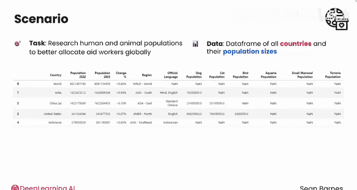
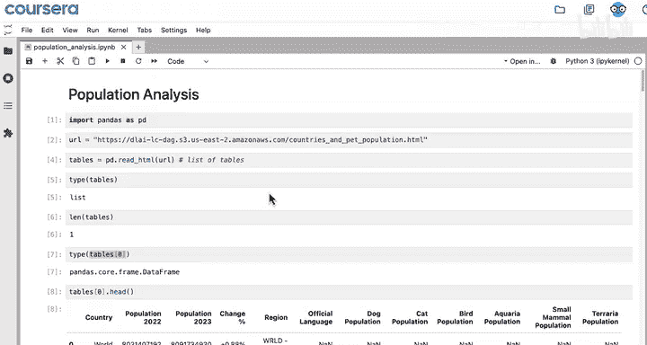
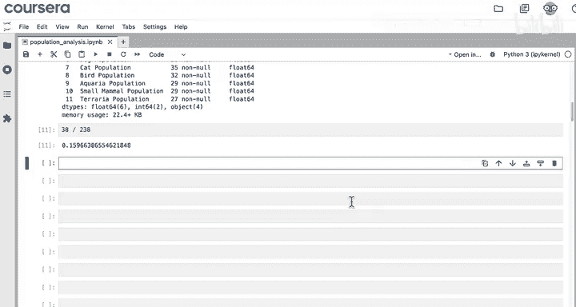
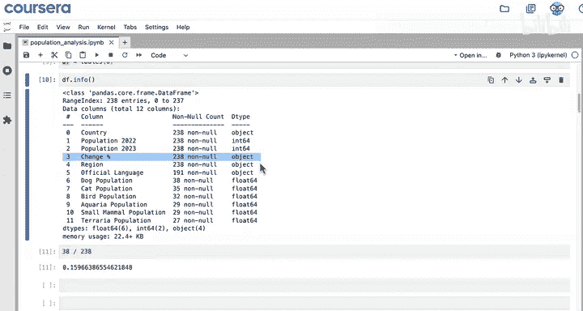
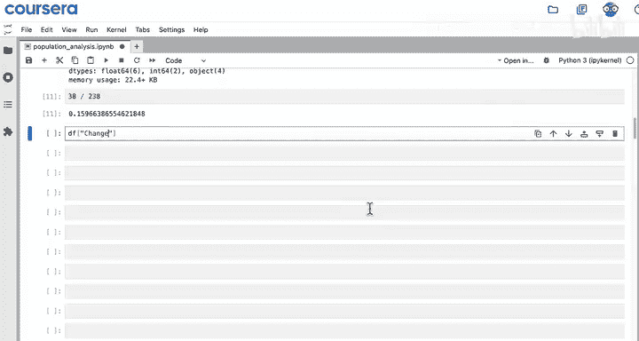
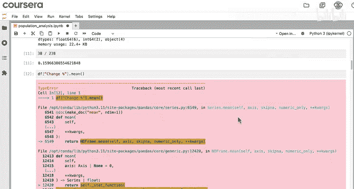
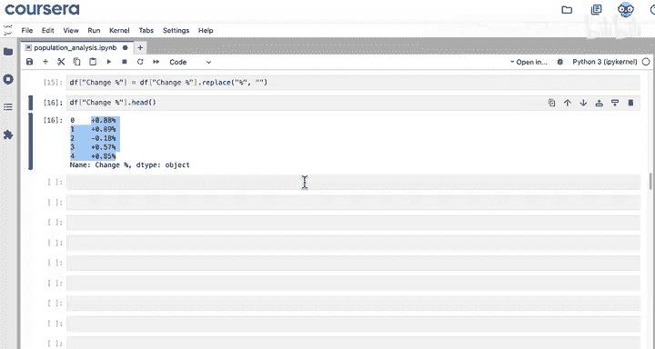
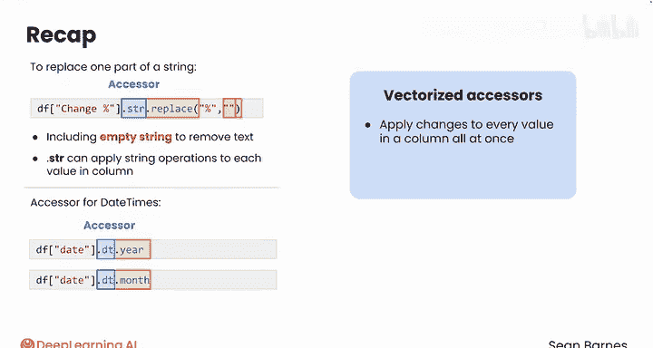

# 吴恩达《数据输入／输出与预处理（Python 和 SQL）Data I／O and Preprocessing with Python and SQL》中英字幕 - P9：8_字符串处理：替换方法.zh_en - GPT中英字幕课程资源 - BV1sZEzzQEkF

In the last video， you saw that data scraped from websites can be messy or incomplete In this video。

 you'll learn your first text processing method for data cleaning just to recap in your role as a data analyst at the international aid organization your task is to research international human and animal populations to better allocate aid workers globally you scraped a useful data frame of all the countries in the world and their population sizes to perform your analysis to recap you're working in this python notebook where you've scraped a website of world populations using PD read H。

 Then you save the table in the variable Df and examine the data remember you can use the practice lab item to follow along with the demos recall that several of the features are stored as objects or text essentially for the names of countries and regions object is the most appropriate type but you saw that the percentage change in population year over year should be stored as a float because it's a number not text that's inconvenient for calculation For example。

 if you try to calculate an average growth rate for all the countries in the world using do mean on the percent change column you'll get this huge。

ARemember that for a long error like this， you should scroll to the bottom to see the actual issue It says could not convert string such as plus 0。

88% to numeric， so you'll need to convert these strings into numbers for analysis the major hang up here is the percent symbol which needs to be removed before you can automatically convert these objects to flips Here's your first text processing method replace This method replaces one part of a string with another part and as a bonus you can also use it to remove things like the percent symbol entirely For example。

 say you want to take this list of the four most populated countries and replace United States with USA to use the replace methods start with the variable countries then use dot replace with two strings as arguments。

 The first string is the text you want to replace and the second string is the text you want to replace it with your arguments would be United States then USA。

Running the cell， United States was replaced with USA。

 Great to remove some text like the percent sign from the string。

 your first argument to replace will be the percent sign as a string。

 Then your second argument will be an empty string。

 You're removing the percent sign and replacing it with nothing。

 Remember the empty string isnt a space。 It's just nothing。 It has zero characters。😊。

Now you want to perform this operation on this entire column to replace the percent sign in each cell。

 let's give it a try， use dot replace on the entire column， then save it back into that column。

When you view the first five values of this column now， what do you expect to see？

It should be positive and negative floating point numbers with no percents。 aas。

 the column is exactly the same as before。 Let's ask the LLM why this isn't working as intended。

 Tell it that you're trying to remove the percent sign from every value in a column of a data frame。

 Why doesn't it work， The column looks the same as before， and then paste in the code。

Okay， so the LLM explains that the dot replace method in pandas is meant for replacing entire values。

 not parts of them， essentially DF Change percent is being treated as a string rather than a collection of strings。

 this is a super common mistakesaique to fix this issue you can use the STR dot replace method so copy this code and give it a try。

Nice， you successfully remove that percent sign from every cell in this call。

Let's do a quick recap of what you've just seen。 You learn that the dot replace method in Python allows you to replace one part of a string with something else。

 including the empty string if you'd like to remove some text。

 you also learn that dot STR and pandas can apply string operations like dot replace directly to each value in a column dot STR is called an accessor and Python for data analytics you've already encountered the dot Dt accessor for date times For instance。

 you might use dot Dt to extract the year or month from a datetime call dot STR and dot Dt are both vectorized accessors。

 which means they apply changes to every value in a column all at once without you needing to rent a loop。

Data won't always come clean and ready to analyze， but with tools like dot replace。

 you can transform messy strings into usable data In the next video。

 you'll take it one step further by casting these clean strings to numeric types。'll see there。

