# 吴恩达《文档 AI：从 OCR 到智能体化文档抽取｜Document AI From OCR to Agentic Doc Extraction》中英字幕 - P10：10.lab-4%3A-document-understanding-with-agentic-document-extraction-ii.zh_en - GPT中英字幕课程资源 - BV1LmkEBHEHU

All right， we're back with the continuation of La 4。

 Our setup will be identical to the previous notebook across those first four cells。

 we've imported some general data science libraries set up landing AI's AD loaded the API key from the environment variable and we're ready to go As before will import some helper functions which you can examine separately in the helper file In exercise 3。

 you'll assume the role of a person who works at a bank and is reviewing loan applications and will develop a fairly realistic full document processing pipeline If you've ever applied for loan。

 you will probably ask to upload various financial documents。

 you probably supplied some sort of income statement such as a pay stub some sort of tax form showing your total income from the year before。

 maybe a bank statement or an investment statement to show the value of your assets and probably also some sort of government issued ID Now the challenge for the bank。

Receiving all of those documents is that they may have all sorts of crazy names might be upload a might be image 4。

5，6。 They need to understand what is this document that you uploaded。

 and then they need to pull out the key value pairs that they're actually interested in such as that total asset value。

 So that's the processing pipeline we're going to build here。

 we're going to have a user upload multiple mixed documents of unknown types。

 We're going to parse all of them。 Under what they are。 extract key value pairs from them。

 and then run some verification。 and we're going to do all of this using ADde as our main API。

 So let's do it first preview the documents that have been supplied to do that we'll create a function that displays everything in a particular directory。

 So before I execute this cell。 I'll warn you that these documents are all from different people。

 This is not actually a complete loan kits because we had to work with sample documents that are anonymized。

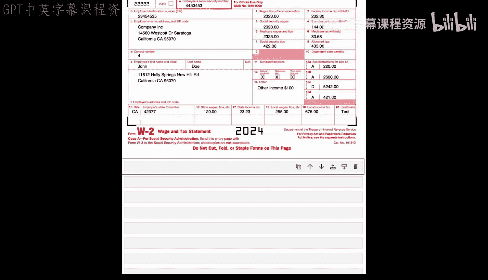

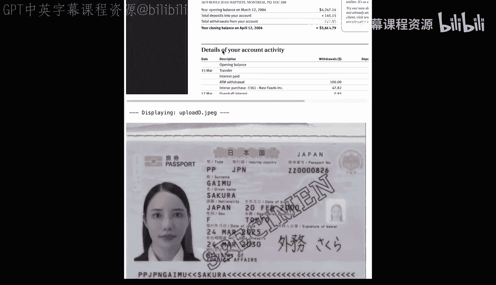

From the Internet。 So here's upload a PDFf looks to be a fidelity investment statement。

 uploadload B looks like a payroll statement。 uploadload C first glance looks like a bank statement。

 upload D looks like a passport and upload E looks like a USW2 form。 And of course。

 I recognize all of these instantly with my human vision but how is a document processing pipeline going to understand these in the same way。

 recall that all the documents came in with names such as upload a。

 So we will need to categorize them。 And to do that we'll be using the extract API from Ade with a pedantic JSsonN schema。

 Now， this schema looks a little bit different than the schema from exercise1 because we're using pedantic rather than JSON。

 These are the two options that ADE accepts as an input。

 Here we define a class document type where we enumerate the。

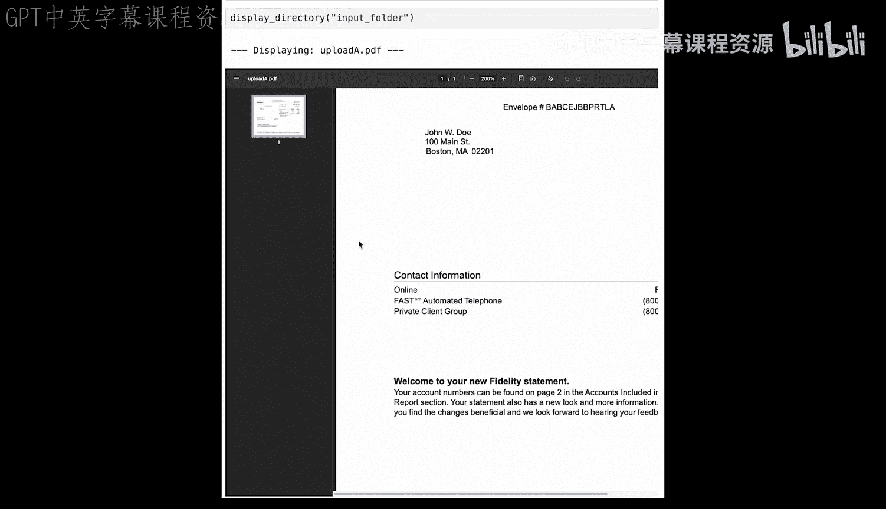

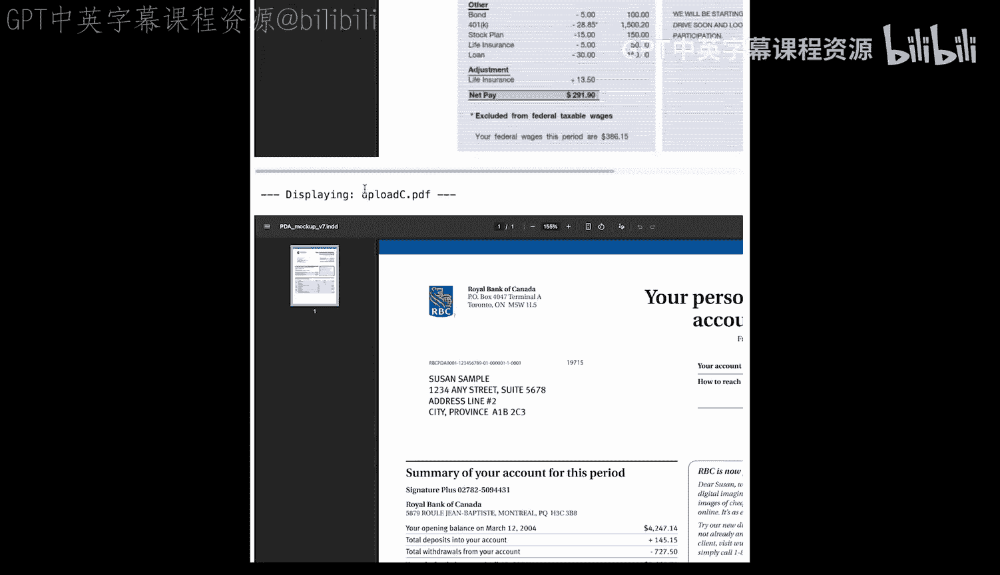

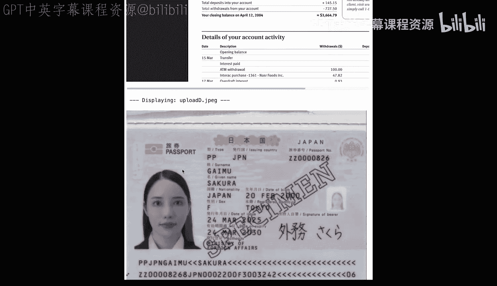

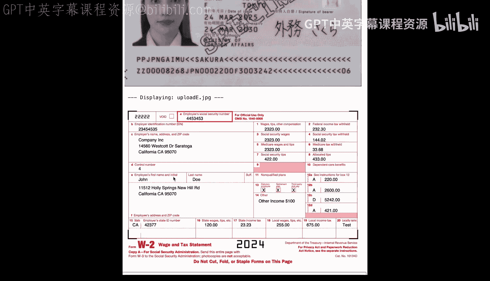

Tpes that we're expecting and provide a rich description of what each might look like。

 and then a class doc type to bring that all together。 Now， we'll proceed to again。

 use pedantic to define documentspec extraction schemas。 What do we want from the payub。

 What do we want out of the investment statement。 What do we want out of the bank statement and so on and so forth。

 in this cell， we have five different documentspec pedantic schemas。

 Let's just take a look at one or two of them。 So in the class for the I schema。

 We're expecting some sort of government issued I such as a driver's license or a passport。

 that should definitely contain the full name of the person。

 It should have the state or country issuing the identification。

 It should have an issue date and some sort of unique identifier。

 So these are the four strings that we're looking for in the field extraction step from the I document。

 The W2 is a US tax form that is issued at the end of the。

So here we would be expecting the employee name， the employee name。

 the year that it was issued for and box1 wages refers to the total amount that that person earned in that year。

 Here we've got one integer and one float。 You can review the other schemas on your own time。

 down at the bottom of the cell， notice that we are mapping the schemas to a shorthand name that we can use later。

 This cell uses a function provided by landing AI to convert the pedantic schema to JSson。

 recall that both Json and pedantic are accepted for defining your schema， but under the hood。

 we will convert pedantic to JSson before we pass it to the extract API。

 Now we have all the components in place to do the parsing and the categorization。

 Let's take a look at the code in the cell before we execute it。

 We're going to be processing all of the documents in the input folder We'll be sending them to the parse API will be using Dpt2。

Latest and then this parameter is new。 We're actually asking for a markdown response for each individual page rather than for the document as a whole。

 So for example， if the investment statement had 11 pages。

 We would actually get back 11 different markdowns。

 The reason for that is that in order to identify the document， we often only need the first page。

 So the identification step， we'll just use the first page of the markdown here in step 2。

 we're calling the extract API。 we're using the doc type Jason that we defined earlier。

 and we're sending the first page markdown。 So let's go ahead and do that now。

 the way that I've written this code， it's actually sending each document in series。

 but there are many options for parallelizing this workload that will make the entire process go faster。

 We can look at the results as they come back。 Upload C has been identified as a bank statement。

 Upload a is an investment。E looks to be the W2。Upload D is the identification document and B is the pay stub。

 fantastic。At this point， we have marked down corresponding to all five documents。

 and we know what type it is。 So we're ready to apply the correct schema to the correct type of document and extract those key value pairs。

 Let's take a look at this cell before we execute it。 First。

 we create a dictionary to store the extraction results。 Then for each document。

 we want to look up the appropriate schema that goes along with it based on its document type。

 Then we'll send the correct schema along with the markdown to the extract API。 Finally。

 we'll store all of the results as they come back focusing on the extractions themselves and the extraction metadata where we'll find the visual groundings。

 Let's go ahead and do that。 Now。 Among all this output。

 recall that upload D was the identification document。

 It was a passport issued by the country of Japan with an issue date， March 24，2025。

 and recall that upload E was the。😊。

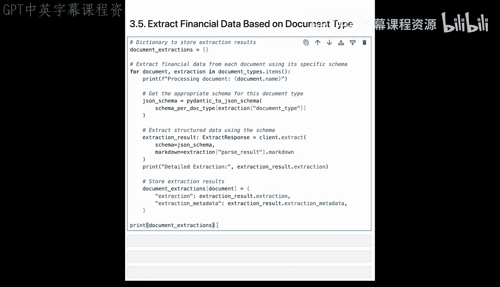

For for John Doe， who earned $2323 in the year 2024。 This is all looking good。

 The top part of the output has the extractions themselves and below you start to see the extraction metadata where you have these long chunk IDs。

 which we covered in lesson1 to kind of understand how to connect the chunk I back to the original document。

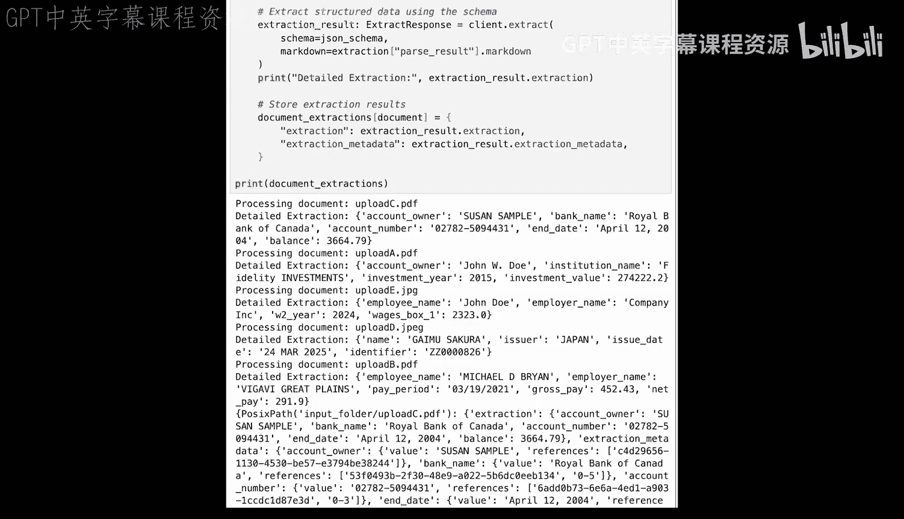

Let's do some visualizations of those parsing results with the bounding boxes overlaid。

 This is very similar to what we did in lesson1。 Here we're actually going to save each of the five as an annotated image。

 and then we'll actually view those images。 Here we have the annotated bank statement。

 which was upload C。 See several text chunks， two major table chunks。

 and all of the cell level grounding。

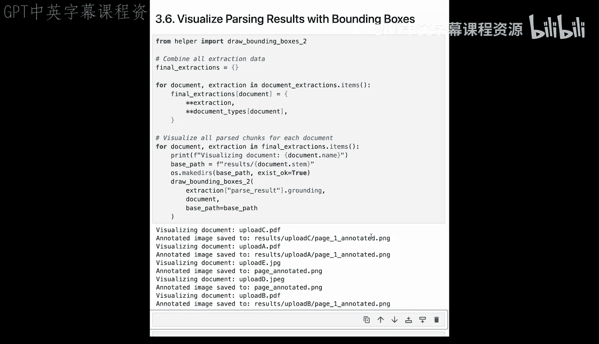

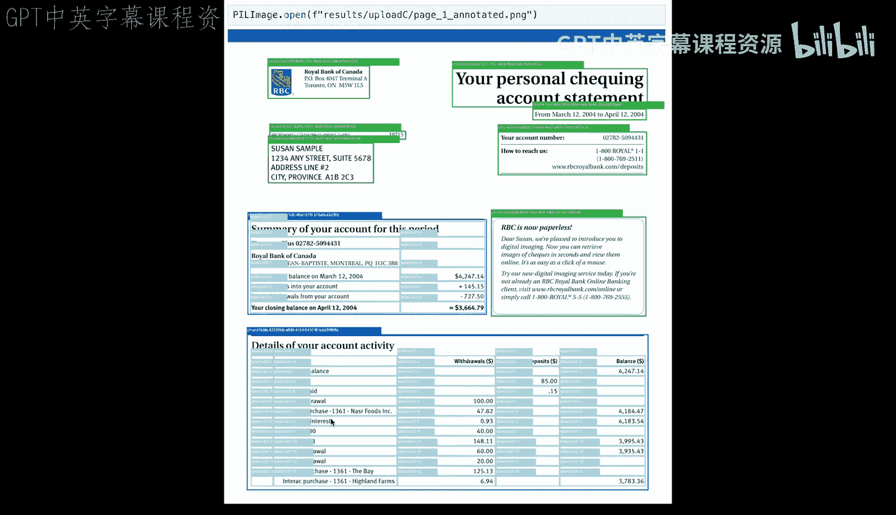

And let's look at one more。Here's the W2 statement。

 you can see the year is nice and prominent and the wage is up here 2323 in box1。

If you're building a document processing system， say with human in the loop。

 it can be really helpful to draw the human's eyes to the specific fields where those extracted values were found。

 Here we loop through all of the documents again， but we only annotate the specific fields that appear in the schema。

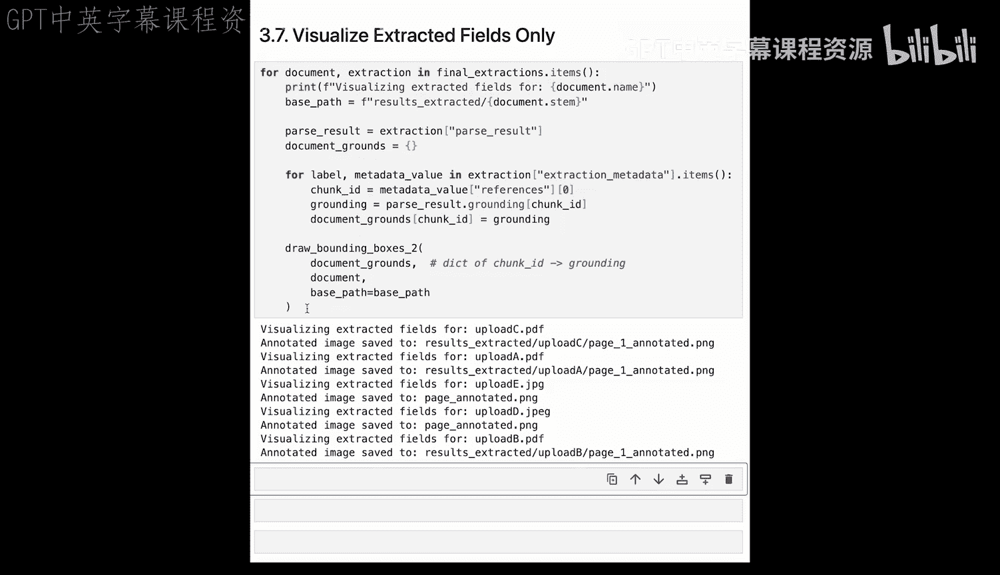

Let's take a look at Up C， which should be the bank statement。 And indeed。

 now that I is really drawn to where the name appears。

 where the total balance appears and where the statement date appears。

 So going back to our scenario of being the person who's receiving all of these loan documents。

 we're going to want to create some sort of final summary that represents everything that the person has provided。

 So in this block of code， we're going to go through all of those previous document extractions。

 and we're going to create a table with five columns as a panda's data frame。All right。

 This is a pretty nice summary of what the person has provided。

 We've got the folder corresponding to that applicant， the name of the document。

 the type that it was categorized as the field that was requested and off screen here。

 the field value。 Let's take a look at those。 Pretty good。

 This would definitely save you a ton of time versus opening all of these documents individually and visually hunting for this information。

 And then typing it into some sort of user interface。So as we mentioned previously。

 the names on these documents do not match， but that would actually be a key responsibility of the person receiving all of these documents。

 They need to check that these assets actually belong to the person who applied for the loan or that this identification actually belongs to the person who applied for the loan and you haven't just uploaded your next or neighbors documents。

 So here's a nice example of validation to check whether the name fields across all of these documents match and quickly surface if they do not。

 You can imagine now sending a trigger or an alert email back to the applicant saying these documents don't match。

 please check your work。 Here's another validation example。 Typ when applying for a loan。

 you need to provide recent documents and so it may be appropriate to actually check that all of these documents are from the same year。

 The rest of this code really just focuses on pulling the year。

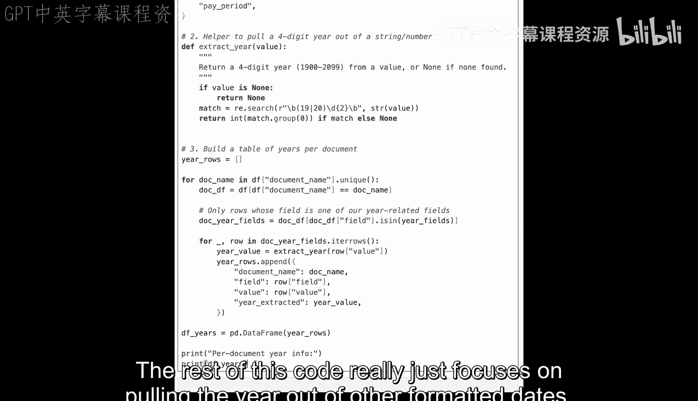

Of other formatted dates。 And again， because they're demonstration documents。

 there's some old ones that snuck in here。 They are definitely not all from the current year。

 So you're probably getting the hang of this， but just to round it out。

 let's sum all of the bank balances and all the investment balances to understand this person's total assets。

 In our example， there was just one bank statement and one investment statement。

 But imagine if that person had their assets spread all over。

 and they had uploaded 10 different bank statement。

 This would at least bring together all of the assets into one final number。

So that brings us to the end of exercise 3 in this exercise， you have authenticated with the ADE API。

cateterized a mixture of financial documents， parsed those documents and extracted their layout and content。

 defined custom pedantic schemas corresponding to different document types than extracted structured data with visual grounding。

 visualize those results， and finally define custom validation logic to spot check document gaps and errors。

 This also brings us to the end of lesson 4 and lab 4。 Now。

 you have handson experience using a single agentic API that understands your documents without further instructions from the user Ade from landing AI really allows you to focus on your use case rather than on lowle document parsing tasks。

 It's inherently agentic design grounded in a vision first model architecture allows it to understand any input with any layout in any language。

 If you want to try more for yourself get your own。PIkeyva。landending。

 will even throw in a thousand free credits to start with next up in lesson5 we'll hand it back over to David to go through a Gentic Do extraction for RaG。

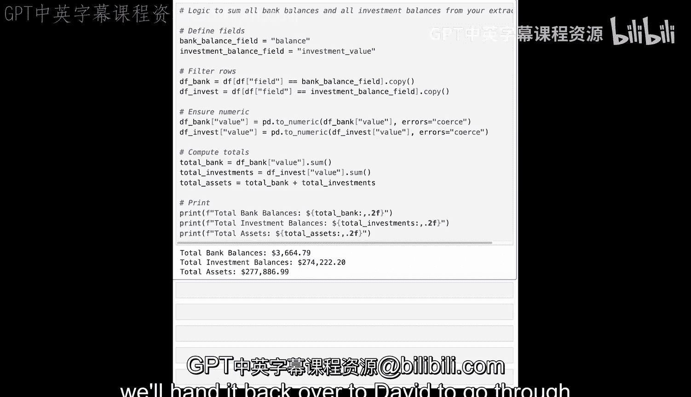