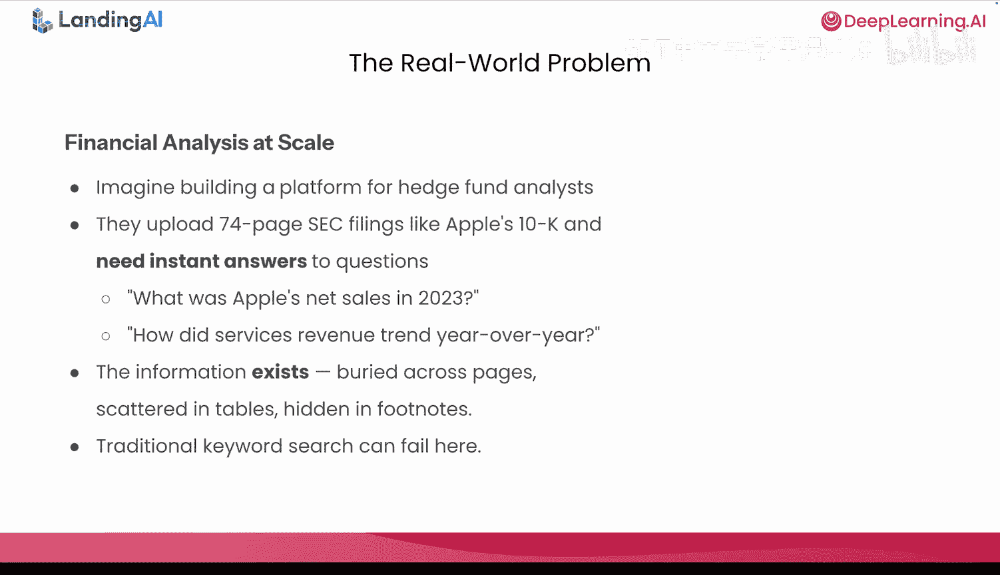
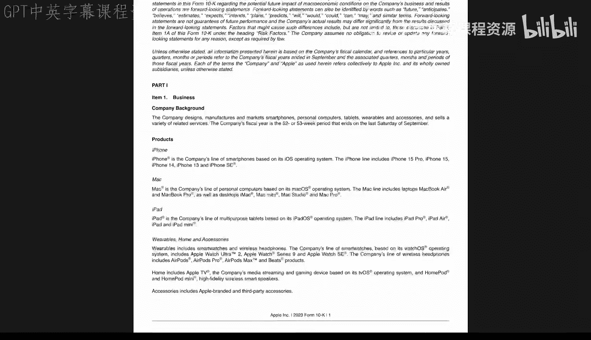
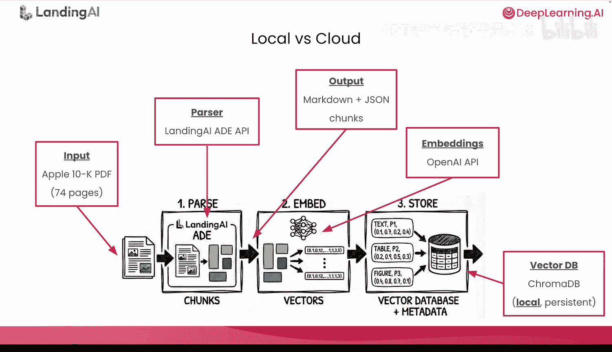
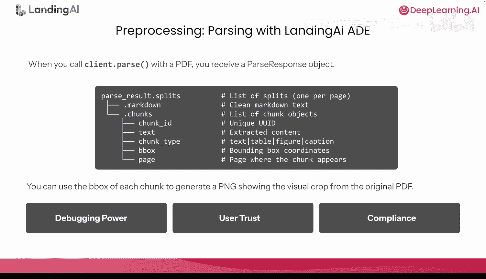
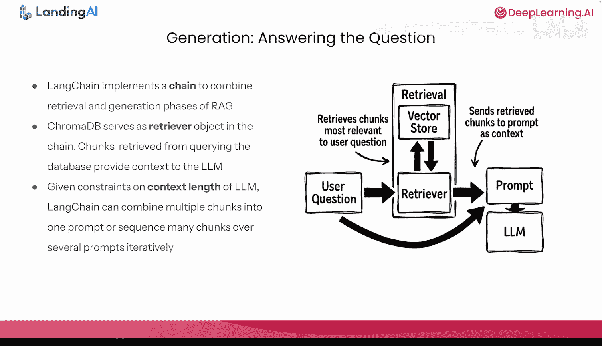
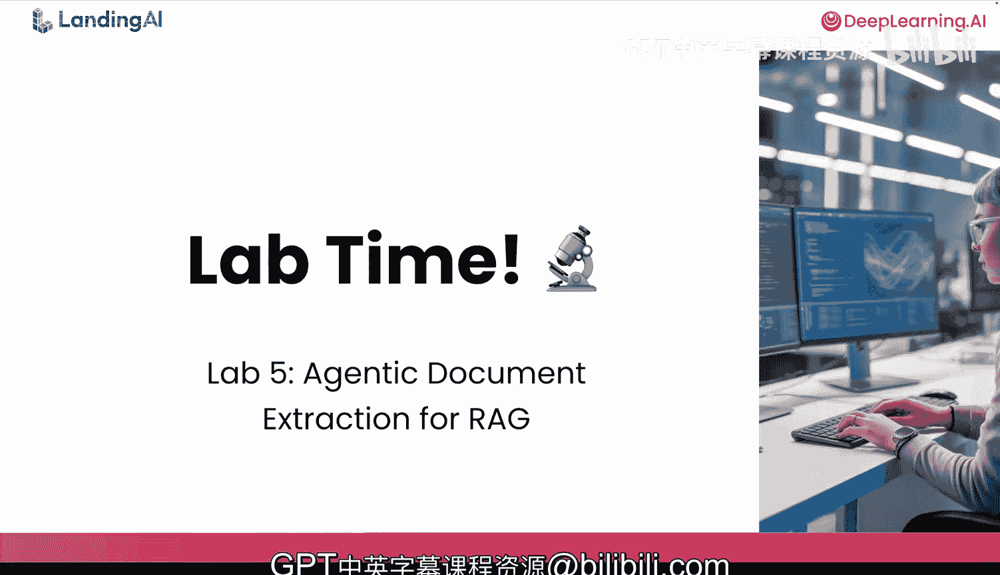

# 吴恩达《文档 AI：从 OCR 到智能体化文档抽取｜Document AI From OCR to Agentic Doc Extraction》中英字幕 - P11：11.agentic-document-extraction-for-rag.zh_en - GPT中英字幕课程资源 - BV1LmkEBHEHU

Having learned how to parse and extract information from your files。

 you will now learn how to answer questions about these files in this lesson。

 you will build a ragG application to queryrry your PDFs。

 You'll first use ADE to parse the documents， then store the parse chunks in a vector database and retrieve them to answer questions about your documents。

Let's dive in。Up to now we've been learning about document AI why OCR fails。

 how to best utilize layout and why reading order matters and how landing AI's agentic document extraction gives us clean grounded output by combining all the complexities of document processing in a single unified workflow。

 So now the obvious question is what do we do with all this structured data。

 One possible answer is building real systems。 specifically will build a retrieval。

 augmented generation pipeline or a rack system that turns a 74 page financial filing into a living breathing document and a queryrryable knowledge base。

 This is the same architectural pattern， powering modern document QA systems and production today across all industries and verticals。

 Let's frame this in a real scenario。 Imagine you're building an internal platform for a hedge fund。

 Your analysts have SEC filings like this Apple 10 K。 It contains detailed financial。

And business information that publicly traded companies must disclose to the Security and Exchange Commission。

 The analysts want to upload the files to the platform and ask questions like what was Apple's net sales in 2023。

 What are the biggest business risks。 How did the services revenue trend year over year The information they need is in the document somewhere maybe in a table on page 28 maybe in a footnote on page 45 or spread across three different risk disclosures on pages 1215 and 18。

 Now， why does traditional keyword search fail here first is semantic mismatch if an analyst searches for revenue but if the document uses phrases like net sales。

 Tra search would return nothing。 The concepts are identical。

 but the words don't match exactly Second， is context blindness the word revenue may appear 75 times in this document And if you want to know which mention is relevant to the analyst question。

Keyword search cant tell without additional guidance， and this isn't scalable。

 Third is fragmentation。 Information is scattered to fully answer the question。 What are the risks。

 You need to synthesize content from multiple pages。 Tra search can't do that。

 You need semantic understanding。 You also need context where retrieval。

 which means you need a system that understands what the user is asking， not just matches strings。

 This is where rack comes in， which is what you will build in the lab for this lesson。

 So what is ragg and why does it matter， Rag or retrieval augmented generation is the architecture behind nearly every modern document Q and A system today。

 The pipeline has six steps across three core phases。 First is preprocessing phase。 You parse embed。

 then store parsing takes rawwl documents and parse and extract clean structure text。

 This is where ADdeE comes in。 Clean input is critical。 garbageb in garbage out。

 If your parsing is noisy with OCR errors and mangle table。That you saw in previous lessons。

 everything downstream suffers。 embedding converts parse content into embeddings or vectors that capture semantic meaning。

 Storing saves these vectors and a vector database optimized for similarity search。

 you will use chromroma Db。 A local open source option perfect for development and learning。

 Second is the retrieval phase。 queryrry and retrieve。 querying embeds the user's question。

 searches through the database to find the top ranking vectors as measured by similarity。

 In other words， the most similar vectors to the queryrry Retrieving filters out any vectors whose similarity might be too low。

 then fetches the rest。 Third is the generation phase。

 It feed the retrieve content as context to a language model to generate a natural language answer with the corresponding retrieve content for grounding and verification。

 This is critical for heavily regulated organizations or HROs like financial services。

Healthcare and life sciences Now here's a key insight that ties back everything you've learned。

 ADde's clean grounded output in phase1 is what makes this entire pipeline possible If your parsing is unreliable and if you're feeding the system distorted OCR outputs or missing tables charts and graphs with visual storytelling no amount of clever embeddings。

 prompt engineering or sophisticated retrieval will save you by the end of this lessons lab。

 you will understand how ADde output flows directly into a RAG system。

 build a local ragg pipeline using Chma Db and embeddings generated by an open AI model。

 run semantic search， not keyword search over real documents verify every result visually using grounding images then be fully prepared to scale and deploy this system to AWS in lesson6 So you may be wondering why are we building locally why not jump straight to AWS for a real production。

System That's great question。 And there are three reasons。 reasonson number one is faster iteration。

 You can change code， rerun a cell， C results in two seconds with no deployment overhead。

 no debugging when you're learning speed matters。 reasonson number two is lower cost Exping locally is essentially free after the initial API calls。

 You're not burning cloud compute credits while you learn and debug reason3 is clear learning。

 You can strip away the cloud complexity to focus purely on the Rag mechanics and dataflow In lesson 6。

 will take this exact logic and productionize it on AwS same dataflow at cloud scale。

 but youll build the foundation in this lab in particular， here's what youll use in the lab。

 The input will be Apple's 10k from the previous fiscal year a 74 page Pdf of dense financial reporting。

 which is a real document with real world complexity。

 The parser AD API from landing AI The outputs are provided。To you。

 so you won't be doing the parsing step。 This process was well covered in the previous lesson with Andrea。

 The output markeddown text plus Json chunks with metadata clean structure data ready for embedding embeddings will be generated using open AIs text embedding three small model where using their API for convenience。

 but you could swap it out for any open source alternatives vector database。

 Chroma Dv running locally and the lab environment with persistent storage。

 Let's start with the first step of the preprocessing phase。 parsing with ADde。

 When you parse the document with ADde。 you will get back a parse response object。

 Let's break down is structure。 at the top， you have parse results splits。

 which is a list one split per page when you pass the split equals page parameter。

 Each split has two key attributes。 First is the dot markdown。

 This is the clean markdown text extracted from that page。

Tables become markeddown tables with pipes and dashes。

 Headings become markeddown headings with hash symbols is human readable， structured text。

 not a wall of unformmentted Ocrs is also LL M ready for downstream use cases。 Second is dot chunks。

 This is a list of chunk Is， Each chunk is a piece of content on the page。 a paragraph， a table。

 a figure or a caption for each chunk， you also have metadata， chunk Id。

 a U U Id that uniquely identifies this piece of content。 The text。

 the extracted content itself chunk type， which tells you what kind of content this is text tables。

 figures， attestation logo， etc cetera。 B box Boonnie box coordinates showing exactly where on the page this chunk appeared page page number where the chunk appears。

 And importantly， for every chunk， you can generate a grounding image。

 a visual crop from the original P Df。 This gives you。

The ability to debug when you're building your pipeline and you can visually verify that extraction work correctly。

 No guessing you can build trust when your system tells a user net cells where 383 billion。

 you can show them the exact table that information came from they can see with their own eyes。

 which builds massive confidence in your system。 compliance in regulated industries like finance healthcare and legal。

 you need to prove where information came from。 Grounding images give you that audit trail。

 No hallucinations。 Since you've already seen how to call the parse API with Andrea willll skip this step in the lab。

 you'll be directly provided with these AD outputs。

 The next step in preprocessing is to embed the text of each ADde's chunk。

 You will transform each chunk's text into an embedding vector of size 1536。

 Each embedding vector will mathematically encode the meaning of the parse text so that semantically similar text gets a similar vector。

SoWhen you ask a question about your document， you can retrieve the chunks that have embeddings similar to the embeddings of your question。

 This is called chunk level embedding。 The other option is to do page level embedding meaning you embed the entire text of a page Let's understand the tradeoffs in practice page level is simple to implement your embeddings faster database build and it can be effective for broad questions and shorter documents chunk level provides more precise retrieval exact table paragraph matching。

 more granular context and is better for focus questions with complex documents and with ADE we can even give you celllel groundings for complex tables in the lab you will use chunk level approach but in production you can tune this based on your use case The last step in preprocessing is to store the vectors in a vector database where' using Chroa Db because it's ideal for learning and prototyping you have one line install persistent storage。

Since Chroma Db saves your vectors into your desk automatically if you close your notebook and come back tomorrow。

 your data will still be there。 you don't have to reembed everything。

 This is crucial for efficient iteration Fast similarity search Chroma Db uses HNSW indexing under the hood hierarchical navigable small world graph This is a state of the art algorithm for approximate nearest neighbor search core is return in milliseconds even with thousands of vectors you'll have same API locally and in production Chroma Db has a client server mode The same API you use locally works in production with a remote chromroma Db server This is huge no mental model shift when you scale and finally rich metadata support for each chunk you can store metadata that can help with filtering allowing you to retrieve items based on specific criteria within their metadata In the lab you'll store the chunk type。

 page number and。Of the boing boxes as metadata for each chunk。

 When you add a chunk to chroma Db unit to specify an ID。

 you use the exact chunk I that is provided from ADde Note that in lesson6 swap this for AWS bedrock knowledge base。

 but the concept stays identical。 After you set up the vector database youll write a function that you will use in retrieval step Let's walk through exactly what happens when you run it for what was Apple's net cells in 2023 First we embed the question and it will be transformed into an embedding vector same embedding model use during preprocessing and same size for the vector。

 Second search you will pass that qua vector to Chroa Db and say find me the top chunks that are closest to this core vector by default equals3 So we want the three most similar chunks you can adjust this based on your use case。

 Third is score Chroa Db also returns distance metrics。The distance metrics to similarity。

 similarity equals one minus distance。 higher similarity means better match。

 This is a parameter you can adjust to further fine tune your rag engine。4th is filter。

 You'll then remove results based on similarity thresholds。 Then you can visualize。 Finally。

 you will display the chunk text， Is， scores， page numbers and types for the return results。

 You will also use the coordinates of the bounding boxes to display the grounding images。

 This is one of my favorite features of Ade。 and is something that differentiates landing AI from commodity document AI systems。

 For every chunk that Ade extracts。 you can generate8 grounding image。

 This is a P G file showing the visual crop of that specific chunk from the original Pdf。

 Let me tell you why this is so crucial in practice。 This helps build massive trust。

 Use aren't just blindingly accepting answers or getting full by LLM hallucinations。

 They're verifying them。 And when they verify a few answers and。See they correct。

 They trust the system for futurequeries。 This will ensure adoption Groing images gives you that paper trail and opportunities to introduce human in the loop for risk mitigation。

 Imagine a financial analyst using your system to pull data for a quarterly report six months later。

 if the auditors ask where did this number come from。

 They can say it came from page 28 table 3 row 5 column 6 of the Q310k filing。

 And here's the visual proof which is really powerful。

 You will finally incorporate what you've learned into a full rag pipeline。 And for that。

 you'll be using lang chain for orchestration。 taking advantage of a prebuilt chain that combines the retrieval and generation phases of our rack pipeline。

 you will create a retrieval object from the Chroa Db database。

 Rettrivers are components of lang chain that fetches information and slots into prompt as added context。

 Sometimes a retriever。Might provide too any chunks， given a limited context window of LLMs。

 Lang chain can combine multiple chunks into a single prompt or sequence many chunks over several prompts iteratively。

Alright， let's build a real rack system with ADE。

