# 吴恩达《文档 AI：从 OCR 到智能体化文档抽取｜Document AI From OCR to Agentic Doc Extraction》中英字幕 - P13：13.building-rag-pipelines-with-agentic-document-extraction-on-aws.zh_en - GPT中英字幕课程资源 - BV1LmkEBHEHU

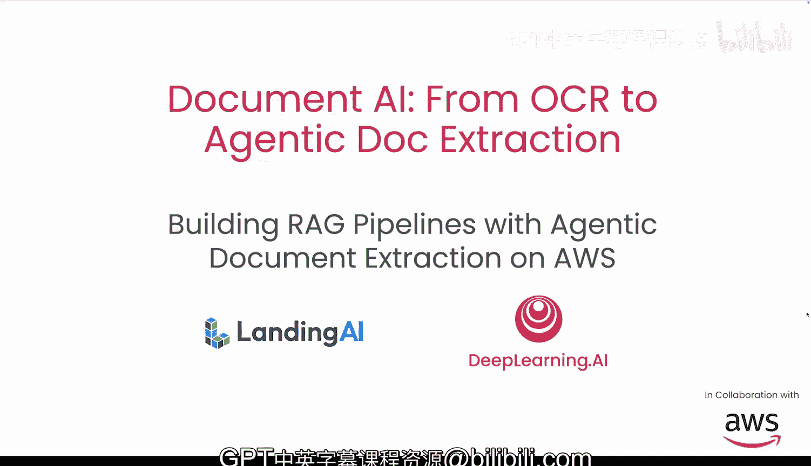

Now that you have learned tools and techniques for document processing。

 youll see them in action on AWS。 you will learn to implement an event driven pipelines that automatically triggers Ade to process new documents uploaded to an S3 bucket。

 These parse documents can then be loaded into a bedrock knowledgebase。

 enabling you to answer questions through agentic Rag built with AWS strands agents。 Let's get to it。

 Before we begin， I would like to thank Naoma Okulo4。

 Partner solutions architect at AWS for the collaboration。 Here's what we will cover in this lesson。

 First， how to implement a rack pipeline on AWS。 Second。

 what we mean by event drivenve and serverless architecture。 Third。

 an overview of AWS resources you will use to implement the pipeline。 and finally。

 how to build an agentic application with memory and knowledgebased search tool with strandands agents。

 Here's how you implement the pre。

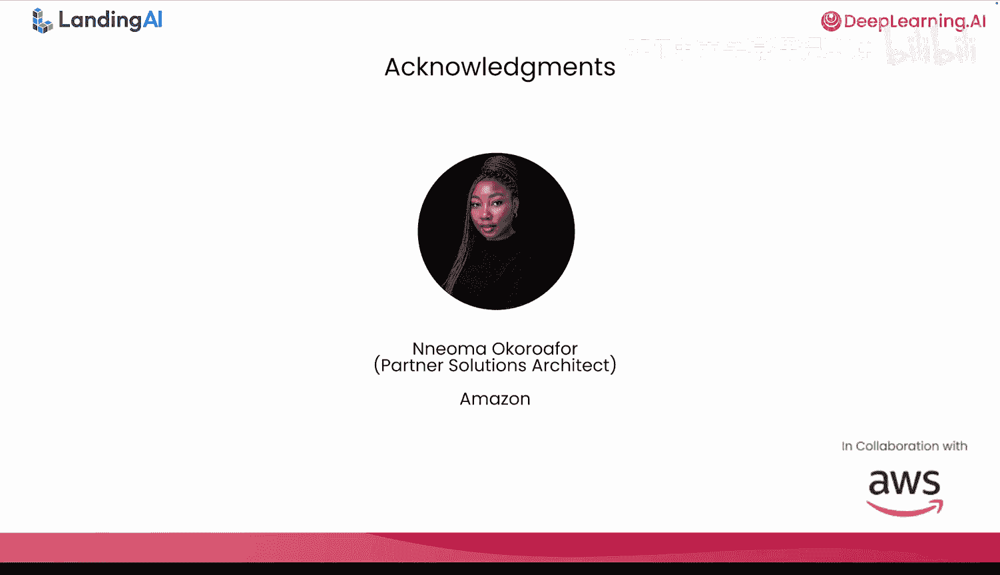

phasese in the previous lesson First， the row documents were stored locally and they were passed to the ADdeE parser。

 which was also run locally using the computing and memory resources of your local environment。

 the parse outputs were then passed to the embeder We used an embedding model from open AI and finally the embedding vectors were passed to a local database using Chroma Db We're now going to swap all of these local components with AWS services。

 This will help make this pipeline production ready on the cloud。

 which can easily scale with a larger number of documents。

 So instead of storing the documents locally， will upload them to an S3 bucket。

 which is a cloud object storage instead of using the computing resources of your own machine will use a Lada function to run the parsing logic。

 the Lambda function provides a serverless isolated computing environment on the cloud it will be automatically triggered when new documents are uploaded to S3。

For the embedter and Ve database， we'll use Amazon bedrock services。

 which provides serverless embeddings and knowledge bases。

 If you're unfamiliar with these resources or what serverless means， don't worry。

 I'll explain them in this video you also saw how to use L chain to define a retrieval object that extracts information from the vector database to answer userqueries。

 you'll do the same on AWS you'll build an agent using strandsag。

 which is an open source framework for building production ready agents with native AWS support and you'll equip the agent with a retrieval tool that connects it to the knowledgebase。

 you'll also use Amazon bedrock to provide your agent access to an LLM and Amazon bedrock agent core memory so you can create an agent that remembers user interactions for full context。

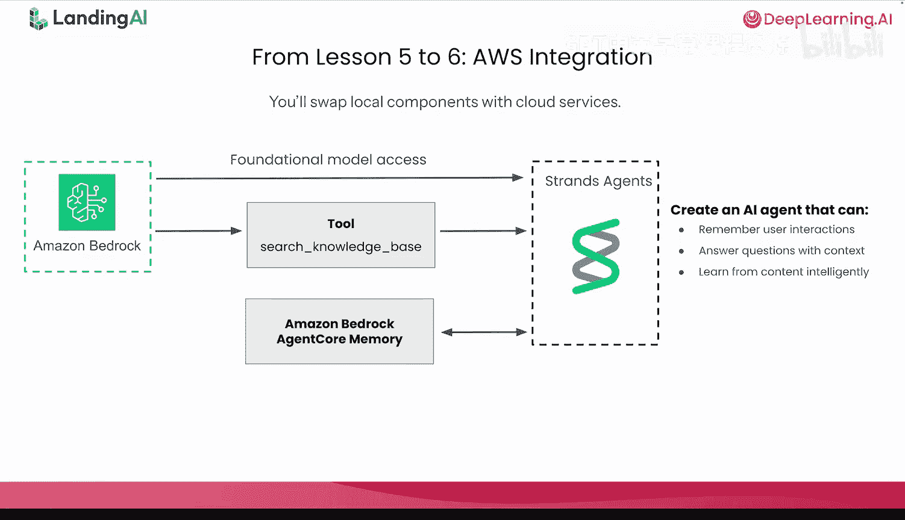

So here's how you can think about your architecture。 It has AIbased components。

 landing AIs ADde for parsing and transfer agenttic framework。 It also has these main AWS components。

 Amazon S3 AWS Lambda and Amazon bedrock previously I mentioned that AWS Lambda and Amazon bedrock provides serverless services。

 So what does that mean serverless means two things。 First。

 you don't provision or manage any servers。 AWS handles the infrastructure and security updates。

 Second， you only pay when your code actually runs not during idol time。

 This also means AWS automatically scales through application based on demand。

 whether you have 10 concurrent users or 10000 and because there is no infrastructure to configure you can rapidly prototype and deploy new features The second characteristic of your architecture is that it includes an eventtri component。

 the AE parser will run auto。

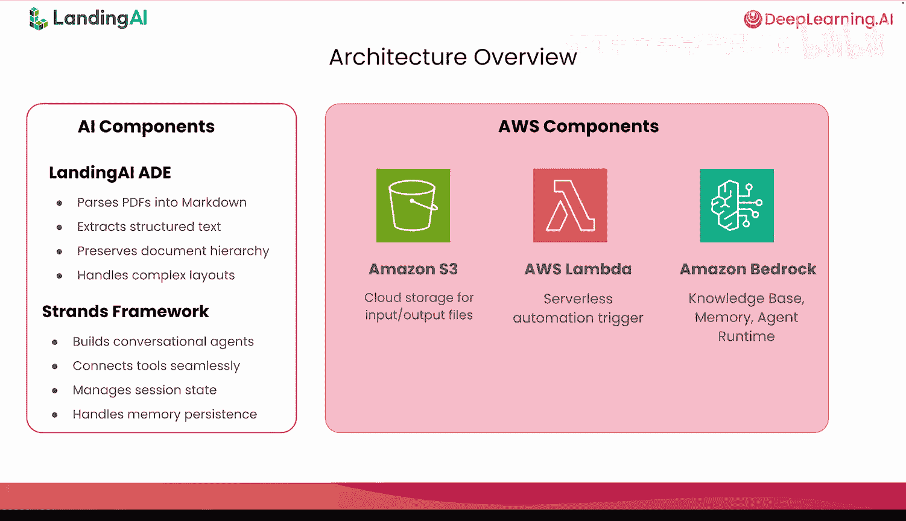

ically when a new document is uploaded to S3 How does that work。

 This is what's called event drivenve architecture。

 a modern design pattern where systems are decoupled and communicate by sending and receiving events which are essentially notifications that something has happened。

 Let me break this down into three steps First step is event producers these are components like S3 buckets that emit events when pertinent actions occur In your case。

 when you upload a file to S3。 It emits a file uploaded event。 Second step。

 event channel or broker services like Amazon eventbri that route these events to interested parties Think of it as a notification system that knows who needs to be informed about what there are also other messaging services on AwS like Amazon SNS a pubup framework and Amazon Sqs for queuing which support simpler pop up plus queuing patterns。

 Evenbri is best for event driven architectures。With more complex routing third step is event consumers。

 services like AWS Lambda that subscribe to and react to specific events。

 Your Lambda function with ADdeE parser is listening for that file uploaded event and automatically starts processing when it arrives。

 Here's a helpful analogy instead of constantly pulling Are we there yet。

 Check S3 every few seconds to see if there's a new file。

 an event drivenven approach is like a push notification。 S3 notifies Lambda。

 the moment interesting event happen。 and Lambda immediately reacts。

 So when you upload a document to S3 S3 creates an event。

 Even bridge routes it and your Lambda function automatically runs the AdeE parser。

 No manual trigger is needed。 Let's not break down each component of your system and understand is specific role。

 You have three main AWS components。 Amazon S3 AWS Lambda and Amazon bedrock let dive。

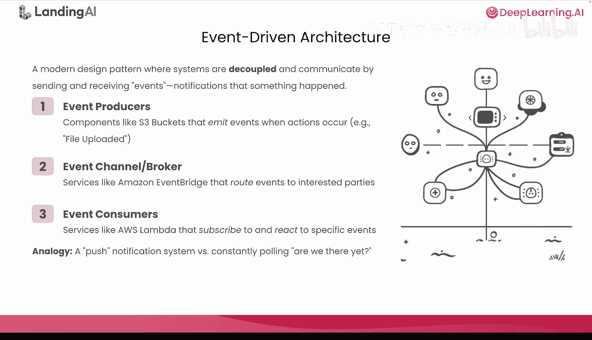

Into each one and see what they do。 First up is Amazon S3。

 which stands for simple storage service S3 is scalable objectject storage service from Aws for files of any type and size。

 Think of it as an infinite digital filing cabinet accessible from anywhere on the Internet。

 no matter how many files you add。 It never runs out of space。

 This will serve as the central repository for your data。 you store raw input data like Pdfs。

 Is or text files in dedicated S3 buckets。 Then you say the results of your AI processing summaries。

 parse documents and transform data back into organized folders within those buckets。

 Just as a quick note， a bucket is the topleve container you create an S3 to organize your files similar to a main folder on your computer。

 Next is AWs Lambda。 It is a serverless compute service that runs your code without you managing any servers。

 Think of it as a parttime robot assistant。

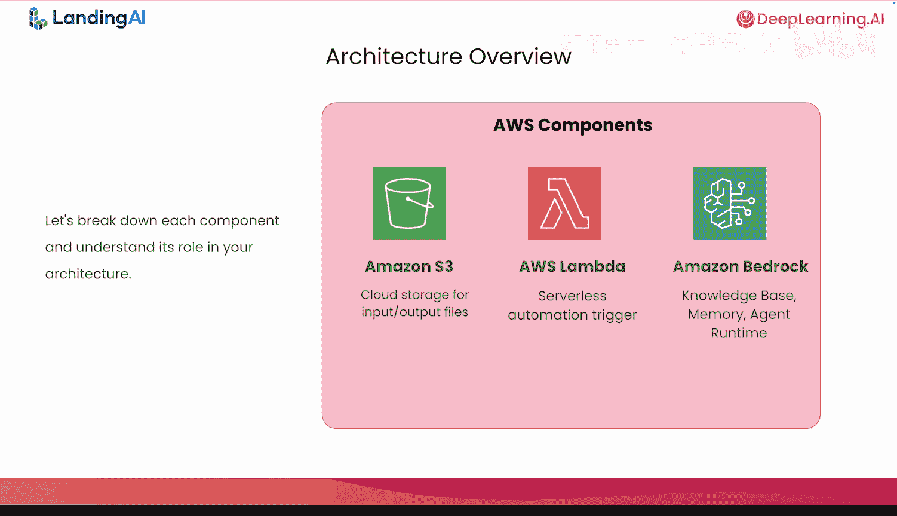

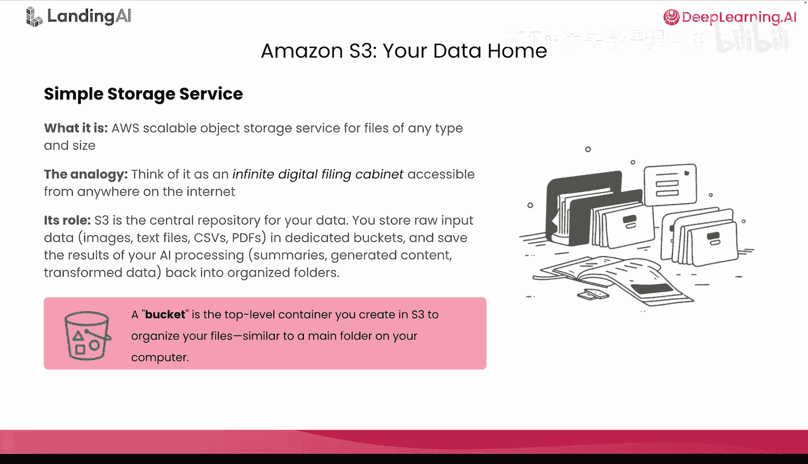

Or a function on demand that only activates when called is not running all the time。

 It springs into action only when it needed。 Lambda executes small pieces of code in response to specific events like S3 uploads API calls or schedule triggers In your case。

 when a document is uploaded to S3， Lambda will automatically run your AdeE parsing logic and you pay only for the compute time consumed measured in milliseconds。

 So if your Lambda function runs only for2 milliseconds。

 you only pay for those two milliseconds of compute。 Now。

 for Lambda to access other AWS services like reading from S3， it needs appropriate permissions。

 This is where IA comes in。 Iam stands for identity and access management。

 Its the security framework for controlling who or what can access your resources on AWS。

 When you create a Lambda function， you need to set up two things。 an Iam role and an IA policy。

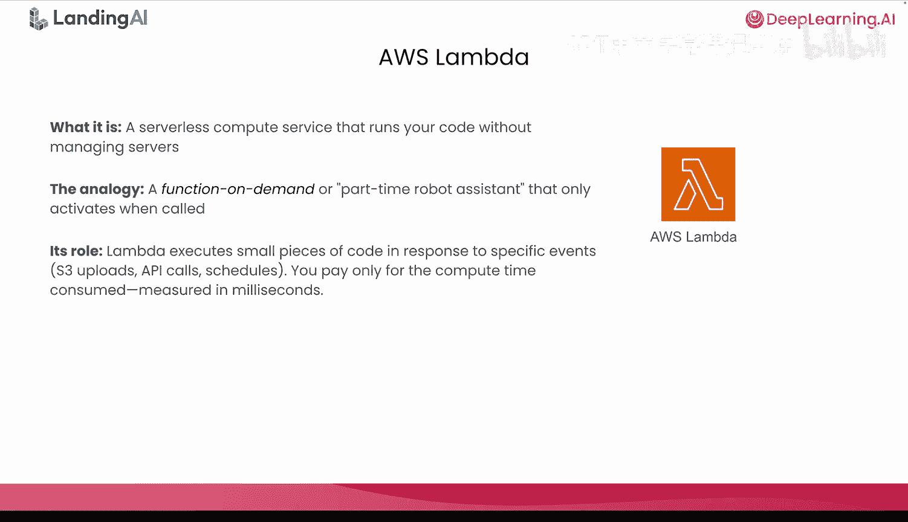

Let me explain the difference。 Ro represents who can have access。

 Think of a role as an I badge or job title。 It the identity that your lambmbda function assumes when it runs。

 The role proves that I am the S3 to bedrock processor function or I am the document parser。

 Services like Lambda don't have username or passwords。 Instead。

 they assume roles to prove their identity to other AWS services。

 So when your Lambda function starts running， It tells AWS。

 I'm assuming the role of document processor。 and here is my temporary access credential。

 I am policy， however， is what it can do。 Now， a role by itself doesn't guarantee any permissions。

 That's where the policy comes in。 Think of the policy as a list of rules written on that I badge。

 It specifies exactly what actions the role is allowed to perform。

 The policy is a Json document that defines actions like S3 get object。

 which means you can read files from S3， or S3。Put object， which means you can write files 2 S3。

 putting it all together when you create a Lambda function， you have to create a Iam role。

 the identity or badge， attach an Iam policy to that role。

 The rules on the badge and assign the role to your Lambda function。 Hopefully。

 the key takeaways are clear。 Ro defines who it is and policy specifies what it can do。 Finally。

 Amazon bedrock。 Amazon bedrock is a fully managed service that provides access to foundation models。

 large language models like cloud or Nova from Aws。 along with embedding models。

 all three single API。 Think of it as a menu of pretrained AI models。

 instead of training and hosting your own models from scratch。

 you can simply select the model you need and use it。

 Amazon bedrock powers three key parts of your architecture。 First， the knowledge base。

 This is where your parse documents are automatically embedded and stored as vectors。

 Brock handles the embedding。

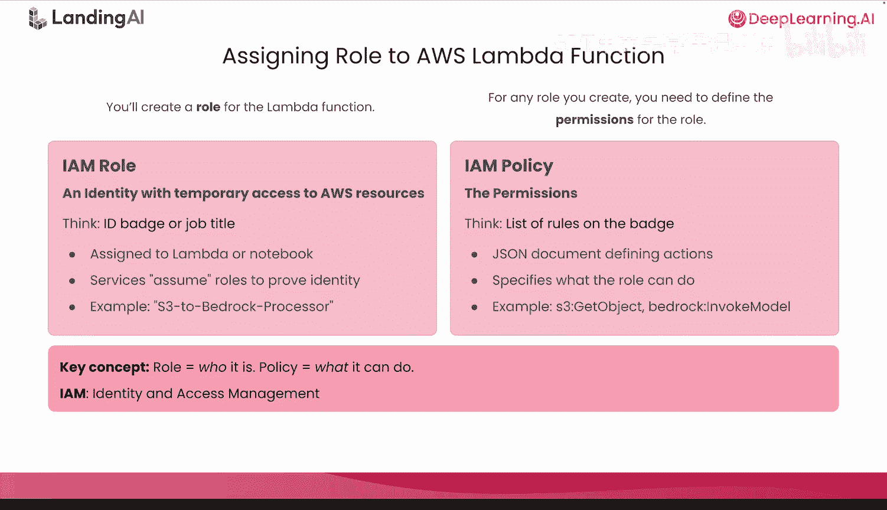

Converting your text into a numerical representation and providing semantic search capabilities so your agent can retrieve relevant information。

 Second， agent runtime。 bedrock provides the foundational model that powers your agent's reasoning and responses When your agent receives a query。

 It uses bedrocks LLM to generate intelligent， grounded answers。 Third agent core memory。

 This is where your agent's memory is stored。 conversation history。

 user preferences and semantic facts。 Me allows your agent to remember context across interactions。

 making it fill more like a real assistant。 Keep in mind that bedrock is serverless in nature。

 So it scales automatically and you only pay for what you use。 Now。

 let's go through the agentic component of your architecture。 strands agent。 It's an open source SDK。

 strands agent is an AWS open source framework specifically designed for building agents。

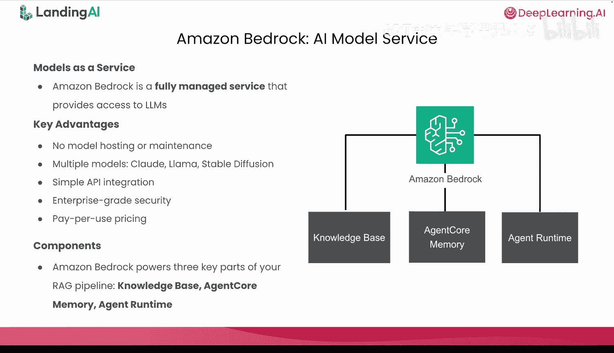

In notebooks and production environments。 it helps simplify orchestration。

 strandag seamlessly integrates with AWS resources such as S3 bedrock and other tools without requiring complex manual coding。

 It also helps create agent definition with trans agent is specify which bedrock models to use。

 What tools your agent could access and how memory works。 This makes your agent configuration clear。

 maintainable and easy to modify。 Last but not least， it is also enterprise ready。

 strands agent is production grade。 It comes with built in tooling for tracing and logging performance monitoring and error handling。

 and it also supports flexible deployment patterns。

 Now let's see how all these components work together。 Let's walk through the process step by step。

 Step1 is uploading the document in the lab。 you will work with medical research papers。

 You upload a P to the S3 input medical folder。 the S3 upload event。

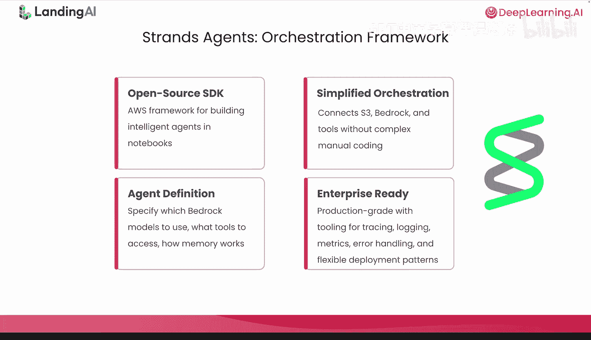

s your Lambda function Lambda runs the ADdeE parser to parse and structure the content。

 The parsse output is uploaded back to S3 in the output medical folder into two formats。

 A markeddown file for the parse content and a JSson file containing chunk information for visual grounding like chunk type and bounding box coordinates。

 This all happens automatically。 You just upload the file and event drivenven architecture takes care of the rest。

 Step2 is ingesting the parse documents into your knowledge base。

 you start ingesting the markdown files from the S3 output medical folder into the knowledge base。

 Amazon bedrock reads the files。 generates the embeddings for each chunk of text and stores them in a vector database Once the ingestion is complete。

 your knowledge base is now searchable the agent can query this knowledge base to retrieve relevant information Note that you can also implement a separate lambmbda function for the ingeesttion job from S。

Bets to the knowledge base automatically， but in the lab will keep it simple and only implement one Lambda function for parsing。

 Step 3 is creating the search knowledgebased tool。

 This tool connects your agent to the knowledge base when the agent needs information from your documents it calls this tool which core is the vector database and returns the most relevant content。

 This is what enables your agent to answer questions based on your uploaded documents。

 Step4 is setting up the agent memory。 Amazon bedrock agent core memory provides three types of long-term memory One is user preference is stores likes。

 dislikes and personal context。 Second is semantic memory， which stores facts。

 entities and relationships。 Third is summary memory。

 which stores conversation summaries and key points。Important。

 memory will persist across sessions so your agent can remember past interactions and provide personalized responses step。

Is building the agent itself。 You will configure the system prompts instructions for how the agent should behave the search knowledgebased tool you created。

 the memory enabled by agent core memory and the L LM model hosted on bedrock。

 once everything is configured， your agent is ready to interact with the users。 Finally， step 6。

 You can chat with your agent。 Here is an example。 The user might say， I like sushi with tuna。

 And the agent might respond。 Got it。 I remember that preference。 And in the later session。

 you might ask， what should I eat for lunch today， The agent might respond。 How about sushi。

 you mentioned that you like tuna。 The key feature is that the agent remembers you。

 Its not just answering isolated questions in one session。

 Is building context and learning your preferences over time。

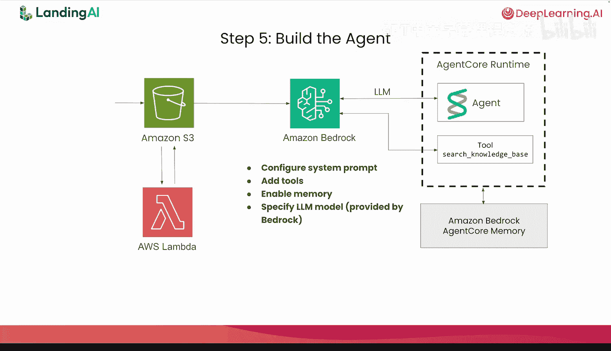

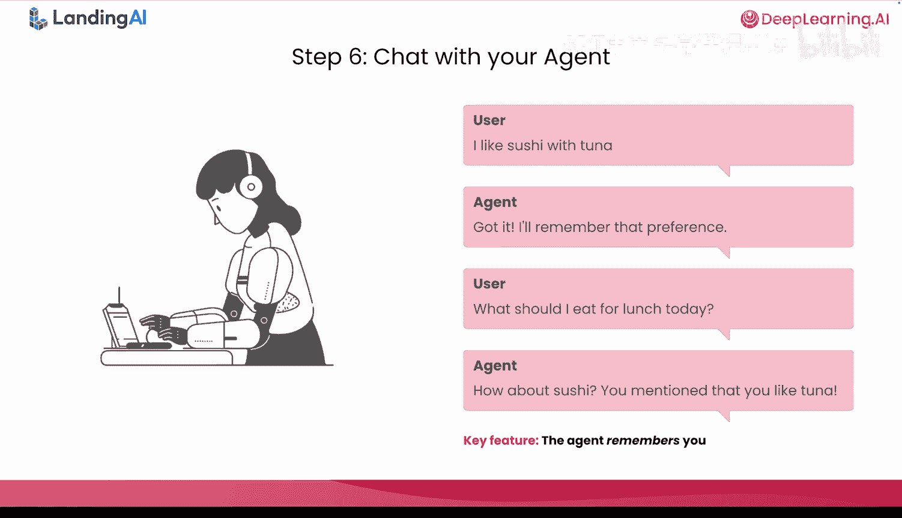

Now is lap time， let's switch to the notebook and start building。

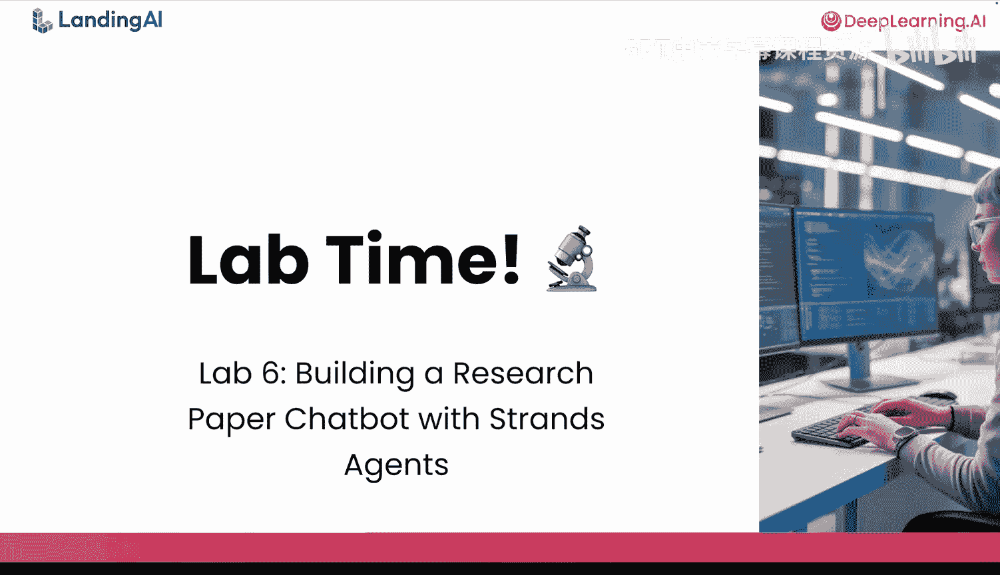