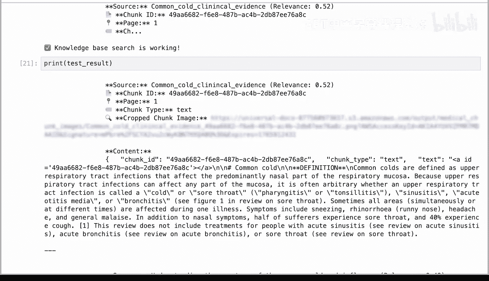
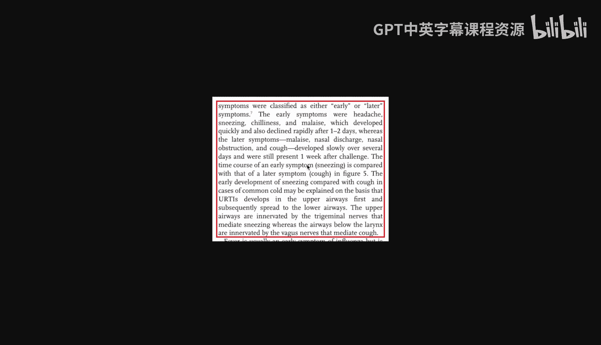
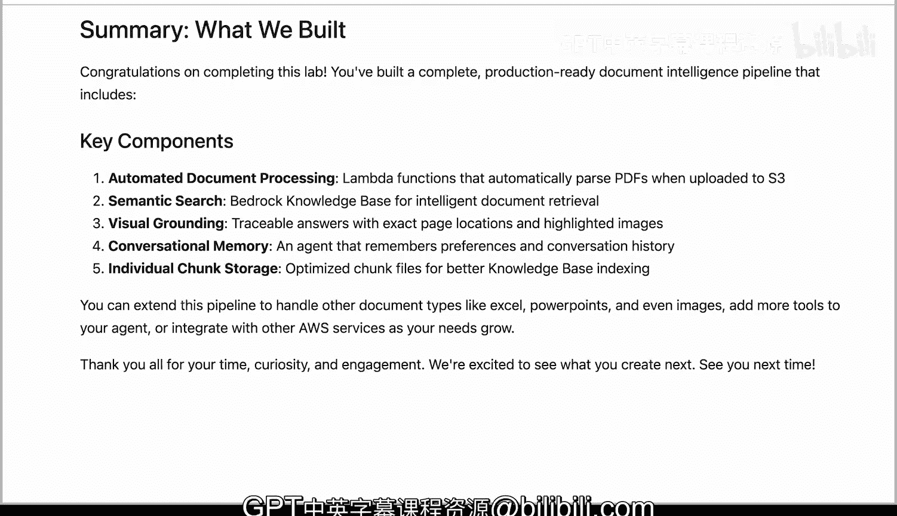

# 吴恩达《文档 AI：从 OCR 到智能体化文档抽取｜Document AI From OCR to Agentic Doc Extraction》中英字幕 - P14：14.lab-6%3A-building-a-research-paper-chatbot-with-strands-agents.zh_en - GPT中英字幕课程资源 - BV1LmkEBHEHU

Welcome to the final lab in this course In this lab。

 youll build a complete document intelligence pipeline with landing AI Ade on AWS that combines automated document parsing with a conversational AI agent。

 Just a quick note， this lab assumes basic familiarity with AWS。 However， if you're new to AWS。

 you can follow along with the explanations to understand how production ready document pipelines are built。

 All lab files are available in the reading item that follows this lab。

 Before diving into the implementation， Let's review the architecture will be building。

 You've already seen this diagram in the previous video。

 But here is how the data flows to the system。 First。

 a user uploads a Pdf to the S3 buckets input folder。 Second。

 S3 automatically triggers the Lambda function when a new file arrives。 Third。

 Lambda uses landing AI A to parse the Pf into structure markdown。4， the parse markdown。

 visual grounding data and individual chunks are saved to the S3 output folder。

Bedrock knowledgegebase indexes the documents for semantic search and last but not least users ask questions to the strands agent。

 which has memory to maintain context。 There are some prerequisites to the lab。

 This lab assumes there are an S3 bucket with input and output folders and a bedrock knowledge base connected to the output medical chunks folder of the S3 bucket will include links on how to create an AwS account。

 set up these resources and learn the basics of AWS if you like to try the lab yourself。

 Let's start by installing the packages we'll need throughout the lab。

 Bo to3 is the official AwS SDK for Python。 This lets you interact with AwS services programmatically such as creating a Lada function uploading downloading files from the S3 buckets from a notebook environment instead of the AwS console Python Ev loads secrets from a do Ev file P annots Pdf pages with highlights for visual grounding Pu P renders PDF pages as image。

And for AWS agent services， bedrock agent core provides memory management for agents and trans agent is a framework for building the AI agent with the packages installed。

 let's load our environment variables from the dot Ev file This file contains sensitive credentials so we don't want to hardcode in our notebook Here is an example that Ev file you can use as a template Now that our environment is configured。

 we need to set up connections to the AWS services we'll be using the Bo to three library provides this capability through clients。

 Here's how it works。 First， we create a Bo to three session that manages the AWS credentials from the session we create a client for each AWS service we want to interact with and will create clients for the following services As three client uploads Pdfs download outputs and manage buckets Lambda client deploys Lambda functions update code and configured triggers IAM client creates roles with proper permissions for the Lambda function。

Logs client uses Cloudwatch logs to monitor Lambda execution and debug errors。

 bedrock agent runtime client quaries knowledge basiss for document search and bedrock runtime client calls cloud models directly。

 with our AWS clients ready， we can now build the complete pipeline。

 Here's the rowmap for what we'll accomplish。 Part1， setting up the Lambda function。 Step 3 through5。

 will'll set up the Lambda function in three steps。 First。

 package the code by bundling the Python file dependencies into a zip folder。 Second。

 create a role by defining permissions that allow Lambda to access S3 for downloading and uploading files。

 Third， deploy de function by uploading the package to AWS Lambda。 Part 2， setting up the trigger。

 Step 6 Next， we' configure S 3 to automatically invoke our Lambda function。

 Whenever new files are uploaded to the input folder。 Part 3， building the agent step 7 through12。

 Finally， we'll upload medical research papers in just the parse documents。

into the bedrock knowledge base and build an intelligent agent using strand agent to keep this notebook focused on the core concepts。

 we've created helper functions in Lambda helpers pi。

 These functions handle the lower levelvel AWS operations I'll explain the logic of each helper function as we use them throughout the lab step 3。

 creating the deployment package So what is a lambmbda deployment package to create an AWS Lambda function。

 you need to bundle your source code and all its dependencies into a zip file。

 This package contains everything Lambda needs to run your code。

 your source code in ADde S3 handler that pi contains the ADde parsing logic that executes when the Lambda function is invoked and install dependencies。

 All Pip packages， your source code imports and here's what the package structure looks like for creating the package will use the create deployment package helper function to build this package and it takes four parameters。

 the source files the Python files containing our code requirements。

The P packages our code depends on output zip， the name for the output zip file。

 and the package directory， a temporary directory for building the package behind the scenes。

 this helper function creates a temporary directory， installs packages using Pip into that directory。

 copies your source code files to the temporary directory creates the zip file from everything in that directory and cleans up the temporary directory。

 Before we move to the next step， let's understand the code that runs inside of Lambda。

 This diagram shows the complete flow。 Fford export the source code if you want more details。

 Here's what happens step by step。 First event is received。

 When a Pdf file is uploaded to the S3 input folder and S3 event triggers the Lambda function。

 Second， the ADde handler function extracts the file key from the event。 Third。

 the handler checks that is a Pf file skips the folders and verifies the output doesn't already exist。

 Four， the Pf is downloaded to Lambda。Diy5， the Pf is sent to the ADE API。

 which pars it and returns markdown text， as well as the chunks 6。

 the results are uploaded to the S3 output folder in three formats。

 a markdown file for the parse content。 A Json file containing chunk information for visual grounding and individual chunk Json files for optimized knowledge based indexing。

 Let me help you understand what each output file contains。 For example。

 if you upload input medical research underscore paper do Pf。

 here's what you have in the S3 bucket output folder after a DE process。

 The markdown is the complete document in readable format containing anchor tags linking text to chunk Is。

 Grounding Json is a single file containing all chunks with their bounding box coordinates。

 as well as other metadata like chunk type and page numbers。

  individual chunk Json is one file per chunk optimized for vector database in。

Each file is self contained with text， location and source metadata similar to the previous lab。

 since we're implementing a rack pipeline， well focus on using only output medical chunks for bedrock knowledgebased indexing and for generating the annotated images。

 Also will generate the embeddings from each individual chunk。

 The other folders can be used for different experiments and downstream use cases。 Step 4。

 creating the IM roll。 What is an IM roll， Lambda functions run in isolated containers that have no inherent permissions by default。

 They can access any AWS resources。 an IM roll grants the function permission to access specific AwS services using temporary credentials for creating the role will use the create or update Lambda roll。

 helper function to create a role with the permissions are Lambda function needs。

 The roles include these permissions。 for S3 permission， get object， put object and head object。

 which。pRe PDFs from the input folder， write markdown files to the output folder。

 and check if output folder already exists respectively for logs。

 creates a CloudWatch log group for this function， create log stream。

 creates a log stream for each execution， and put log events， help write log entries for debugging。

Step 5， deploying the Lambda function。 Now we have both pieces we need。 the deployment package。

 which is our code and the IM roll。 our permissions。

 Let's deploy the Lambda function using the deploy Lambda function helper。

 which expects the function name。 the locationation of the zip file and the IM roll for Lambda。

 The deployment includes additional important configuration options。

 The environment variables are configuration values are code can access at runtime time out maximum execution time set to 900 seconds or 15 minutes for processing larger Pdfs。

 Me size amount of Ramm allocated will set it to 124 MBbys。 Step 6， setting up the S 3 trigger。

 Our Lambda function is deployed。 but it won't automatically run Yet。

 We need to tell S 3 to trigger the lambmbda function When new files are uploaded。

 S 3 can send events to Lambda when objects are created。

 modified or deleted will configure to invoke our function。Specifically。

 when files are uploaded to the input folder， the setup S3 trigger helper handles this configuration。

 Step 7， uploading documents for processing。 The infrastructure is now ready。 Now。

 let's upload our medical Pf documents and watch the pipeline in action。

 This diagram shows how Pf files flow from your local medical folder to the S3 input bucket。

 The Lambda function， which is triggered automatically processes each Pf using ADde and produces three types of output files。

 We'll use the upload folder to S3 helper to upload our local documents。

 While the Lambda function processes our documents， we can monitor its progress in real time。

 This helper function watches cloudwa logs to display the processing status。

 Lambda automatically writes logs。 We just need to read them to stop monitoring。

 press the escape button followed by double clicking I You have the option to show all output files but for the video will just press note。

Step 8， connecting to the bedrock knowledge base。 Our documents are now parsed and stored in S 3。

 The next step is to make them searchable by ingesting them into the bedrock knowledge base。

 A vector database that enables semantic search。 First。

 let's verify that our knowledge base is available and properly configured。

 We use the bedrock agent client to list all knowledge bases and their data sources。

 Note that the knowledge base was preconfigured in the Aws console to point to our S 3 output。

 medical chunks folder as the data source， use Amazon Titan for creating vector embeddings and storing vectors in open search serverless for fast similarity search。

 This information is not printed here。 but I wanted to let you know about the configurations we use in this lab。

 Step 9， ingesting documents into the knowledge base。 Now。

 let's sync the parsed documents from S3 into the knowledge base。 This process is called ingestion。

 So what happens during ingestion。 First， the knowledge base reads all new or modified Json files。

From the S3 output medical chunks folder。 Second， it creates vector embeddings for each chunk。 Third。

 these vectors are stored in the database for fast similarity search。 Once the ingestion is complete。

 we can query the knowledge base with natural language questions。

 and will find the most relevant document section。 The start ingestion job API kicks off asynchronous processing。

 It immediately returns the job I and the actual work happening in the background。 Step 10。

 creating the search tool with visual grounding。 with our documents index in the knowledge base。

 we can now create a search tool for our agent。 but we're going to ask something special landing AI's visual grounding。

 The nextel shows the code for our search tool。 Not that is decorated with at strands do tool。

 which makes it callable by our agent。 The logic in this code is illustrated in this visual diagram。

 Let me walk you through the logic。 The tool follows this pattern。

 When a user submits a corey like what helps with cold symptoms First， bedrock retrieves。

By querying the knowledge base using hybrid search。

 combining keyword matching and semantic similarity。 Second， for each result。

 it will check if this is a chunk Json file from medical chunks folder。 Third。

 it will parse chunk Json to get the metadata like chunk I D chunk type page and bonding boxes。

 Then it will dynamically generate a cropped chunked image and upload the cropped image to S 3 and return a presigned URL。

 Last but not least the agent will format the response。 give you the source， the chunk I D page。

 chunk type， crop chunk image URL and the content。 Before creating the agent。

 let's verify that our search tool works correctly。

 The simple test cores the knowledge base and shows the first result。

 Le's search common cold symptoms。You can see that the knowledge base search is working correctly。

 We can now print these test results。

And when you click on the presign URL， you can see the chunk image that was dynamically created for traceability and auditability。

 This could be incorporated into your RP system or any downstream application for heavily regulated organizations and high risk operations。

Step 11， creating memory for the agent。 Our search tool is working。 Now。

 let's create memory for our agent so it can remember conversations and learn user preferences over time。

 AW S bedrock agent core provides three memory strategies。 each serving a different purpose。

 S summarizes past sessions。 Use preference learns user preferences over time。

 and semantic extracts and stores facts。 We'll configure all three strategies to give our agent comprehensive memory capabilities。

 We'll first check whether or not there are memories created already for the agent。

 Otherwise will create a new memory。 After creating the memory。

 we need to set up a session manager that organizes information for each conversation。

 Each conversation needs two identifiers。 Actor I D who is using the agent。

 which enables personalization across sessions。 The session I D。

 a unique identifier for this specific conversation。 Step 12， creating the strand agent。😊。

We now have all the components ready。 a search tool with visual grounding and memory for maintaining context across conversations。

 Let's bring everything together into a strands agent。

 The agent is configured with the model clo via bedrock as the underlying L LM。 the system prompt。

 which are instructions that defined the agent's personality and behavior。 The session manager。

 memory for remembering preferences， historical summaries and facts， tools。

 the search knowledge base function we created earlier。

 Notice how the system prompt explicitly instructs the agent to include visual grounding information like page numbers。

 location coordinates and annotated images and its responses。 Step 13。

 the interactive chat your medical document agent is now ready。

 Let's start an interactive chat session。 Let's start with how effective is vitamin C for treating colds。

 So here it shows that it used the tool search knowledge base and it returned a list of symptoms。😊。

And the source of information where we can find the annotated image。

 I will now tell it that I prefer short answers， than exit。

Let's run it again and ask the same question。You can see that it returned more concise answers based on my previous preference。

To exit， type， exit， quit or buy。Congratulations on completing this lab。

 you've built a complete production ready document intelligence pipeline that includes these key components。

 automated document processing， Lambda functions that automatically parse Pfs when uploaded to S3 semantic search。

 bedrock knowledge base for intelligent document retrieval， visual grounding。

 traceable answers with exact page locations and highlighted images， conversational memory。

 an agent that remembers preferences and conversation history and individual chunk storage。

 optimized chunk files for better knowledge based indexing。

You can now extend this pipeline to handle other document types like Excel。

 PowerPoint and even images， add more tools to your agent or integrate with other AWS services as your needs grow。

 Thank you all for your time， Curioity and engagement。

 We're so excited to see what you will create next。 We'll see you next time。😊。

