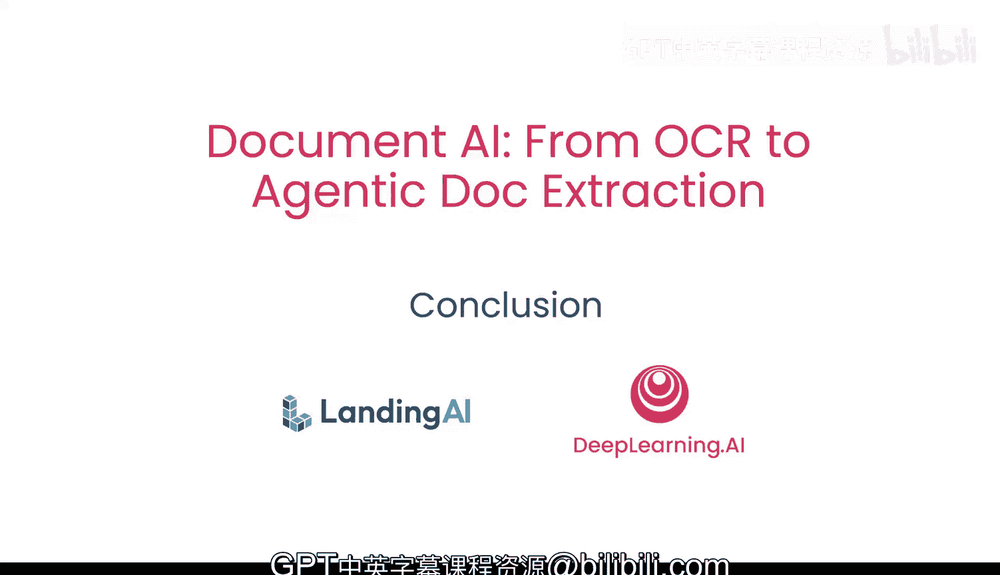

# 吴恩达《文档 AI：从 OCR 到智能体化文档抽取｜Document AI From OCR to Agentic Doc Extraction》中英字幕 - P15：15.conclusion.zh_en - GPT中英字幕课程资源 - BV1LmkEBHEHU

In this course， you learned about a Gentic document processing。

 enabling you to parse and extract information from files like PDFs。

You explored how to convert images to text through OCR， analyze layout with bounding boxes。

 and logically order recognizable chunks。You also employed VLMs to understand text and context。

Using ADE， a Vision First agent Gen approach to document understanding。

 you processed complex documents and build a RAG application for answering questions about unstructured files。

Finally， you explored moving your application to the cloud and making it event driven。

 I'm looking forward to seeing what you'll build on your own。😊。

