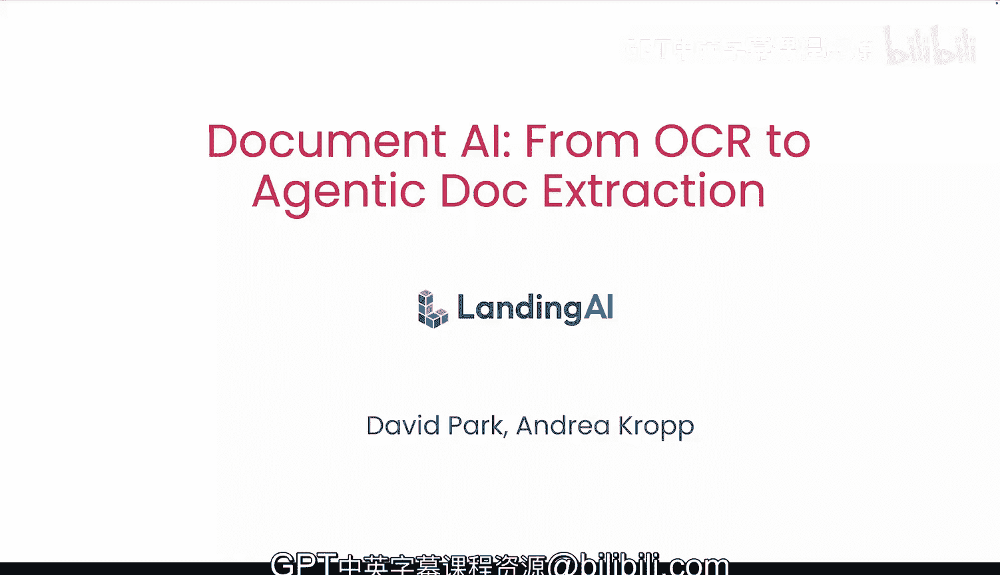
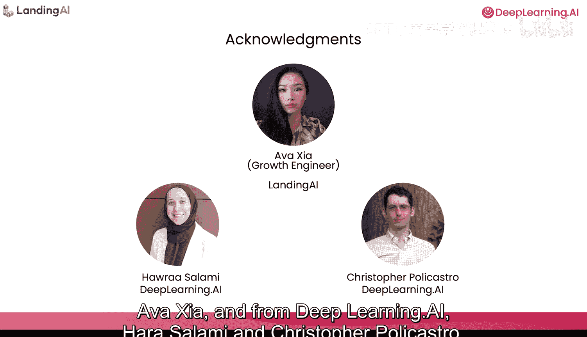

# 吴恩达《文档 AI：从 OCR 到智能体化文档抽取｜Document AI From OCR to Agentic Doc Extraction》中英字幕 - P1：1.intro.zh_en - GPT中英字幕课程资源 - BV1LmkEBHEHU

Welcome to Do AI from OCR to Age Gen Doc extraction。

 built in partnership with landing AI where I'm executive chairman。

 along the data is locked up in PDF000 other documents on the laptops on the web and encompasscompies cloud storage In this course you in document processing pipelines that transform your complex documents into OM ready markdown text and extract information for analysis。

😊，You begin by exploring traditional OCR， which only extracts text and add techniques to detect document structure and identify visual components such as tables with complex formatting like Mer cells or charts with captions or false with checkboxes you implement an agent workflow that combines layout detection with ElM based reasoning。

Then you learn to use agent Gen document extraction or ADE。

 a tool designed by landing AI that automates this entire workflow for you I'm delighted the instructors for this course are David Park。

 who is senior director of apply AI and Onreroprop， who is apply PI engineer。

Both have helped many developers build complex document AI systems。Thanks， Andrew。

 we're excited to teach this course together。 Traditional OR systems work by segmenting documents into individual characters and they classifying each character using supervised learning。

 These systems could extract characters accurately。

 but they lack understanding of how different parts document hang together。

 such as the document structure or tables or forms or even what is their reading order of different elements of the document。

😊，Ling AI's Ade takes a different approach。 It treats each page of a document as an image and breaks that image down the deposit and it extracts from each pod separately using an agent workflow。

 Ade trees document as visual objects in which meaning is encoded in layout structure and spatial relationships。

 It uses custom visual models that directly interpret complex tables， graphs， images。

 charts and other elements and grounds every extracted piece of text to a precise location on the page。

 On top of this， ADde uses an agentic orchestration layer that decomposes complex documents into smaller sections for careful examination in several steps。

 Human don't process a document with a single glance。 Instead。

 we examine the different parts of the document to pull out information piece by piece in multiple iterations。

 Ade works the same way。 For example， given a complex document。

ADE might extract a table and then further extract E table structure， identifying rows， columns。

 MEs cells， and so on。 In this course， you'll explore traditional OCR based processing pipelines to see what they can do and also their limitations。

 You'll also build your own agent document workflow from scratch。

Then you'll learn how to use ADE to process complex documents and build a pipeline to parse mixed documents and extract required key value pairs。

You'll also learn to integrate ADE extracted information into RaG applications and then implement a cloud based version on AWS using an event drivenve architecture that automatically triggers AdeE for document processing whenever new documents appear Many people have worked to create this course I'd like to thank from learning AI A and from Deepblind AI Hra Salami and Christopher Polycaststro In the first lesson。

 you start by looking at traditional OCR models Let's go to the NIs video and dive in。

