# 吴恩达《文档 AI：从 OCR 到智能体化文档抽取｜Document AI From OCR to Agentic Doc Extraction》中英字幕 - P2：2.document-processing-basics.zh_en - GPT中英字幕课程资源 - BV1LmkEBHEHU

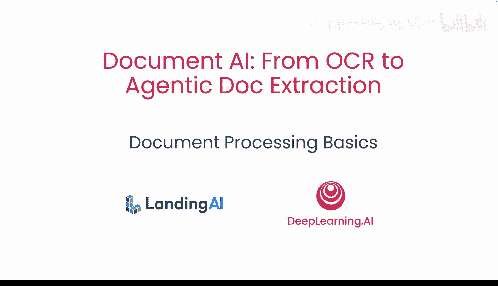

In this lesson， you'll learn how to parse documents using optical character recognition and how to integrate its results into agent workflows。

 you'll build an agent to parse text from documents using OCR。

 and then extract information from the text using LLMs along the way you will identify cases like handwriting tables and scan images that make these steps really challenging。

Le Ivan。Today is lesson one document processing basics。 We're going to start simple today。

 but everything we cover is foundational to the production grade systems used by enterprises and developers today。

 which we will cover in subsequent lesson。So here's the agenda for today。

 processing what it is and why it matters， parsing， extracting and output formats。

 JSO markeddown and how they are used OCR how it works under the hood and its workflow and limitation where you can break agentic AI and the react framework。

 adding a brain on top of OCR and we'll review some practical demos and failure modes and what still challenges。

 real systems。 And after all that we'll roll up our sleeves and do some coding。

 where you'll build your first simple document agent。

 you'll notice this is at bottom up journey from pixels， text to structure and then reasoning。

 Let's ground this in the real world pane。 these systems are meant to solve modern organizations are flooded with digital documents。

 Invoices， receipts， contracts and reports these documents live in a massive digital filing cabinets。

 usually as PDFfs， PowerPos， Worddcs or even images。They're built for human eyes， not machines。

 which means the information is hard to search， hard to analyze， and of course， hard to automate。

If your data is trapped inside unstructured documents， someone has to manually open， read。

 and retype it into a different system， which does not scale。

So if we want to use this information in analytics， automation or AI。

 we need to convert unstructured documents into structure machine readable data So what does the solution look like document processing is turning unstructured documents into structured machine readable data typicallyy JSON or markdown It's more than just grabbing text parsing must understand what pieces of text actually mean how they're related and how to organize them into predictable structure if you're parsing an invoice。

 you don't just want a blob of text， you want to extract the vendor name Invoice date total amount and line items Extracting assumes text is already machine readable but if your document is a scan or a photo。

 the computer sees only image pixels So before extracting can happen we need OCR to turn pixels into text how do we represent the output parsing and extracting typically produce two useful formats First is markdown or HTML which。

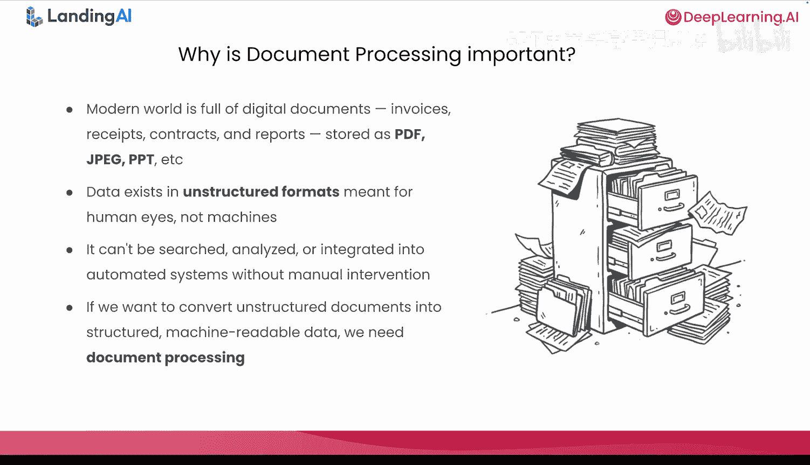

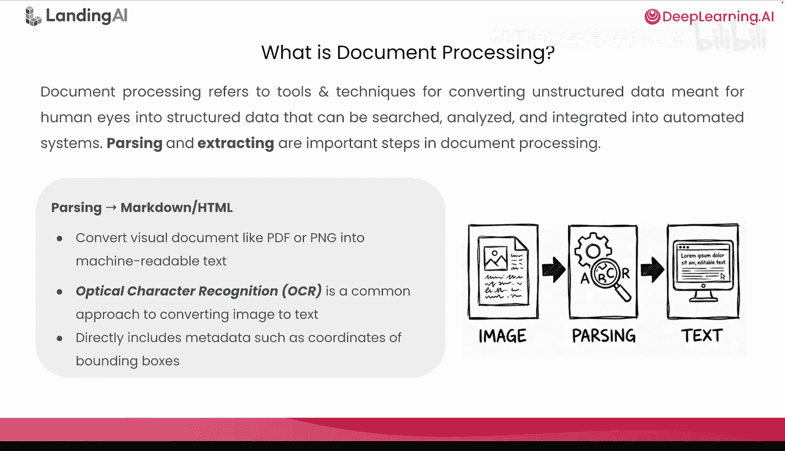

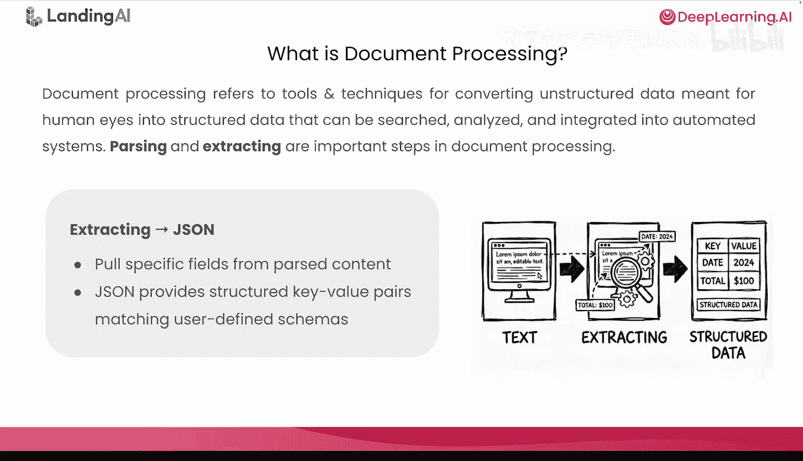

Is designed for humans like us and LLMs This preserves structures like headers tables and lists and is perfect for feeding into LLms or showing to end users。

 second is Json for machines and As， it is hierarchical easy to traverse programmatically and perfect for downstream pipelines and applications。

 So remember， JSson is for machines， markdown or Hl is for humans and LLms good rule of thumb。

 if you're thinking about analytics or databases， JSsonN is a great option。

 And if you're thinking about building a rack solution or a chat user interface。

 markdown or HTMLml could be a great option but all of this assumes we already have the text What if all we have is just pixels OCR or optical character recognition is the technology that takes an image of text and con it into machine readable text。

 It typically works in two steps first is。

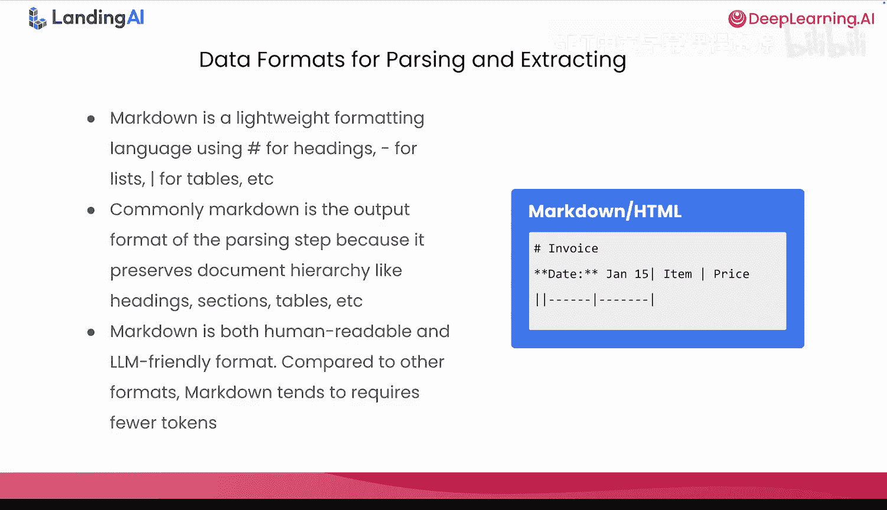

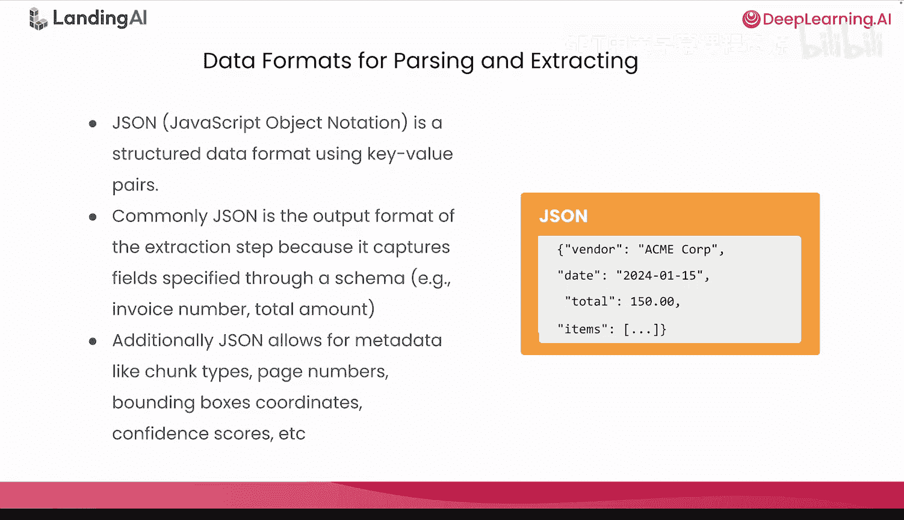

Image cleanup。 So desing， denoing or contrast adjustment。 Then text recognition。 pattern matching。

 Does this shape look like an8 or A B。

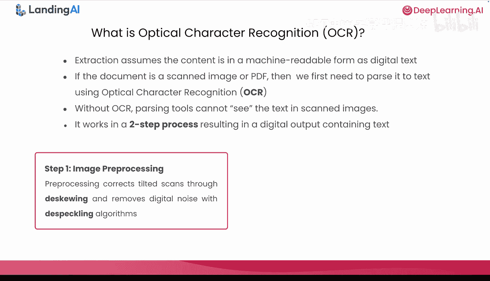

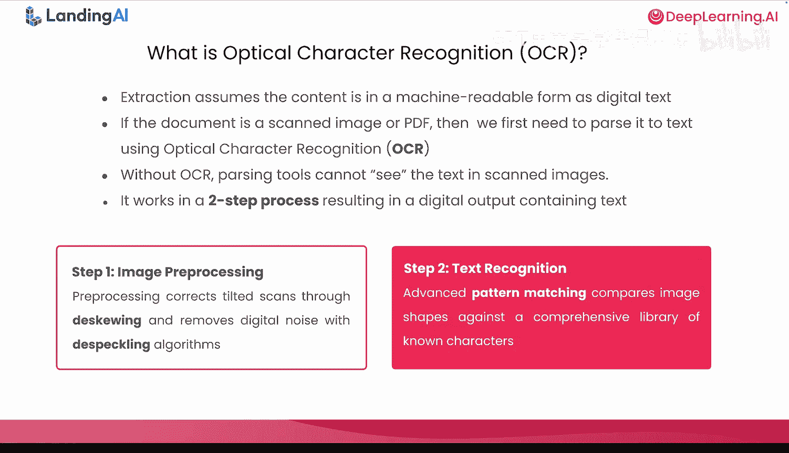

Once it recognizes a text， it will produce editable text as a digital output or a searchable PDF。

But we also need to be honest about what OCR cannot do。

 OCR is really good at reading clean documents， but it does not understand structure。

 meaning or relationships。 After OCR， you typically get a wall of text If you want to find totals。

 extract tables， identify headings and classified document。 you need intelligence on top of OCR。

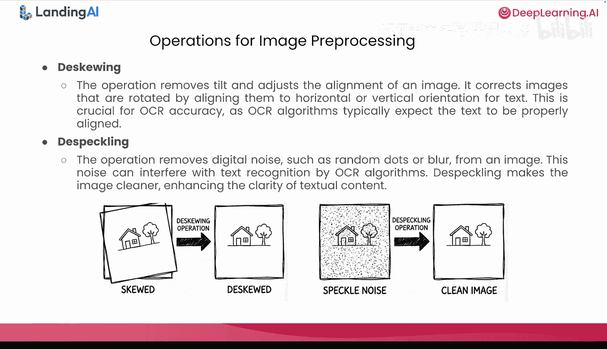

You can think of O C R as the eyes， but not the brain。 And beyond its lack of understanding。

 it could also just fail。 O C。 R breaks in predictable ways。 Poor image quality， blurry photos。

 shadows and noise， complex lays and skekuws， though multi column texts， nested tables， and。

 of course， non standard texts like hewriting stamps， stylized fonts。

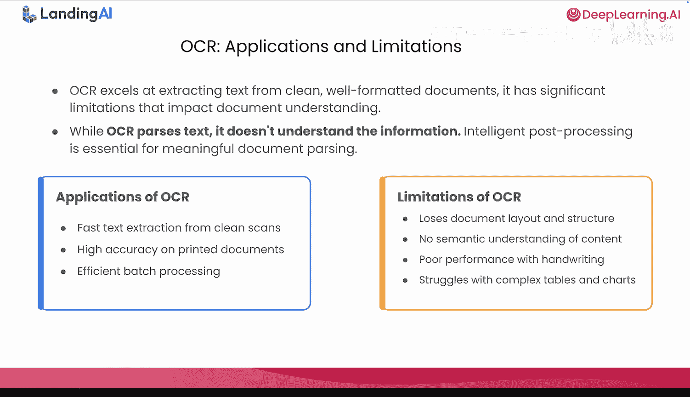

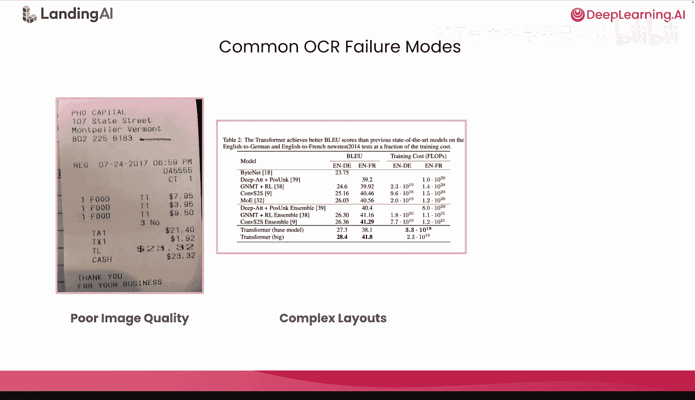

These failures cascade down into parsing and extraction errors。 So OCR is necessary。

 but nowhere near sufficient for full document understanding。

So if you've ever tried to OCR a picture of a receipt taken in a dim restaurant。

 you've probably experienced all three failure modes at once。All of this leads to a key idea。

 Prosing is not the same as understanding。 O CR can read characters， but it doesn't comprehend them。

 It doesn't know what is a header versus a value。 Which number is the total。

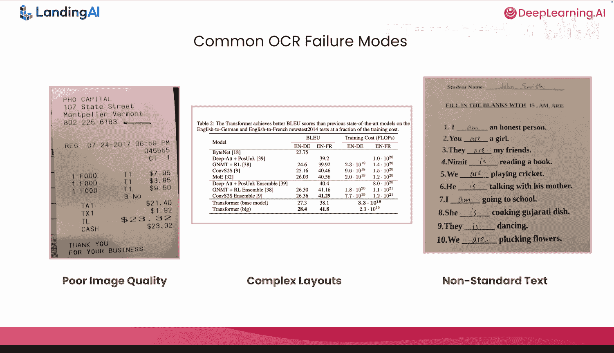

Or whether text belongs in a table or a footnote。OCR gives you perception， pixels to character。

 but no cognitive layer。To turn that wall of text into meaningful structured data， we need a brain。

 and that's where agent AI comes in。

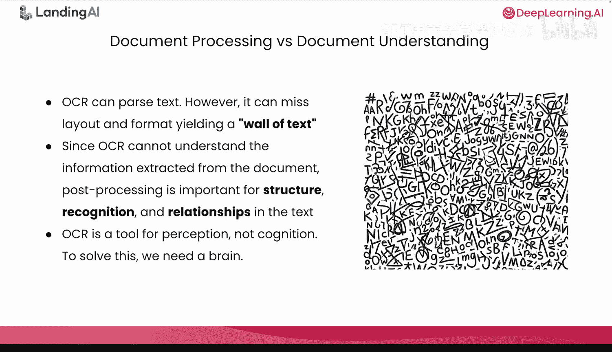

Agentic AI adds the missing cognitive layer， an agent is an autonomous system that can perceive its environment。

 reasonable goals， and takes certain inact。In document processing specifically。

 the agent reads a document via OCR if needed， thinks about what the user asked。

 chooses which tools to call， and iterates until it reaches the goal， if the OCR is the eyes。

 the agent is the brain， and rules based pipelines can collapse the moment you hit an edge case whereas agents can reason through them。

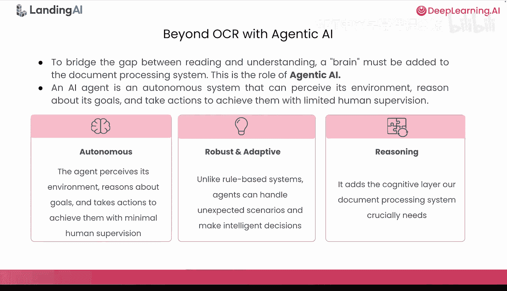

So what does an agentic system look like under the hood Ageic document systems typically have three parts。

 the brain using an LLM， which is responsible for reasoning， planning and decision making。

The I or OCR， which converts visual content into text and the hands or the tools that agents can use。

 APIs， database lookups， file operations and function calls。

And when all these three things are wired together， you can say。

 find the total amount on this invoice。Then the agent will decide to run OCR， inspect the text。

 locate the total， and return the answer。You don't have to hardcode every step or every edge case。

This mental model， brain， eyes and hands， will appear again and again in subsequent labs and lessons。

But how does the agent think not just once， but step by step， The react。

 reason and act framework describes how agents think。 First is thought。 What do I need to do next。

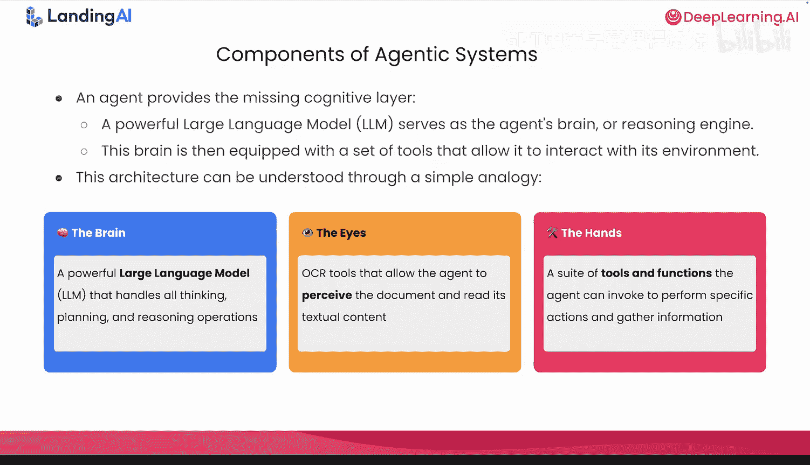

Then it will take a certain action， choose and call a set of tools that it needs。And once it's done。

 it will go through an observation process to examine the result。Then repeat， think， act。

 observe and think again。This loop gives agents agency， adaptability。

 and the ability to correct mistakes。Most modern agent frameworks are built on some variation of react。

And of course， one major benefit is that is debugable。

 you can literally read the agent's thoughtsts and tool calls。

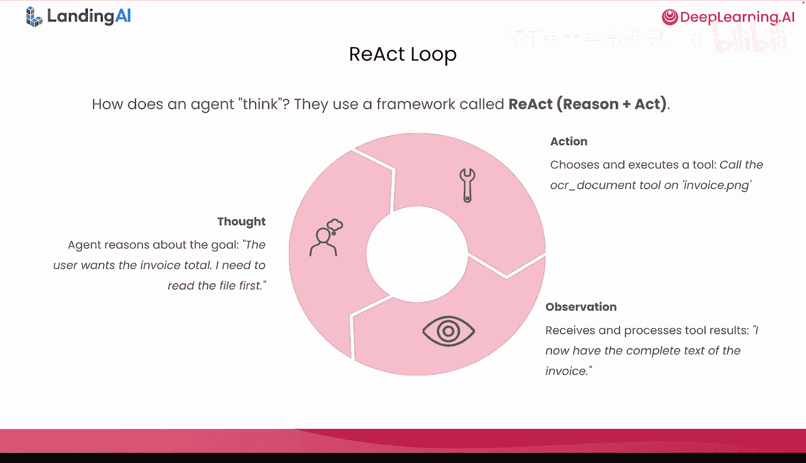

Alright， that's enough theory。 Let's build something。Now it's lab time。

 we're going to take everything we covered on the slides， parsing。

 OCR and agentic reasoning and build a simple document agent together By the end of the lab。

 you'll have an agent that can read a document， use OCR as a tool， extract structured information。

And don't worry if this is your first time， we'll go step by step， let's switch to the notebook。

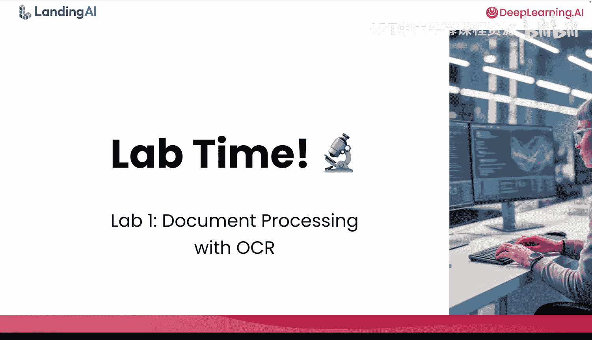