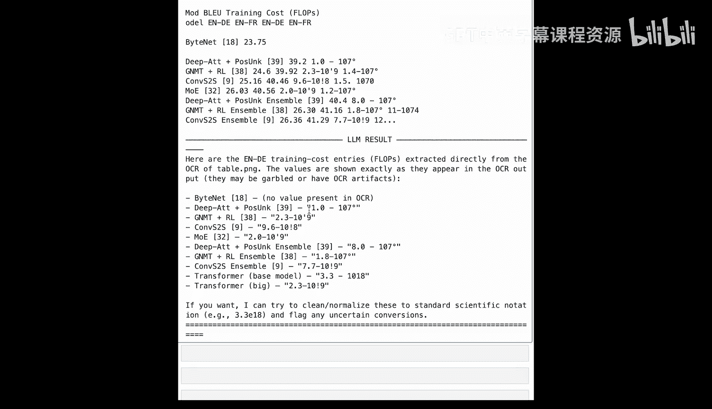
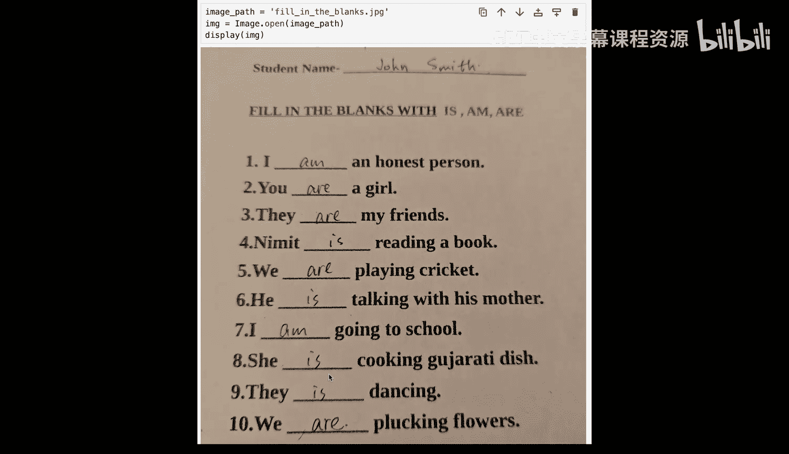
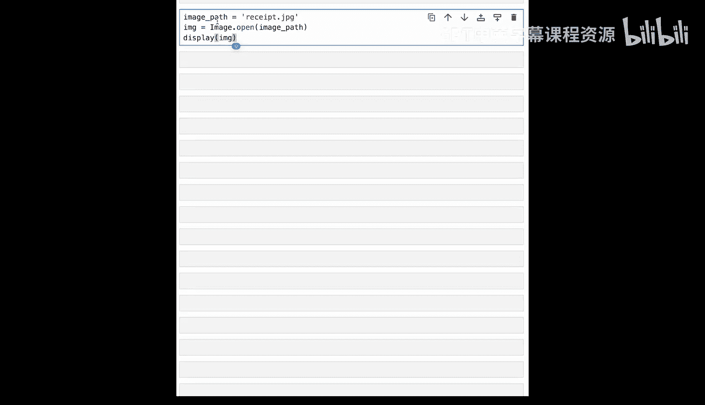
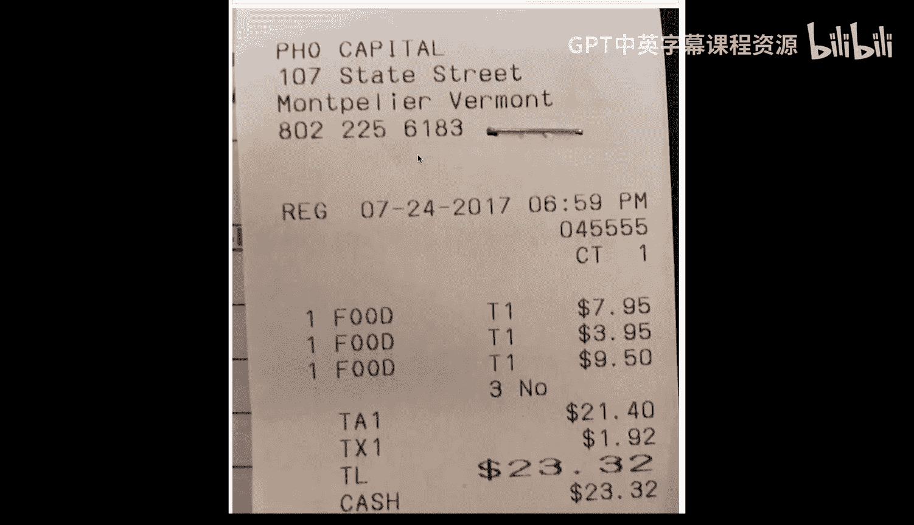
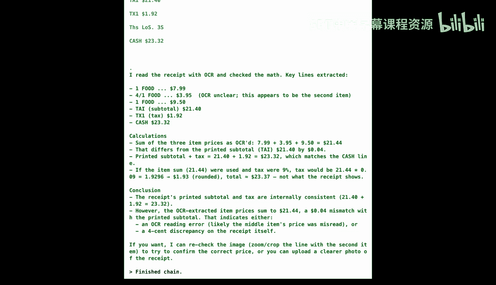

# 吴恩达《文档 AI：从 OCR 到智能体化文档抽取｜Document AI From OCR to Agentic Doc Extraction》中英字幕 - P3：3.lab-1%3A-document-processing-with-ocr.zh_en - GPT中英字幕课程资源 - BV1LmkEBHEHU

All right， now that we cover the concepts and decides， let's get our hands dirty。

 we're going to build a simple but powerful document processing agent。

The goal here isn't to build a perfect production system。

 is to see how O C R set rules and L LM based reasoning all fit together Here。

 we import all the packages of our system。Hello for loading images。Pyteerak for OCR。

Lang chain and tools for agent scaffolding。And open AI models， Prom templates。

Agent executor that runs the full react loop here is where you turn OCR into an actual tool the agent can call。

This function takes an image path。Uses Teseract to extract text and returns the result。

 the At tool decorator turns this into something the agent can recognize and call by name。

During the agent loop， the LLM will literally decide I need to read the document first。

 Call OCR tool， guest detect， and continues reasoning。

You will see later the agent's reasoning is only as good as the inputs it receives。

Here is the first test image， a nice， clean digital envoice。This is the ideal case for O C R。

 perfect lighting， Chris font， no henwriting， no shadows。 This is where traditional O C R shines。

 Take a second look at this。 In your mind。 How would you extract the text and the total value。

If you're writing a script， rejects or regular expressions or rules。Let's see what happens。

Now we run the OCR tool on the invoice This output is exactly what you would get if you piped the image through Tesaract。

Raw text， no structure， no meaning and no understanding。

 And this is why everything doesstream regular expression， M L models。

 extraction is often very brittle。Here is the moment where classic rule based systems start to break。

 We write a simple rejectex for text and total。Let's see what happens。

It misses the tax line entirely。And it grabs the wrong total。 It grabs the subtotal， first。

And this ist a bug in our rex。 This is a fundamental flaw of rules interacting with noisy OCR data。

 Reggx doesn't equal understanding。This is how most legacy。

 intelligent document processing systems fell silently in production。

Let's look at how the redex is set up for text and total match。

 it's looking for the words tax and total followed by spacing and a dollar sign and a set of numbers。

And it reading the O CR output text。 If we go back to the document。

 you can see that the word total comes up multiple times as subtotal and total。

 and the tax has an at symbol instead of just spaces。

Which can throw off the document and if you are processing millions and billion of invoices per year from different vendors that can have different structures。

 you can see how using something like RedX can break very quickly。So what went wrong。

 our reject search for tax failed because the OCR output had tax at， not just tax。Similarly。

 the res initially matched the subtotal as the total because it appeared earlier and fit the pattern before the actual total。

You can clearly see the limitation of rex on O CR text。 It is very brittle。

 It depends heavily on the exact wording and layout。Rgex has no semantic understanding。

 It doesn't know that tax refers to a tax line。So the main takeaway is that OCR alone gives you raw text。

 rex provides some set of rules， but neither actually understands the meaning。

That's where LLMs and agents come in。Here is where we build our agent。

 and there are three key components。The LLM which is the brain， and we're using G 5 mini here。

 so I'll go ahead and upload my API key。 Second is OCR or I。

 which we defined earlier and we'll set up the open API GT model and the hands Lastly all the tools that agents can use It tells the agent what tool it has and how to use them。

This is the essence of the react framework， think， act， observe， and think again。

Here we are creating the agent using the react framework， we're passing the LLM， the set of tools。

 and the prompt we defined above。Then we need an agent executor object to run the tool enable loop using Lang chain。

When we ask the agent to extract the text and total， something magical happens。

 it recognizes that it needs OCR， so it calls the OCR tool。

 it readsmanally and returns structure JSON。No reject， no rules， and no templates。

And this is why agent systems are replacing static， intelligent document processing。

 or IDP pipelines。As you can see， the agent return structure JSON and it picked up the right tax and the total instead of the subtotal。

So you didn't have to create any rules or templates to achieve this with the comprehension capabilities of LLMs。

 the agent is able to extract the information correctly based on the parse result of the OCR tool。

Our earlier example worked well because the invoice had a clean layout and high text quality。

But real world documents aren't always so kind。 Let's explore what happens when the input gets messier。

Here is a table from the attention is all you need paper。Tables are notoriously difficult for OCR。

 They require spatial alignment and column reconstruction。

 something Tesaract was never designed to do。For this table there are no clear lines that separate each columns and row。

 there are empty cells and scientific numbers which can throw off conventional OCR tools like Tesarect。

So let's give the agent a new task， I want it to extract the training cost and flops for English to German translation for all methods from the table using the OCR tool I also wanted to return the result as a list with model name and its training cost。

So we wanted to extract a value from this particular column here。First， let's get the raw OCR output。

Then we will use the invoke function with a dictionary input for the agent executor。

And will display the results， side by side。So this is the raw output of the OCR。

And once it's done running。You have the output from the agent itself。

Here we print both the OCR output and the output from the LLM and the agent。

Let's look at the OCR output。 It is absolutely chaotic。 Exponents become apostropphes。

 Decimals have become exclamation points， columns are shifted。

But the agent still attempts a best effort interpretation。 And this is what L L Ms do really well。

 They try to understand intent， even when the input is degraded。Even if the OCR output was imperfect。

 the LLM was able to get to the right conclusion on some of the cases。

If you look at the by net and the training costs， you can see that it's empty。

And even though the LCCR output didn't preserve the table structure。

 it was able to understand that there was no value present for this particular model。

If you look at the second row， it was supposed to be empty。

 but it picked up a different value from a different column incorrectly。

If you look at the actual value itself， it was supposed to be 1。0 times 10 to the 20th power。

 whereas the OCR read that as 1。0 minus 107 degrees， which is incorrect。

Let's walk through another example and try to push OCR beyond its breaking point， handwriting。

So this is a document that we're analyzing， I say fill in the blanks exercise for a student named John Smith and you can see the answers that he submitted for these sentences。

 I am an honest person， I am going to school， day is dancing。

 which we know is grammatically incorrect。

Now let's look at the task that we're asking the agent to do。

We are asking it to process the document， fill in the blanks JPEG using the OCR tool and extract the following information in JSsonN format。

 First I want the student name， then I want the student answer to all the 10 questions。

So I will run the agent again and pass in the document。So let's look at the output。

 the raw OCR output， as you can see， was not able to capture the student name。

And the filling the blank answers are completely incorrect。Instead of M， it read A U M。

 some numbers are recognized as letters。And for answer nine， instead of day is dancing。

 they picked up 1% for whatever reason。If you look at the LLM result。

 it will able to assume and come up with the right answers for some of the questions。

And if you look at question nine， instead of picking up the actual answer by the student。

 which was is。It overcorrected， and。Came up with R as the answer， which is not what we want。

Let's look at a third example， a picture of a receipt。

Reces， as you know， are extremely messy。 It can be low resolution with thermal printing。

 It can have misaligned text and shadows。

Let's give the agent a new task， I wanted to process the receipt document。

 the JPEG and evaluate whether or not the total is correct。Now。

 let's compare the OCR output to the actual receipt。

You can see that it produces a small numerical error。

And how the agent attempts to reason through the inconsistencies。

If you look at the first line item for the food， the actual value is $7。95。

 but the OCR misinterpreted that as $7。99， which should throw off the total calculation。

If we look at the LLM result， it's reading through all the line item provided by the OCR tool。

And it even picks up that some of them are a little bit unclear and it goes through the calculation to get to sum of all three items listed on the receipt。

And then it compares it to the actual total and comes to the conclusion that the total does not add up correctly。

The reasoning is solid， but the answer is incorrect。

 and that is because the OCR tool didn't capture the numbers accurately。

So here's what we cover during the lab OCR is great at reading， but terrible at understanding。

It performs very well on clean printed text， providing accurate document parsing。However。

 it struggles with complex tables and handwriting。It can read characters。

 but doesn't truly understand structure or meaning。

And Rex breaks easily when OCR output changes even slightly。

Adding an LLM layer with an agent introduces understanding。

 which makes information extraction and interpretation more effective。

Agents combine tools and reasoning， giving us the foundation for modern document systems。

Real world document understanding requires OCR， layout detection， vision language models。

 agentic workflows and grounding and validation loops。All right， that wraps up lesson one。

 you've now seen how basic document processing systems work。

How OCR fits in and how we can layer agentic reasoning on top to make these systems far more intelligent。

For our next lesson， Andrea will take us deeper into the foundation of all these concepts。Lesson two。

 four decades of OCR evolution will explore how OCR itself has transformed over the years。

From classic engines like Teserak to modern deep learning approaches like Pado OCR and why that evolution matters for real world document workflows。

