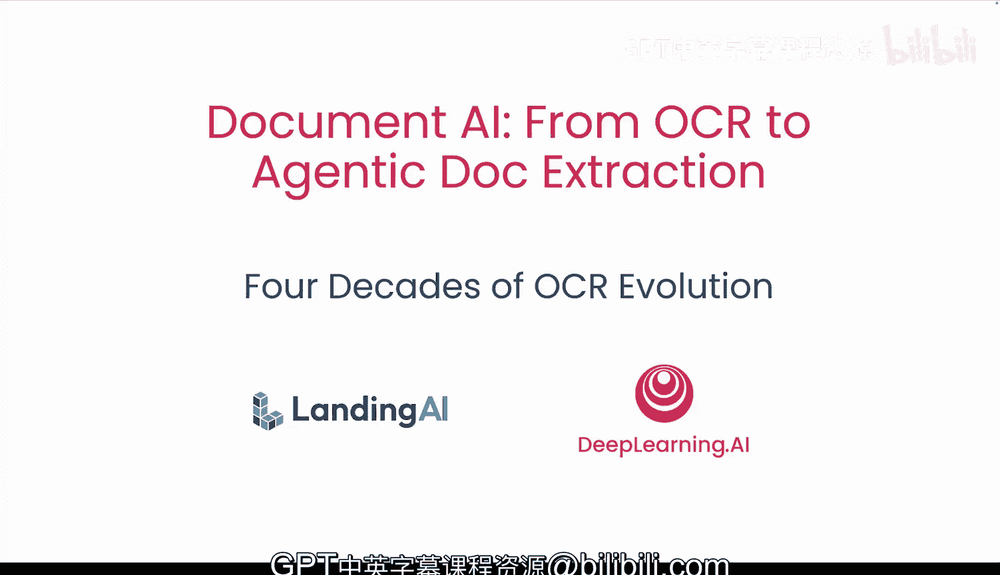
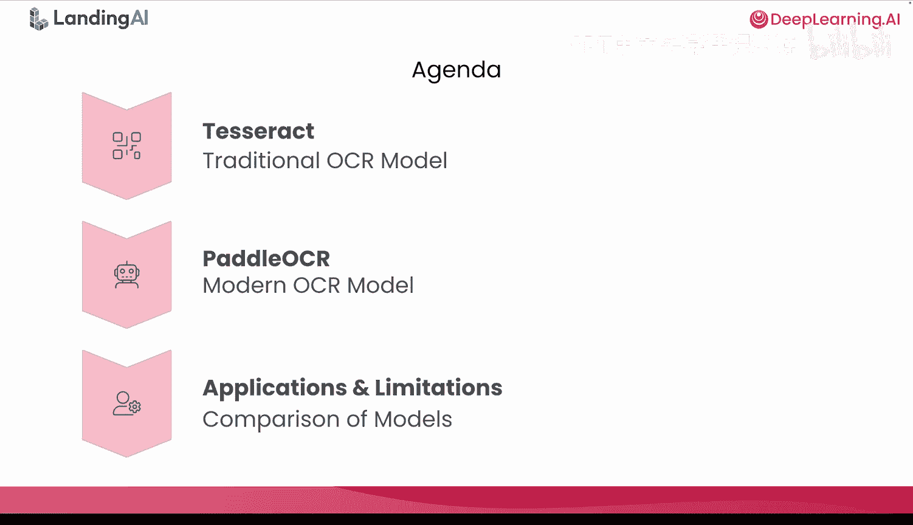
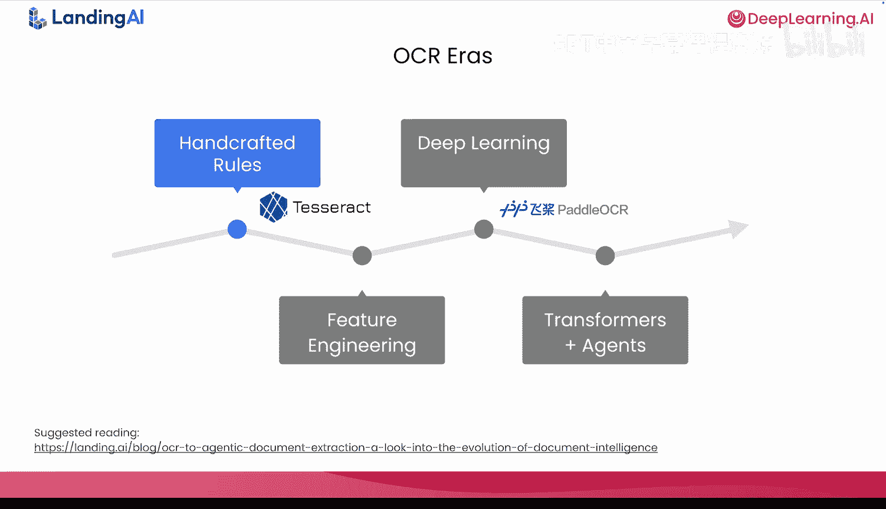
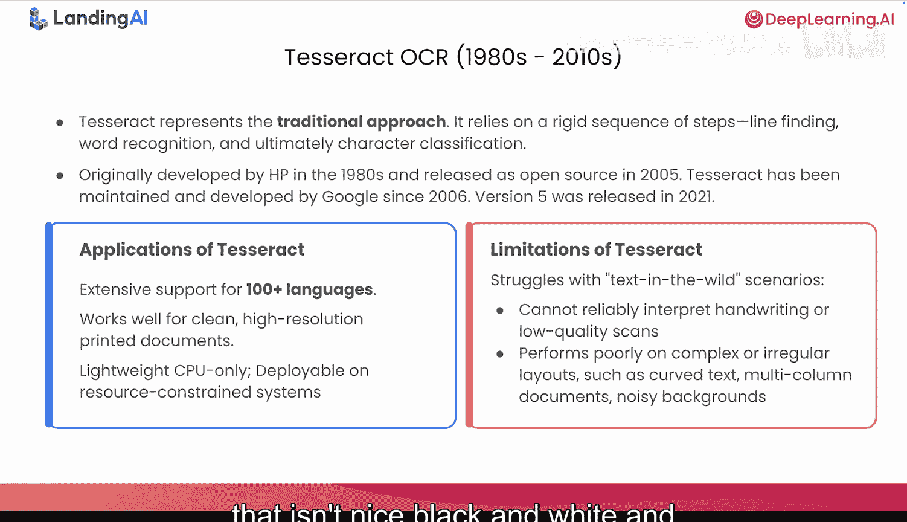
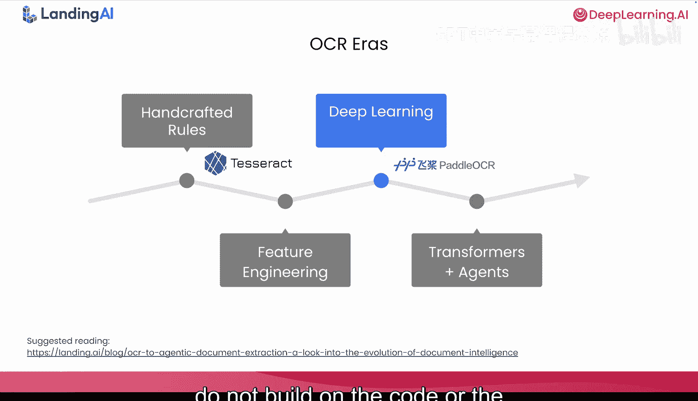
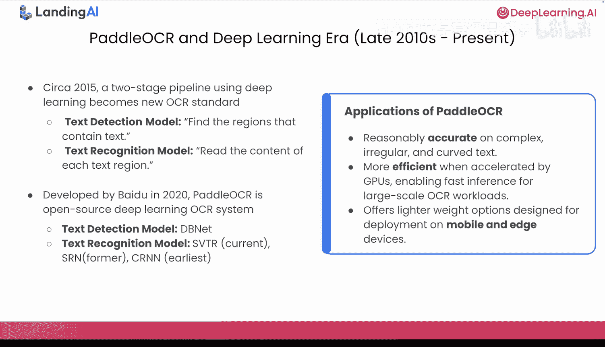
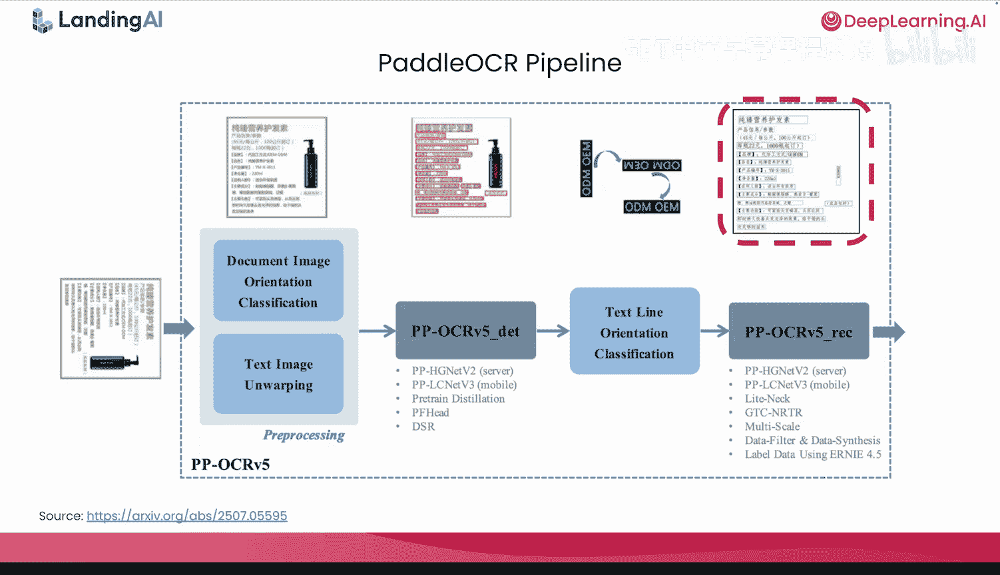
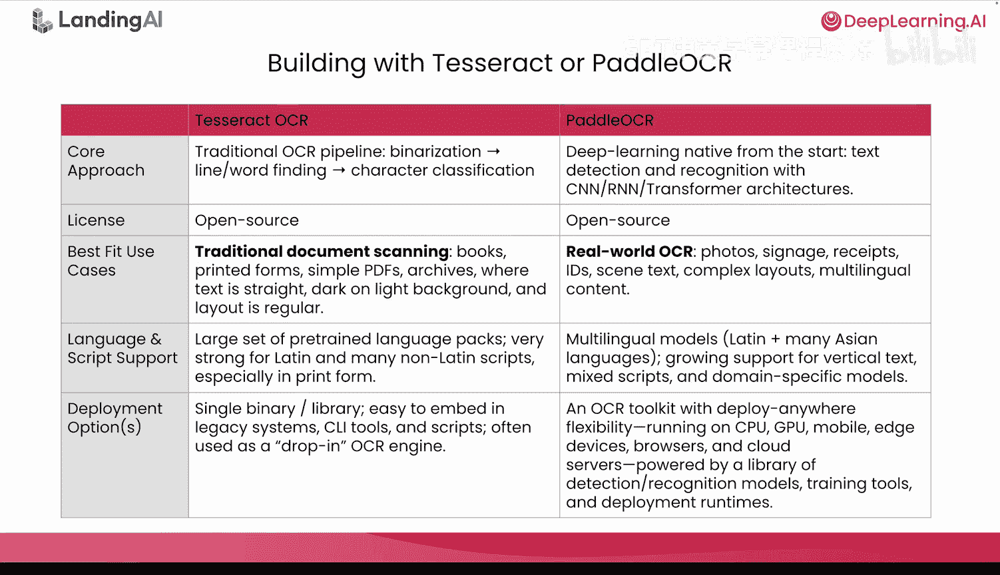
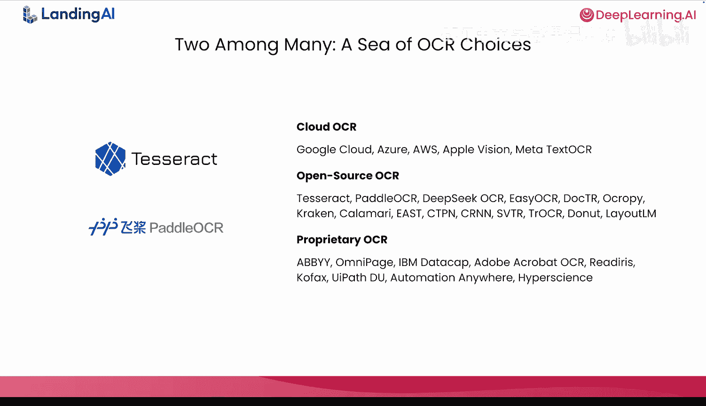
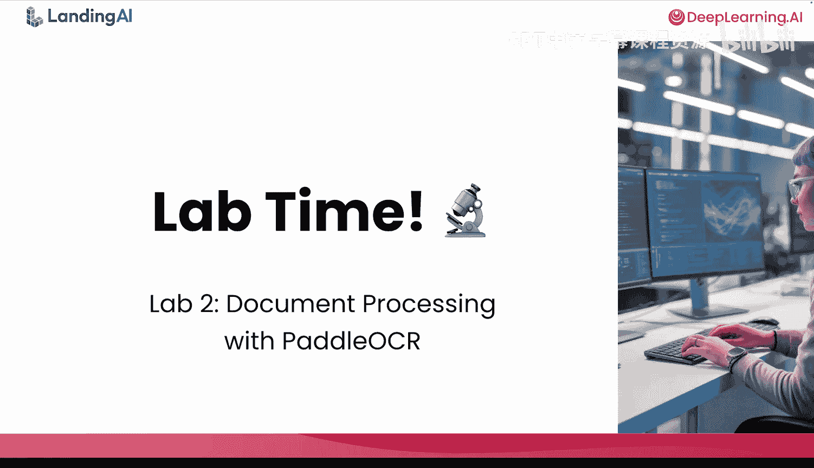

# 吴恩达《文档 AI：从 OCR 到智能体化文档抽取｜Document AI From OCR to Agentic Doc Extraction》中英字幕 - P4：4.four-decades-of-ocr-evolution.zh_en - GPT中英字幕课程资源 - BV1LmkEBHEHU

In this lesson， you'll learn how O CR has evolved over time from early approaches relying on the shapes of letters to modern deep learning systems。

In the lab， you'll use one such deep learning algorithm to run a detection and recognition pipeline on documents with real world messiness。

 You'll get to see the improvements that deep learning brings while bumping into new challenges related to document layouts and reading order。

 Okay， let's go。 Welcome back， everyone。😊，In lesson one。

 we focused on simple document processing systems， parsing， OCR。

 and then adding an agent brain on top。In lesson 2， four decades of OCR evolution。

 we're going to zoom in on OCR itself and look at how it's evolved over time。 Now。

 we cannot possibly cover every advance， every researcher and every important paper。

 So we're going to focus the backstory on two technologies that are representative of their eras。

 Those are Tessaract and PaocCR。Have you heard of them， have you used them。

 They may not be what you think they are because they too have evolved over time。

Let's start by placing Testsar Act and PaOCR into their corresponding eras。

Teser Act stands for the Tra Procedural computer vision approach， lots of hand engineering。

 lots of steps， lots of rules。PataloR is representative of the deep learning era；

 it uses neural networks end to end for detection and recognition。

And the shift from Tesact style to PaloC style systems really mirrors the broader shift in AI。

 from carefully designed pipelines with handcrafted features to data driven trainable models that learn directly from examples。

If you're interested in the full story， check out the suggested reading。

Now， you already had a chance to use Tesseract in lab 1。

 But here's a little bit more of the backs story。 And the story matters because this was state of the art as recently as 20 years ago。

The rigid sequence of line finding word recognition。

 character classification is still what comes to mind when you say O C R to many people。

 especially outside the technology domain。 So a couple things to know about Testact。

 It was proprietary to Hewlett Packard for the 80s and 90s and then was released as open source in 2005 and has since been maintained by Google in lab1。

 when you use Testact， you were actually using version 5。Now。

 Tes Act still performs well on clean printed documents such as books。

 but you should think of a novel that has no pictures in it。

 not something like a physics textbook with a bunch of diagrams。

 It supports many languages and it can run on resource constrained systems because it only needs a CPU。

You already saw some of the limitations in lab 1。 Any sort of text in the wild that isn't nice。

 black and white and straight lines is going to be a problem。

So for the history buffs out there and for you visual learners。

 take a look at some of these examples that were embedded in the 2017 Test rec paper。

Notice how the figures really demonstrate this hand engineering of understanding the shapes and spacing of individual letters。

 We're going to move on from Tesseract Now。 and it's important to note that although this was the earliest O C R approach。

 you should not think of it as foundational technology。

 what comes next in the next era is actually an entirely new approach。 So stated another way。

 the deep learning approaches that we're about to look at do not build on the code or the architectural concepts from Tesseract。

So enter the deep learning era starting around 2015。

 the deep learning approach to OCR really becomes the new standard。

 and the OCR problem is broken into two stages， and those can now be optimized separately。

 That makes the overall process much more modular。The first is text detection。

 find all of the regions that contain the text， and the second is text recognition。

 read the content of each text region。So in today's lab for lesson2。

 you're going to use PaOCR developed by Baidu， It's one such deep learning OCR system and it's open source with fairly broad adoption。

 as of 2025， PaloCR is on version 3， and in version 3， the text recognition comes from DBNe。

 which stands for differentialial binization Network， and the text recognition comes from SVTR。

 which stands for a short vision transformformer Rer。Now。

 a couple notable strengths include its handling of complex， irregular and curved text。

 high efficiency when accelerated by GPUs， and several lightweight deployment options。

This is the architecture diagram that accompanies the 2025 paper called PaddleOCR 3。

0 technical report linked at the bottom。Within this illustration。

 notice the gray box for the text detection module ending in underscore DET。

 and then the text recognition module ending in underscore R E。Surrounding those two。

 notice the pre processingcessing on the left and the line orientation in the center。Now。

 follow with your eyes， the input image on the left， it kind of looks like a lotion bottle to me。

First， the whole input is rotated counterclockwise， and then all the text areas are detected。

 and you see some red rectangles overlaid。One of those rectangles is actually on top of the lotion bottle and is rotated relative to the other lines。

 so that needs to be corrected。And then finally， the text within the box is recognized and returned to the user。

Compared to the old pipelines， you can really see how much of the complexity is now handled by learned models rather than by fixed rules。

Since this is a course about building document intelligence pipelines。

 let's touch on when you should build with each of these tools。 And let's just go row by row。

 So I think we've already covered the core approach and the underlying technology for each。

 Good news is the licensing here， they're both open source。😊，As far as best fit use cases。

 Teser Act is really going to be ideal for document scanning。

 Think really about books any time that you've got black on white text and their layout is fairly regular。

Palor is going to perform better with some real world use cases。

 It's going to be able to handle signage and receipts and complex layouts in the content。

 as far as which particular languages and tools， both of them support a wide range of tools。

 including Latin and non Latin characters， and they both have easy integrations with Python。

As far as deployment options， think of Test Act as fairly lightweight versus being part of the PaddleOCR framework is really much more of a complete toolkit。

To wrap up the slide portion of this lesson， it's important to acknowledge that both Testact and Paddle O C R really stand for an era of O C R development。

 There are many other O C R solutions to choose from。 and these are simply two， among many。

And in lesson 4， we're going to introduce yet another one not listed。

 which belongs in the agentic era。

So it's lab time again in this lab， you'll get hands on with PaOCR， and by the end of the lab。

 you should feel comfortable with running PaOC on your own images， interpreting its outputs。

 and thinking about how to plug it into larger document processing or agentic systems。

