# 吴恩达《文档 AI：从 OCR 到智能体化文档抽取｜Document AI From OCR to Agentic Doc Extraction》中英字幕 - P5：5.lab-2%3A-document-processing-with-paddleocr.zh_en - GPT中英字幕课程资源 - BV1LmkEBHEHU

So first， a little bit of setup up for our modern O CR stack。

 We're going to import pillow for images， open CSV and nuumpy for image processing。

 mattepllibib for plotting。 and， of course， paddle O CR from Paddle O CR。

 This cell is importing the API key that we'll need for the agent very similar to the previous lab。

Having completed our setup， let's get into it。 Allright。

 so here we create a Paddle OCR object with the language specified as English and notice that the two models from the architecture diagram from the slides are represented here。

 So here's that underscore D ET text detector model and here's the underscore R E recognition model。

Now you won't actually call these models sequentially。

 Paddle OCR is going to handle all of the preprocessing and calling these models all as one pipeline。

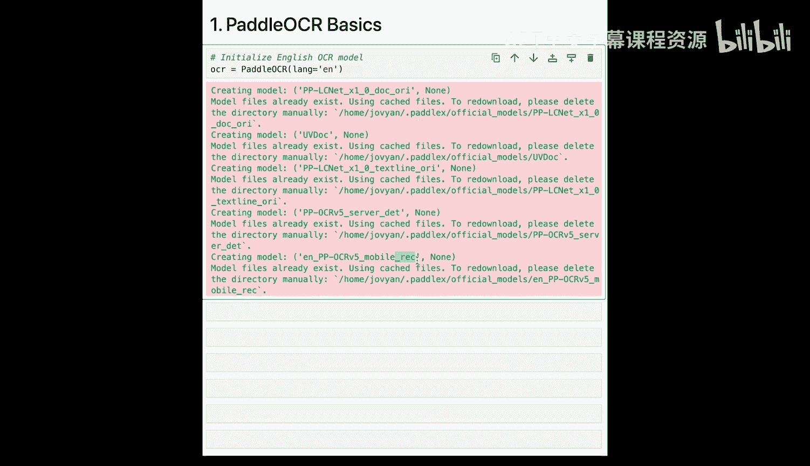

This receipt image will look familiar from La 1。 This cell runs the O C R。

 The result will be a list where each item corresponds to a process page。 So for a single page image。

 it's only going to contain one dictionary。

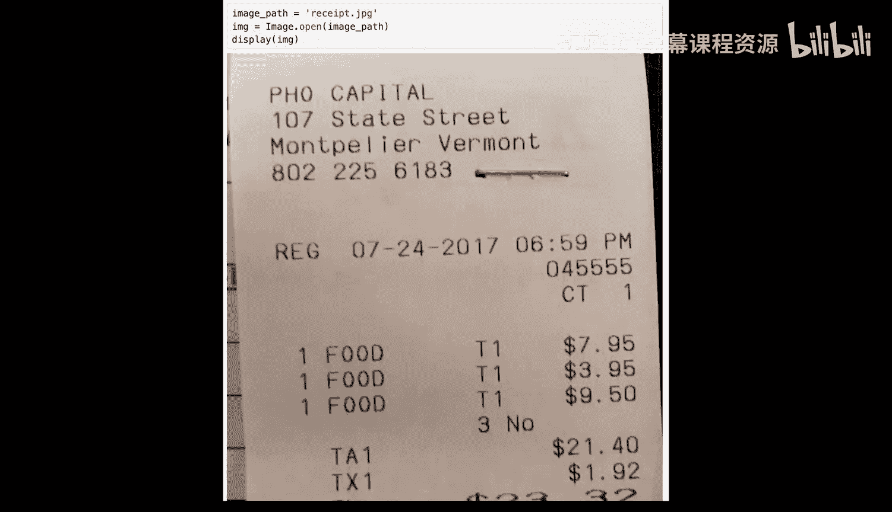

So this cell is going to print some of the contents of result zero。

 specifically the text that was recognized。The confidence score associated with that and the bounding box coordinates。

 And as we scroll down， we'll see all of the text that was recognized across the entire receipt。

All right。 Before we execute this saw， let me explain what to expect。

Recall from the architecture diagram that the pipeline also pre processes the image where necessary。

 and it can correct rotational issues or de skew or unwwarp the issue。

 So what we're going to see now is actually the pre processcessed image with the bounding box and the text recognition overlaid。

 So let's go ahead and request the image。And then execute another cell where we can view it with all of those items overlaid。

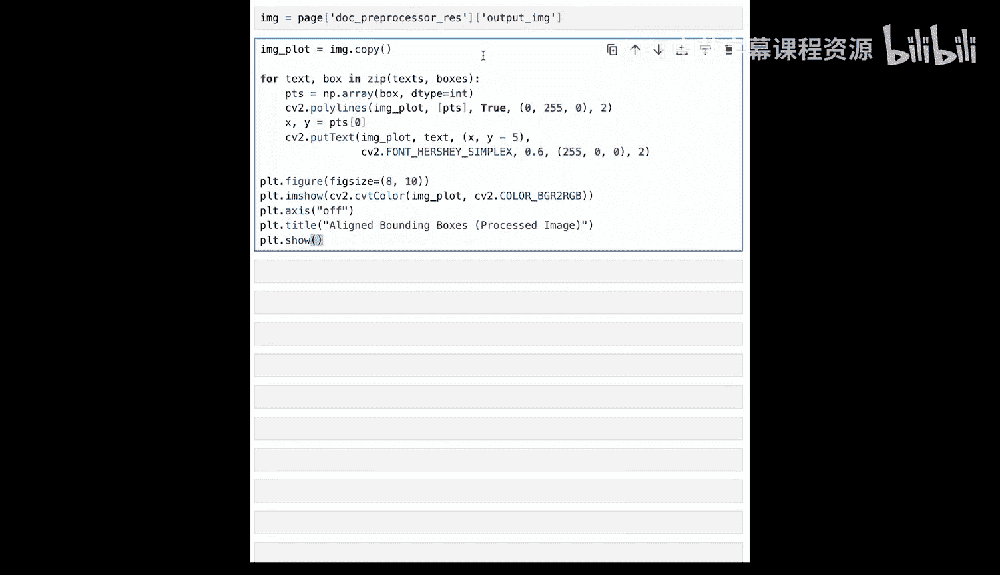

Now， if you compare this image carefully to the original。

 you'll actually see that some of the background is removed and there is a slight rotation clockwise to make it a little bit more horizontal。

And then the code draws the bounding boxes on the processed image and places the recognized text on the top。

So why repeat an example such as this one。 Well， notice the addition of the bounding boxes。

 We now have localization information about where in the receipt a particular text field is found。

 and also notice that we are getting the value correct。 Previous， this 795 was incorrect。

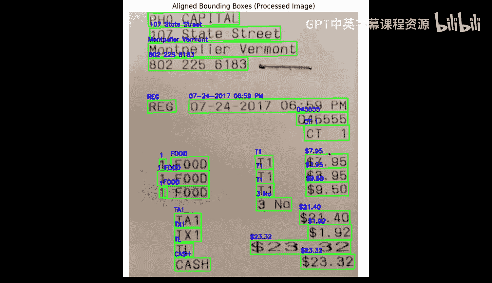

All right， so now we're going to turn Paddle OCR into a tool that can be used with an agent。

 this will be very similar to lab1。So this long function， we're setting this up as a tool。

 and here the result is going to be coming from the paddle O CR， and much of the rest is the same。

 We're going to be printing out the text and the boxes and the confidence scores。

 as we saw in the prior example。All right， having defined that function we'll now specify that that function is the tool that will be available to the agent。

 The rest of this is going to be the same as lesson1 and note that we're using GT 5 mini as our LLM。

This task should look familiar as well， we're going to use the receipt and evaluate that the total is correct。

So as I scroll down here， of course we see the paddle OCR output here in the turquoise。

 the green output is coming from the LLM， the task again was to perform some basic addition and because the inputs are correct then the addition has a much greater chance of being correct。

 and we do get the correct total。So this example really shows how a combination of paddle OCR and an LLM can handle a real world receipt。

Remember that the table exercise and the student handwriting， we're going to do those two next。

 we're going to define another helper function。 There's actually nothing new to see here。

 so the OCR result is still coming from paddle OCR we've still got some printed output。

 We're still working with the postproed image and then we're going to be doing some annotations on top of that using the bounding box coordinates。

 but now it's wrapped into one function called run OCR and you'll see this one repeatedly through the rest of the lesson。

All right， so let's apply all of that to the table。Is a reminder of what it looks like。

And our second chunk of output is the paddle O CR printed information。 Again。

 we've got the recognized text， confidence score and bounding boxes scrolling on past that。

 We have the actual overlaid bounding boxes with the recognized text in blue。

So as you visually inspect this， you may detect one or more OCR errors。

 and the first one that I see actually continues with the treatment of the exponential notation we had problems with this previously。

The 10 to the 20th over here is recognized as 1，0，2，0。

 And that's like a billion billions difference from the real answer。

 So it also seems like most of the exponents are recognized in this way。

But let's go ahead and power forward。We'll give the agent the task of again extracting the flops from the English to German noted as EN to DE column in the table。

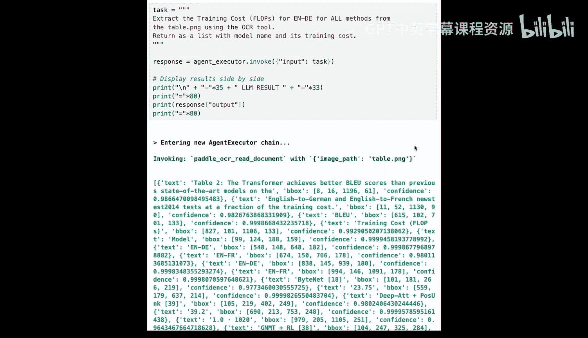

All right， let's scroll through this output again， the turquoise is coming from paddle OCR。

Green is coming from the LL M。 and then in our function。

 we also asked for this printed result down at the bottom。

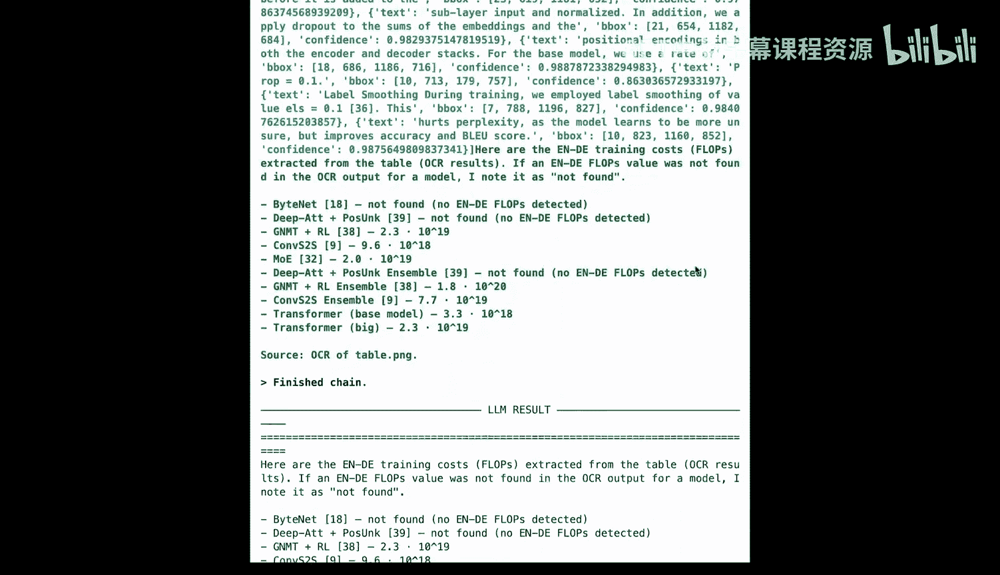

So you can do the visual inspection for yourself or you can trust me that this is actually fully correct。

 and let me draw your attention to two aspects that were incorrect in the previous run。

So this Btenet and this deep ATT are correctly noted as not found because they are blank areas in the original table。

And fortunately， our scientific notation has been corrected。 Instead of 1020。

 this is now reported as 10 to ops， which stands for the floating point operations。

 It simply doesn't make sense for the result to be 1020。 It needs to be a much larger number。

 So the agent has been able to apply reasoning to the OCR output and remedy that situation。

Let's see if we can also remedy the issue with the student handwritten grammar exercise。

 here's a reminder of what it looks like。

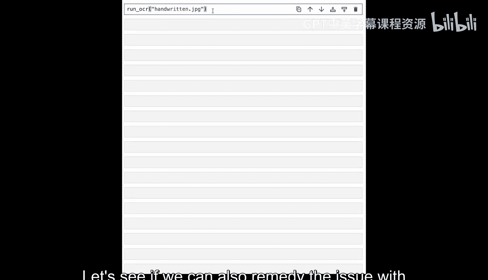

Let's take a look at the output and notice at the top here that tension to a few other things。

So question number one is very clearly I am， but in the text recognition。

 I think we're getting I underscore and then this looks like A UAN to me so that's not good number two。

 you know we've got an extra underscore in here we could probably clean that up in post is which is an improvement over the test Act performance。

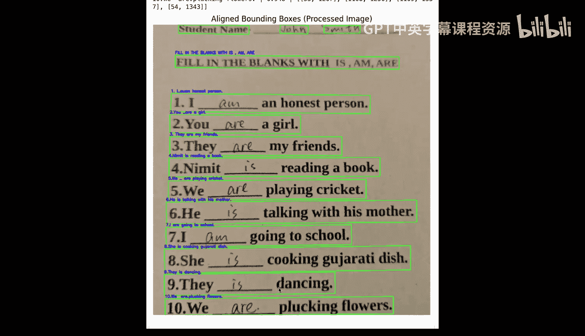

So now let's give the agent the task of extracting the student responses as JSON。

And we'll actually just skip right ahead to the LLN response here。

So question1 here is somewhat nonsensical and recall from the pitessact architecture diagram that there is a detection stage and a recognition stage。

 So the detection is what's giving us the bounding boxes。

 and that is clearly helping with the understanding of the overall document。

 and the recognition here is also better。 There are fewer actual character level mistakes in terms of transcribing or recognizing the text。

 So definitelyly performing better on these identical examples。

 and now we'll move on to some more difficult examples to expose some weaknesses。

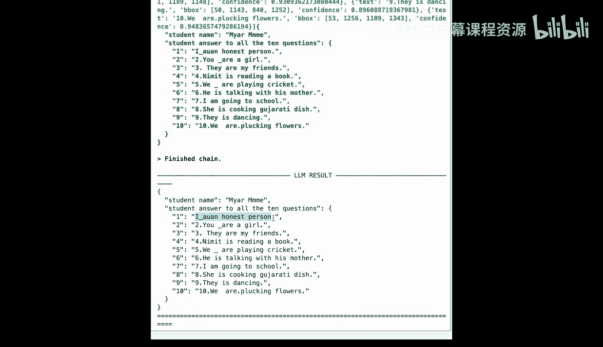

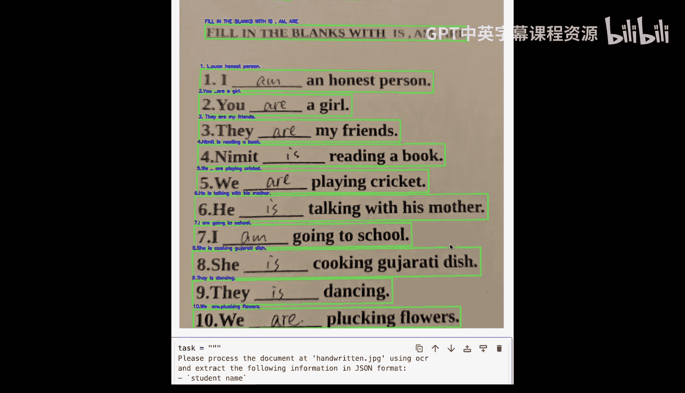

So in this section， we're going to look at three new examples and we have specifically selected them to expose some weaknesses。

 but these are things that you need to be aware of if you're building with PaOCR。

So this is a new example， it's called report。pNG， and it appears to be an interior page from a report about the US economy。

At the top there's a table， the center has some basic text。

 and at the bottom there is a line chart with a caption to the left。

Let's take a look at how Paddle OCR has extracted this document。So at first glance。

 the table output actually looks quite good and the text is fairly straightforward。

 but let's take a look at this line chart。So there's no box around the whole thing。

 So that's my first clue that it's not being recognized as a single unit。

 but there are boxes around some of the X and Y axis labels such as this0， negative 2， negative 4。

 negative 6。And these are now completely out of context， which we can see if we scroll back up。

So indeed， here's that 0， completely disconnected from this negative 2。

 separated by some other content and then negative 4。

 So there's really no way of understanding that these were y axis labels or that they actually belonged to a chart。

 which was ignored completely。So we've exposed one weakness。 All right。

 let's take a look at article do Jpeg。 What does this contain。

This looks like it's the front page of an academic article about teeth。Okay。

 so what do we notice about this article So there are multiple columns of text here。

 so at the top of the article there's kind of two columns we've got the abstract next to this call out and then the body of course。

 is presented as three columns of text， which is kind of interrupted by this table。

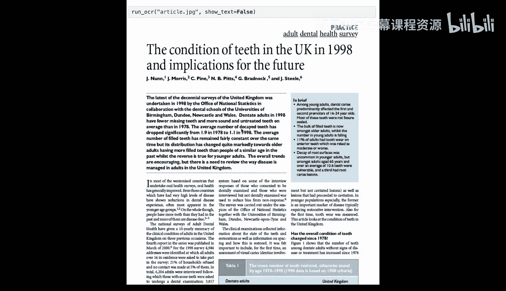

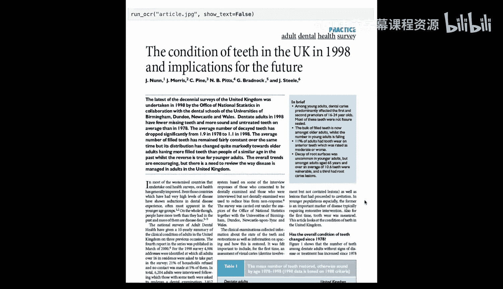

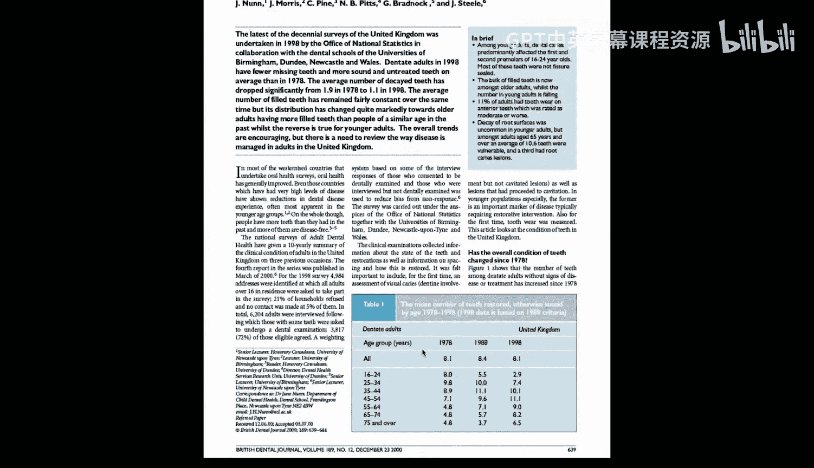

So let's scroll down to view the bounding box output and see how well it does with this multi column document。

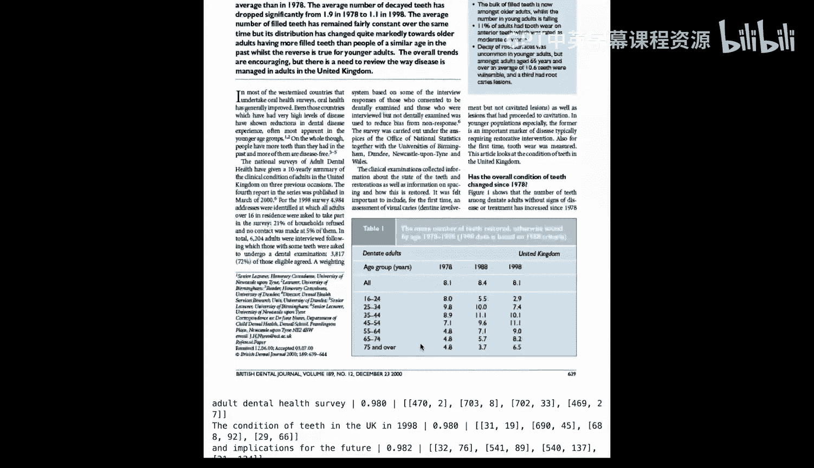

All right， there's a lot of boxes here， but I'm just going to draw your attention to the first and second column and of course the reading order here。

 you would read it in most of the Westernized countries that undertake oral health surveys right so we would be reading all the way down the left hand column。

But in the OCR， we're actually going to see reading straight across if you're following my mouse。

 so it would be in most of the Westernized countries， that system based on some of the interview。

 which of course makes absolutely no sense and manages to garble the entire article if you continue that way for you know another 10。

15 pages。So what we've learned about Paddle OCR is that it is not able to handle these multi column layouts and runs the risk of garblling your text if this is a layout that's part of your document。

So we've surfaced these weaknesses around layout and we're starting to realize that layout aware text detection is really going to be at the cornerstone of accurate real world OCR because of course。

 layouts like this are very common。But the PalOCR model doesn't have vision。

 we actually are going to need some sort of vision model for more complex documents。So good news。

 PanloCR actually does have its own version of layout detection and as we mentioned before it has been going through active development and we haven't been using the layout detection previously。

 so here's our chance to import that and start to use it in conjunction with the text detection and recognition。

So here we will initialize that layout detection model。

So we'll define a new function called process document。

 and we'll send our image to this layout engine。And as part of the response。

 we'll get back the label。The score and the bounding boxes。

 So the score and the bounding boxes we've seen before。

 But now we're going to get a label for that region。And that'll make more sense once you see it。

All right， let's apply process document to that interior page from the report on the US economy。

Hopefully， now the meaning of label is more clear。 We're getting back things such as text， chart。

 paragraph title or number， or even footer。 So this is identifying the different regions on the document and labeling them for what they are。

And the purpose of this long function is just to aid in visualization。

So let's look again at that economic report， but now with the layout detection overlaid。

Let's take a look at things here。 I'm seeing several text blocks。 I'm seeing a paragraph title。

 I'm seeing a table up here。 And very importantly， I'm seeing a chart and an entire bounding box around that chart。

 and then also small details such as number and footer。

 But the layout model really now has identified the major regions of this document correctly。

And now you'll do the same thing with the article about teeth。So as I'm visually taking this in。

 I'm seeing labels that I've seen before， such as text and paragraph title。

 I'm seeing a few new ones such as document title and abstract。

 I'm seeing high confidence scores associated with those， and then as I scroll down。

 seeing some footnote and footer and also table。But I will note that the table， to me is one table。

 and it's being recognized here as two tables with slightly lower confidence。But all in all。

 the layout model is now really going to help keep this text together。

 so we no longer have the problem of continuing from the word that to the word system because this entire text block is going to indicate that the word after that is undertake。

So let's see how far we can push this with one more example。This one is a bank statement。

 and typically when dealing with bank statements， the ultimate downstream use case is to extract a certain number of key value pairs out of it。

And I'm actually seeing the same challenge with the table。 In this case。

 this is all being detected as one large table。 But for me， you know。

 with my human vision and human experience looking at bank statements can actually tell that the headers should have been right here。

 Ds， description， category， amount and balance。That's actually the table break and the table headers。

 Everything up above could be interpreted as a table。

 but it should definitely be a separate table from the one below。

So there's definitely still some weaknesses here。Odly in this example。

 the small text at the bottom is entirely ignored and sometimes that's where a legal footnote or other important information might appear。

Al right。 so that brings us to the end of lab 2。 And let me recap a few of the main takeaways。

 So Pan OR is from the deep learning O CR era， and it's clearly a strong engine that beats traditional O C R on many of these real world images。

 but it still mostly thinks in terms of individual lines of text。Then we added the layout detection。

 and that gave you some of this region level structure。 So where are the paragraphs。

 the tables and the figures， but it's still not full semantic understanding。

 And it doesn't really represent the way that humans see documents。

 and humans really operate very much on a visual system。

 So we'll continue to bring more of these concepts from vision as we move forward in the course。

 In the next lesson， we'll hand it back to David。 And he'll double click on some of these concepts around layout and reading order in a lesson called layout detection and reading order。

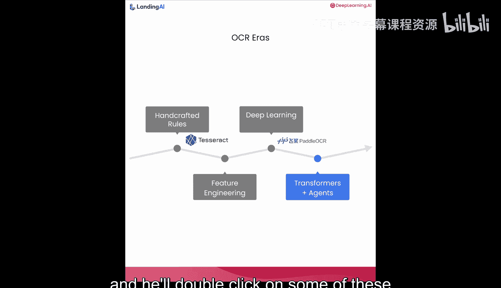