# 吴恩达《文档 AI：从 OCR 到智能体化文档抽取｜Document AI From OCR to Agentic Doc Extraction》中英字幕 - P6：6.layout-detection-and-reading-order.zh_en - GPT中英字幕课程资源 - BV1LmkEBHEHU

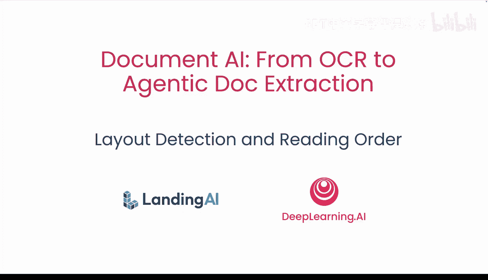

Documents do not always present information in a strictly top to bottom left to right order。

 In this lesson， you will learn how to use models like layout reader to detect text ordering。

After identifying a documents layout and locating and ordering the text。

 you will use a VLM to develop a holistic understanding of the document。 Okay， let's get to it。

 In lesson2， Andrea walked us through the evolution of OCR from traditional engines like Teserak to modern deep learning systems。

 Now that we understand how text is extracted were ready for the next challenge。

 documents with complex layouts。 We'll start by grounding ourselves in what layout detection and reading order actually mean and why they matter so much for document intelligence。

 Then we'll look at how modern systems try to solve these problems using learningbased approaches instead of simple heuristics。

 We'll also cover real world challenges， dealing with forms， tables， figures。

 handwriting and multilingual documents and how they can be solved with specialized models from there。

 we'll introduce vision language models and talk about how they differ from traditional languageon models。

 Finally， we'll discuss how you can combine。Tiques into a hybrid architecture that you'll implement in the lab。

 Let's begin with the pipeline that many teams and organizations still rely on today。 First。

 you extract the text from the document。 Then you pass that text into a language model and ask it questions on the surface。

 This feels reasonable， simple， even elegant。 But the problem is that most text extraction can be destructive。

 The moment we flatten a document structure is lost。 Cols and rows get mixed together。

 tables become meaningless floating text bbs。 captions detach from figures。

 and reading order becomes unpredictable for complex document， financial reports。

 research papers and legal contracts， OCR plus an LLM simply doesn't have enough context to reason correctly。

 layout detection or document layout analysis is the first step toward fixing that problem Rather than treating a document as a corpus of raw text。

 layout detection identifies meaningful region。

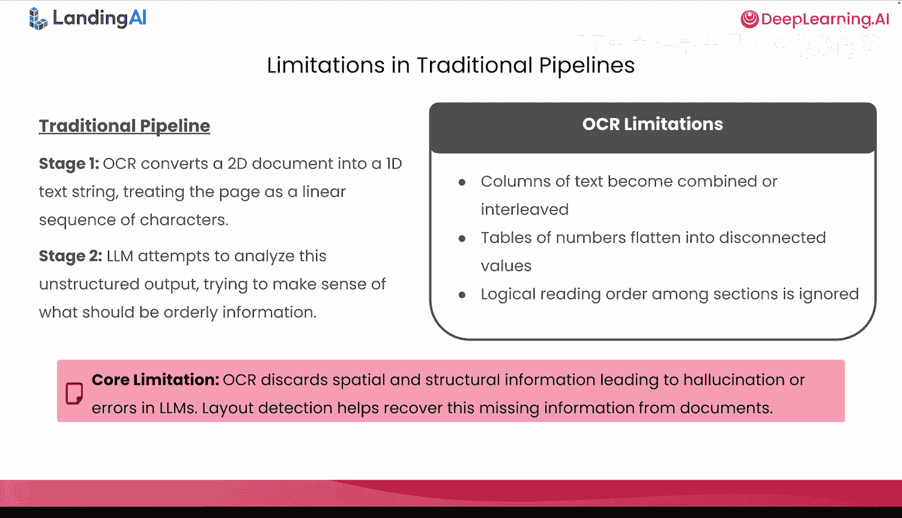

On the page and figures out where they are and what they represent。

 It distinguishes between paragraphs， tables， figures， headers， Fers and captions。 In other words。

 we're no longer just extracting content。 where understanding the structure of the document。

 This turns out to be incredibly important。 Preserving layout prevents different sections of text from getting mixed together and convoluted。

 It preserves the narrative flow in multicoln documents。

 It allows you to target specific parts of a page like totals in a table or key fields in a form。

 The core idea here is simple but powerful。 layout is important。

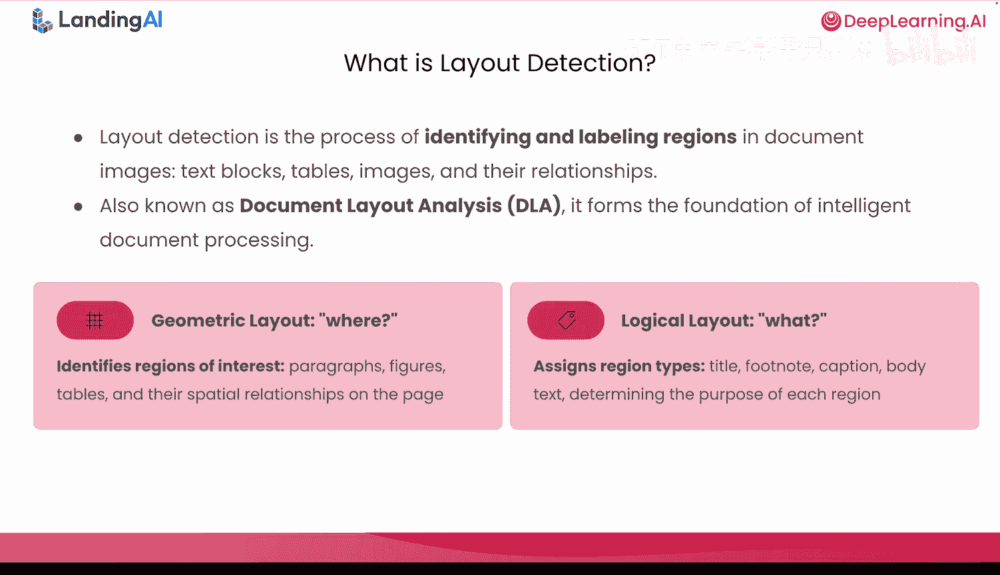

Once you throw it away， understanding becomes fragile and error prone。

 If you look at real world documents， such as the ones you've seen in the previous lab。

 they're rarely just blocks of text。 They include columns， tables charts， images， captions， headers。

 footers， stamps and annotations When you explicitly detect and label these components。

 Bostream models know what kind of information they're looking at before they tried to reason over them。

 Once we know what's on the page and where it is， the next question is， how should it be read。

 layouty tells us where things are。 reading order tells us in what sequence a human would actually read them。

 This matters enormously in multi columnlumn layouts or documents with floating figures and captions。

 without a reliable reading order， even a clean layout still leaves room for ambiguity。 Hisically。

 reading order was handle with rules。 you assert regions top to bottom， left to right， maybe apply。

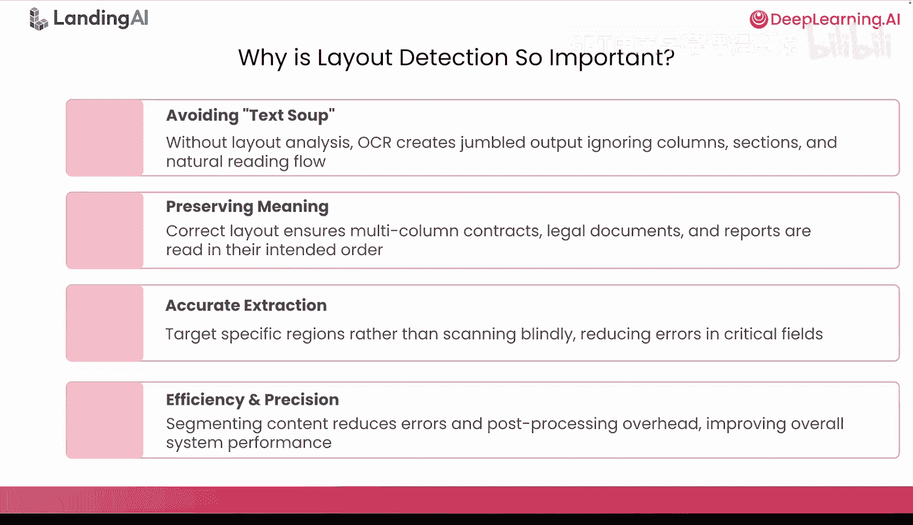

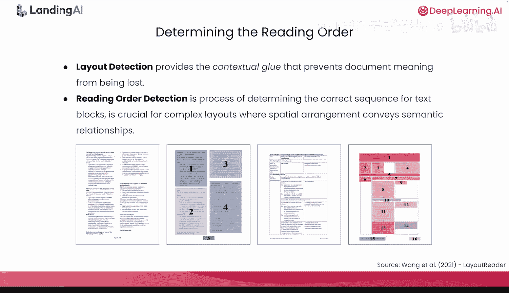

An X Y cut algorithm。 And hope for the best。 This works for very clean documents。

 but breaks down immediately for anything real and complex。 Any columns。

 sidebar or floating elements and those heuristics start producing nonsense。

 That change with layout reader Instead of rules。 It's a learn model trained on reading bank data set。

 over 500000 annotated pages with correct reading sequences。

 Each word gets represented as a tuple containing the word itself and is apparent index along with layout features。

 were color bonding box coordinates with an height。

 The model learns to predict the correct reading order from these visual and spatial features。

 This handles complex layouts。 multi columnlumn structures and irregular reading flows that rules based system can't manage。

 Let's look at how layout reader actually works。 The architecture is a sequence to sequence model using layout L M as is encoder。

 layout L M was developed by Mark。

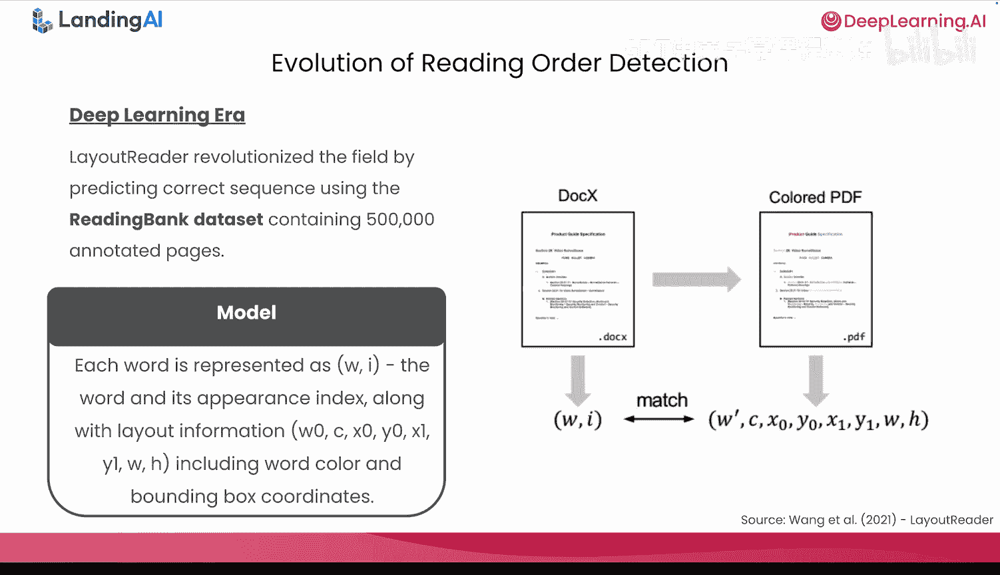

soft in 2020 and combines text， layout and visual information。

 The purpose is to predict the correct reading order of words or text lines in a document。

 The process takes OCR produced bounding boxes。 For example， from Pa OCR。

 and rearranges the documents tokenken sequence to reconstruct a human readable reading order。

 The model was trained on reading bank。 a benchmark data set。

 Microsoft created specifically for this task。 It contains 500000 document images annotated for reading order。

 You can see the diversity it handles。 Research papers with multicollon layouts。

 scientific documents with mixed structures， and financial documents with tables and lists。

 Each gets the correct reading sequence despite their varying layouts。 Now。

 let's talk about why OCR and reading order is not enough。

 Read order detection depends entirely on the input quality from the OCR。

 But here is the fundamental limitation。 OCR only captures text。

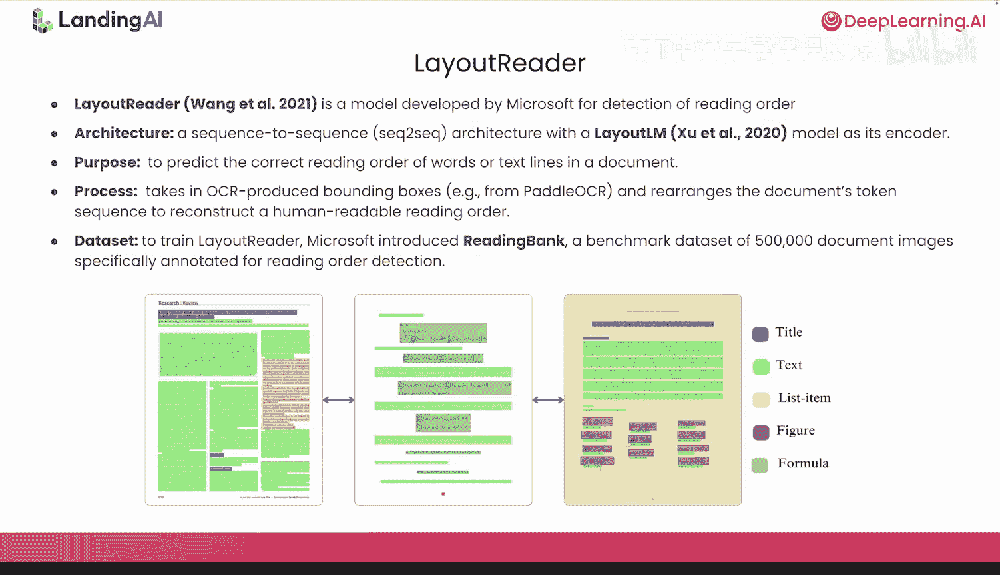

It misses visual information， images， charts， diagrams， spatial relationships and visual context。

 So even with perfect reading order， you're working with incomplete information。

 So what does this look like in practice， You'll see these challenges repeatedly misaligned forms。

 complex tables， handwriting multilingual documents and figures that require interpretation rather than transcription。

 These are exactly the points where O CR based pipelines fall apart。

 And you've already encounter some of these issues directly in the lab Forms are a perfect example of why this is hard。

 The core challenge is associating labels with values， especially when they're not adjacent。

 You have a few possible approaches。 templatebased extraction using fixed coordinates， which is fast。

 but inflex when layouts change， Flex key value pair detection using rules or Ml based on proximity and content or fine tune transformers like layout L M trained on data sets like fun SD that learn these relations。

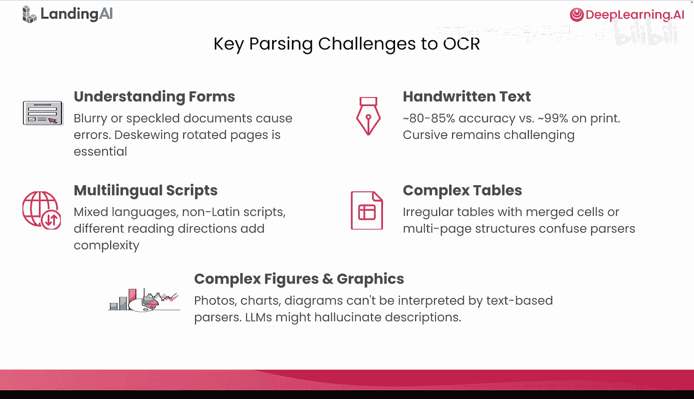

automatically， and you still need computer vision for non-text elements like checkbox states solving this requires combining layout understanding with semantic reasoning and visual detection Tables are another notorious failure points Tra OCR destroys table integrity by flattening rows and column relationships。

 One structure is lost。 numbers stop making sense。 Mo models tackle this differently。

 Table transformformer uses object detection to find tables rows and columns as distinct objects。

 Tform takes an image to sequence approach Translating table images directly to HTML Tt uses split emerge for large dense tables。

 The output can be CSV JSson H or pandas data frame so we can reason over data instead of text bbs。

 Handwriting and multilingual documents represent two more failure modes。

 Standard OCR trained on printed text fails on handwriting due to various styles， cursives。

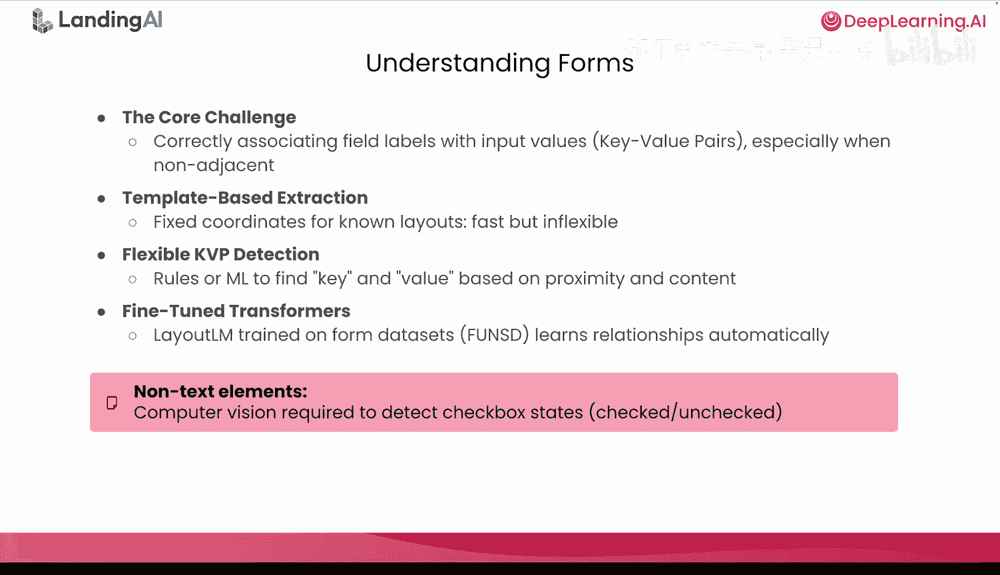

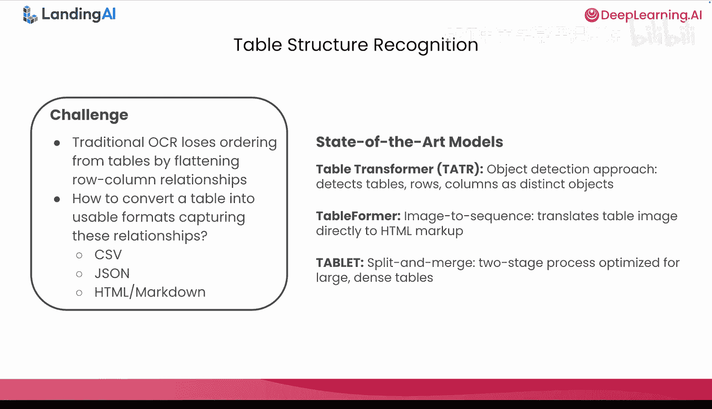

Inconsistent character formation all break the model。

 Intellig character recognition or ICR is a specialized model trained on handwritten dataset sets and uses CNN R architectures for sequence modeling and character levell predictions。

 Multilingual documents bring different challenges。 nonstander characters。

 Uni fonts and alternate reading directions right to left for Arabic vertical text and East Asian languages。

 This requires robust multilingual models with automatic language detection。

 language specific OCR engines， script detection and routing as well as reading order adaptation per language。

 These specialized models have been the workhors of document AI for years。

 Each refined to excel at a specific task， but recently。

 a new paradigm has emerged vision language models。

 these represent a fundamental shift from specialized tools to general purposepo intelligence that can handle all these tasks and more。

 So what is a vision language。

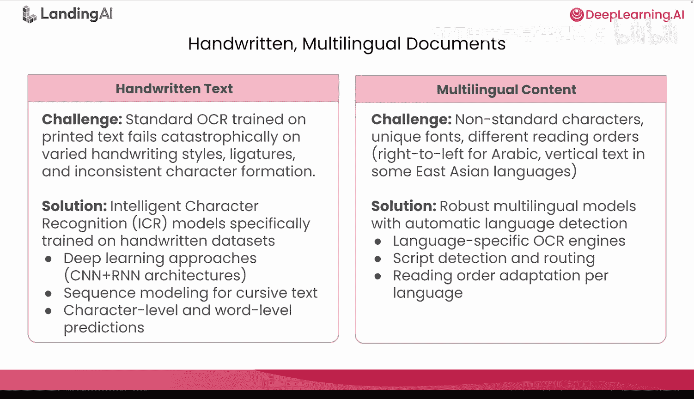

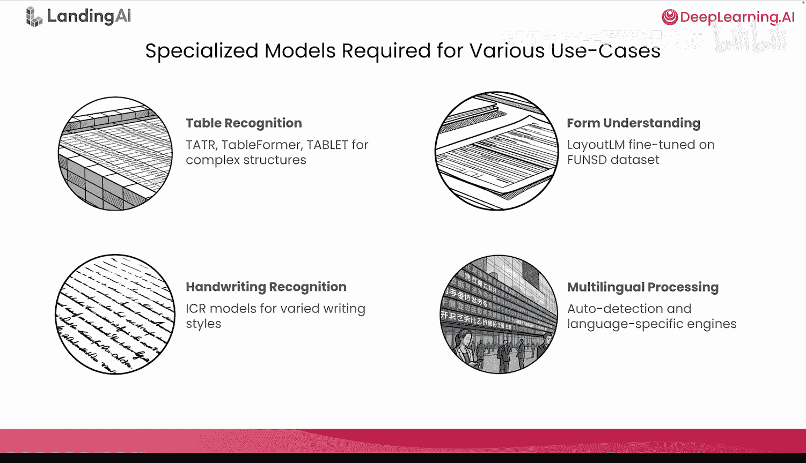

Traditional LLMs operate purely over text tokens。 VLMs unify vision and language。

 processing images and text simultaneously to form a shared semantic representation。

 This allows models to reason about what's happening in the visual scene。 not just what words appear。

 Let's discuss what changes when we move from an LLM to a vision language model。

 On the left is a regular LLM。 It takes text tokens as input goes through the transformer and you get text output。

 Everything the model understands， comes from text alone。 On the right is a vision language model。

 The input is image plus text。 before anything reaches the language model。

 The visual input has to be translated into something the LLM understands using a vision encoder。

 Then it produces the text output。 That's what the three components below represent。

 First is the vision encoder。 Model like clip or sigip convert pixels into visual vectors。

 Second is the projector。 this translation layer。

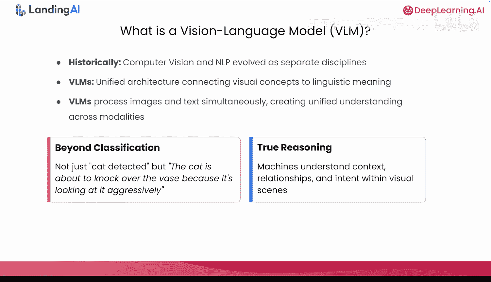

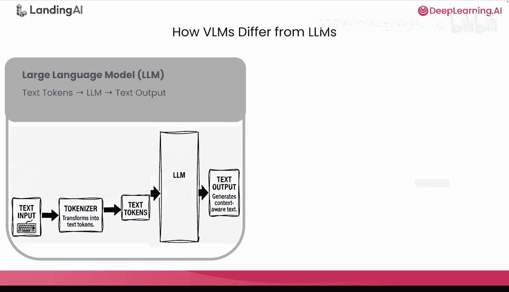

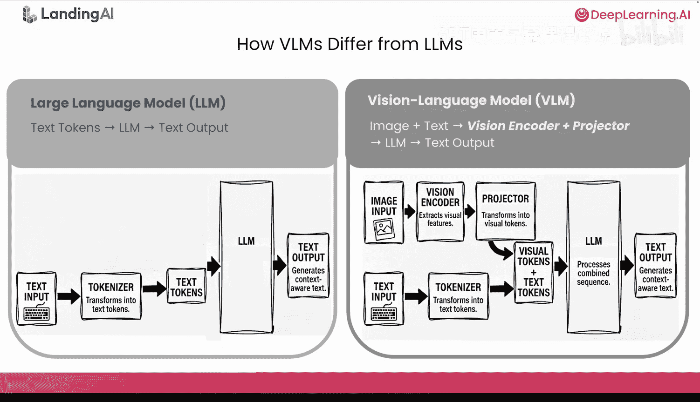

verseVi vectors into token embeddings。 the LLM can process。 Third， the LLM backbone。 At this point。

 a standard LLM reasons over those visual tokens and produces text output。

 The key takeaway is simple。 A VLM is still an LLM， but with a vision stack in front of it。

It can see images， but how well it understands documents still depends on how structure。

 layout and reading order are handled。 Vis language models are powerful。

 but they're not a complete solution on their own。 So if you give a VLM a visually rich document all at once。

 VLms can struggle。 They hallucinate when visual cues are missing or ambiguous。

 day like deterministic grounding， meaning they can't reliably tie their answers back to specific regions of the page。

 They struggle with nesta layouts。 multipage structure and small text。 VLM's Excel。

 when paired with structure， but they can' replace the structure reasoning require for real world document tasks。

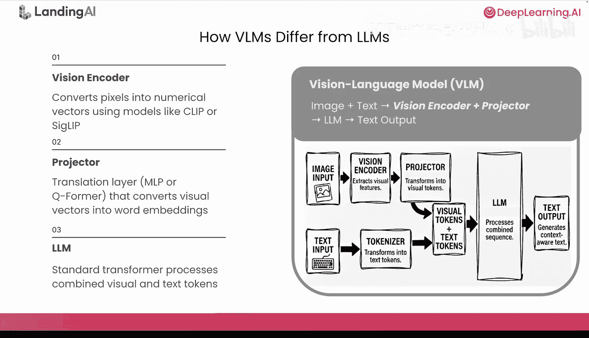

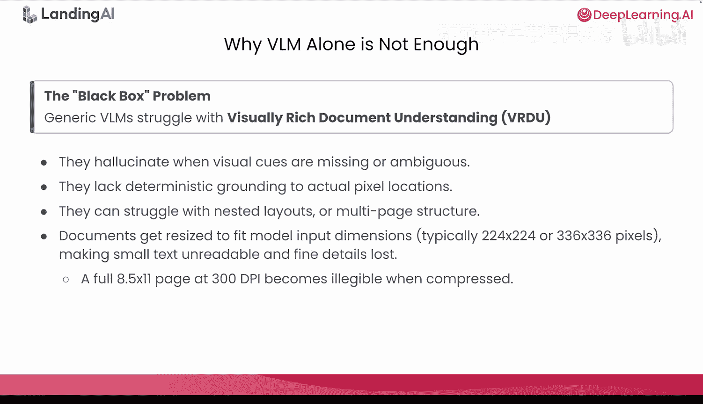

One possible solution is to combine layout detection with VLM reasoning。

 The layout analysis we discussed earlier provides the structure foundation。

 identifyingdent reading order， document regions and their type。

 The structure information can then guide how you process each region。

 Charts and visualizations might go to a VLM with a targeted prompt。

 Tables could use either a VLM or a specialized transformer， depending on the complexity。

 textex regions might use traditional OcrR or VLM vase extraction。 In conclusion。

 layout detection provides the deterministic grounding。

While the VlMs handle the elements that benefit from visual reasoning。

 One way to orchestrate this workflow is through an agentic framework in the lab。

 you will implement a pipeline that demonstrates this starting with an input document。

 Youll extract and order text using Pa OcrR。 This gives you all the OC text along with bounding boxes and confidence scores。

 You will then use layout reader to reorder the extracted text。

 You will also run region detection using pa OcrR's layout detect to identify tables。

 charts and text blocks。 Youll provide all the context above the OcrR text in the correct order。

 region Is and chunk types as context for a la chain agent。

 The agent will have access to two specialized tools。

 Ana chart to send crop chart images to a VlM to extract chart type axes， data points and trends。

 analyze table does the same for tables。 Extracting headers。

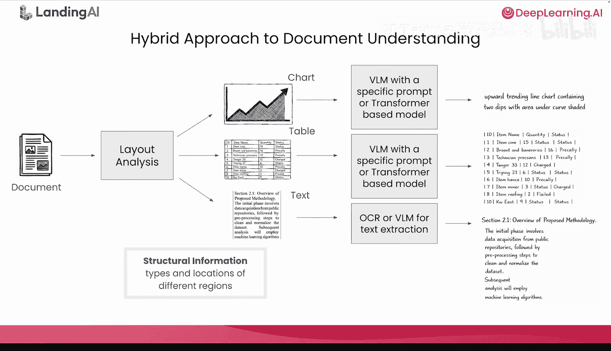

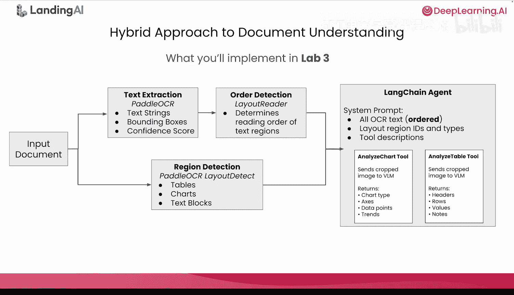

valuess and notes based on the user's question， the agent can decide which region needs VLM analysis and which tools to invoke。

 so let's get to it by the end of the lab you'll see exactly how these pieces work together and how this sets the foundation for ADE in the next lesson with Andrea。

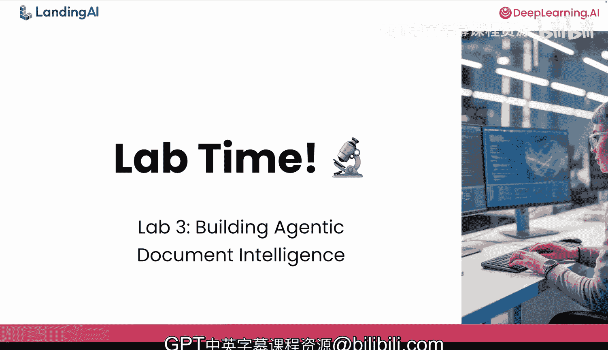