# 吴恩达《文档 AI：从 OCR 到智能体化文档抽取｜Document AI From OCR to Agentic Doc Extraction》中英字幕 - P8：8.a-single-api-for-agentic-document-understanding.zh_en - GPT中英字幕课程资源 - BV1LmkEBHEHU

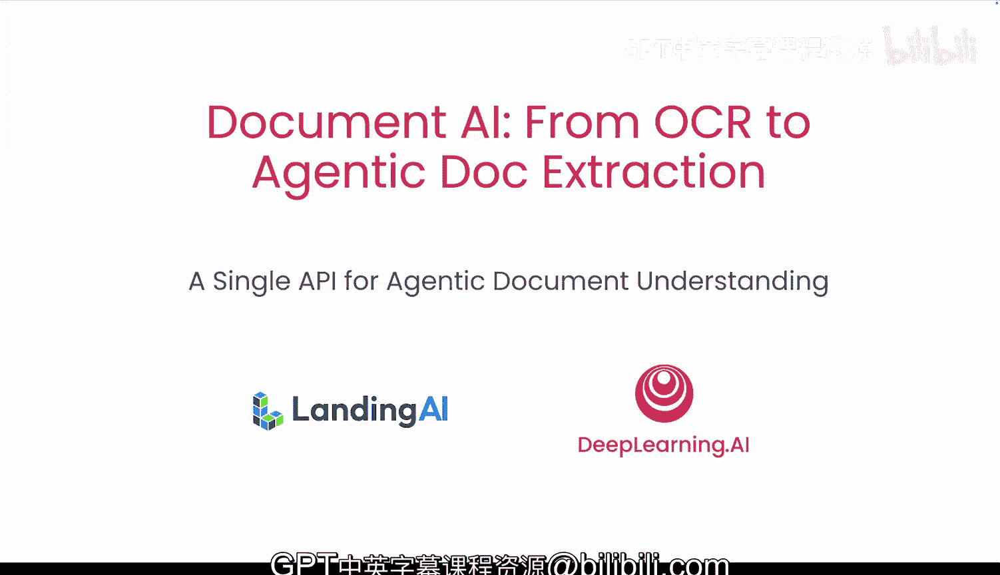

In this lesson， you'll use the agent document extraction framework from landing AI to parse documents and extract key value pairs without using character recognition。

 layout analysis or vision language models。In the lab。

 you'll use AE to parse complex documents and build a pipeline to parse mixed documents。 All right。

 let's have some fun。 This lesson is named a single API for agentantic Do extraction。

 So why did we choose that name。It's really a very apt description of landing AI's agent document extraction。

Much of the complexity you've seen in prior lessons is now replaced by a single API。

So what are we going to cover in this lesson？After providing an overview of agent Gen Do extraction。

 we'll look at the two primary use cases， field extraction and ragG。

Then I'll share some of the key technology differentiators that make ADE special。

We'll look at one relevant benchmark and then I'll set you up with some basics for getting started before you embark on the lab exercises。

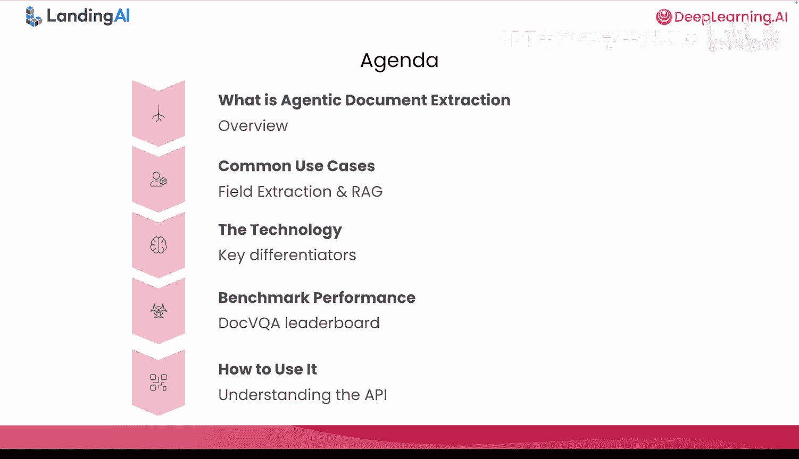

In my role as an applied AI engineer at Land AI， I have the pleasure of helping our users build document intelligence pipelines around agent document extraction。

 and I'll refer to it often by its acronym A D E。As this graphic suggests。

 ADE is an API that converts input documents， presentations， images。

 and even spreadsheets into well structured Markdown and JSO， Our users include students。

 solopreneurs， small businesses and large enterprises around the world。

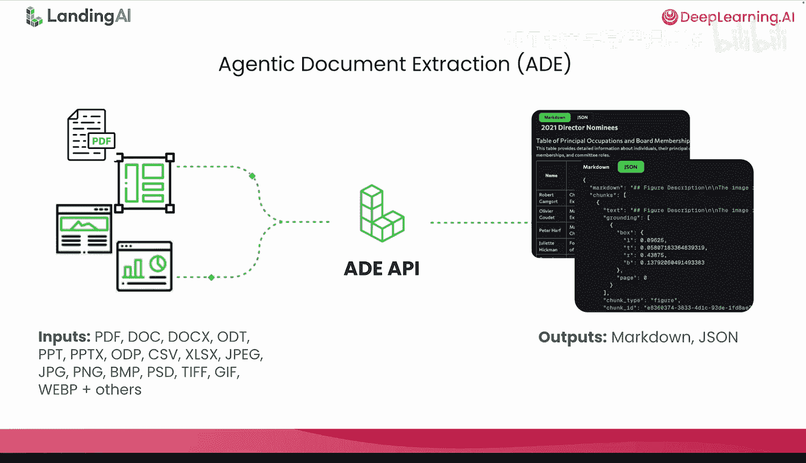

What are some of the key use cases， the first is field extraction。

 also known as key value pair extraction。Users who receive a lot of user supplied documents need the ability to extract specific information from those documents and the ability to trace that back to the original。

 The second major use case is Reg or building knowledge assistance that understand the underlying content。

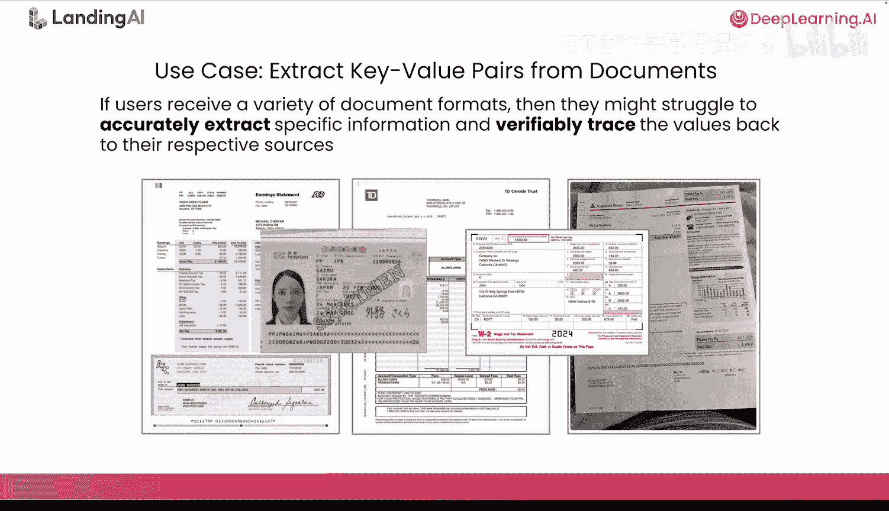

Users who prepare documents for Rag need the ability to understand content that also contains tables。

 figures， flow charts， and the ability to trace those all back to the original。 So how does it work。

 A D E is not an incremental step over what existed previously。 Rather。

 it's a novel approach to document AI pioneered by our engineers。

 It's part of the agentic era with a vision first data centric approach。

 And these are the three pillars of Ade E， visionsion first， data centric and agentic。

 So what do we mean by each of these， Vision first means that we treat documents as visual objects。

 where the meaning is encoded in the layout structure and spatial relationships。

 Data centric means training on the highest quality curated data。

 We believe that the right data is as important as the right model architecture。 and finally。

 agentic Deli systems that plan decide， act and。

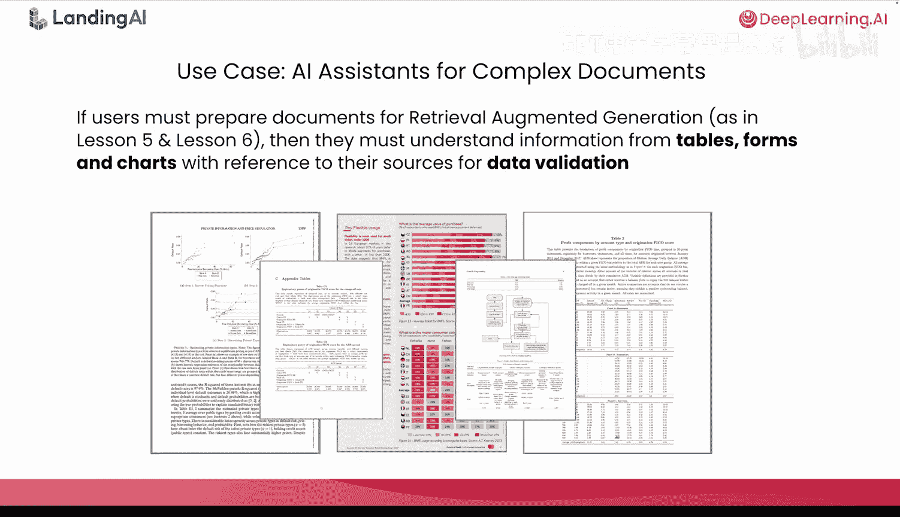

Verify until the response meets quality thresholds。

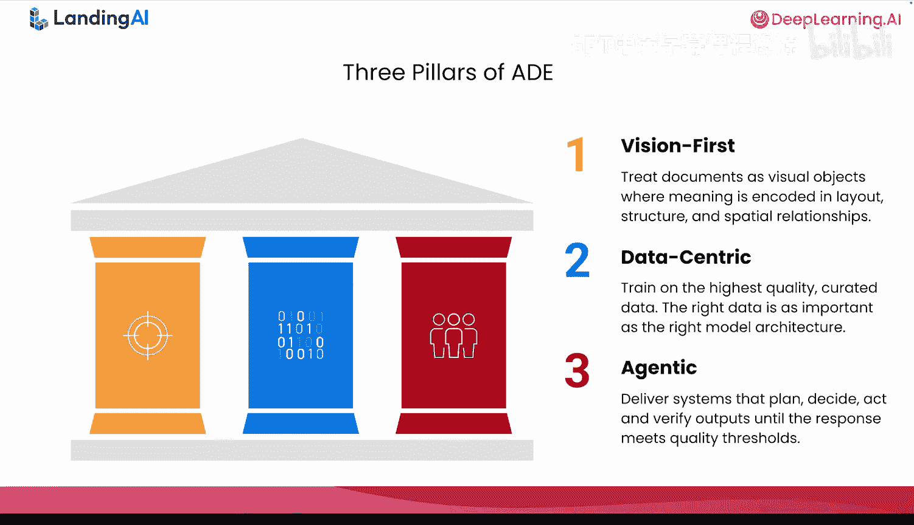

So this graphic really drives home the point that vision is foundational to ADE Landing AI brings years of vision expertise to the problem of document AI The foundation layer at the bottom is state of the art document native vision models that have been trained to see document the way that humans see them and built on that foundation are intelligent agents to handle parsing and routing separate chunks such as text tables and figures all follow separate pathways and finally the agents and app layer on top This layer focuses on what users really want in a document processing pipeline delivering features such as field extraction and document splitting and those foundational vision models from the prior slide are part of the growing document pretrained transformer family or DPT for short as of this recording you can choose from DPT1 DPT2 and DPT2 mini all of them return high quality document par。

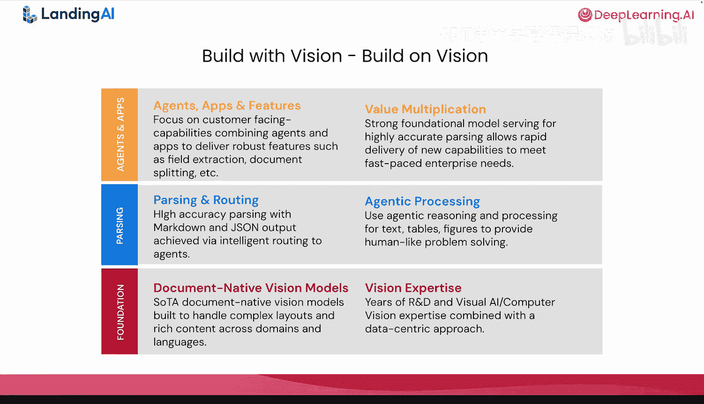

Including reading order detection， layout detection， text recognition， and figure captioning。

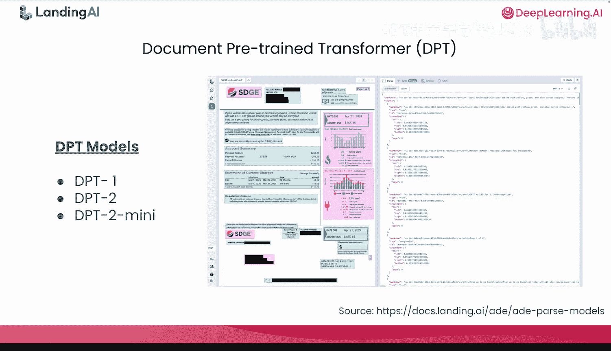

So how well do these DPs at the core of ADdeE perform？ Well。

 ADdeE actually exceeds human performance on the Doc VQA benchmark set。

 and as presented in the table on the right at 99。15% accuracy。

 It also exceeds all other published models。 I'll draw attention into the blog post announcing these results。

 which has a wonderful interactive document gallery for you to explore。

 if you aren't familiar with Doc VQA， It question and answering benchmark of real scanned documents comes from the UCSF industry documents library。

 This slide shows as an example down in the lower right。

 the question to be answered is what is the home telephone number of the individual。

 and that answer can be found in the handwritten section in the green bounding box。

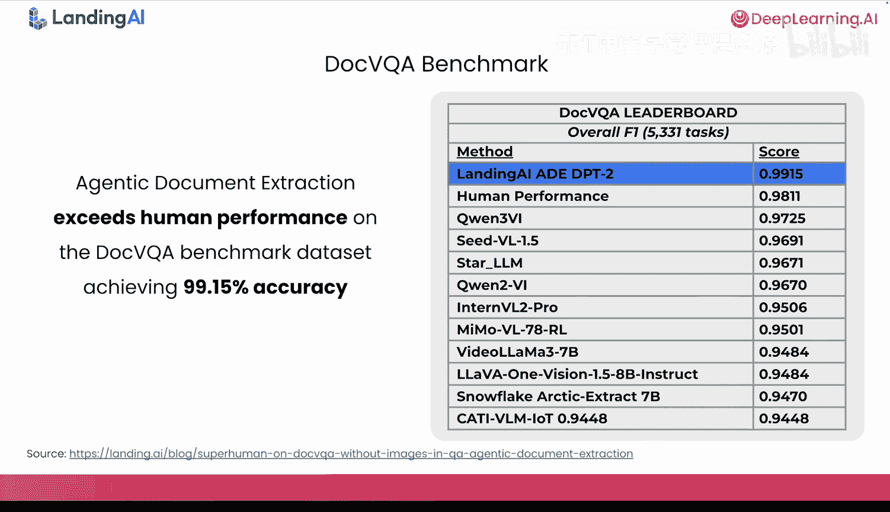

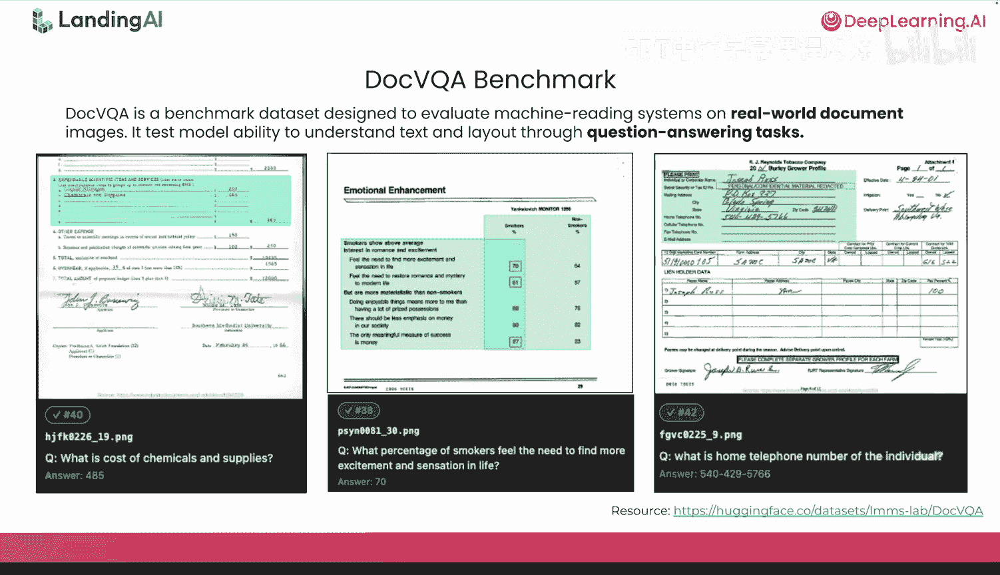

So that brings us to the question， how do I use it This is a screenshot from the ADE visual playground。

A DE offers parse split and extract separately， which you can flexibly combine when developing your document processing pipeline。

 Development options include the visual playground for drag and drop。

 The rest API and the Python and Typescript libraries in the lab that follows。

 you'll only use the Python library and the parse and extract APIs。

 So be aware that split is also available for splitting apart huge Vdfs and parse jobs is available for very large document。

 think you know hundreds to thousands of pages and to use ADdeE outside of the course。

 you'll need your own API key。 You can generate a free key and get some initial free credits at V do landing do AI and now its lab time again。

 join me for three handson exercises。

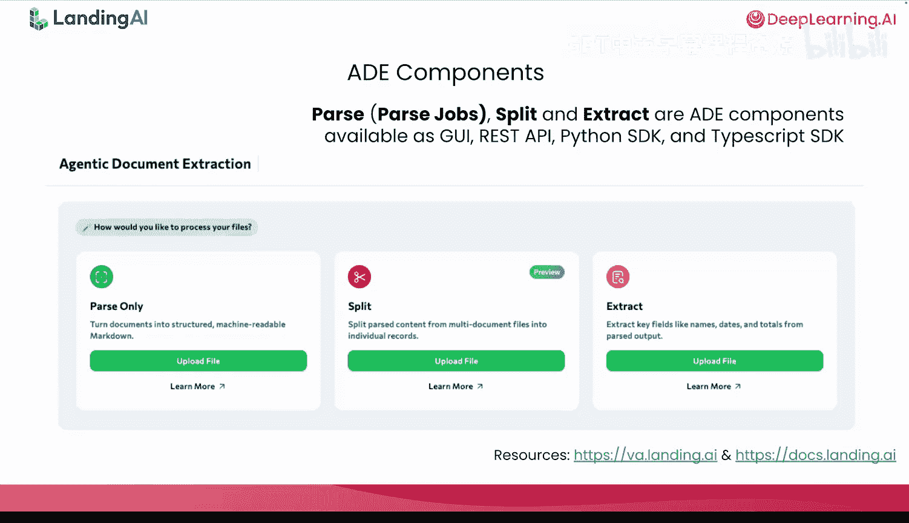

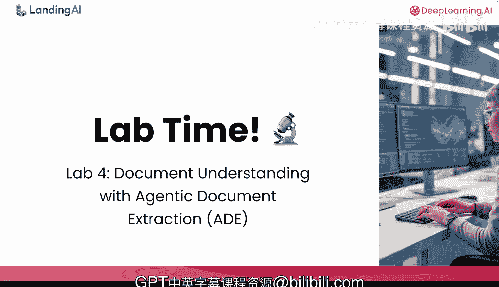