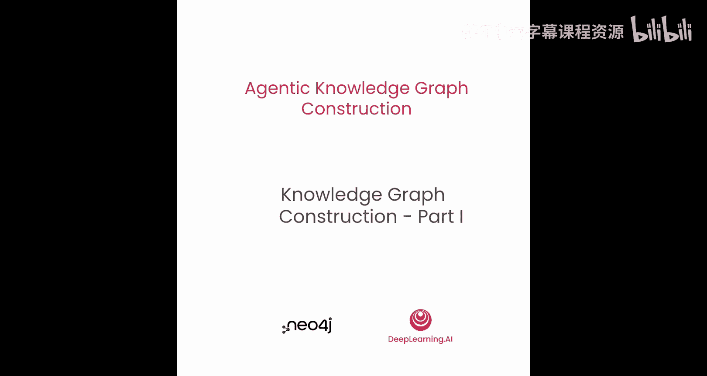
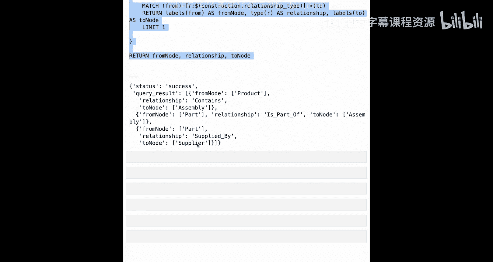
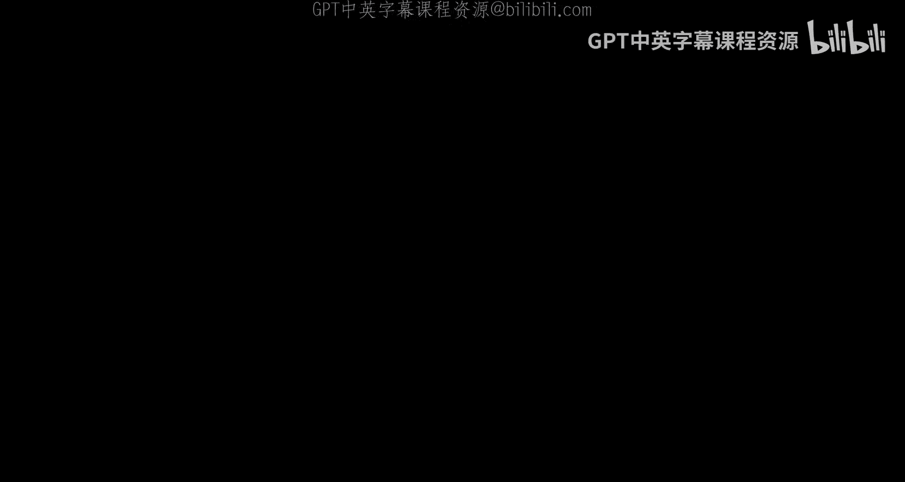

# 吴恩达《智能体驱动的知识图谱构建｜Agentic Knowledge Graph Construction》Claude-4-s翻译 - P10：10.knowledge-graph-construction---part-i.zh_en - GPT中英字幕课程资源 - BV1AShCzoENH

You now have a complete specification for how to construct a knowledge graph。

Join me in this final lesson where you'll define the tools that will execute the construction plan。

 as specified by the workflow of agentss。

With a graph construction plan and a knowledge extraction plan in place。

 you are now ready to build a graph In this lesson。

 you will dive into the details of the knowledge graph construction tool。 If your feeling generous。

 You can call this a neurosymbolic agent。 hybrid of language models with rule based systems。

 Let's take a step back for a moment to look at what these plans will produce。

 The graph construction plan will load Csv files to produce the domain graph。

 There is almost a one to one mapping from Cv file to node type with some extra mapping to create relationships。

 You could probably ask an L M with a giant context window to perform this task。

 But this is a very direct mechanical process。 You have converged to code。

 The work will be performed by single tool you'll define called the construct domain graph。

 That tool will have a bunch of helper functions that it uses for all the different parts of constructing the graph。

 So we'll go through。😊，Each of those tools one step at a time。As always， we'll import some libraries。

Check that Open AI is running。And also make sure Neo4j is still there。Perfect。

Now let's start to find the tools themselves。For domain graph construction。

 we can create a series of tools， each one with very specific responsibility。

 you'll start with creating a uniqueness constraint on the database。

 Now that we're moving from to thinking about the data files。

 We have to think about preparing the database for the data import that's about to happen。

And the first part about preparing the database is to make sure that we have uniqueness constraints。

Now in the database， that ends up meaning that for any nodes that have a particular label。

 we can say that whenever that label occurs and there's a property on that label that we want that property to be unique。

 that correlates exactly with the CV files that have a unique column I D that's going to be a unique constraint for each one of those。

 So this utility function is going to take care of that for us。

You're just going to pass in the label and what the unique property key should be。

 and it'll take care of actually creating the constraint on Ne4 J。 Now， the s query down in here。

 you can see。Create constraint， the constraint name that gets passed in。

 only created if it doesn't already exist。And it gets created for a particular label。

 And on that label， we require that this unique property key will be unique。Now。

 before we were using a lot of query parameters。When we're setting up constraints like this instead of Ne4j。

 it's not possible to pass in a query parameter for that。

 So we're going to be doing a little bit of unsafe work here by actually doing string concatenation。

 And we know that that's not really a recommended practice。

 We should have a sanitized function in here to make sure there's nothing happening。 That's。

 you know， bad。 But for now， this will be just fine。So the next function you want。

 if you have the ability to actually create uniqueness constraints for nodes。

 we then want to be able to load nodes from a CSP file， you can define a function for that。

AndSo here's the load node from CSV function， it takes in a source file。

 the label for that source file， which of the columns in that CSV file is unique。

 and then also a list of all the properties that should be created from the source file。

Now looking down here at the cipher that's created。

 there's a special cipher syntax for loading from CSV files that are in the import directory。

 so that's why everything that we are working with are all relative paths here when we're using load CSV in Ne4j。

 this file URL that's here is going to end up being relative to Ne4j's import directory。

So we're going to load a CSV file with headers from that directory and then for every row in that file。

 we're going to call a subquery here and in the subquery it's actually going to go ahead and do the merging of those rows merge of course it's going to do a creation but first seeing if that node already exists and if it doesn't it'll go ahead and create that node based on the unique column that we're passing in。

And then this next line here， the four each is a little bit of unique way of taking advantage of the property list that was passed in。

 it's really just the names of some properties and what we end up doing is looping through each of those properties and for each of those property names we're going to set the property value on the node that was just created to the row value that was passed in from the CSV file so in effect we're going to loop through all the names and go ahead and just iteratively set those values here。

Now， by using this inside of a sub query， we then get the option of doing this in batch。

 So we're going to do this in transactions of 1000 rows。 So no matter how big the CsV file is。

 we're going to do it as a batch of just 1000 at a time。

 You can then see what we're actually going to call to new for J， sending in the query。

 we're going to pass that query in along with a bunch of query parameters that will get used。

Now for each CSV file that you have， you actually want to do both of the functions that we just defined。

 we want to call both of them to first call the creating uniqueness constraint to make sure that we'll have unique values for each node so the IDs are respected and then after we've created uniqueness constraints for each of the CSV files we're then going go ahead and actually do the import using the load nodes from CSv tool that we just saw So that's what's happening here inside of import nodes it's just taking the construction rule and then first based on the values from the construction rule it's going to go ahead and call the create uniqueness constraintsstraints tool right here and then if it doesn't have an error itll go on and do the import from the nodes from the CSV file and all it's doing here is just taking from the construction rule each of the different values it need to be passed into the function。

You can do something simpler with importing relationships now in relationships。

 we don't need to apply a uniqueness constraint on those because they're not going to have any identities themselves。

 They're going to be connected directly to nodes on either side either the from or the two node and those should be unique。

 but the relationship themselves you're going to be unique simply because there's just one of each for every row in the files that we're importing。

This is a little particular to the data files that we have here。

 we'd want to take a little bit more care if we had know data files are set up in some more complicated way。

 but for the data files that we have in this example。

 this is an inadequate way to actually do the import。As with the note loading。

 we're going to use load CSV with headers。From the import directory and load all those as rows。

 And then if for each of those rows， we're going to actually do a little bit more work inside of the subquery。

 First， we're going to find the existing nodes that were previously loaded。

 So we're going to find the from node。 and we're going to find the two node。

 Then after we found those using a match clause。 We'll use the merge clauses here。

 to actually create the relationship from the from node to the two node。

 So this is only going to allow us to create one relationship for any given pair of a from and a two of a particular type of relationship。

 So if there are two relationship that were say there are two A B K likes coffee rows。

 that would only happen once because even if there were two that occurred in the Csv file。

 by merging it here， The merge will look at the nodes， those are already unique on either side。

 and the relationship already has an A B K likes。 So the likes is ready there。

 It's not going to create another relationship。😊，And the same thing with the nodes。

 we're going to do the properties setting on the relationships。

 if there were't any properties are available， we'll loop through them using this for each construct here。

 and that'll set all the values that are available。And then just go ahead and call the query。

 passing in all the query parameters。Directly from the construction rule itself。

So all of those functions do most of the real work and then construct a main graph itself really doesn't have to do a whole lot other than to take in as an argument。

 the full construction plan and then do the right ordering of construct all the nodes first。

 and then now with the nodes already existing， then you can go ahead and create the relationships。

With construct main graph already defined， we can go ahead and give it a try。 Now， to run this。

 of course， we're going to need a complete construction plan。 So here's the whole construction plan。

 This will be different from previous lessons， depending on what the L M decided to do。

 When this notebook was created。 Here's the construction plan that was valid。

And you can take a look through that。 It's， it's kind of expected。

 I think the thing to pay most attention to here that we'll check later is the relationships that are created。

 There is a contains relationship that goes from a product that contains an assembly。

 That sounds right。And this is part of goes from a part。 A part is a part of an assembly。 Okay。

 that's a little wordy， But that's that's correct。 And the front node here is a part that is supplied by a supplier。

 also seems perfectly fine。So that will be the input to our construct main graph function。

 so let's give it a run。Now， when that function is done。

 you don't see any output could have added a print statement or something to let you know that， okay。

 it's finished doing its work。 Instead what we're going to do here is actually interact with the graph as if we are still doing some querying。

 And so let's inspect the domain graph with a bit of a fancy cipher statement。

What we're going to do is first find all the just relationship construction rules from the construction plan。

 and we're going to do that with just a list comprehension expression inside of Python。

 So we're just going to loop through all the construction plan values。

 And whenever the construction type is relationship it gets put into this list。

 So here's all the Russian constructions that we saw before。 But without the node constructions。

 And then we're going to do a little bit of cipher magic here。

And so I'm going to walk through this one step at a time。 in this fancy cipher query。

 we're about to run。 The goal is basically to do a little sampling of the graph。

 So we're not going to get the entire graph to take a look at。

 But what we want to do is we're expecting that for every relationship construction rule that was up here。

 there should at least be one occurrence of that relationship type in the resulting graph。

 So if we just get a collection of all the different relationship types and just do pattern matching on those。

 and then see the output of that。 We should see that all of the things we expected to be created were actually created。

 I'm not sure if I said that correctly。 But let's actually walk through it and see how this plans out。

So here's the first step。 we're going to pass in this list of construction rules and in cipher you have the ability to take a list of things and unwind it into a collection of rows。

 So what was a list of rules as a single item， will be turned into multiple rows where each element in each row will have a single rule So unwind list basically does that。

 So the constructions list will be turned into a series of rows where each row element。

 which is have a single construction value in it。So then with those。

 what we want to end up doing is for the construction rule。

 we want to do a pattern match from some node， and we don't have any qualification for it here。

 but we're going to match from a node through a relationship that we're going to call R。

 And the relationship type is what we're actually going to use from the construction rule。

 we're going to pull out the construction rules relationship type value。 And here， of course。

 the dollar signed we're referring to the query parameter。

 So we're going to go ahead and pull that out into this relationship type here。

 And so if we had up here。You'll see that we've got a supplied by relationship type that will end up getting substituted in here by the query parameter。

 So we'll have a from some node that is supplied by some other node。

And what well do is return just the labels of the from node and the labels of the two node。

 and then the type of the relationship itself。What we should end up with is a little triple of just the relationship labels and the node labels on either side。

And we're going to limit to just one because we don't want to see the whole graph。

 We just want to verify that this exists。We're going to put that inside of a sub queryry so that we can apply the match there just once to every element that we've unwo earlier。

 So that's what's happening here in this part。 We're going to call a sub queryry。

 And this match1 path that we' just defined is going to be put inside there。

And then in the fully assembled cipher， we're going to unwind the list。

 do the matching inside of the sub queryry。 And then from all of that。

 return just the triples of the from node relationship in two node， which be the labels。

 the types and the labels on the two node as well。Okay。

 and you can see that this is going to go ahead and print out the value。

So you can see what the cipher looks like before we run it and then we'll finally run the cipher。

So here's the complete Cypher statement。And here are the relationships that we have found。

 We've got from product Cons assembly， and a part is part of an assembly。

 and a part is supplied by a supplier。 perfectfect。

 that match is what we saw earlier in the construction rules。

 So it looks like this graph has been constructed in a nice way。

