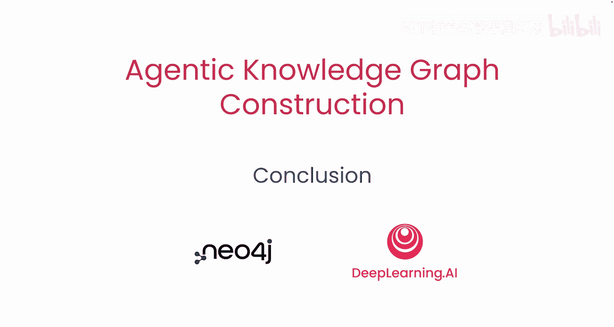

# 吴恩达《智能体驱动的知识图谱构建｜Agentic Knowledge Graph Construction》Claude-4-s翻译 - P12：12.conclusion.zh_en - GPT中英字幕课程资源 - BV1AShCzoENH

In this course， you learned how to build a multi agent system that transforms your structured and unstructured data into a knowledge graph。

You learned how to set up each specialized agent in your system。

 what prompt you use and what tools to define and how to share context among the agents。

 Congratulations on completing this course， and I looking forward to seeing what you'll build on your own。

😊。