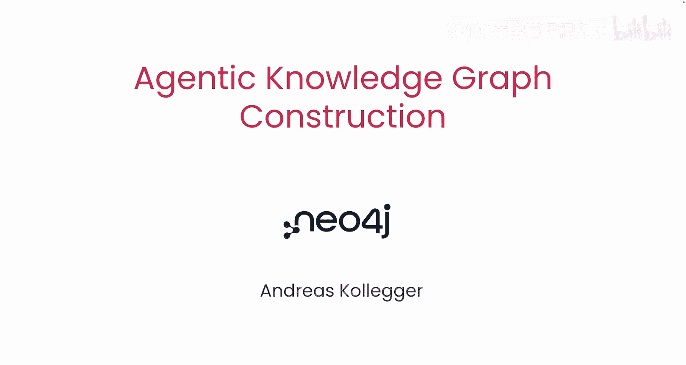
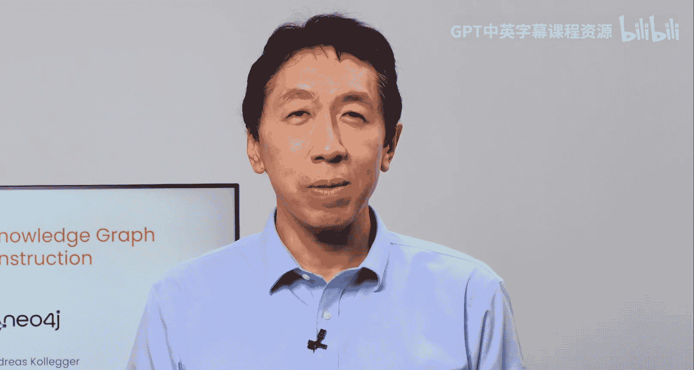
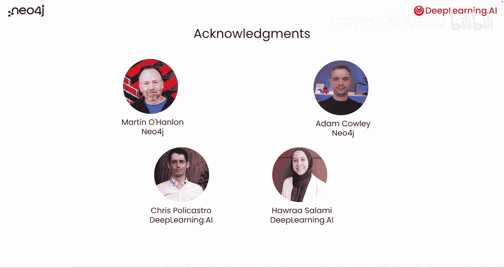

# 吴恩达《智能体驱动的知识图谱构建｜Agentic Knowledge Graph Construction》Claude-4-s翻译 - P1：1.introduction.zh_en - GPT中英字幕课程资源 - BV1AShCzoENH

Welcome to a Gen knowledge draft construction built in partnership with Neo4j In this course。

 you design a multiagent system that transforms your structured and structured data into a knowledge draft I found knowledge drafts really useful for high stakes applications where accuracy of the information we store and retrieve is important。

 This course will T you Y and also give you a great set of tools to building these knowledge drafts I'm delighted to instructor for this course is Andres Colliger who is a developer evangelist the Gen of AI at Neo4j。

😊。

Thanks， Andrew， I'm excited to be back here and to work with you on this course。 S ragg。

 a knowledge graph system splits your text documents into chunks and stores them in the vector database。

😊，But in addition to that， it places the chunks into draft structure。

 which chunk is later entities extracted from the chunks。For example。

 a text chunk from a product review can contain entities such as product orders or delivery issues or product defects to build a knowledge graph。

 you extract the relevant entities to the chunks， then connect the chunks and the entities in a graph through edges。

😊，Here each age represents a relationship， for example。

 maybe it represents that this chunk mentioned a certain product or that that product has an issue。

The entities are retrieved alongside the relevant chunks to provide more relevant context to theLM to generate more precise and accurate answers。

You can also connect this type of d to another draft containing additional information extracted from structured data such as CSC files。

In this course， An Js will walk you through how to build a multi agentian system that helps you do all this work of constructing this type of knowledge graph to transform your structured and unstructured data into a knowledge graph。

 you first need to decide on the graph schema， meaning what types of entities or nodes you can extract from the data and what relationships exist between them。

Once you have the schema defined， you can construct the actual graph and store it in a graph database。

 Instead of mainly looking at your data to find the graph schema。

 you will design a multiag system for doing that using Google's A V K or agent development kit。

 after you learn the basic syntax with A K。 you'll design your system one agent at a time。

 The first agent will converse with you to extract the goal and type of graph you want to build。

 And given that goal， a group of agents will specialize in extracting the entities and relationships from your structured data。

 And another group of agents will handle your unstructured data。 Finally。

 the final set of agents will connect the two models and construct the graph accordingly。😊。

Many people have worked to create this course I'd like to thank from Neo4j。

 Martin O'hanlon and Adam Kowli from Deep Binda AI Christopher Pooccostro and Harra Salami also contributed to this course in the first lesson you learn more about the underlying structure of knowledge droughts and how you can build one and use it to identify root causes of product issues。

Sounds great。 Let's get started。